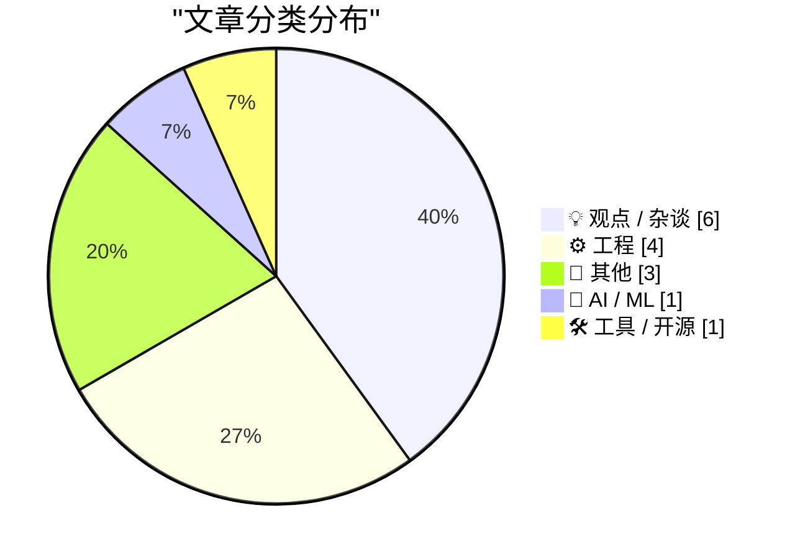
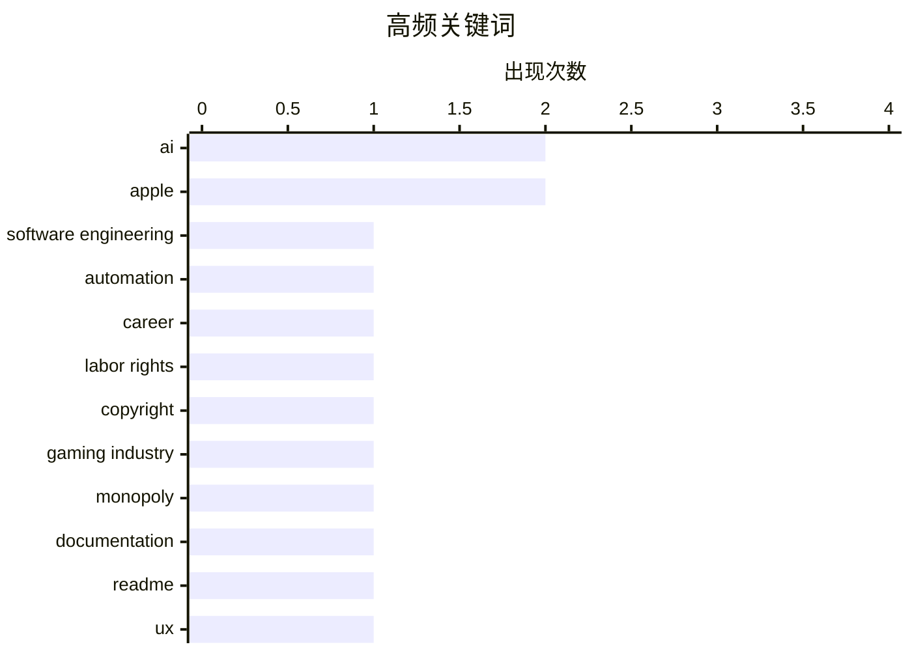

# 📰 Oct 12, 2026

> 来自 Karpathy 推荐的 92 个顶级技术博客，AI 精选 Top 15

## 📝 今日看点

今日技术圈深度反思 AI 时代的职业伦理，探讨软件工程师在自动化浪潮中的定位，并出现抵制中心化巨头、倡导“人工证明”的去中心化趋势。工程领域迎来现代化转折，从传奇游戏引入版本控制到文档编写的实战优化，开发者正通过工具迭代与流程规范提升协作质量。同时，对电信先驱的致敬与复古芯片的逆向工程，彰显了技术社区在追逐前沿之余对数字遗产与底层原理的持续守护。

---

## 🏆 今日必读

🥇 **软件工程师没资格在 AI 面前当“卢德分子”**

[Software engineers don't get to be Luddites about AI](https://seangoedecke.com/software-engineers-dont-get-to-be-luddites-about-ai/) — seangoedecke.com · 15 小时前 · 💡 观点 / 杂谈

> 文章探讨了软件工程师对 AI 自动化取代其专业技能的愤怒情绪。作者指出，软件工程师职业的核心本质就是通过代码实现自动化，过去几十年里他们一直在取代旅行社职员、银行柜员和文员的工作。这种“以剑谋生者必死于剑下”的逻辑意味着，工程师是世界上最没有资格抱怨自动化的人。与其像卢德分子一样抵制技术进步，不如接受这一职业宿命并积极应对。结论认为，软件工程师必须意识到自己一直以来就是自动化的推动者，而非受害者。

💡 **为什么值得读**: 深刻揭示了程序员职业本质与 AI 浪潮之间的讽刺性矛盾，促使从业者反思自身定位。

🏷️ AI, software engineering, automation, career

🥈 **劳动权利如何从垄断者手中救回《创世纪》**

[Pluralistic: How labor rights rescued Ultima from a monopolist (12 Oct 2026)](https://pluralistic.net/2026/10/12/termination-of-transfer/) — pluralistic.net · 3 小时前 · 💡 观点 / 杂谈

> 探讨了如何利用劳动权利法案从垄断巨头手中夺回经典游戏《创世纪》（Ultima）的版权。文章重点介绍了美国版权法中的“转让终止权”（Termination of Transfer），该条款允许创作者在转让版权 35 年后重新收回权利，无论合同如何规定。作者以理查德·盖瑞特与 EA 的博弈为例，说明了这一机制在对抗大型出版商方面的威力。结论认为，关注劳动正义和具体的法律救济手段比单纯讨论版权改革对创作者更有意义。

💡 **为什么值得读**: 揭示了一个鲜为人知的法律利器，展示了创作者如何利用法律条款在与科技巨头的博弈中反败为胜。

🏷️ labor rights, copyright, gaming industry, monopoly

🥉 **我付费请人尝试遵循我的 README 文档**

[I paid people to try and follow my README](https://shkspr.mobi/blog/2026/10/i-paid-people-to-try-and-follow-my-readme/) — shkspr.mobi · 1 天前 · ⚙️ 工程

> 针对开发者普遍不擅长编写文档的问题，作者提出了一种通过付费雇人测试 README 的实战方案。文章指出，大多数文档充满了过时的提示和模糊的说明，导致用户难以上手。作者通过观察测试者在实际配置过程中的卡点，发现了文档中隐藏的假设和特定环境下的 Bug。这种“文档可用性测试”方法能有效消除开发者的知识盲区。结论强调，只有经过第三方验证的文档才是真正合格的文档。

💡 **为什么值得读**: 提供了一个极其务实且具有启发性的建议，帮助开发者从用户视角审视并优化项目文档。

🏷️ documentation, README, UX, testing

---

## 📊 数据概览

| 扫描源 | 抓取文章 | 时间范围 | 精选 |
|:---:|:---:|:---:|:---:|
| 83/92 | 2532 篇 → 18 篇 | 48h | **15 篇** |

### 分类分布



### 高频关键词



<details>
<summary>📈 纯文本关键词图（终端友好）</summary>

```
ai                   │ ████████████████████ 2
apple                │ ████████████████████ 2
software engineering │ ██████████░░░░░░░░░░ 1
automation           │ ██████████░░░░░░░░░░ 1
career               │ ██████████░░░░░░░░░░ 1
labor rights         │ ██████████░░░░░░░░░░ 1
copyright            │ ██████████░░░░░░░░░░ 1
gaming industry      │ ██████████░░░░░░░░░░ 1
monopoly             │ ██████████░░░░░░░░░░ 1
documentation        │ ██████████░░░░░░░░░░ 1
```

</details>

### 🏷️ 话题标签

**ai**(2) · **apple**(2) · **software engineering**(1) · automation(1) · career(1) · labor rights(1) · copyright(1) · gaming industry(1) · monopoly(1) · documentation(1) · readme(1) · ux(1) · testing(1) · ai-ethics(1) · openai(1) · anthropic(1) · big-tech(1) · xmodem(1) · bbs(1) · telecommunications(1)

---

## 💡 观点 / 杂谈

### 1. 软件工程师没资格在 AI 面前当“卢德分子”

[Software engineers don't get to be Luddites about AI](https://seangoedecke.com/software-engineers-dont-get-to-be-luddites-about-ai/) — **seangoedecke.com** · 15 小时前 · ⭐ 26/30

> 文章探讨了软件工程师对 AI 自动化取代其专业技能的愤怒情绪。作者指出，软件工程师职业的核心本质就是通过代码实现自动化，过去几十年里他们一直在取代旅行社职员、银行柜员和文员的工作。这种“以剑谋生者必死于剑下”的逻辑意味着，工程师是世界上最没有资格抱怨自动化的人。与其像卢德分子一样抵制技术进步，不如接受这一职业宿命并积极应对。结论认为，软件工程师必须意识到自己一直以来就是自动化的推动者，而非受害者。

🏷️ AI, software engineering, automation, career

---

### 2. 劳动权利如何从垄断者手中救回《创世纪》

[Pluralistic: How labor rights rescued Ultima from a monopolist (12 Oct 2026)](https://pluralistic.net/2026/10/12/termination-of-transfer/) — **pluralistic.net** · 3 小时前 · ⭐ 24/30

> 探讨了如何利用劳动权利法案从垄断巨头手中夺回经典游戏《创世纪》（Ultima）的版权。文章重点介绍了美国版权法中的“转让终止权”（Termination of Transfer），该条款允许创作者在转让版权 35 年后重新收回权利，无论合同如何规定。作者以理查德·盖瑞特与 EA 的博弈为例，说明了这一机制在对抗大型出版商方面的威力。结论认为，关注劳动正义和具体的法律救济手段比单纯讨论版权改革对创作者更有意义。

🏷️ labor rights, copyright, gaming industry, monopoly

---

### 3. 对 OpenAI 和 Anthropic 说不

[Just say no to OpenAI and Anthropic](https://micahflee.com/just-say-no-to-openai-and-anthropic/) — **micahflee.com** · 16 小时前 · ⭐ 23/30

> 呼吁开发者和用户抵制 OpenAI 和 Anthropic 等中心化 AI 巨头。作者受《末日法西斯主义》一书启发，认为这些科技寡头正在构建一种损害环境且加强监控的权力结构。文章建议转向使用本地运行的开源大模型（LLMs），以摆脱对大公司基础设施的依赖。通过这种方式，用户可以保护隐私并减少对资源密集型云服务的支持。作者的核心观点是，选择开源不仅是技术选型，更是一种政治和道德立场。

🏷️ AI-ethics, OpenAI, Anthropic, Big-Tech

---

### 4. 我为何感到厌倦

[Why I Get Bored](https://idiallo.com/byte-size/why-i-get-bored) — **idiallo.com** · 23 小时前 · ⭐ 18/30

> 厌倦感本质上是大脑在遇到技术瓶颈或面对不擅长任务时发出的避难信号。作者以制作 YouTube 视频为例，描述了从最初的兴奋创作到在 DaVinci Resolve 剪辑软件中受挫，最终产生“这很无聊”的心理防御机制。这种情绪并非真正的缺乏兴趣，而是大脑试图通过贬低任务价值来逃避潜在的挫败感。识别这种“伪装的厌倦”是克服创作障碍的关键，它要求我们在大脑劝说放弃时保持警觉。在繁忙的日程和多重责任压力下，区分真正的无聊与技能不足导致的逃避心态至关重要。

🏷️ productivity, psychology, boredom

---

### 5. 不要对你的对手进行“诊断”

[Don't diagnose your opponents](https://seangoedecke.com/dont-diagnose-your-opponents/) — **seangoedecke.com** · 1 天前 · ⭐ 17/30

> 在观点分歧中存在两种路径：一是正面回应对方的论点与证据，二是“诊断”对方为何会产生这种想法的心理动机。这种“诊断”行为（如指责对方有偏见或心理缺陷）虽然能带来智力优越感，但本质上是逃避逻辑验证的攻击手段。文章指出在软件架构讨论（如单体与微服务的选型）中，这种动机分析会导致沟通彻底破裂。保持有效沟通的核心在于尊重对手的理性，专注于证据本身而非揣测其背后的心理成因。只有停止对他人的心理诊断，才能回归到真正有价值的技术争论中。

🏷️ communication, soft skills, critical thinking

---

### 6. X 再次成为焦点

[★ X Once Again Marks the Spot](https://daringfireball.net/2026/10/x_once_again_marks_the_spot) — **daringfireball.net** · 17 小时前 · ⭐ 15/30

> 社交平台 X（原 Twitter）在埃隆·马斯克接手后经历了剧烈的品牌与功能重塑。文章以一种讽刺的视角指出，当前的平台状态看起来就像是所有者因厌倦而随意处置的产物。这种变化不仅体现在从蓝鸟到 X 的视觉更替，更深层地反映在算法推荐机制和社区互动模式的根本性转变中。作者通过观察平台现状，探讨了极端个人意志驱动下的社交媒体演变路径。这种演变对公共对话空间产生了深远影响，使得平台呈现出一种与过去截然不同的混乱与陌生感。

🏷️ X, Twitter, social media, Elon Musk

---

## ⚙️ 工程

### 7. 我付费请人尝试遵循我的 README 文档

[I paid people to try and follow my README](https://shkspr.mobi/blog/2026/10/i-paid-people-to-try-and-follow-my-readme/) — **shkspr.mobi** · 1 天前 · ⭐ 23/30

> 针对开发者普遍不擅长编写文档的问题，作者提出了一种通过付费雇人测试 README 的实战方案。文章指出，大多数文档充满了过时的提示和模糊的说明，导致用户难以上手。作者通过观察测试者在实际配置过程中的卡点，发现了文档中隐藏的假设和特定环境下的 Bug。这种“文档可用性测试”方法能有效消除开发者的知识盲区。结论强调，只有经过第三方验证的文档才是真正合格的文档。

🏷️ documentation, README, UX, testing

---

### 8. 拆解 80 年代使用开关电容的滤波器芯片

[Inside a 1980s filter chip that uses switched capacitors](http://www.righto.com/feeds/5504631233106574875/comments/default) — **righto.com** · 1 天前 · ⭐ 20/30

> 记录了对一颗 20 世纪 80 年代神秘哈里斯（Harris）芯片的逆向工程分析。由于该芯片型号在任何数据手册中都查不到，作者通过显微镜观察其内部结构，发现了一组密集的方形电容阵列。分析确认这是一款“开关电容滤波器”芯片，该技术通过快速切换电容来模拟电阻，从而在芯片上实现高精度滤波。这种设计巧妙地解决了在集成电路中难以制造大阻值、高精度电阻的难题。文章展示了早期模拟电路设计的精妙之处和硬件考古的乐趣。

🏷️ reverse-engineering, IC, electronics, hardware

---

### 9. 《矮人要塞》终于开始使用版本控制了

[Dwarf Fortress uses version control now](https://simonwillison.net/2026/Oct/11/dwarf-fortress/) — **simonwillison.net** · 1 天前 · ⭐ 19/30

> 揭示了传奇游戏《矮人要塞》（Dwarf Fortress）开发史上的一个重大转折：该项目终于开始使用版本控制系统了。长期以来，这款以复杂度著称的游戏一直由开发者 Tarn Adams 在没有版本控制的情况下手工维护，这在软件工程界被视为一种奇观。文章回顾了作者从 2013 年至今对该项目开发流程的追踪，确认了其向现代工程实践的转型。这一转变标志着这个“手工作坊”式的庞大代码库正式步入现代开发时代。结论认为，即使是最特立独行的项目，最终也会因复杂度压力而拥抱标准工具。

🏷️ version control, Dwarf Fortress, game development

---

### 10. 逻辑的范畴模型

[Categorical models of logics](https://www.johndcook.com/blog/2026/10/12/categorical-models-of-logics/) — **johndcook.com** · 2 小时前 · ⭐ 16/30

> 模态逻辑与拓扑空间之间存在着深刻的数学对应关系，这种关联为理解抽象逻辑提供了直观的几何模型。文章探讨了如何利用范畴论（Category Theory）来构建逻辑模型，使原本枯燥的逻辑推演具备更清晰的数学结构。对于熟悉拓扑学但对逻辑感到陌生的研究者，这种对应关系能显著降低跨学科的学习门槛。通过范畴化的视角，复杂的逻辑系统可以被简化为对象与态射之间的关系。这种模型化方法不仅揭示了不同逻辑体系间的内在一致性，也为计算机科学中的形式化验证提供了理论支撑。

🏷️ logic, topology, mathematics

---

## 📝 其他

### 11. 电信先驱沃德·克里斯滕森逝世

[Ward Christensen, telecommunications pioneer](https://dfarq.homeip.net/ward-christensen-telecommunications-pioneer/?utm_source=rss&#038;utm_medium=rss&#038;utm_campaign=ward-christensen-telecommunications-pioneer) — **dfarq.homeip.net** · 1 天前 · ⭐ 23/30

> 纪念于 2024 年 10 月逝世的电信先驱沃德·克里斯滕森（Ward Christensen）。克里斯滕森在 1977 年发明了 Xmodem 文件传输协议，解决了早期个人电脑间数据交换的难题。1978 年，他共同创办了世界上第一个电子公告板系统（CBBS），这被视为现代社交媒体和在线社区的雏形。文章回顾了他从 1945 年出生到在芝加哥郊区去世的生平，以及他对数字通信领域的深远影响。他的工作为现代互联网的互联互通奠定了重要基石。

🏷️ Xmodem, BBS, telecommunications, history

---

### 12. 苹果直到三天才开始向 iOS 26 用户推送 iOS 27 升级建议

[Apple Only Started Suggesting iOS 26 Users Upgrade to 27 Three Days Ago](https://www.macrumors.com/2026/10/08/apple-now-pushing-ios-27/) — **daringfireball.net** · 20 小时前 · ⭐ 18/30

> 分析了苹果公司在推送 iOS 27 大版本更新时的策略性延迟行为。尽管 iOS 27 已发布数周，但直到三天前，iOS 26 用户才在设置中看到醒目的升级提示，此前该位置一直被 iOS 26.7.1 占据。这种做法反映了苹果通过分阶段推送来确保系统稳定性并缓解服务器压力的惯用手段。文章指出，大多数用户依赖自动更新或系统显著提示，因此这种策略直接控制了新版本的普及速度。结论认为，苹果在追求新功能与维持旧版本稳定性之间选择了极其谨慎的平衡。

🏷️ iOS, Apple, software update

---

### 13. 域名世界的迷人之处

[The Fascinating World of Domains](https://blog.jim-nielsen.com/2026/domains-article-on-wired/) — **blog.jim-nielsen.com** · 20 小时前 · ⭐ 17/30

> 域名系统（DNS）不仅是互联网的基础设施，更是一个交织着技术规范与商业博弈的复杂领域。文章深入解读了 ICANN 对顶级域名（TLD）的管理机制，包括像 .meow 这样的小众域名背后的故事。重点探讨了 .com 注册局的运作逻辑以及域名作为数字资产的演变历史。通过对域名系统深层细节的剖析，揭示了这些看似简单的字符映射如何支撑起价值数十亿美元的行业。对于追求技术细节的开发者来说，了解域名的政治与经济属性与理解其解析原理同样重要。

🏷️ DNS, ICANN, TLD, internet-history

---

## 🤖 AI / ML

### 14. “人工证明”：AI 时代的创作新标准

[‘Proof-of-Human’](https://x.com/bzamayo/status/2108498107184934914) — **daringfireball.net** · 1 天前 · ⭐ 21/30

> 探讨了在 AI 创作泛滥的背景下，企业开始流行提供“人工证明”（Proof-of-Human）的现象。起因是苹果公司在宣传活动中专门展示了其 Logo 是由人工手工缝制的幕后花絮。Benjamin Mayo 创造了该术语，用以描述公司必须通过展示真人创作过程来证明其作品非 AI 生成的趋势。虽然展示工艺一直很受欢迎，但现在它已演变成一种防御性的品牌验证手段。作者认为，未来展示“人迹”将成为衡量艺术价值和真实性的关键指标。

🏷️ AI, creativity, Apple, marketing

---

## 🛠 工具 / 开源

### 15. Python 3.15.0 已添加到 GitHub Actions 版本库

[Python 3.15.0 added to actions/python-versions](https://simonwillison.net/2026/Oct/10/python-actions/) — **simonwillison.net** · 1 天前 · ⭐ 20/30

> 报道了 Python 3.15.0 正式版已被添加到 GitHub Actions 的官方 Python 版本库中。这意味着开发者现在可以在其 CI/CD 工作流中直接调用这一最新版本。作者 Simon Willison 分享了他如何利用 ChatGPT 编写脚本，每小时自动检查该仓库的更新动态。虽然这是一个细分领域的技术动态，但对于追求最新特性的 Python 开发者至关重要。该更新解决了开发者在自动化测试中无法使用最新稳定版 Python 的痛点。

🏷️ Python, GitHub Actions, CI/CD

---

*生成于 2026-10-12 15:05 | 扫描 83 源 → 获取 2532 篇 → 精选 15 篇*
*基于 [Hacker News Popularity Contest 2025](https://refactoringenglish.com/tools/hn-popularity/) RSS 源列表，由 [Andrej Karpathy](https://x.com/karpathy) 推荐*
