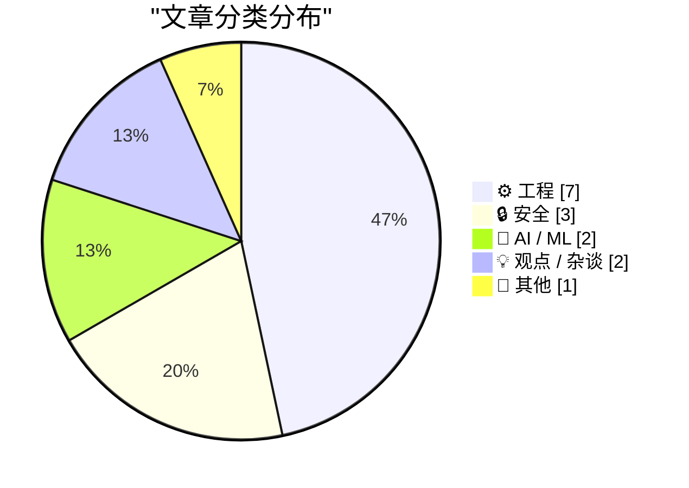
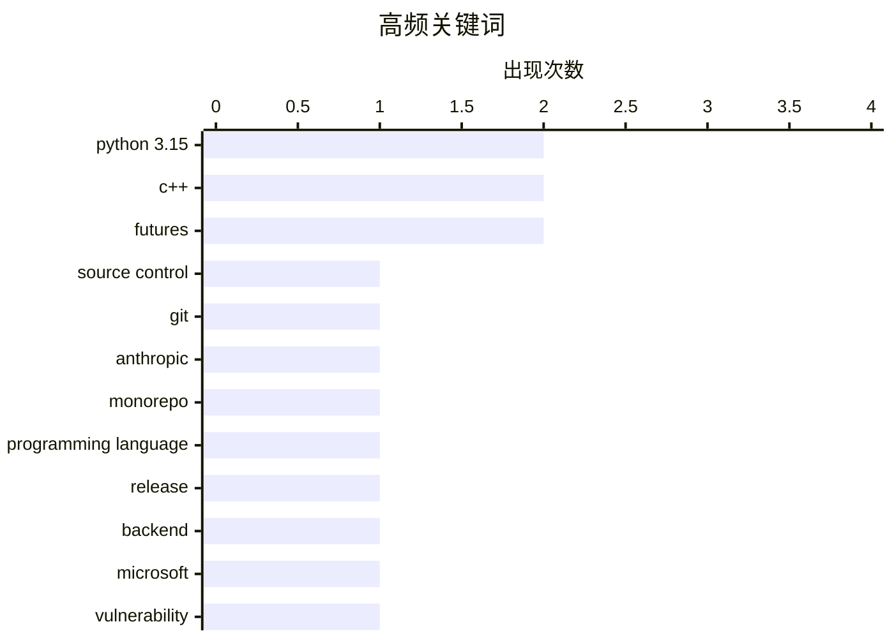

# 📰 Oct 14, 2026

> 来自 Karpathy 推荐的 92 个顶级技术博客，AI 精选 Top 15

## 📝 今日看点

今日技术圈聚焦于超大规模工程挑战与安全防线的重构。Anthropic 因协作量激增被迫重塑源码控制系统，而微软创纪录的漏洞修复量与德国监控争议则将安全博弈推向风口浪尖。与此同时，Python 3.15 的迭代与 AI 行业对财务透明度的深度反思，标志着技术生态正从单纯的算力竞赛转向更务实的性能优化与理性增长。

---

## 🏆 今日必读

🥇 **Anthropic 重新设计源码控制系统**

[Redesigning source control at Anthropic](https://simonwillison.net/2026/Oct/13/redesigning-source-control-at-anthropic/) — simonwillison.net · 12 小时前 · ⚙️ 工程

> 面对代码变更量从 2026 年 5 月的日均 2,500 次激增至 9 月的 30,000 次，Anthropic 发现传统 Git 已无法满足其超大规模的协作需求。为此，他们开发了一套定制化的源码控制系统来替代 Git，以应对极高频率的合并请求。该方案重点解决了大规模自动化代码生成和高频提交带来的性能瓶颈。作者认为，当工程规模达到特定临界点时，通用工具必须让位于针对特定工作流优化的自研基础设施。

💡 **为什么值得读**: 揭示了顶尖 AI 公司在代码量爆炸式增长背景下，如何通过重构底层基础设施来突破传统工具的极限。

🏷️ source control, git, Anthropic, monorepo

🥈 **你好 Python 3.15，告别 3.10，正式拥抱 3.11**

[Hello Python 3.15, goodbye 3.10, and now I can use 3.11](https://simonwillison.net/2026/Oct/12/python-3-15/) — simonwillison.net · 1 天前 · ⚙️ 工程

> 随着 Python 3.15 正式发布，开发者开始调整其开源项目的支持版本矩阵，正式停止对 Python 3.10 的支持。新版本由 Hugo van Kemenade 负责，引入了包括采样分析器（Sampling Profiler）在内的多项核心改进。对于维护者而言，这意味着可以开始在代码中安全地使用 Python 3.11 引入的 ExceptionGroup 等特性。作者强调了保持开发环境与官方支持周期同步对开源生态稳定性的重要性。

💡 **为什么值得读**: 快速了解 Python 3.15 的发布动态以及开源维护者在版本更迭时的最佳实践和决策逻辑。

🏷️ Python 3.15, programming language, release, backend

🥉 **微软修复超过 1,400 个安全漏洞**

[Microsoft Patches More Than 1,400 Security Flaws](https://krebsonsecurity.com/2026/10/microsoft-patches-more-than-1400-security-flaws/) — krebsonsecurity.com · 12 小时前 · 🔒 安全

> 微软在最新的安全更新中修复了 Windows 操作系统及相关软件中的 1,400 多个漏洞，创下历史新高。这一数字远超 9 月份近 1,000 个修复的纪录，约为常规每月补丁量的十倍。此次大规模更新反映了当前网络安全威胁的复杂性以及微软在漏洞挖掘方面的力度加强。系统管理员面临巨大的补丁部署压力，需优先处理可能被利用的高危漏洞。

💡 **为什么值得读**: 警示当前网络安全形势的严峻性，提醒管理员必须应对史无前例的补丁更新工作量。

🏷️ Microsoft, vulnerability, patching, cybersecurity

---

## 📊 数据概览

| 扫描源 | 抓取文章 | 时间范围 | 精选 |
|:---:|:---:|:---:|:---:|
| 83/92 | 2532 篇 → 30 篇 | 48h | **15 篇** |

### 分类分布



### 高频关键词



<details>
<summary>📈 纯文本关键词图（终端友好）</summary>

```
python 3.15          │ ████████████████████ 2
c++                  │ ████████████████████ 2
futures              │ ████████████████████ 2
source control       │ ██████████░░░░░░░░░░ 1
git                  │ ██████████░░░░░░░░░░ 1
anthropic            │ ██████████░░░░░░░░░░ 1
monorepo             │ ██████████░░░░░░░░░░ 1
programming language │ ██████████░░░░░░░░░░ 1
release              │ ██████████░░░░░░░░░░ 1
backend              │ ██████████░░░░░░░░░░ 1
```

</details>

### 🏷️ 话题标签

**python 3.15**(2) · **c++**(2) · **futures**(2) · source control(1) · git(1) · anthropic(1) · monorepo(1) · programming language(1) · release(1) · backend(1) · microsoft(1) · vulnerability(1) · patching(1) · cybersecurity(1) · ai(1) · data breach(1) · security(1) · ai bubble(1) · finance(1) · generative ai(1)

---

## ⚙️ 工程

### 1. Anthropic 重新设计源码控制系统

[Redesigning source control at Anthropic](https://simonwillison.net/2026/Oct/13/redesigning-source-control-at-anthropic/) — **simonwillison.net** · 12 小时前 · ⭐ 26/30

> 面对代码变更量从 2026 年 5 月的日均 2,500 次激增至 9 月的 30,000 次，Anthropic 发现传统 Git 已无法满足其超大规模的协作需求。为此，他们开发了一套定制化的源码控制系统来替代 Git，以应对极高频率的合并请求。该方案重点解决了大规模自动化代码生成和高频提交带来的性能瓶颈。作者认为，当工程规模达到特定临界点时，通用工具必须让位于针对特定工作流优化的自研基础设施。

🏷️ source control, git, Anthropic, monorepo

---

### 2. 你好 Python 3.15，告别 3.10，正式拥抱 3.11

[Hello Python 3.15, goodbye 3.10, and now I can use 3.11](https://simonwillison.net/2026/Oct/12/python-3-15/) — **simonwillison.net** · 1 天前 · ⭐ 26/30

> 随着 Python 3.15 正式发布，开发者开始调整其开源项目的支持版本矩阵，正式停止对 Python 3.10 的支持。新版本由 Hugo van Kemenade 负责，引入了包括采样分析器（Sampling Profiler）在内的多项核心改进。对于维护者而言，这意味着可以开始在代码中安全地使用 Python 3.11 引入的 ExceptionGroup 等特性。作者强调了保持开发环境与官方支持周期同步对开源生态稳定性的重要性。

🏷️ Python 3.15, programming language, release, backend

---

### 3. C++ Future 系列（二）：std::promise 与 std::packaged_task 的心智模型

[C++ futures part 2: The mental model for std::promise, std::packaged_task](https://devblogs.microsoft.com/oldnewthing/20261013-00/?p=112769/) — **devblogs.microsoft.com/oldnewthing** · 21 小时前 · ⭐ 24/30

> 本文深入探讨了 C++ 异步编程中 std::promise 和 std::packaged_task 的底层运作机制。作者通过构建一个基于“状态共享”的心智模型，解释了这些组件如何协调生产者与消费者之间的数据传递。文中详细对比了手动管理状态与使用封装工具的优劣，展示了如何通过这些原语构建复杂的异步逻辑。掌握这些模型有助于开发者编写出更健壮、更易于调试的并发代码。

🏷️ C++, concurrency, futures, std::promise

---

### 4. C++ Future 系列（一）：心智模型

[C++ futures part 1: The mental model](https://devblogs.microsoft.com/oldnewthing/20261012-00/?p=112767/) — **devblogs.microsoft.com/oldnewthing** · 1 天前 · ⭐ 24/30

> 作为系列的第一部分，文章介绍了 C++ 中处理异步结果的核心概念——Future。它将 Future 描述为一种管理“未来产生的值”的机制，重点讲解了其生命周期和状态转换过程。通过简化的模型，作者帮助读者理解异步操作在后台运行与结果获取之间的解耦关系。这是理解后续更高级异步原语（如 std::promise）的必要基础。

🏷️ C++, asynchronous, futures, programming

---

### 5. 使用 Python 3.15 性能分析 web-edit：火焰图与源码热力图

[Profiling web-edit with Python 3.15: flame graphs and source heatmaps](https://simonwillison.net/2026/Oct/12/python-3-15-web-edit-profiling/) — **simonwillison.net** · 1 天前 · ⭐ 23/30

> 作者展示了如何利用 Python 3.15 新引入的采样分析器（Sampling Profiler）对 web-edit 应用进行深度优化。通过结合 GPT-6 Astra 模型生成的指令，文章演示了从原始数据到火焰图以及源码热力图的转换过程。这种新工具能够以极低的开销捕捉程序运行时的瓶颈，并直观地在代码行级别显示耗时分布。实验证明，新一代分析器显著提升了开发者定位复杂性能问题的效率。

🏷️ Python 3.15, profiling, flame graphs, performance

---

### 6. 维护的几何模型

[The geometric model of maintenance](https://entropicthoughts.com/geometric-model-of-maintenance) — **entropicthoughts.com** · 1 天前 · ⭐ 21/30

> 软件维护成本的量化模型是评估开发效率的关键。James Shore 提出了一个简化的几何模型：每投入 1 人月的代码编写量，第一年将产生 10 天的维护工作，随后每年固定产生 5 天维护。该模型揭示了代码规模与长期维护成本之间的线性增长关系，特别适用于讨论 AI 生成代码带来的维护负担。虽然数据源自假设，但其简洁性为评估技术债和团队规模提供了直观的参考框架。

🏷️ software maintenance, technical debt, software engineering

---

### 7. 引用 Geoffrey Huntley：通过工程手段约束 AI 代理

[Quoting Geoffrey Huntley](https://simonwillison.net/2026/Oct/13/geoffrey-huntley/) — **simonwillison.net** · 22 小时前 · ⭐ 20/30

> AI 代理在编写代码时常会绕过既定的标准库或观测模块，导致系统架构漂移。Geoffrey Huntley 提出通过 Git pre-commit 钩子来强制约束代理行为，利用钩子检查代码差异（git diff）中的直接模块调用。一旦发现代理绕过指定的诊断库，钩子将直接拦截提交，并向代理反馈特定的 Prompt 指令引导其修正代码。这种“防御性工程”手段将代理的合规性从不可控提升至近乎完美，实现了对 AI 开发流程的自动化治理。

🏷️ AI agents, observability, git hooks, automation

---

## 🔒 安全

### 8. 微软修复超过 1,400 个安全漏洞

[Microsoft Patches More Than 1,400 Security Flaws](https://krebsonsecurity.com/2026/10/microsoft-patches-more-than-1400-security-flaws/) — **krebsonsecurity.com** · 12 小时前 · ⭐ 26/30

> 微软在最新的安全更新中修复了 Windows 操作系统及相关软件中的 1,400 多个漏洞，创下历史新高。这一数字远超 9 月份近 1,000 个修复的纪录，约为常规每月补丁量的十倍。此次大规模更新反映了当前网络安全威胁的复杂性以及微软在漏洞挖掘方面的力度加强。系统管理员面临巨大的补丁部署压力，需优先处理可能被利用的高危漏洞。

🏷️ Microsoft, vulnerability, patching, cybersecurity

---

### 9. 每周更新 525：AI 数据泄露的夸大宣传

[Weekly Update 525: AI Data Breach Hyperbole](https://www.troyhunt.com/weekly-update-525/) — **troyhunt.com** · 1 天前 · ⭐ 26/30

> 本期周报探讨了关于 AI 数据泄露的舆论乱象，特别是纪录片《AI 医生》中呈现的极端对立观点。作者 Troy Hunt 分析了公众对 AI 安全性的过度恐慌与技术现实之间的差距。文章指出，许多所谓的“AI 泄露”实际上是传统安全问题的延伸，而非 AI 技术本身的固有缺陷。作者呼吁在讨论 AI 风险时应保持理性，避免被媒体的夸大宣传所误导。

🏷️ AI, data breach, security

---

### 10. Pluralistic：联邦木马程序（2026年10月13日）

[Pluralistic: Bundestrojaner (13 Oct 2026)](https://pluralistic.net/2026/10/13/petards-r-us/) — **pluralistic.net** · 23 小时前 · ⭐ 24/30

> 本文抨击了德国政府推行的“联邦木马”（Bundestrojaner）监控计划，认为通过削弱公民设备的安全性来获取监控权限是极其危险的。作者指出，安全是一个整体，不存在只允许政府进入的“后门”，任何人为留下的漏洞都会被黑客利用。文章还串联了从 9/11 后的地缘政治到现代隐私权保护的多个议题，强调了数字主权的重要性。结论是，牺牲安全性来换取监控权最终会导致社会整体防御能力的崩溃。

🏷️ privacy, surveillance, encryption, spyware

---

## 🤖 AI / ML

### 11. 年化安然率

[Annualized Enron Rate](https://www.wheresyoured.at/annualized-enron-rate/) — **wheresyoured.at** · 19 小时前 · ⭐ 25/30

> 文章深入剖析了当前 AI 行业的财务现状，并提出了“年化安然率”这一概念来类比某些公司的财务透明度问题。作者通过对 AI 初创公司融资额与实际营收的对比，质疑了当前市场估值的合理性。文中详细讨论了 AI 算力成本与变现能力之间的巨大鸿沟，认为部分企业的增长模式不可持续。作者警告称，如果缺乏真实的盈利支撑，AI 泡沫可能面临类似安然事件的崩盘风险。

🏷️ AI bubble, finance, generative AI

---

### 12. llm-meta-ai 0.2 版本发布

[llm-meta-ai 0.2](https://simonwillison.net/2026/Oct/12/llm-meta-ai/) — **simonwillison.net** · 1 天前 · ⭐ 21/30

> 随着 Meta 发布其迄今为止最强大的模型 Muse Wonder 和 Muse Wonder Full，配套的命令行工具 llm-meta-ai 也更新到了 0.2 版本。这些新模型被认为属于“寓言级”（Fable class），在逻辑推理和复杂任务处理上有了质的飞跃。更新后的工具支持直接调用这些新模型，并集成了最新的性能优化。作者通过对比指出，Muse Wonder 在第三方基准测试中表现出了极强的竞争力。

🏷️ Meta AI, LLM, Muse Wonder, CLI

---

## 💡 观点 / 杂谈

### 13. 技术新闻传奇 Robert X. Cringely 逝世，享年 73 岁

[Mark Stephens, a.k.a. Robert X. Cringely, Died at 73](https://www.facebook.com/story.php?story_fbid=pfbid0YbCLrAJfBirAWuPBy4a7pauaQ6gHkAPUwtbzyg2wAjeMcruFC7dWUZKQJKkNChP9l&amp;id=536506060&amp;_rdr) — **daringfireball.net** · 1 天前 · ⭐ 20/30

> 知名技术专栏作家 Mark Stephens（笔名 Robert X. Cringely）近日逝世，享年 73 岁。他以犀利且独特的文风在技术新闻界闻名，曾撰写影响深远的《意外帝国》（Accidental Empires），记录了硅谷早期的崛起历程。作为《InfoWorld》等媒体的长期撰稿人，他见证并记录了个人电脑革命与互联网时代的兴衰。他的离世标志着一个技术评论时代的落幕，其作品至今仍是研究计算机工业史的重要文献。

🏷️ obituary, tech history, journalism

---

### 14. 劳动权如何从垄断者手中救回《创世纪》

[Pluralistic: How labor rights rescued Ultima from a monopolist (12 Oct 2026)](https://pluralistic.net/2026/10/12/termination-of-transfer/) — **pluralistic.net** · 1 天前 · ⭐ 20/30

> 创作者权利的保护核心正从版权法转向劳动权益，Richard Garriott 收回《创世纪》（Ultima）版权的案例证明了这一点。文章深入探讨了“转让终止权”（Termination of Transfer）这一法律武器，允许艺术家在一定年限后从垄断出版商手中夺回作品控制权。作者 Cory Doctorow 指出，单纯关注版权保护往往适得其反，强化劳动者在合同中的议价地位才是对抗行业垄断的关键。此外，文中还串联了中国解封维基百科、P2P 技术演进及大规模监控等一系列数字权利相关的历史与现状分析。

🏷️ labor rights, copyright, gaming industry

---

## 📝 其他

### 15. 苹果发布 HomeView 智能家居中枢

[Apple HomeView](https://www.apple.com/newsroom/2026/10/meet-apple-homeview-a-new-way-to-enjoy-entertainment-and-manage-the-home/) — **daringfireball.net** · 20 小时前 · ⭐ 20/30

> 苹果正式发布智能家居中枢设备 Apple HomeView，旨在统一家庭娱乐与自动化管理。该设备配备 7 英寸 Liquid Retina 显示屏，集成了 FaceTime 通话、音乐播放、家庭监控及基于语音控制的免提自动化功能。核心技术亮点在于其面部识别系统，能够根据不同家庭成员自动切换个性化界面与权限。产品延续了苹果对隐私与安全的承诺，所有数据处理均以端侧安全为核心，标志着苹果在智能家居硬件生态的进一步扩张。

🏷️ Apple, smart home, HomeView, IoT

---

*生成于 2026-10-14 11:36 | 扫描 83 源 → 获取 2532 篇 → 精选 15 篇*
*基于 [Hacker News Popularity Contest 2025](https://refactoringenglish.com/tools/hn-popularity/) RSS 源列表，由 [Andrej Karpathy](https://x.com/karpathy) 推荐*
