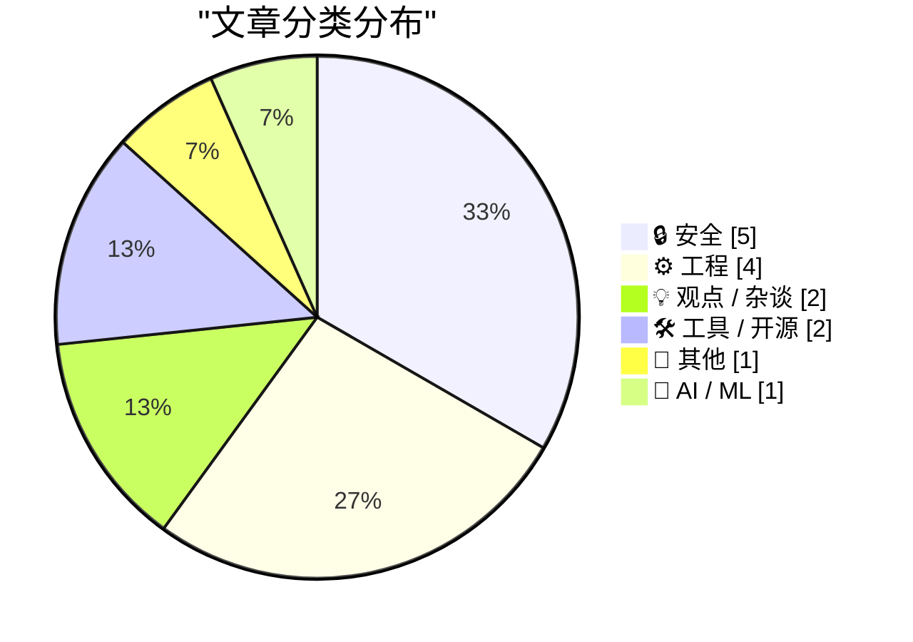
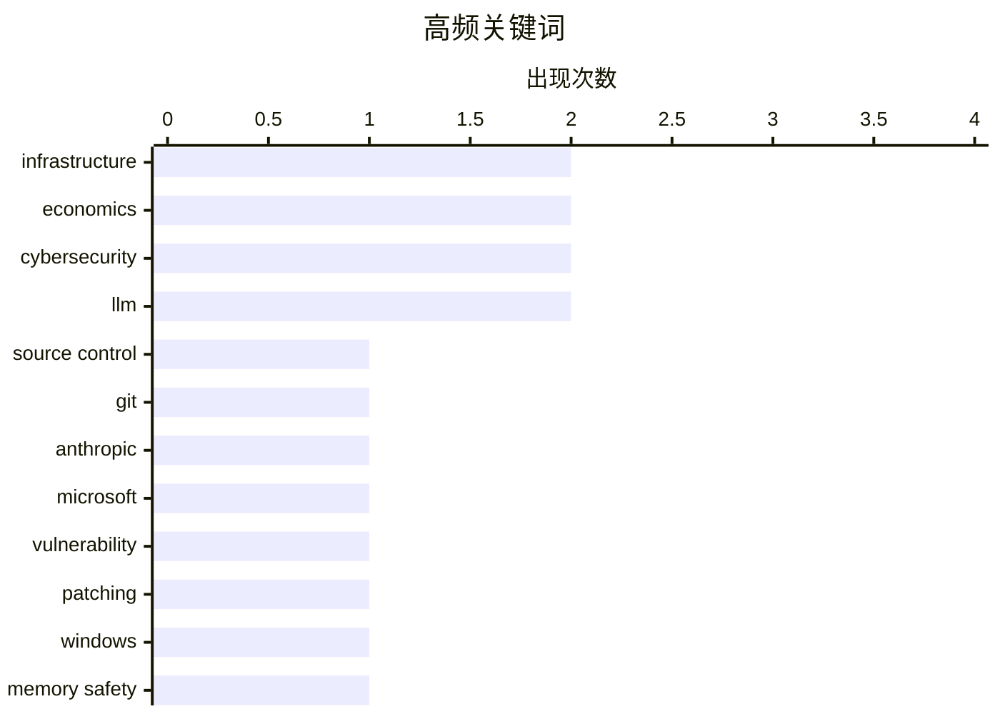

# 📰 Oct 15, 2026

> 来自 Karpathy 推荐的 92 个顶级技术博客，AI 精选 Top 15

## 📝 今日看点

AI 驱动的代码爆发式增长正倒逼底层工程架构重构，但行业繁荣背后潜藏的财务泡沫与“年化安然率”风险亦引发市场深度忧虑。全球安全形势进入极端高压期，从微软创纪录的漏洞修复量到 OpenAI 内部窃听丑闻，揭示了核心技术设施在内外部威胁下的脆弱性。与此同时，围绕加密货币洗钱、电网安全及政府监控手段的博弈，标志着技术监管已成为地缘政治对抗与数字权利争夺的新前线。

---

## 🏆 今日必读

🥇 **Anthropic 重构源码控制系统**

[Redesigning source control at Anthropic](https://simonwillison.net/2026/Oct/13/redesigning-source-control-at-anthropic/) — simonwillison.net · 1 天前 · ⚙️ 工程

> Anthropic 弃用 Git 并构建了自定义源码控制系统，以应对 AI 驱动下代码变更率的爆炸式增长。2026 年 5 月至 9 月间，其日均合并代码量从 2,500 次激增至超过 30,000 次，传统 Git 工作流已无法支撑这种规模。该方案旨在优化大规模并发提交和自动化代码生成的处理效率，解决了高频冲突和元数据膨胀问题。这标志着在超大规模 AI 开发环境下，基础设施必须从通用工具转向专用架构以维持研发效能。

💡 **为什么值得读**: 揭示了 AI 辅助编程如何彻底改变软件工程的规模边界，以及顶尖 AI 公司如何通过重构底层工具链解决工程瓶颈。

🏷️ source control, Git, Anthropic, infrastructure

🥈 **微软修复超过 1,400 个安全漏洞**

[Microsoft Patches More Than 1,400 Security Flaws](https://krebsonsecurity.com/2026/10/microsoft-patches-more-than-1400-security-flaws/) — krebsonsecurity.com · 1 天前 · 🔒 安全

> 微软在 2026 年 10 月发布了史无前例的安全更新，修复了 Windows 操作系统及相关软件中超过 1,400 个安全漏洞。这一数字打破了 9 月份近 1,000 个修复的记录，是常规月份补丁数量的十倍左右。如此大规模的漏洞爆发反映了当前软件供应链安全面临的严峻挑战，以及自动化漏洞挖掘技术的普及。系统管理员需紧急应对这一“史诗级”补丁批次，以防范潜在的大规模利用攻击。

💡 **为什么值得读**: 了解网络安全史上的里程碑事件，警示企业级系统维护在漏洞激增时代面临的极端复杂性与紧迫性。

🏷️ Microsoft, vulnerability, patching, Windows

🥉 **“无法防范”：唯一频繁发生此类问题的语言用户如是说**

["No way to prevent this" say users of only language where this regularly happens](https://xeiaso.net/shitposts/no-way-to-prevent-this/memory-safety/CVE-2026-92392/) — xeiaso.net · 1 天前 · ⚙️ 工程

> curl 项目披露了编号为 CVE-2026-92392 的严重漏洞，涉及 HTTP/2 上传重试机制中的“释放后使用”（use-after-free）缺陷。该漏洞源于清理过程中将残留上传数据转为新请求时，错误保留了已释放的 Curl_easy 句柄指针，可能导致远程代码执行（RCE）。文章以讽刺笔调指出，这类内存安全问题在 C 语言项目中屡见不鲜，尽管社区反复修补却难以根除。SRE 和系统管理员正紧急重新构建并修补受影响的系统，以应对恶意服务器的攻击威胁。

💡 **为什么值得读**: 通过深度剖析顶级开源项目 curl 的高危漏洞成因，引发对底层语言内存安全性及系统加固的深刻反思。

🏷️ memory safety, C, curl, CVE

---

## 📊 数据概览

| 扫描源 | 抓取文章 | 时间范围 | 精选 |
|:---:|:---:|:---:|:---:|
| 83/92 | 2533 篇 → 26 篇 | 48h | **15 篇** |

### 分类分布



### 高频关键词



<details>
<summary>📈 纯文本关键词图（终端友好）</summary>

```
infrastructure │ ████████████████████ 2
economics      │ ████████████████████ 2
cybersecurity  │ ████████████████████ 2
llm            │ ████████████████████ 2
source control │ ██████████░░░░░░░░░░ 1
git            │ ██████████░░░░░░░░░░ 1
anthropic      │ ██████████░░░░░░░░░░ 1
microsoft      │ ██████████░░░░░░░░░░ 1
vulnerability  │ ██████████░░░░░░░░░░ 1
patching       │ ██████████░░░░░░░░░░ 1
```

</details>

### 🏷️ 话题标签

**infrastructure**(2) · **economics**(2) · **cybersecurity**(2) · llm(2) · source control(1) · git(1) · anthropic(1) · microsoft(1) · vulnerability(1) · patching(1) · windows(1) · memory safety(1) · c(1) · curl(1) · cve(1) · cryptocurrency(1) · sanctions(1) · ransomware(1) · cybercrime(1) · openai(1)

---

## 🔒 安全

### 1. 微软修复超过 1,400 个安全漏洞

[Microsoft Patches More Than 1,400 Security Flaws](https://krebsonsecurity.com/2026/10/microsoft-patches-more-than-1400-security-flaws/) — **krebsonsecurity.com** · 1 天前 · ⭐ 26/30

> 微软在 2026 年 10 月发布了史无前例的安全更新，修复了 Windows 操作系统及相关软件中超过 1,400 个安全漏洞。这一数字打破了 9 月份近 1,000 个修复的记录，是常规月份补丁数量的十倍左右。如此大规模的漏洞爆发反映了当前软件供应链安全面临的严峻挑战，以及自动化漏洞挖掘技术的普及。系统管理员需紧急应对这一“史诗级”补丁批次，以防范潜在的大规模利用攻击。

🏷️ Microsoft, vulnerability, patching, Windows

---

### 2. 英国制裁为俄罗斯洗钱的加密货币平台 Cryptomus

[U.K. Sanctions Cryptomus for RU Money Laundering](https://krebsonsecurity.com/2026/10/u-k-sanctions-cryptomus-for-ru-money-laundering/) — **krebsonsecurity.com** · 20 小时前 · ⭐ 24/30

> 英国政府宣布对加密货币平台 Cryptomus 实施经济制裁，指控其为俄罗斯洗钱的重要渠道。该平台被视为勒索软件、毒品交易、暗网市场及各类网络犯罪服务的支付中转站，帮助俄罗斯规避现有的金融限制。专家指出，Cryptomus 具有极强的伪装性，是当前非法跨境资金流动的关键节点。此举标志着国际社会正加大力度打击利用加密技术进行的规避制裁行为。制裁旨在切断支持网络犯罪和地缘政治对抗的资金链条。

🏷️ cryptocurrency, sanctions, ransomware, cybercrime

---

### 3. FBI 逮捕涉嫌在公司高管会议室安装窃听器的沙特籍 OpenAI 员工

[The FBI Arrested a Saudi National OpenAI Employee for Planting a Recording Device in the Company’s Executive Conference Room](https://www.justice.gov/opa/pr/saudi-national-arrested-installing-surreptitious-audio-recording-device-openai) — **daringfireball.net** · 14 小时前 · ⭐ 24/30

> 美国司法部逮捕了 OpenAI 员工 Abdulrahman Alfozan，指控其在公司高管会议室安装电子监听设备以拦截口头通讯。这名 35 岁的沙特籍员工于 2026 年 10 月 9 日被捕，并已在联邦法院首次出庭。该事件凸显了顶尖 AI 公司面临的严重内部威胁和潜在的国际间谍风险。此案被提升至国家安全高度，反映了全球超级智能竞赛中知识产权保护的极端敏感性。OpenAI 及相关监管机构正重新评估核心研发区域的物理与信息安全策略。

🏷️ OpenAI, FBI, espionage, insider threat

---

### 4. Pluralistic：联邦木马与数字安全悖论

[Pluralistic: Bundestrojaner (13 Oct 2026)](https://pluralistic.net/2026/10/13/petards-r-us/) — **pluralistic.net** · 1 天前 · ⭐ 23/30

> Cory Doctorow 针对“联邦木马”（Bundestrojaner）及政府监控手段发表评论，核心观点是“不能通过降低安全性来提高安全性”。文章严厉批评了政府通过在软件中预留后门或利用已知漏洞进行监控的做法，认为这会破坏整体数字生态的信任基础。文中串联了从 9/11 地缘政治遗产到现代隐私权保护等一系列社会技术议题，探讨了技术后门如何最终成为犯罪分子的温床。作者呼吁加强端到端加密，认为这是保护公民免受各类威胁的唯一可靠途径。

🏷️ surveillance, privacy, encryption, cybersecurity

---

### 5. 尚未监管的太阳能云：第九届欧洲电网网络安全论坛笔记

[The still unregulated solar power clouds: notes from 9th E.DSO – EE-ISAC - ENCS – ENISA Cybersecurity Forum](https://berthub.eu/articles/posts/solar-nightmare-at-the-conference/) — **berthub.eu** · 21 小时前 · ⭐ 23/30

> 在布鲁塞尔举行的 #CyberGrids26 论坛揭示了太阳能云平台在监管方面的严重缺失。与会专家指出，分布式能源接入电网带来了巨大的网络安全风险，尤其是缺乏统一安全标准的逆变器监控系统。目前，太阳能发电设备的数字化程度极高，但防护水平参差不齐，存在被大规模远程攻击导致电网频率崩溃的隐患。会议强调了建立跨国界、跨行业的能源基础设施安全规范的紧迫性。监管机构、运营商和设备商需协同制定强制性的网络安全准则。

🏷️ cybersecurity, power grid, infrastructure

---

## ⚙️ 工程

### 6. Anthropic 重构源码控制系统

[Redesigning source control at Anthropic](https://simonwillison.net/2026/Oct/13/redesigning-source-control-at-anthropic/) — **simonwillison.net** · 1 天前 · ⭐ 27/30

> Anthropic 弃用 Git 并构建了自定义源码控制系统，以应对 AI 驱动下代码变更率的爆炸式增长。2026 年 5 月至 9 月间，其日均合并代码量从 2,500 次激增至超过 30,000 次，传统 Git 工作流已无法支撑这种规模。该方案旨在优化大规模并发提交和自动化代码生成的处理效率，解决了高频冲突和元数据膨胀问题。这标志着在超大规模 AI 开发环境下，基础设施必须从通用工具转向专用架构以维持研发效能。

🏷️ source control, Git, Anthropic, infrastructure

---

### 7. “无法防范”：唯一频繁发生此类问题的语言用户如是说

["No way to prevent this" say users of only language where this regularly happens](https://xeiaso.net/shitposts/no-way-to-prevent-this/memory-safety/CVE-2026-92392/) — **xeiaso.net** · 1 天前 · ⭐ 26/30

> curl 项目披露了编号为 CVE-2026-92392 的严重漏洞，涉及 HTTP/2 上传重试机制中的“释放后使用”（use-after-free）缺陷。该漏洞源于清理过程中将残留上传数据转为新请求时，错误保留了已释放的 Curl_easy 句柄指针，可能导致远程代码执行（RCE）。文章以讽刺笔调指出，这类内存安全问题在 C 语言项目中屡见不鲜，尽管社区反复修补却难以根除。SRE 和系统管理员正紧急重新构建并修补受影响的系统，以应对恶意服务器的攻击威胁。

🏷️ memory safety, C, curl, CVE

---

### 8. AI 正在大规模反编译游戏：既令人惊叹又令人担忧

[AI is mass decompiling games. That's both awesome and scary.](https://simonwillison.net/2026/Oct/14/ai-is-mass-decompiling-games/) — **simonwillison.net** · 18 小时前 · ⭐ 23/30

> 独立开发者 Popcar 探讨了 AI 驱动的大规模游戏反编译浪潮，这一技术正彻底改变游戏考古与移植领域。通过 AI 自动生成的源代码，开发者能轻松实现跨游戏素材混搭，并将老旧游戏通过 WebAssembly 移植到现代浏览器运行。虽然这极大地促进了游戏保存项目，使旧作能在新硬件上焕发新生，但也带来了版权侵权和代码滥用的法律隐忧。这种技术突破让原本需要数年人工逆向工程的任务在短时间内即可完成。AI 正在模糊合法保存与非法破解之间的界限。

🏷️ AI, decompilation, game development, reverse engineering

---

### 9. C++ Future 系列（二）：std::promise 与 std::packaged_task 的心智模型

[C++ futures part 2: The mental model for std::promise, std::packaged_task](https://devblogs.microsoft.com/oldnewthing/20261013-00/?p=112769/) — **devblogs.microsoft.com/oldnewthing** · 1 天前 · ⭐ 23/30

> 微软技术专家 Raymond Chen 深入解析了 C++ 中 `std::promise` 和 `std::packaged_task` 的底层心智模型。文章重点讨论了如何基于“共享状态”（shared state）构建异步操作，并理清了这些组件与 `std::future` 之间的协作关系。通过对比不同封装方式在处理异常和结果返回时的优劣，为开发者提供了处理并发任务的清晰路径。这是理解 C++ 标准库并发设施从基础语法到工程实践的进阶指南。文章强调了正确理解状态所有权对编写健壮异步代码的重要性。

🏷️ C++, concurrency, futures, programming

---

## 💡 观点 / 杂谈

### 10. 年化安然率：审视 AI 行业的财务泡沫

[Annualized Enron Rate](https://www.wheresyoured.at/annualized-enron-rate/) — **wheresyoured.at** · 1 天前 · ⭐ 24/30

> 文章深入探讨了当前 AI 行业的财务现状，并提出了“年化安然率”这一概念来警示潜在的行业泡沫。作者通过对 AI 独角兽公司财务数据的深度剖析，质疑了当前高估值与实际营收能力之间的巨大鸿沟。内容涵盖了从昂贵的算力基础设施投入到尚未验证的订阅制盈利模式的详细对比。结论指出，若不解决投入产出比失衡的问题，AI 行业可能面临类似安然公司的系统性财务危机。这为投资者和从业者提供了一个冷峻的风险评估视角。

🏷️ AI bubble, finance, economics

---

### 11. Pluralistic：Expedia 正在将酒店行业“亚马逊化”

[Pluralistic: Expedia amazoned hotel rooms (15 Oct 2026)](https://pluralistic.net/2026/10/15/enshittipedia/) — **pluralistic.net** · 10 分钟前 · ⭐ 21/30

> Cory Doctorow 深入探讨了 Expedia 等在线旅游平台如何通过垄断地位对酒店行业进行“亚马逊化”改造，导致消费者和商家双输。文章指出，这些平台利用算法操纵搜索结果并收取高额佣金，迫使酒店提高基础价格，最终将成本转嫁给所有用户。作者借此分析了“平台腐烂”（Enshittification）的普遍现象，涵盖了从微软的封闭生态到 AI 泡沫对版权的侵害等多个领域。结论认为，当前的互联网平台经济已演变为纯粹的榨取式垄断，亟需通过反垄断手段和技术主权进行重构。

🏷️ monopoly, platform decay, Expedia, economics

---

## 🛠 工具 / 开源

### 12. 苹果发布 HomeView：集成 7 英寸视网膜屏的智能家居中控枢纽

[Apple HomeView](https://www.apple.com/newsroom/2026/10/meet-apple-homeview-a-new-way-to-enjoy-entertainment-and-manage-the-home/) — **daringfireball.net** · 1 天前 · ⭐ 21/30

> 苹果正式推出了名为 HomeView 的智能家居中控设备，配备 7 英寸 Liquid Retina 视网膜显示屏，旨在成为家庭娱乐与管理的中心。该设备支持 FaceTime 通话、音乐播放及基于语音控制的自动化操作，并利用面部识别技术为不同家庭成员提供个性化界面。HomeView 强调隐私与安全，所有数据处理均在本地完成，并能无缝联动 HomeKit 生态系统。苹果此举旨在填补其在专用智能显示器市场的空白，通过深度集成系统生态挑战亚马逊和谷歌的统治地位。

🏷️ Apple, Smart Home, IoT, HomeView

---

### 13. llm-gemini 0.35 发布：支持最新的 Gemini 4 Argon 模型

[llm-gemini 0.35](https://simonwillison.net/2026/Oct/13/llm-gemini/) — **simonwillison.net** · 1 天前 · ⭐ 20/30

> Simon Willison 发布了 llm-gemini 插件的 0.35 版本，正式引入了对 Google 最新发布的 Gemini 4 Argon 模型支持。该模型目前已通过 Gemini API 向开发者开放，并包含在每月 100 美元的订阅计划中。通过此更新，用户可以在命令行界面利用 llm 工具直接调用 Argon 模型的强大推理能力。此次更新还优化了与 Google 基础设施的连接稳定性，为开发者探索 Gemini 4 的新特性提供了便捷的入口。

🏷️ Gemini, LLM, Python, API

---

## 📝 其他

### 14. Formlabs 推出 699 美元 SLA 打印机，弃用树莓派转向自研硬件

[Formlabs dropped the Raspberry Pi on the way to a $699 SLA printer](https://www.jeffgeerling.com/blog/2026/formlabs-form-studio-1-resin-printer/) — **jeffgeerling.com** · 22 小时前 · ⭐ 21/30

> Formlabs 推出了售价仅为 699 美元的 Form Studio 1 光固化 3D 打印机，旨在打破专业级 SLA 设备的高价门槛。为了实现这一极致性价比，该型号舍弃了以往机型中常用的树莓派（Raspberry Pi）计算模块，转而采用更具成本效益的定制 SoC 方案。尽管价格大幅下调，它依然深度集成 PreForm 软件生态，并保留了自动树脂搅拌和加热等核心功能。作者认为，这一转变标志着 Formlabs 正在通过硬件去中心化和供应链优化，将工业级打印精度推向消费级市场。

🏷️ 3D printing, Raspberry Pi, hardware, Formlabs

---

## 🤖 AI / ML

### 15. Claude，别碰我的“肿块”：关于永久幸福的秘密钥匙

[Claude, don’t touch my lump](https://www.experimental-history.com/p/claude-dont-touch-my-lump) — **experimental-history.com** · 1 天前 · ⭐ 21/30

> 这篇来自 Experimental History 的文章探讨了人类情感中的“肿块”——即那些痛苦、缺陷或独特的生命体验——与 AI 优化逻辑之间的冲突。作者通过与 Claude 的互动，反思了现代技术试图通过算法消除不适感以追求“永久幸福”的虚幻性。文章指出，真正的幸福并非源于被 AI 磨平的完美生活，而是源于对生命中不可替代的复杂性和痛苦的接纳。作者呼吁用户在与大模型交互时保持自我意识，警惕 AI 对人类主观经验的过度干预和简化。

🏷️ Claude, LLM, psychology

---

*生成于 2026-10-15 11:14 | 扫描 83 源 → 获取 2533 篇 → 精选 15 篇*
*基于 [Hacker News Popularity Contest 2025](https://refactoringenglish.com/tools/hn-popularity/) RSS 源列表，由 [Andrej Karpathy](https://x.com/karpathy) 推荐*
