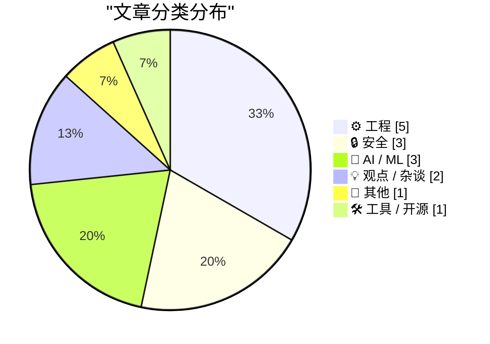
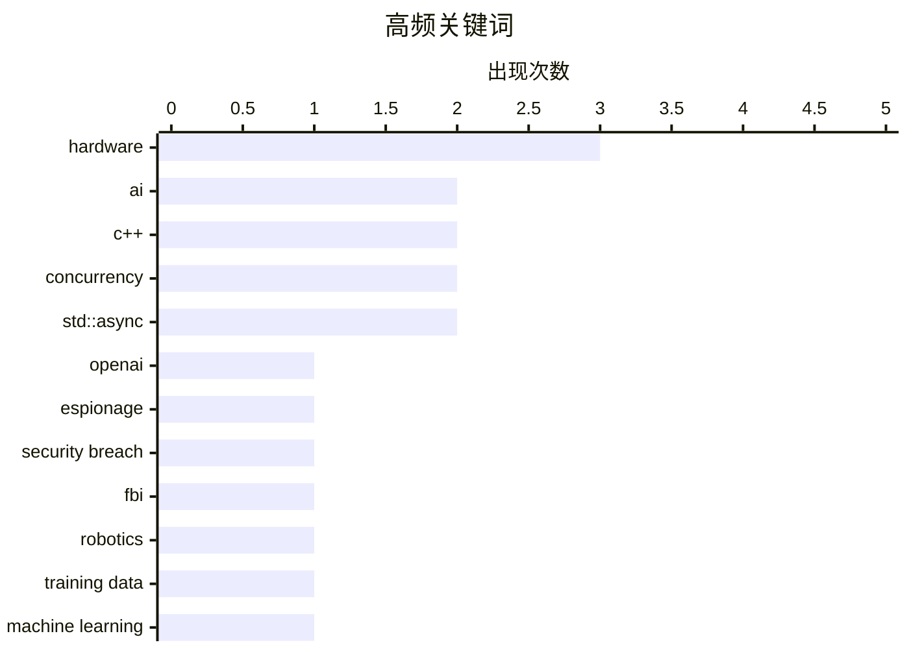

# 📰 Oct 16, 2026

> 来自 Karpathy 推荐的 92 个顶级技术博客，AI 精选 Top 15

## 📝 今日看点

AI 浪潮正从纯软件领域向物理世界与底层工程深度渗透，不仅驱动了机器人训练范式的演进，更通过降低开发门槛催生了大量轻量化软件项目的爆发。与此同时，技术安全与地缘政治的博弈愈发激烈，从 OpenAI 内部的间谍风波到针对加密洗钱平台的国际制裁，凸显了前沿科技在高速扩张中面临的合规与防御挑战。此外，随着 Anthropic 等巨头营收激增并筹备上市，AI 产业正加速进入商业化变现与基础设施安全监管的新阶段。

---

## 🏆 今日必读

🥇 **FBI 逮捕一名在 OpenAI 会议室安装窃听器的沙特籍员工**

[The FBI Arrested a Saudi National OpenAI Employee for Planting a Recording Device in the Company’s Executive Conference Room](https://www.justice.gov/opa/pr/saudi-national-arrested-installing-surreptitious-audio-recording-device-openai) — daringfireball.net · 1 天前 · 🔒 安全

> OpenAI 一名沙特籍员工 Abdulrahman Alfozan 因在公司高管会议室安装秘密录音设备被 FBI 逮捕并起诉。该员工涉嫌利用电子或机械装置截获内部口头通信，于 10 月 9 日被捕并已首次出庭。此事件发生在人工智能全球竞争白热化的背景下，凸显了 AI 核心企业的内部安全已上升至国家安全层面。司法部强调，赢得超级人工智能竞赛是国家的优先战略，保护此类技术免受非法监控至关重要。这起案件反映了顶级 AI 实验室正面临严峻的间谍威胁和地缘政治风险。

💡 **为什么值得读**: 揭示了 AI 巨头面临的真实间谍威胁以及地缘政治对顶尖技术公司安全架构的影响。

🏷️ OpenAI, espionage, security breach, FBI

🥈 **如何训练你的机器人**

[How to Train Your Robot](https://www.construction-physics.com/p/how-to-train-your-robot) — construction-physics.com · 20 小时前 · 🤖 AI / ML

> 过去几年 AI 能力的飞跃主要由海量训练数据的可用性驱动，而这一逻辑正在向机器人领域迁移。文章探讨了如何通过规模化数据采集来提升机器人的物理泛化能力，使其能像 LLM 处理文本一样处理复杂的现实环境。核心挑战在于如何获取高质量的动作数据，目前的技术路径正从规则驱动转向大规模行为克隆和仿真数据训练。作者认为，数据规模而非算法微调，将是实现通用机器人智能（General Purpose Robotics）的关键驱动力。最终目标是让机器人通过“观看”和“模仿”海量示例来掌握无限的技能。

💡 **为什么值得读**: 深入浅出地解释了机器人学从规则驱动转向数据驱动的范式演变，是理解具身智能路径的必读方案。

🏷️ AI, robotics, training data, machine learning

🥉 **英国制裁涉嫌为俄罗斯洗钱的加密货币平台 Cryptomus**

[U.K. Sanctions Cryptomus for RU Money Laundering](https://krebsonsecurity.com/2026/10/u-k-sanctions-cryptomus-for-ru-money-laundering/) — krebsonsecurity.com · 1 天前 · 🔒 安全

> 英国政府正式对加密货币平台 Cryptomus 实施经济制裁，指控其为俄罗斯洗钱的主要渠道。专家指出，该平台充当了勒索软件、毒品交易、暗网市场及各类网络犯罪支付的中转站，协助俄罗斯规避现有的国际金融限制。Cryptomus 被描述为具有“变色龙”属性，通过复杂的支付结构掩盖资金流向，服务于多种非法跨境交易。此举反映了国际监管机构正加大力度打击利用加密技术进行的规避制裁行为。该制裁旨在切断俄罗斯通过非传统金融渠道获取资金的路径。

💡 **为什么值得读**: 了解加密货币在现代地缘政治冲突和网络犯罪链条中的角色，以及国际金融监管的最新动向。

🏷️ Cryptocurrency, Sanctions, Money Laundering, Cybercrime

---

## 📊 数据概览

| 扫描源 | 抓取文章 | 时间范围 | 精选 |
|:---:|:---:|:---:|:---:|
| 83/92 | 2533 篇 → 23 篇 | 48h | **15 篇** |

### 分类分布



### 高频关键词



<details>
<summary>📈 纯文本关键词图（终端友好）</summary>

```
hardware        │ ████████████████████ 3
ai              │ █████████████░░░░░░░ 2
c++             │ █████████████░░░░░░░ 2
concurrency     │ █████████████░░░░░░░ 2
std::async      │ █████████████░░░░░░░ 2
openai          │ ███████░░░░░░░░░░░░░ 1
espionage       │ ███████░░░░░░░░░░░░░ 1
security breach │ ███████░░░░░░░░░░░░░ 1
fbi             │ ███████░░░░░░░░░░░░░ 1
robotics        │ ███████░░░░░░░░░░░░░ 1
```

</details>

### 🏷️ 话题标签

**hardware**(3) · **ai**(2) · **c++**(2) · concurrency(2) · std::async(2) · openai(1) · espionage(1) · security breach(1) · fbi(1) · robotics(1) · training data(1) · machine learning(1) · cryptocurrency(1) · sanctions(1) · money laundering(1) · cybercrime(1) · cybersecurity(1) · smart grid(1) · infrastructure(1) · regulation(1)

---

## ⚙️ 工程

### 1. Formlabs 推出 699 美元 SLA 打印机，并弃用了树莓派

[Formlabs dropped the Raspberry Pi on the way to a $699 SLA printer](https://www.jeffgeerling.com/blog/2026/formlabs-form-studio-1-resin-printer/) — **jeffgeerling.com** · 1 天前 · ⭐ 24/30

> 知名 3D 打印厂商 Formlabs 推出了售价仅为 699 美元的入门级光固化（SLA）打印机 Form Studio 1。技术博主 Jeff Geerling 在评测中发现，为了优化成本和供应链，Formlabs 在该型号中弃用了此前长期使用的树莓派（Raspberry Pi）核心。这一转变标志着专业级 3D 打印设备正通过自研硬件或更廉价的替代方案走向大众市场。文章详细对比了 Form Studio 1 与高端型号 Form 4 的性能差异，认为这是 SLA 技术普及的重要里程碑。尽管价格大幅下降，该设备仍保持了 Formlabs 一贯的打印精度和易用性。

🏷️ Raspberry Pi, 3D Printing, Embedded Systems, Hardware

---

### 2. AI 正在大规模反编译游戏：既令人惊叹又让人担忧

[AI is mass decompiling games. That's both awesome and scary.](https://simonwillison.net/2026/Oct/14/ai-is-mass-decompiling-games/) — **simonwillison.net** · 1 天前 · ⭐ 23/30

> 独立游戏开发者 Popcar 探讨了利用 AI 技术大规模反编译现有游戏的新趋势，这为游戏重制和跨平台移植带来了革命性变化。通过 AI 辅助，开发者能更轻松地将老旧游戏二进制代码转化为可读源码，从而实现向 WebAssembly 等现代环境的迁移。这一技术极大地推动了游戏存档和保护项目，让许多“被遗忘”的作品得以在现代硬件上重新运行。然而，这也引发了关于版权保护、非法修改以及游戏 IP 完整性的法律与伦理担忧。AI 正在打破游戏开发的封闭性，让玩家社群拥有了前所未有的逆向工程能力。

🏷️ Decompilation, Reverse Engineering, AI, Game Dev

---

### 3. C++ Future 系列（四）：如何实现立即在当前线程执行的 std::async？

[C++ futures part 4: What if I want an immediate on-thread std::async?](https://devblogs.microsoft.com/oldnewthing/20261015-00/?p=112776/) — **devblogs.microsoft.com/oldnewthing** · 21 小时前 · ⭐ 23/30

> 本文是 Raymond Chen 关于 C++ Future 系列的第四部分，专门解决 `std::async` 无法直接支持“立即在当前线程执行”这一特定场景的问题。作者深入分析了 C++ 标准库中 `std::launch::deferred` 与 `std::launch::async` 的局限性，并提供了相应的技术绕过方案。通过探讨异步任务的调度机制，文章展示了如何手动控制任务的执行时机以满足高性能编程需求。这为需要精细化控制并发行为的 C++ 开发者提供了实用的底层实现参考。文章延续了作者一贯的硬核风格，直击标准库设计的痛点。

🏷️ C++, concurrency, std::async, programming

---

### 4. C++ Future 系列（三）：std::async 的心智模型

[C++ futures part 3: The mental model for std::async](https://devblogs.microsoft.com/oldnewthing/20261014-00/?p=112774/) — **devblogs.microsoft.com/oldnewthing** · 1 天前 · ⭐ 23/30

> std::async 的核心在于建立调用者与异步任务之间的共享状态，而非简单的后台执行。它支持 std::launch::async（立即异步执行）和 std::launch::deferred（延迟到获取结果时执行）两种策略。开发者必须注意其特有的“阻塞析构”行为：如果返回的 std::future 是最后一个持有共享状态的对象，其析构函数会阻塞直到任务完成。这种设计旨在确保任务不会在后台静默失败，但也常导致非预期的同步等待。理解这一模型对于避免并发编程中的死锁或性能瓶颈至关重要。

🏷️ C++, concurrency, std::async, mental model

---

### 5. Chirp Pong：基于音频传输的网页版乒乓球游戏

[Chirp Pong](https://simonwillison.net/2026/Oct/15/chirp-pong/) — **simonwillison.net** · 15 小时前 · ⭐ 20/30

> Chirp Pong 是一项利用手机麦克风和扬声器进行近场通信的创新游戏实验。该项目采用纯静态 HTML 构建，通过发送特定频率的音频脉冲（Chirps）在两台手机间同步游戏状态，无需依赖蓝牙或 Wi-Fi 配对。玩家只需将两台手机靠近，即可实现低延迟的实时对战。这种“声学联网”方案展示了在无传统网络连接环境下，利用基础硬件实现跨设备交互的新可能性。该实验证明了音频数据传输在简单多人交互场景中的可行性。

🏷️ Web Audio, Networking, HTML5, Chirp

---

## 🔒 安全

### 6. FBI 逮捕一名在 OpenAI 会议室安装窃听器的沙特籍员工

[The FBI Arrested a Saudi National OpenAI Employee for Planting a Recording Device in the Company’s Executive Conference Room](https://www.justice.gov/opa/pr/saudi-national-arrested-installing-surreptitious-audio-recording-device-openai) — **daringfireball.net** · 1 天前 · ⭐ 26/30

> OpenAI 一名沙特籍员工 Abdulrahman Alfozan 因在公司高管会议室安装秘密录音设备被 FBI 逮捕并起诉。该员工涉嫌利用电子或机械装置截获内部口头通信，于 10 月 9 日被捕并已首次出庭。此事件发生在人工智能全球竞争白热化的背景下，凸显了 AI 核心企业的内部安全已上升至国家安全层面。司法部强调，赢得超级人工智能竞赛是国家的优先战略，保护此类技术免受非法监控至关重要。这起案件反映了顶级 AI 实验室正面临严峻的间谍威胁和地缘政治风险。

🏷️ OpenAI, espionage, security breach, FBI

---

### 7. 英国制裁涉嫌为俄罗斯洗钱的加密货币平台 Cryptomus

[U.K. Sanctions Cryptomus for RU Money Laundering](https://krebsonsecurity.com/2026/10/u-k-sanctions-cryptomus-for-ru-money-laundering/) — **krebsonsecurity.com** · 1 天前 · ⭐ 25/30

> 英国政府正式对加密货币平台 Cryptomus 实施经济制裁，指控其为俄罗斯洗钱的主要渠道。专家指出，该平台充当了勒索软件、毒品交易、暗网市场及各类网络犯罪支付的中转站，协助俄罗斯规避现有的国际金融限制。Cryptomus 被描述为具有“变色龙”属性，通过复杂的支付结构掩盖资金流向，服务于多种非法跨境交易。此举反映了国际监管机构正加大力度打击利用加密技术进行的规避制裁行为。该制裁旨在切断俄罗斯通过非传统金融渠道获取资金的路径。

🏷️ Cryptocurrency, Sanctions, Money Laundering, Cybercrime

---

### 8. 尚未监管的太阳能云：第九届欧洲电网网络安全论坛笔记

[The still unregulated solar power clouds: notes from 9th E.DSO – EE-ISAC - ENCS – ENISA Cybersecurity Forum](https://berthub.eu/articles/posts/solar-nightmare-at-the-conference/) — **berthub.eu** · 1 天前 · ⭐ 25/30

> 文章记录了在布鲁塞尔举行的第九届欧洲电网网络安全论坛（#CyberGrids26）的核心讨论，重点关注太阳能发电设施的监管真空。与会者包括欧盟委员会、电力运营商及安全研究人员，共同探讨了分布式能源（DER）接入电网带来的系统性风险。目前大量太阳能逆变器及云端管理平台的安全性参差不齐，且缺乏统一的强制性安全标准。作者指出，如果不对这些“电力云”进行有效监管，分布式能源可能成为电网最脆弱的攻击面。会议达成共识，认为必须尽快将这些边缘能源设备纳入网络安全监管框架。

🏷️ cybersecurity, smart grid, infrastructure, regulation

---

## 🤖 AI / ML

### 9. 如何训练你的机器人

[How to Train Your Robot](https://www.construction-physics.com/p/how-to-train-your-robot) — **construction-physics.com** · 20 小时前 · ⭐ 26/30

> 过去几年 AI 能力的飞跃主要由海量训练数据的可用性驱动，而这一逻辑正在向机器人领域迁移。文章探讨了如何通过规模化数据采集来提升机器人的物理泛化能力，使其能像 LLM 处理文本一样处理复杂的现实环境。核心挑战在于如何获取高质量的动作数据，目前的技术路径正从规则驱动转向大规模行为克隆和仿真数据训练。作者认为，数据规模而非算法微调，将是实现通用机器人智能（General Purpose Robotics）的关键驱动力。最终目标是让机器人通过“观看”和“模仿”海量示例来掌握无限的技能。

🏷️ AI, robotics, training data, machine learning

---

### 10. Anthropic 告知投资者其季度营收增长近 50% 达 168 亿美元，准备 IPO

[Anthropic tells investors quarterly revenue up nearly 50% to $16.8bn ahead of IPO](https://simonwillison.net/2026/Oct/15/anthropic-tells-investors/) — **simonwillison.net** · 22 小时前 · ⭐ 24/30

> AI 初创公司 Anthropic 在投资者会议上披露其季度营收环比增长近 50%，达到 168 亿美元。这一惊人的财务表现发生在公司筹备首次公开募股（IPO）的关键时期，显示了企业级 AI 市场的强劲需求。尽管面临 OpenAI 等对手的激烈竞争，Anthropic 凭借其 Claude 系列模型成功实现了商业化加速。这组数据不仅刷新了市场对 AI 独角兽盈利能力的认知，也为即将到来的 IPO 奠定了高估值基础。文章还透露了公司在模型训练成本与收入转化率方面的多项核心细节。

🏷️ Anthropic, IPO, Revenue, AI Business

---

### 11. Pluralistic：承重结构——数字主权与 AI 的博弈

[Pluralistic: Load-bearing (16 Oct 2026)](https://pluralistic.net/2026/10/15/sovereign-it/) — **pluralistic.net** · 4 小时前 · ⭐ 23/30

> Cory Doctorow 在本文中探讨了“数字主权”与 AI 发展之间的矛盾，分析了技术系统中那些不可或缺的“承重”部分。文章批评了当前 AI 浪潮中存在的过度炒作，并呼吁建立更具韧性、不受巨头垄断的自主技术架构。通过对历史事件的回顾，作者强调了在算法统治时代保护个人与机构自主权的重要性。核心观点认为，真正的技术进步应服务于人类的数字主权，而非成为新的监控或剥削工具。文章警示读者，过度依赖封闭的 AI 系统可能会导致社会基础设施的脆弱性增加。

🏷️ digital sovereignty, AI policy, tech ethics

---

## 💡 观点 / 杂谈

### 12. AI 正在驱动“适度成功”软件项目的爆发

[AI is driving a boom in modestly successful software projects](https://seangoedecke.com/ai-is-driving-a-boom-in-modestly-successful-software/) — **seangoedecke.com** · 11 小时前 · ⭐ 23/30

> 针对“为什么 AI 没能催生大量惊艳的新软件”这一疑问，作者提出了不同见解：AI 实际上正驱动着无数“适度成功”的小型软件项目涌现。AI 编程助手（Coding Agents）极大地降低了开发门槛，使得个人或小团队能够快速构建解决特定痛点的工具，而非追求改变世界的独角兽应用。这些项目虽然规模不大，但足以维持生存并解决实际问题，形成了软件生态的“长尾效应”。作者认为，AI 的真正价值在于让软件开发从精英化转向平民化，产生大量实用的小众产品。这种趋势正在改变软件行业的竞争格局和创新模式。

🏷️ AI Agents, Software Development, Productivity, SaaS

---

### 13. Pluralistic：Expedia 正在将酒店预订“亚马逊化”

[Pluralistic: Expedia amazoned hotel rooms (15 Oct 2026)](https://pluralistic.net/2026/10/15/enshittipedia/) — **pluralistic.net** · 1 天前 · ⭐ 21/30

> Expedia 正通过类似亚马逊的垄断手段对酒店行业进行“平台剥削”，导致消费者和商家双输。平台利用市场支配地位强制收取高额佣金，并操纵搜索排名以优先展示利润更高的选项而非用户最需要的房间。文章进一步探讨了这种“平台腐烂”（Enshittification）现象如何蔓延至游戏 DRM、数字版权及神经科学等领域。作者指出，这种系统性的寻租行为正在推高全球生活成本并削弱个人权利。最终，这种垄断结构使得互联网服务变得既昂贵又低效。

🏷️ monopoly, platform decay, Expedia, economics

---

## 📝 其他

### 14. 对本周新款 Apple TV 4K 与 HomePod Mini 2 的初步看法

[★ Initial Thoughts on This Week’s New Apple TV 4K (4th Generation) and HomePod Mini 2](https://daringfireball.net/2026/10/thoughts_on_new_apple_tv_4k_and_homepod_mini_2) — **daringfireball.net** · 9 小时前 · ⭐ 22/30

> 苹果近期更新了 Apple TV 4K 和 HomePod Mini 2，但其定价策略发生了剧烈变化。对比四个月前的价格，购买一台 128GB Apple TV 加两台 HomePod Mini 的组合已从 350 美元飙升至 600 美元。其中 Apple TV 单机价格从 150 美元翻倍至 300 美元，HomePod Mini 也从 100 美元涨至 150 美元。这种大幅调价使得原本具有性价比的家庭影院入门方案变得昂贵。这反映了苹果在智能家居硬件定位上从“普及型”向“高溢价型”的转变。

🏷️ Apple, Hardware, Smart Home, Pricing

---

## 🛠 工具 / 开源

### 15. 极廉价物联网时代

[The Internet of Very Cheap Things](https://shkspr.mobi/blog/2026/10/the-internet-of-very-cheap-things/) — **shkspr.mobi** · 1 天前 · ⭐ 21/30

> 物联网设备已从十年前的昂贵奢侈品转变为极度廉价的日用品。以 Zigbee 彩色灯泡为例，其价格已降至仅 4 英镑（约合人民币 37 元），远低于早期的市场预期。尽管人工智能的发展导致内存等核心资源价格上涨，但摩尔定律在消费级电子硬件领域依然发挥着降本增效的作用。这种价格的剧烈下滑标志着智能家居技术已完成从高端选配到大众普及的转变。硬件成本的消失为大规模部署和 DIY 实验扫清了最后的经济障碍。

🏷️ IoT, Zigbee, hardware, Moore's Law

---

*生成于 2026-10-16 11:09 | 扫描 83 源 → 获取 2533 篇 → 精选 15 篇*
*基于 [Hacker News Popularity Contest 2025](https://refactoringenglish.com/tools/hn-popularity/) RSS 源列表，由 [Andrej Karpathy](https://x.com/karpathy) 推荐*
