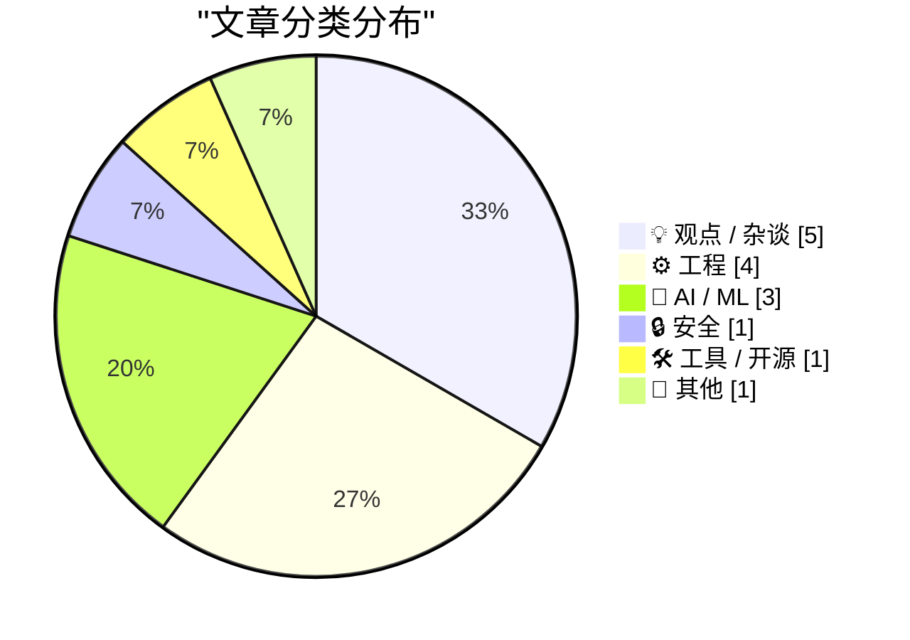
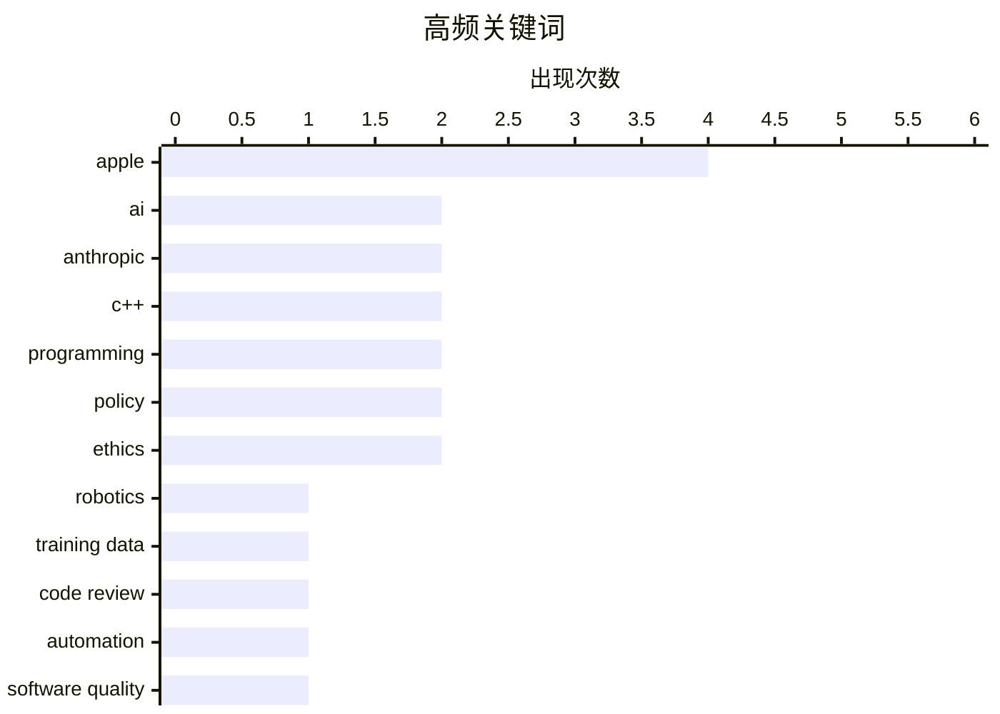

# 📰 Oct 17, 2026

> 来自 Karpathy 推荐的 92 个顶级技术博客，AI 精选 Top 15

## 📝 今日看点

今日技术圈见证了 AI 商业化的全面提速，Anthropic 营收的爆发式增长与“中等成功”软件的繁荣，标志着 AI 正在从技术愿景转化为巨大的市场动能。在工程实践层面，从机器人训练的数据荒挑战到代码审查流程的自动化重构，开发者正通过范式创新突破效率瓶颈。与此同时，针对 AI 滥用与平台垄断的监管博弈也进入深水区，苹果等巨头正通过收紧审核指南，在技术爆发期重塑数字主权与安全边界。

---

## 🏆 今日必读

🥇 **如何训练你的机器人**

[How to Train Your Robot](https://www.construction-physics.com/p/how-to-train-your-robot) — construction-physics.com · 1 天前 · 🤖 AI / ML

> 机器人领域正面临 AI 发展的“数据荒”挑战，缺乏像互联网文本那样海量的训练数据。目前主流方案包括通过人类遥操作采集真实数据，以及利用物理引擎进行大规模仿真训练（Sim2Real）。此外，研究者正尝试利用海量互联网视频进行自监督学习，以提取物理世界的先验知识。虽然仿真技术在不断进步，但解决“现实差距”（Sim-to-Real gap）仍是实现通用机器人的核心瓶颈。 scaling 机器人数据规模被认为是通往具身智能的必经之路。

💡 **为什么值得读**: 深入探讨了机器人领域如何突破数据瓶颈，是理解具身智能（Embodied AI）发展现状与挑战的深度好文。

🏷️ AI, robotics, training data

🥈 **Anthropic 如何重塑代码审查流程**

[Quoting Addy Osmani, Morgan Westlee Lunt, and Qing Wang](https://simonwillison.net/2026/Oct/16/code-review/) — simonwillison.net · 12 小时前 · ⚙️ 工程

> Anthropic 重新定义了代码审查流程，将其从 PR 阶段的“最后关卡”转变为贯穿开发全过程的持续检查。核心理念在于不再盲目追求“人工阅读率”，而是识别变更中潜在的风险点，并匹配最合适的自动化或人工检查手段。这种模式类似于实时拼写检查，在编写代码时即提供反馈，显著缩短了反馈循环。通过将常规检查自动化，团队能够将人类专家的精力集中在架构设计和复杂逻辑等高风险领域。

💡 **为什么值得读**: 揭示了顶尖 AI 公司如何利用自动化工具重塑传统软件工程流程，为提升研发效能提供了新思路。

🏷️ code review, Anthropic, automation, software quality

🥉 **AI 正在驱动“中等成功”软件项目的繁荣**

[AI is driving a boom in modestly successful software projects](https://seangoedecke.com/ai-is-driving-a-boom-in-modestly-successful-software/) — seangoedecke.com · 1 天前 · 💡 观点 / 杂谈

> 尽管 AI 编程助手大幅降低了软件开发门槛，但市场并未出现预期的“杀手级”应用大爆发。作者指出，AI 真正驱动的是大量“中等成功”软件的涌现，这些项目解决了特定小众需求，但在商业规模上难以触及独角兽级别。软件开发的瓶颈已从“编写代码”转移到了“发现需求”和“市场分发”。这种现象表明，AI 正在让软件行业变得更加长尾化，而非仅仅催生新的行业巨头。

💡 **为什么值得读**: 辩证地分析了 AI 对软件创业生态的真实影响，解释了为什么编程效率提升并未直接导致爆款应用激增。

🏷️ AI agents, software development, productivity, SaaS

---

## 📊 数据概览

| 扫描源 | 抓取文章 | 时间范围 | 精选 |
|:---:|:---:|:---:|:---:|
| 81/92 | 2481 篇 → 27 篇 | 48h | **15 篇** |

### 分类分布



### 高频关键词



<details>
<summary>📈 纯文本关键词图（终端友好）</summary>

```
apple         │ ████████████████████ 4
ai            │ ██████████░░░░░░░░░░ 2
anthropic     │ ██████████░░░░░░░░░░ 2
c++           │ ██████████░░░░░░░░░░ 2
programming   │ ██████████░░░░░░░░░░ 2
policy        │ ██████████░░░░░░░░░░ 2
ethics        │ ██████████░░░░░░░░░░ 2
robotics      │ █████░░░░░░░░░░░░░░░ 1
training data │ █████░░░░░░░░░░░░░░░ 1
code review   │ █████░░░░░░░░░░░░░░░ 1
```

</details>

### 🏷️ 话题标签

**apple**(4) · **ai**(2) · **anthropic**(2) · c++(2) · programming(2) · policy(2) · ethics(2) · robotics(1) · training data(1) · code review(1) · automation(1) · software quality(1) · ai agents(1) · software development(1) · productivity(1) · saas(1) · meta(1) · open weights(1) · mac studio(1) · concurrency(1)

---

## 💡 观点 / 杂谈

### 1. AI 正在驱动“中等成功”软件项目的繁荣

[AI is driving a boom in modestly successful software projects](https://seangoedecke.com/ai-is-driving-a-boom-in-modestly-successful-software/) — **seangoedecke.com** · 1 天前 · ⭐ 25/30

> 尽管 AI 编程助手大幅降低了软件开发门槛，但市场并未出现预期的“杀手级”应用大爆发。作者指出，AI 真正驱动的是大量“中等成功”软件的涌现，这些项目解决了特定小众需求，但在商业规模上难以触及独角兽级别。软件开发的瓶颈已从“编写代码”转移到了“发现需求”和“市场分发”。这种现象表明，AI 正在让软件行业变得更加长尾化，而非仅仅催生新的行业巨头。

🏷️ AI agents, software development, productivity, SaaS

---

### 2. 数字主权 vs AI：关于“承重”技术的思考

[Pluralistic: Load-bearing (16 Oct 2026)](https://pluralistic.net/2026/10/15/sovereign-it/) — **pluralistic.net** · 1 天前 · ⭐ 23/30

> Cory Doctorow 在本文中探讨了数字主权与 AI 发展之间的冲突，批评了科技巨头利用 AI 进一步巩固垄断地位的行为。文章分析了“承重”技术（Load-bearing technology）如何被企业用来剥夺用户的控制权，并呼吁建立更具主权性的 IT 基础设施。作者通过多个案例展示了当关键技术被少数公司掌控时，社会面临的系统性风险。此外，文中还涉及了版权保护、数据隐私以及开源生态在对抗技术霸权中的作用。

🏷️ AI, digital sovereignty, policy, ethics

---

### 3. Expedia 的“亚马逊化”：酒店预订平台的腐烂

[Pluralistic: Expedia amazoned hotel rooms (15 Oct 2026)](https://pluralistic.net/2026/10/15/enshittipedia/) — **pluralistic.net** · 1 天前 · ⭐ 22/30

> 本文揭示了旅游预订平台 Expedia 如何通过垄断手段推高酒店价格，并将其描述为平台“腐烂化”（Enshittification）的典型案例。作者指出，这些中介平台利用算法和市场支配地位，在增加消费者负担的同时也压榨了酒店利润。文章将这种模式与亚马逊的商业策略进行类比，分析了互联网平台从服务用户到剥削用户的演变过程。这种垄断行为不仅破坏了市场竞争，也导致了整体服务质量的下降。

🏷️ monopoly, platform, economics, Expedia

---

### 4. 风险投资正在自我毁灭

[Premium: Venture Capital Is Killing Itself](https://www.wheresyoured.at/premium-venture-capital-is-killing-itself/) — **wheresyoured.at** · 18 小时前 · ⭐ 22/30

> 风险投资行业正面临严重的结构性危机，过去十四年间的监管失误让科技公司与风投机构合谋，通过信息差合法“收割”散户投资者。文章指出，这种模式通过虚假抬高科技公司 IPO 估值，将风险转嫁给公众，同时剥夺了市场获取真实财务信息的权利。风投机构不再追求长期的技术创新，而是转向了追求短期套现的“庞氏”逻辑。这种短视行为不仅破坏了资本市场的诚信，也正在从内部瓦解风投行业赖以生存的根基。

🏷️ venture capital, tech economy, investment

---

### 5. 秘密文件揭示特朗普白宫宴会厅 3.3 亿美元捐赠者：苹果与英伟达各出资 2500 万美元位居榜首

[Secret Documents Reveal Donors Behind $330 Million for Trump’s Ballroom — Apple and Nvidia Top the List at $25 Million Each](https://www.washingtonpost.com/investigations/2026/10/15/secret-documents-reveal-donors-behind-330-million-trumps-ballroom/) — **daringfireball.net** · 1 天前 · ⭐ 21/30

> 一份被披露的秘密文件揭示了特朗普白宫宴会厅项目背后的巨额捐赠者名单，总金额高达 3.3 亿美元。科技巨头苹果（Apple）和英伟达（Nvidia）各承诺捐赠 2500 万美元，成为该项目的最大出资方。调查发现，许多捐赠者曾从政府的监管决策、政府采购合同甚至特赦令中直接获益。这起事件引发了公众对科技巨头通过政治捐赠换取政策优待的深度质疑。

🏷️ Apple, Nvidia, politics, ethics

---

## ⚙️ 工程

### 6. Anthropic 如何重塑代码审查流程

[Quoting Addy Osmani, Morgan Westlee Lunt, and Qing Wang](https://simonwillison.net/2026/Oct/16/code-review/) — **simonwillison.net** · 12 小时前 · ⭐ 25/30

> Anthropic 重新定义了代码审查流程，将其从 PR 阶段的“最后关卡”转变为贯穿开发全过程的持续检查。核心理念在于不再盲目追求“人工阅读率”，而是识别变更中潜在的风险点，并匹配最合适的自动化或人工检查手段。这种模式类似于实时拼写检查，在编写代码时即提供反馈，显著缩短了反馈循环。通过将常规检查自动化，团队能够将人类专家的精力集中在架构设计和复杂逻辑等高风险领域。

🏷️ code review, Anthropic, automation, software quality

---

### 7. C++ Future 系列（五）：std::future 与 std::shared_future

[C++ futures part 5: std::future and std::shared_future](https://devblogs.microsoft.com/oldnewthing/20261016-00/?p=112778/) — **devblogs.microsoft.com/oldnewthing** · 20 小时前 · ⭐ 24/30

> 本文深入探讨了 C++ 中 std::future 与 std::shared_future 的区别与应用场景。std::future 采用独占所有权模式，仅允许一个消费者通过 get() 获取结果，且该操作具有移动语义。相比之下，std::shared_future 支持多个消费者同时等待并获取同一异步操作的结果，适用于广播通知等场景。文章详细解释了如何从 std::future 构造 shared_future 以及相关的内存管理和线程安全细节。

🏷️ C++, concurrency, std::future, programming

---

### 8. C++ Future 系列（四）：如何实现立即在当前线程执行的 std::async？

[C++ futures part 4: What if I want an immediate on-thread std::async?](https://devblogs.microsoft.com/oldnewthing/20261015-00/?p=112776/) — **devblogs.microsoft.com/oldnewthing** · 1 天前 · ⭐ 24/30

> 针对 C++ 标准库中 std::async 缺乏“立即在当前线程执行”策略的问题，本文探讨了实现该行为的技术方案。标准的 std::launch::deferred 仅在调用 get() 时才执行，而 std::launch::async 则强制开启新线程。作者分析了为什么在某些场景下需要同步执行异步接口，并提供了模拟这种行为的代码模式。这对于需要统一异步接口但又想避免线程切换开销的开发者具有极高的参考价值。

🏷️ C++, async, std::async, programming

---

### 9. NetNewsWire 如何实现对 iPhone Duo 的支持

[How They Got Duo Support in NetNewsWire](https://netnewswire.blog/2026/10/16/how-we-got-duo-support.html) — **daringfireball.net** · 13 小时前 · ⭐ 21/30

> 知名 RSS 阅读器 NetNewsWire 在最新版本中实现了对 iPhone Duo 这一拥有侧边工具栏的新型设备的适配。令人惊讶的是，开发团队并未编写任何特定适配代码，仅通过 Xcode 27.1 和标准 iOS SDK 进行编译即告完成。成功的关键在于应用长期坚持使用标准控件（如导航控制器、拆分视图）并严格遵循 Size Classes 和 Auto Layout 规范。这一案例证明了遵循平台原生开发标准在面对硬件形态剧变时的巨大前瞻性优势。

🏷️ iOS, Xcode, SDK, NetNewsWire

---

## 🤖 AI / ML

### 10. 如何训练你的机器人

[How to Train Your Robot](https://www.construction-physics.com/p/how-to-train-your-robot) — **construction-physics.com** · 1 天前 · ⭐ 26/30

> 机器人领域正面临 AI 发展的“数据荒”挑战，缺乏像互联网文本那样海量的训练数据。目前主流方案包括通过人类遥操作采集真实数据，以及利用物理引擎进行大规模仿真训练（Sim2Real）。此外，研究者正尝试利用海量互联网视频进行自监督学习，以提取物理世界的先验知识。虽然仿真技术在不断进步，但解决“现实差距”（Sim-to-Real gap）仍是实现通用机器人的核心瓶颈。 scaling 机器人数据规模被认为是通往具身智能的必经之路。

🏷️ AI, robotics, training data

---

### 11. 非常时期，非同寻常的盟友

[Strange Times Make for Strange Bedfellows](https://x.com/finkd/status/2110778025629347999) — **daringfireball.net** · 10 小时前 · ⭐ 25/30

> Meta 宣布开源 Muse Spark Open 模型权重，并特别强调该模型在苹果 Mac Studio 上的卓越运行表现。苹果硬件工程副总裁 John Ternus 对此回应，称赞该模型在桌面端实现了极高的运行效率，展示了 Mac Studio 在端侧 AI 领域的性能边界。此次互动标志着 Meta 与苹果在 AI 生态上的罕见合作，尤其是在 M5 Ultra 芯片即将发布之际。512GB 统一内存的配置使得在个人电脑上运行超大规模模型成为可能。

🏷️ Meta, Apple, open weights, Mac Studio

---

### 12. Anthropic 告知投资者 IPO 前季度收入增长近 50% 至 168 亿美元

[Anthropic tells investors quarterly revenue up nearly 50% to $16.8bn ahead of IPO](https://simonwillison.net/2026/Oct/15/anthropic-tells-investors/) — **simonwillison.net** · 1 天前 · ⭐ 23/30

> Anthropic 在 IPO 前夕向投资者披露，其季度收入已飙升至 168 亿美元，环比增长近 50%。这一财务数据反映了企业级 AI 市场的强劲需求以及 Claude 系列模型的商业化成功。尽管面临 OpenAI 等对手的激烈竞争，Anthropic 凭借其在模型安全性和长文本处理上的优势，实现了极高的营收增速。文章还透露了公司正在进行的融资细节以及对未来算力投入的宏大规划。

🏷️ Anthropic, revenue, IPO, AI business

---

## 🔒 安全

### 13. 苹果：加强 App Store 指南以打击非自愿亲密图像和欺诈应用

[Apple: ‘Strengthening App Review Guidelines Against Nonconsensual Intimate Imagery and Bait-And-Switch Apps’](https://developer.apple.com/news/?id=vvzx6cul) — **daringfireball.net** · 9 小时前 · ⭐ 23/30

> 苹果更新了 App Store 审核指南，重点打击非自愿性亲密图像（NCII）生成应用及“挂羊头卖肉”的欺诈应用。新规明确禁止利用 AI 技术生成他人裸照的“脱衣”类应用，并要求包含用户生成内容的 App 必须具备严格的过滤和举报机制。此外，针对通过虚假宣传诱导下载、随后更改功能的应用，苹果将采取更严厉的下架措施。此举旨在应对生成式 AI 普及带来的伦理风险和应用商店安全挑战。

🏷️ Apple, App Store, privacy, policy

---

## 🛠 工具 / 开源

### 14. Chirp Pong：基于音频通信的双人网页版乒乓球游戏

[Chirp Pong](https://simonwillison.net/2026/Oct/15/chirp-pong/) — **simonwillison.net** · 1 天前 · ⭐ 20/30

> 开发者 Simon Willison 实验性地构建了一款名为 Chirp Pong 的双人对战游戏，其独特之处在于完全不依赖传统的网络连接。该游戏运行在静态 HTML 页面上，通过手机麦克风和扬声器发送“啁啾”声（Chirps）来同步游戏状态。这种基于音频的近场通信方案允许两台近距离的手机在无需配对的情况下实现实时交互。该实验验证了在特定场景下，利用物理声波替代 Wi-Fi 或蓝牙进行低数据量同步的可行性。

🏷️ Web Audio, networking, HTML5, experiment

---

## 📝 其他

### 15. iPhone Duo 预售开启：三小时内售罄，发货日期已排至明年一月底

[iPhone Duo Pre-Orders Launched, and Three Hours Later It’s Sold Out Through the End of January](https://www.macrumors.com/2026/10/16/iphone-duo-sold-out-for-christmas/) — **daringfireball.net** · 19 小时前 · ⭐ 20/30

> 苹果新款设备 iPhone Duo 在开启预售仅三小时后便宣告售罄，美国官网显示所有配置的预计发货时间已推迟至 2026 年 1 月 25 日。这意味着想要在圣诞节前拿到新机的消费者可能面临落空，除非能在 10 月 23 日首发当天从线下零售店抢购到少量库存。目前尚不确定这种缺货是由于市场需求远超预期，还是苹果初期产能受限所致。这一销售盛况再次证明了苹果新型号硬件在市场上的极强号召力。

🏷️ Apple, iPhone, hardware, supply chain

---

*生成于 2026-10-17 10:28 | 扫描 81 源 → 获取 2481 篇 → 精选 15 篇*
*基于 [Hacker News Popularity Contest 2025](https://refactoringenglish.com/tools/hn-popularity/) RSS 源列表，由 [Andrej Karpathy](https://x.com/karpathy) 推荐*
