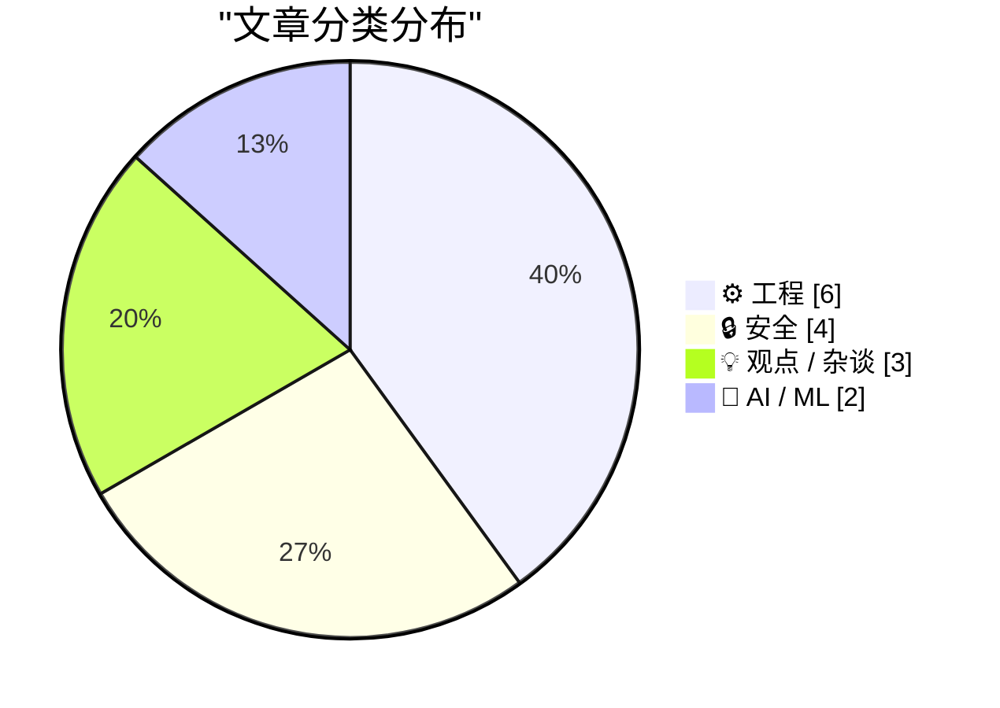
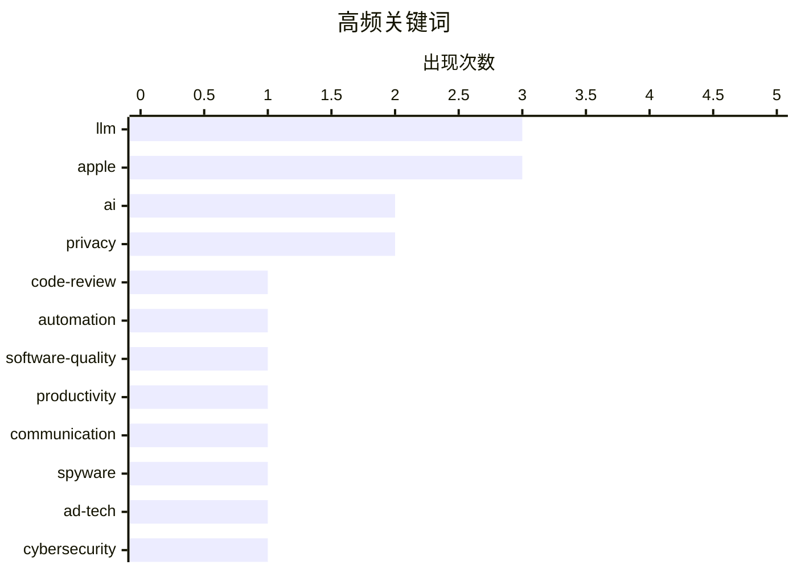

# 📰 Oct 18, 2026

> 来自 Karpathy 推荐的 92 个顶级技术博客，AI 精选 Top 15

## 📝 今日看点

AI 浪潮正从技术爆发期转向深度治理与价值重构，大模型不仅颠覆了传统文档的“工作量证明”属性，也促使头部企业开始重塑研发流程与代码审查范式。与此同时，安全博弈进入白热化阶段，从广告系统沦为间谍软件载体到苹果严打 AI 欺诈应用，监管与反制正成为行业发展的底色。尽管 AI 泡沫风险与巨头间的机密诉讼阴云未散，但 Meta 与苹果在端侧 AI 的协同合作，预示着硬件生态正成为大模型落地的关键战场。

---

## 🏆 今日必读

🥇 **Anthropic 如何重塑代码审查流程**

[Quoting Addy Osmani, Morgan Westlee Lunt, and Qing Wang](https://simonwillison.net/2026/Oct/16/code-review/) — simonwillison.net · 1 天前 · ⚙️ 工程

> Anthropic 重新定义了代码审查的目标，不再将“人类是否读过代码”作为安全性的唯一指标，而是聚焦于识别潜在风险并选择最合适的检查手段。他们将审查环节从 PR 阶段的“终点闸口”提前到了编写过程中的“持续监控”，类似于拼写检查。通过自动化工具处理琐碎逻辑，人类开发者得以专注于高层级的架构设计和复杂安全隐患。这种转变显著缩短了反馈周期，提高了工程效率。这种“持续审查”模式正在改变 AI 时代下的软件开发范式。

💡 **为什么值得读**: 揭示了顶尖 AI 公司如何利用自动化工具将代码审查从低效的人工卡点转变为高效的持续反馈系统。

🏷️ code-review, automation, AI, software-quality

🥈 **写作不再是“工作量证明”**

[Writing is no longer proof of work](https://seangoedecke.com/writing-is-no-longer-proof-of-work/) — seangoedecke.com · 10 小时前 · 💡 观点 / 杂谈

> 科技公司长期依赖文档作为员工投入精力或遵循流程的“工作量证明（PoW）”，类似于比特币的哈希算法。然而，大语言模型（LLM）的普及使得高质量文本的生成成本几乎降为零，彻底破坏了这种信任机制。当写作不再能证明作者付出了思考或努力时，企业内部的合规性证明和沟通效率将面临结构性挑战。作者指出，我们需要寻找新的方式来验证真实的工作投入。这种变革将迫使职场评价体系从“看产出文档”转向“看实际影响”。

💡 **为什么值得读**: 深刻探讨了 AI 时代下职场文档价值的崩塌，以及管理者如何应对“AI 生成垃圾信息”带来的信任危机。

🏷️ LLM, productivity, communication, AI

🥉 **以色列广告技术公司沦为“雇佣兵间谍软件”的分发系统**

[Pluralistic: Israeli ad-tech company was a delivery system for "mercenary spyware" (17 Oct 2026)](https://pluralistic.net/2026/10/17/mercenary-spyware/) — pluralistic.net · 1 天前 · 🔒 安全

> 一家以色列广告技术公司被揭露利用 Google、Facebook 等主流广告平台分发“雇佣兵间谍软件”。该系统通过精准投放广告，将恶意载荷植入目标设备，实现了极高隐蔽性的监控攻击。这种利用合法广告生态系统进行网络间谍活动的手段，暴露了大型科技平台在广告审核和供应链安全上的巨大漏洞。文章还探讨了此类技术对隐私和全球安全的深远威胁。这表明广告追踪技术已成为国家级监控的现成基础设施。

💡 **为什么值得读**: 揭露了广告技术与网络监控合流的阴暗面，是理解现代网络安全威胁和广告平台漏洞的必读案例。

🏷️ Spyware, Ad-tech, Privacy, Cybersecurity

---

## 📊 数据概览

| 扫描源 | 抓取文章 | 时间范围 | 精选 |
|:---:|:---:|:---:|:---:|
| 83/92 | 2537 篇 → 29 篇 | 48h | **15 篇** |

### 分类分布



### 高频关键词



<details>
<summary>📈 纯文本关键词图（终端友好）</summary>

```
llm              │ ████████████████████ 3
apple            │ ████████████████████ 3
ai               │ █████████████░░░░░░░ 2
privacy          │ █████████████░░░░░░░ 2
code-review      │ ███████░░░░░░░░░░░░░ 1
automation       │ ███████░░░░░░░░░░░░░ 1
software-quality │ ███████░░░░░░░░░░░░░ 1
productivity     │ ███████░░░░░░░░░░░░░ 1
communication    │ ███████░░░░░░░░░░░░░ 1
spyware          │ ███████░░░░░░░░░░░░░ 1
```

</details>

### 🏷️ 话题标签

**llm**(3) · **apple**(3) · **ai**(2) · privacy(2) · code-review(1) · automation(1) · software-quality(1) · productivity(1) · communication(1) · spyware(1) · ad-tech(1) · cybersecurity(1) · ai boom(1) · market analysis(1) · future of tech(1) · app-store(1) · deepfake(1) · policy(1) · cryptography(1) · nist(1)

---

## ⚙️ 工程

### 1. Anthropic 如何重塑代码审查流程

[Quoting Addy Osmani, Morgan Westlee Lunt, and Qing Wang](https://simonwillison.net/2026/Oct/16/code-review/) — **simonwillison.net** · 1 天前 · ⭐ 26/30

> Anthropic 重新定义了代码审查的目标，不再将“人类是否读过代码”作为安全性的唯一指标，而是聚焦于识别潜在风险并选择最合适的检查手段。他们将审查环节从 PR 阶段的“终点闸口”提前到了编写过程中的“持续监控”，类似于拼写检查。通过自动化工具处理琐碎逻辑，人类开发者得以专注于高层级的架构设计和复杂安全隐患。这种转变显著缩短了反馈周期，提高了工程效率。这种“持续审查”模式正在改变 AI 时代下的软件开发范式。

🏷️ code-review, automation, AI, software-quality

---

### 2. C++ Future 系列（五）：std::future 与 std::shared_future

[C++ futures part 5: std::future and std::shared_future](https://devblogs.microsoft.com/oldnewthing/20261016-00/?p=112778/) — **devblogs.microsoft.com/oldnewthing** · 1 天前 · ⭐ 23/30

> 本文深入探讨了 C++ 异步编程中获取结果的核心组件 `std::future` 和 `std::shared_future`。`std::future` 采用移动语义，仅允许单个消费者获取异步操作的结果；而 `std::shared_future` 则支持多个消费者共享同一个结果。文章详细解释了两者在所有权管理、异常处理以及线程安全方面的差异。通过具体的代码示例，展示了如何在复杂的并发场景中正确选择和使用这两种类型。这是理解 C++ 标准库异步模型的重要进阶内容。

🏷️ C++, Concurrency, std::future, Programming

---

### 3. 包管理周报：2026年10月17日

[This Week in Package Management: 17 October 2026](https://nesbitt.io/2026/10/17/this-week-in-package-management.html) — **nesbitt.io** · 1 天前 · ⭐ 22/30

> 汇总了 2026 年 10 月中旬全球包管理生态系统的最新动态，涵盖了各大主流包管理器的版本发布、安全公告及深度文章。重点关注了 npm、PyPI 和 Cargo 等工具在供应链安全方面的最新补丁与漏洞预警。文章梳理了开发者在跨平台依赖管理中遇到的常见挑战，并提供了优化构建流程的实践建议。通过这份周报，开发者可以快速掌握软件供应链的合规性与安全性趋势。

🏷️ package management, devops, software supply chain

---

### 4. NetNewsWire 是如何实现 iPhone Duo 支持的

[How They Got Duo Support in NetNewsWire](https://netnewswire.blog/2026/10/16/how-we-got-duo-support.html) — **daringfireball.net** · 1 天前 · ⭐ 20/30

> 揭秘了知名 RSS 阅读器 NetNewsWire 适配新款 iPhone Duo 侧边工具栏与特殊交互背后的技术细节。开发团队并未编写任何特定适配代码，仅通过 Xcode 27.1 和默认 iOS SDK 重新构建即实现了完美兼容。成功的关键在于应用长期坚持使用系统标准控件（如导航控制器、拆分视图）并严格遵循 Size Classes 布局规范。这一案例证明了遵循 Apple 官方设计指南在应对未来硬件形态变化时的巨大优势。

🏷️ iOS, Xcode, SDK, Mobile

---

### 5. 关于复数单位根的笔记

[Notes on the complex roots of unity](https://eli.thegreenplace.net/2026/notes-on-the-complex-roots-of-unity/) — **eli.thegreenplace.net** · 9 小时前 · ⭐ 20/30

> 深入浅出地探讨了数学中看似简单却内涵丰富的“单位根”（即方程 z^n = 1 的解）及其在复平面上的性质。文章从实数范围内的基础概念出发，逐步过渡到复数域中单位根的几何分布与代数特征。通过可视化手段展示了单位根如何构成正多边形的顶点，并解释了其在信号处理和快速傅里叶变换（FFT）中的核心作用。这是一篇将抽象代数与几何直观相结合的数学科普佳作。

🏷️ mathematics, complex numbers, algorithms

---

### 6. 使用 document.currentScript 实现内联渲染

[Inline rendering with document​.currentScript](https://simonwillison.net/2026/Oct/17/document-currentscript/) — **simonwillison.net** · 13 小时前 · ⭐ 19/30

> 介绍了一种利用原生 JavaScript 属性 document.currentScript 实现页面元素动态替换的巧妙技巧。通过在 HTML 中嵌入微小的 <script> 标签，开发者可以在脚本执行时精准定位当前标签位置并将其替换为动态生成的内容。这种方法避免了复杂的 DOM 查询或 ID 绑定，特别适用于需要在特定位置插入动态数据的轻量级场景。文章还展示了如何利用该特性简化组件化开发中的内联渲染逻辑。

🏷️ JavaScript, DOM, web-development

---

## 🔒 安全

### 7. 以色列广告技术公司沦为“雇佣兵间谍软件”的分发系统

[Pluralistic: Israeli ad-tech company was a delivery system for "mercenary spyware" (17 Oct 2026)](https://pluralistic.net/2026/10/17/mercenary-spyware/) — **pluralistic.net** · 1 天前 · ⭐ 26/30

> 一家以色列广告技术公司被揭露利用 Google、Facebook 等主流广告平台分发“雇佣兵间谍软件”。该系统通过精准投放广告，将恶意载荷植入目标设备，实现了极高隐蔽性的监控攻击。这种利用合法广告生态系统进行网络间谍活动的手段，暴露了大型科技平台在广告审核和供应链安全上的巨大漏洞。文章还探讨了此类技术对隐私和全球安全的深远威胁。这表明广告追踪技术已成为国家级监控的现成基础设施。

🏷️ Spyware, Ad-tech, Privacy, Cybersecurity

---

### 8. 苹果加强审核指南：严厉打击非自愿亲密图像及欺诈应用

[Apple: ‘Strengthening App Review Guidelines Against Nonconsensual Intimate Imagery and Bait-And-Switch Apps’](https://developer.apple.com/news/?id=vvzx6cul) — **daringfireball.net** · 1 天前 · ⭐ 24/30

> 苹果更新了 App Store 审核指南，明确禁止生成非自愿裸体或性显性图像的“脱衣（nudification）”类 AI 应用。新规要求托管用户生成内容的 App 必须具备内容过滤、用户举报和屏蔽功能。此外，苹果还加强了对“挂羊头卖狗肉”式欺诈应用的打击力度，防止应用在审核通过后通过远程开关更改功能。这些举措旨在利用平台权力遏制 AI 技术被滥用于制造深度伪造（Deepfake）色情内容。苹果强调，开发者必须对应用产生的 AI 内容负起安全责任。

🏷️ App-Store, privacy, deepfake, policy

---

### 9. NIST 加密曲线洗清“后门”嫌疑

[Cloud of suspicion lifted from NIST curves](https://www.johndcook.com/blog/2026/10/17/nist-curves-exonorated/) — **johndcook.com** · 19 小时前 · ⭐ 24/30

> 长期以来，密码学界一直怀疑 NSA 在 2000 年发布的 NIST 椭圆曲线中植入了后门，尤其是此前 Dual_EC_DRBG 随机数生成器确实存在后门。然而，Anthropic 的研究人员最近发布了新证据，证明了这些曲线种子的生成逻辑，从而洗清了这一长达 20 多年的嫌疑。这一发现为全球广泛使用的加密标准提供了重要的信任背书。研究表明，这些曲线在设计上是安全的，并非情报机构的监控工具。这一进展消除了全球加密基础设施上的一个重大阴影。

🏷️ Cryptography, NIST, ECC, NSA

---

### 10. OpenAI 起诉苹果：前员工涉嫌窃取未发布产品机密

[Whatever You Say Bounces Off Me and Sticks to You](https://www.reuters.com/business/retail-consumer/openai-employee-who-left-apple-took-files-about-unreleased-device-openai-alleges-2026-10-14/) — **daringfireball.net** · 9 小时前 · ⭐ 22/30

> OpenAI 在针对苹果的诉讼中指控，一名跳槽至苹果的前员工窃取了超过 100 份关于未发布产品的机密文件。该员工被指在入职苹果后，向其高层展示了基于这些机密文件的演示文稿。OpenAI 认为苹果正利用这些非法获取的信息进行竞争，并已向加州联邦法院提起诉讼。此案揭示了顶尖 AI 公司之间激烈的人才争夺战以及随之而来的知识产权保护风险。目前苹果尚未对这些具体的指控做出正式回应。

🏷️ OpenAI, Apple, IP-theft, corporate-security

---

## 💡 观点 / 杂谈

### 11. 写作不再是“工作量证明”

[Writing is no longer proof of work](https://seangoedecke.com/writing-is-no-longer-proof-of-work/) — **seangoedecke.com** · 10 小时前 · ⭐ 26/30

> 科技公司长期依赖文档作为员工投入精力或遵循流程的“工作量证明（PoW）”，类似于比特币的哈希算法。然而，大语言模型（LLM）的普及使得高质量文本的生成成本几乎降为零，彻底破坏了这种信任机制。当写作不再能证明作者付出了思考或努力时，企业内部的合规性证明和沟通效率将面临结构性挑战。作者指出，我们需要寻找新的方式来验证真实的工作投入。这种变革将迫使职场评价体系从“看产出文档”转向“看实际影响”。

🏷️ LLM, productivity, communication, AI

---

### 12. 风险投资正在“自杀”

[Premium: Venture Capital Is Killing Itself](https://www.wheresyoured.at/premium-venture-capital-is-killing-itself/) — **wheresyoured.at** · 1 天前 · ⭐ 24/30

> 风险投资行业正陷入一场由自身造成的危机，文章批评风投机构与科技公司合谋通过法律漏洞误导散户投资者。过去十四年里的监管失误，使得风投能够人为推高科技公司在 IPO 时的估值，剥夺了公众获取真实财务信息的权利。这种模式导致了大量独角兽公司在上市后表现低迷，严重损害了资本市场的长期健康。作者认为，这种短视的逐利行为最终将摧毁风投行业自身的信誉。VC 模式正从“支持创新”转向“合法的金融收割”。

🏷️ venture capital, tech economy, finance

---

### 13. 关于 HomeView 的思考与观察

[★ HomeView Thoughts and Observations](https://daringfireball.net/2026/10/homeview_thoughts_and_observations) — **daringfireball.net** · 17 小时前 · ⭐ 21/30

> 深入探讨了苹果新推出的 HomeView 智能家居显示设备的市场定位与实际需求问题。作者指出苹果的官方宣传视频未能有效回答“为什么我们需要这个设备”的核心疑问，质疑其在已有 iPhone 和 HomePod 生态下的存在价值。文章分析了该设备在交互逻辑上的冗余感，认为用户在大多数场景下仍会倾向于使用手机或语音控制。对于追求极简智能家居体验的用户，这款带屏设备可能并非最优解。

🏷️ Apple, HomeView, UX, product-design

---

## 🤖 AI / ML

### 14. AI 热潮可能终结的五种场景

[How the AI boom might really end: 5 scenarios](https://martinalderson.com/posts/how-the-ai-boom-might-really-end/?utm_source=rss&amp;utm_medium=rss&amp;utm_campaign=feed) — **martinalderson.com** · 10 小时前 · ⭐ 26/30

> 随着芯片股遭遇 2008 年以来最长连跌，AI 行业的泡沫风险引发关注。文章提出了 AI 热潮终结的五种潜在路径，包括算力成本过高、监管收紧以及应用层变现困难等。作者认为 AI 的技术价值确实存在，但最终产生的经济收益可能不会流向目前的投资者，而是被基础设施提供商或开源生态吸收。这种“价值错位”预示着行业可能经历剧烈的重新洗牌。对于正在寻求 IPO 的 Anthropic 等公司，市场环境正变得愈发严峻。

🏷️ AI boom, market analysis, LLM, future of tech

---

### 15. 奇妙的盟友：Meta 与苹果在端侧 AI 上的合作

[Strange Times Make for Strange Bedfellows](https://x.com/finkd/status/2110778025629347999) — **daringfireball.net** · 1 天前 · ⭐ 22/30

> 马克·扎克伯格宣布 Meta 的 Muse Spark Open 模型正式发布，并特别感谢苹果团队使其能在新款 Mac Studio 上高效运行。苹果硬件主管 John Ternus 回应称，Mac Studio 的强大性能正不断突破端侧 AI 的边界。即将发布的 M5 Ultra 芯片版本将配备高达 512GB 的统一内存，为运行超大规模本地模型提供硬件支持。这种罕见的互动标志着两家巨头在推动高性能端侧 AI 生态方面的利益趋同。这预示着未来专业级 AI 工作流将更多地向本地桌面端迁移。

🏷️ Meta, Apple, LLM, Mac Studio

---

*生成于 2026-10-18 10:47 | 扫描 83 源 → 获取 2537 篇 → 精选 15 篇*
*基于 [Hacker News Popularity Contest 2025](https://refactoringenglish.com/tools/hn-popularity/) RSS 源列表，由 [Andrej Karpathy](https://x.com/karpathy) 推荐*
