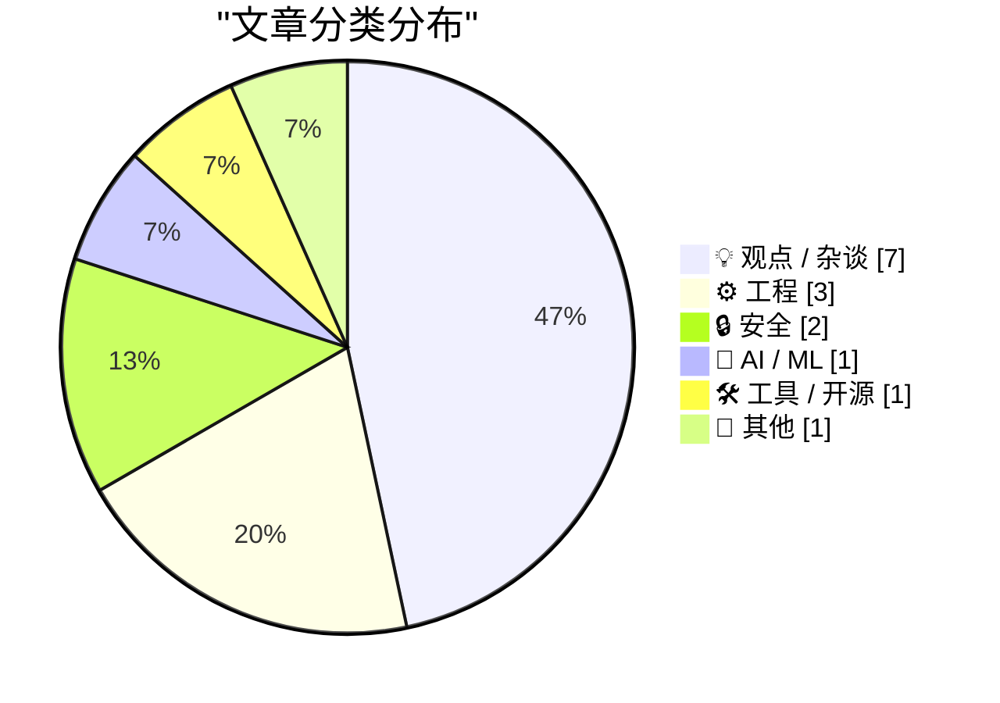
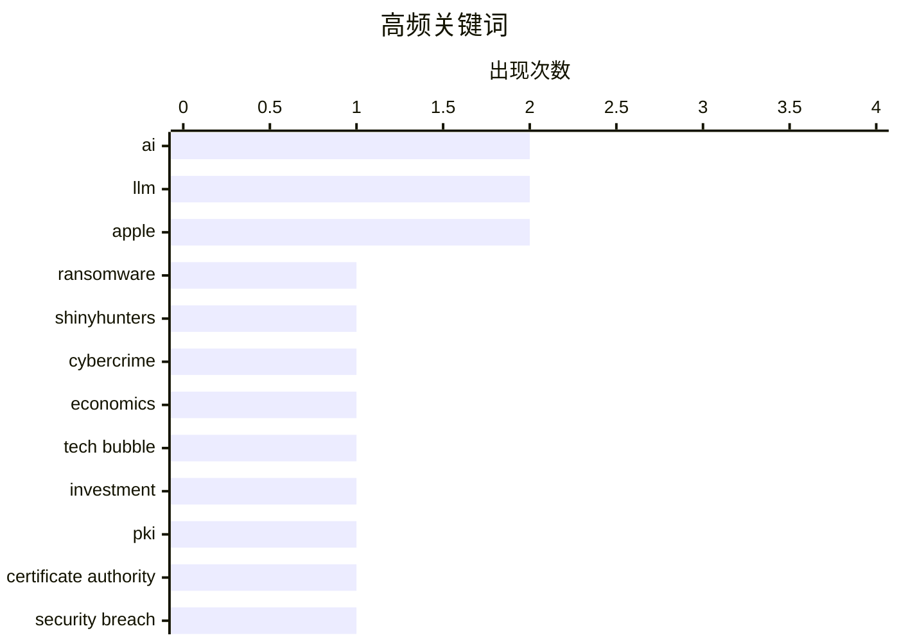

# 📰 Oct 21, 2026

> 来自 Karpathy 推荐的 92 个顶级技术博客，AI 精选 Top 15

## 📝 今日看点

今日技术圈聚焦于 AI 从技术狂热向商业理性的转型，开发者在“氛围编码”兴起的同时，正面临编程职业范式的深刻重塑。安全领域遭遇严峻挑战，CA 证书泄露与勒索软件行业的内部腐败揭示了数字信任体系的脆弱。与此同时，巨头动向依然牵动神经，苹果即将开启的硬件更新与 Google 对出版生态的垄断争议，持续引发行业对技术霸权与数字遗产存续的深度反思。

---

## 🏆 今日必读

🥇 **联邦调查局怀疑勒索软件谈判代表经营 ShinyHunters 勒索网站**

[Feds Suspect Ransom Negotiator Ran ShinyHunters Extortion Site](https://krebsonsecurity.com/2026/10/feds-suspect-ransom-negotiator-ran-shinyhunters-extortion-site/) — krebsonsecurity.com · 1 天前 · 🔒 安全

> 美国联邦调查人员在追踪黑客组织 ShinyHunters 时发现，两家勒索软件谈判公司的执行官与该组织存在异常密切的联系。调查显示，其中一名位于美国的执行官甚至协助 ShinyHunters 运营了一个用于向受害者施压以支付赎金的网站。ShinyHunters 此前曾窃取了包括 FBI 在内的高度敏感数据。这一发现揭露了网络犯罪生态中“谈判者”与“勒索者”之间可能存在的利益勾结。目前相关部门正深入调查这些谈判公司在多大程度上参与了非法活动。

💡 **为什么值得读**: 揭示了网络安全行业中“猫鼠同笼”的惊人内幕，对于理解勒索软件产业链的复杂性具有重要参考价值。

🏷️ Ransomware, ShinyHunters, Cybercrime

🥈 **AI 必须证明其商业价值**

[AI Had Better Work Out](https://www.wheresyoured.at/ai-had-better-work-out/) — wheresyoured.at · 19 小时前 · 💡 观点 / 杂谈

> 本文深入探讨了当前 AI 行业的财务现状及其可持续性问题。作者指出，尽管 AI 技术在过去几年飞速发展，但其高昂的算力成本和研发投入必须转化为实际的盈利能力。文章分析了 AI 公司的融资环境、运营支出以及市场对其长期回报的预期。如果 AI 无法在短期内证明其能够产生足够的现金流，整个行业可能面临严重的估值回调。结论认为，AI 已经进入了必须通过实际业务成果来证明自己的关键阶段。

💡 **为什么值得读**: 从财务视角冷静审视 AI 泡沫，是投资者和从业者评估行业周期不可多得的深度分析。

🏷️ AI, economics, tech bubble, investment

🥉 **eMudhra 中间 CA 证书遭泄露事件**

[eMudhra Intermediate CA Compromise](https://simonwillison.net/2026/Oct/20/emudhra-certificates/) — simonwillison.net · 11 小时前 · 🔒 安全

> eMudhra 的 8 个中间 CA 证书私钥已被确认泄露，这是一个极其严重的安全事件。这些证书链接到被 Mozilla、微软、苹果和 Chrome 等主流根证书计划信任的根证书。这意味着攻击者可以利用这些泄露的私钥伪造受信任的网站证书，从而发起中间人攻击。目前，所有捆绑受信任证书列表的软件和下游信任库都需要紧急更新以撤销这些受损证书。该事件再次引发了对全球公钥基础设施（PKI）安全性的广泛担忧。

💡 **为什么值得读**: 涉及全球互联网信任根基的重大安全漏洞，运维和安全人员必须关注其修复进展。

🏷️ PKI, Certificate Authority, Security Breach

---

## 📊 数据概览

| 扫描源 | 抓取文章 | 时间范围 | 精选 |
|:---:|:---:|:---:|:---:|
| 82/92 | 2527 篇 → 28 篇 | 48h | **15 篇** |

### 分类分布



### 高频关键词



<details>
<summary>📈 纯文本关键词图（终端友好）</summary>

```
ai           │ ████████████████████ 2
llm          │ ████████████████████ 2
apple        │ ████████████████████ 2
ransomware   │ ██████████░░░░░░░░░░ 1
shinyhunters │ ██████████░░░░░░░░░░ 1
cybercrime   │ ██████████░░░░░░░░░░ 1
economics    │ ██████████░░░░░░░░░░ 1
tech bubble  │ ██████████░░░░░░░░░░ 1
investment   │ ██████████░░░░░░░░░░ 1
pki          │ ██████████░░░░░░░░░░ 1
```

</details>

### 🏷️ 话题标签

**ai**(2) · **llm**(2) · **apple**(2) · ransomware(1) · shinyhunters(1) · cybercrime(1) · economics(1) · tech bubble(1) · investment(1) · pki(1) · certificate authority(1) · security breach(1) · google(1) · monopoly(1) · publishing(1) · web-ecosystem(1) · vibe coding(1) · game dev(1) · rts(1) · ai agents(1)

---

## 💡 观点 / 杂谈

### 1. AI 必须证明其商业价值

[AI Had Better Work Out](https://www.wheresyoured.at/ai-had-better-work-out/) — **wheresyoured.at** · 19 小时前 · ⭐ 26/30

> 本文深入探讨了当前 AI 行业的财务现状及其可持续性问题。作者指出，尽管 AI 技术在过去几年飞速发展，但其高昂的算力成本和研发投入必须转化为实际的盈利能力。文章分析了 AI 公司的融资环境、运营支出以及市场对其长期回报的预期。如果 AI 无法在短期内证明其能够产生足够的现金流，整个行业可能面临严重的估值回调。结论认为，AI 已经进入了必须通过实际业务成果来证明自己的关键阶段。

🏷️ AI, economics, tech bubble, investment

---

### 2. Pluralistic：历史上最成功出版商之死

[Pluralistic: The death of history's most successful publisher (20 Oct 2026)](https://pluralistic.net/2026/10/20/main-character-syndrome/) — **pluralistic.net** · 18 小时前 · ⭐ 25/30

> 文章尖锐批评了 Google 患有严重的“主角综合症”，并正在摧毁传统的出版生态。作者认为 Google 通过垄断搜索流量和广告市场，将自己变成了事实上的全球出版商，却不承担内容创作的成本。这种模式导致了大量优质媒体的倒闭，并使得互联网信息流被算法和广告逻辑所主导。文章通过多个案例展示了这种权力失衡对数字历史和文化多样性的破坏。最终呼吁通过反垄断手段和新的分发机制来打破这种中心化的控制。

🏷️ Google, monopoly, publishing, web-ecosystem

---

### 3. 我的编程讣告

[My obituary for programming](https://simonwillison.net/2026/Oct/19/my-obituary-for-programming/) — **simonwillison.net** · 1 天前 · ⭐ 23/30

> 本文探讨了 AI 编程智能体（Coding Agents）对职业程序员职业生涯的深远影响。作者引用 Jeremy Scheff 的观点指出，编程曾是一项通过解决复杂逻辑谜题来获得报酬的理想工作。然而，随着 AI 能够瞬间解决这些“谜题”，程序员的角色正从“解题者”转变为“管理者”或“审核员”。这种转变虽然提高了效率，但也剥夺了编程中最具吸引力的智力挑战乐趣。文章最后感叹，传统意义上以逻辑推演为核心的编程职业正在走向终结。

🏷️ AI Agents, Software Engineering, Career

---

### 4. 死亡与域名：互联网遗产的永久性挑战

[Death & Domains](https://feed.tedium.co/link/15204/17501584/death-domains-commentary) — **tedium.co** · 17 小时前 · ⭐ 22/30

> 文章探讨了当域名所有者去世后，其在线数字遗产如何存续的难题。目前的 DNS 系统高度依赖于所有者的定期续费和维护，一旦所有者不在，相关的数字内容往往会随之消失。作者讨论了“永久域名”的概念，但指出这在现有的中心化管理体制下难以实现。文章提出，我们可能需要一种全新的、去中心化的身份系统，不依赖于传统的域名结构来保证信息的长期存在。这不仅是技术问题，更是关于数字文明如何传承的社会学思考。

🏷️ DNS, digital-legacy, internet-infrastructure

---

### 5. 外行支持技术领域是为了技术，而非艺术

[Laypeople support technical fields for technology, not art](https://seangoedecke.com/laypeople-support-technical-fields-for-technology-not-art/) — **seangoedecke.com** · 1 天前 · ⭐ 21/30

> 针对 LLM 是否应介入编程或数学等领域的争论，许多专家以这些领域具有“艺术性”为由反对自动化。然而，公众对技术领域的支持主要源于其产出的实用价值，而非其创作过程中的美学。如果技术专家无法证明其工作的独特社会效用，仅凭“艺术感”很难说服大众抵制更高效的 AI 工具。文章强调，技术领域必须通过解决实际问题来维持其社会地位，而非退缩到纯粹的智力审美中。

🏷️ LLM, Mathematics, Philosophy

---

### 6. 《时代》周刊专访 John Ternus：苹果的折叠屏时代

[Time Magazine Profiles John Ternus](https://time.com/collection/best-inventions/2026/apple-iphone-duo/) — **daringfireball.net** · 1 天前 · ⭐ 20/30

> 《时代》周刊对苹果公司高管 John Ternus 进行了深度报道，背景设定在备受期待的折叠屏手机 iPhone Duo 发布现场。文章捕捉了 Ternus 在面对全球媒体和网红时的紧张与兴奋，展示了苹果在硬件创新上的新方向。iPhone Duo 的亮相标志着苹果正式进入折叠屏市场，试图通过差异化的工业设计重塑品牌吸引力。这篇人物特写不仅关注产品，更侧重于展示苹果新一代领导层在后库克时代的管理风格与愿景。

🏷️ Apple, leadership, John Ternus

---

### 7. 精益教育者大会：AI 时代的教学变革

[The Lean Educator Conference](https://steveblank.com/2026/10/19/the-lean-educator-conference/) — **steveblank.com** · 1 天前 · ⭐ 20/30

> 硅谷创业教父 Steve Blank 宣布将于 11 月 18-19 日举办精益教育者大会，核心议题为“AI 时代的精益教学”。教学团队发现 AI 对 Deep Tech 等课程产生了意想不到的冲击，传统的精益创业方法论需要重新审视。会议将汇集来自 Hacking for Defense 和 NSF 等机构的教育者，共同探讨如何将 AI 工具整合进创业教育。这标志着精益创业教学法正面临自诞生以来最大的范式转移，必须适应 AI 驱动的快速原型开发环境。

🏷️ AI, Lean Startup, education, entrepreneurship

---

## ⚙️ 工程

### 8. 既然有 int 6，为什么还需要 ud2 指令？

[Why do we need ud2 when int 6 is right there?](https://devblogs.microsoft.com/oldnewthing/20261019-00/?p=112781/) — **devblogs.microsoft.com/oldnewthing** · 1 天前 · ⭐ 23/30

> 本文深入解析了 x86 架构中 `ud2` 指令与 `int 6` 软件中断在底层机制上的本质区别。虽然两者都能触发“无效操作码”异常，但 `ud2` 被设计为显式的未定义指令，用于在代码中标记不可达路径。关键区别在于，`ud2` 产生的是一个“故障（Fault）”，其指令指针指向 `ud2` 本身；而 `int 6` 是一个“陷阱（Trap）”，指令指针指向下一条指令。这种差异在内核调试和异常处理中至关重要。文章通过底层处理逻辑解释了为什么现代编译器更倾向于使用 `ud2`。

🏷️ x86, assembly, CPU, debugging

---

### 9. ClickHouse 会让你在大规模数据下犯错

[ClickHouse Will Let You Be Wrong at Scale](https://matduggan.com/clickhouse-will-let-you-be-wrong-at-scale/) — **matduggan.com** · 21 小时前 · ⭐ 22/30

> ClickHouse 以其卓越的列式存储性能和高压缩率在可观测性领域大放异彩，但其强大的性能也伴随着风险。文章指出，ClickHouse 的灵活性允许用户在配置不当的情况下依然能快速运行，但这可能导致在大规模数据处理时产生错误的统计结果。作者强调，高性能并不等同于高可靠性，错误的查询逻辑在 ClickHouse 中会被“加速”执行。结论认为，在使用此类高性能工具时，必须建立更严格的数据校验和 schema 设计规范。文章提醒开发者，不要被速度蒙蔽了对数据准确性的追求。

🏷️ ClickHouse, database, scalability, observability

---

### 10. 一个琐碎问题背后的深层技术教训

[A frivolous problem with a deeper lesson](https://www.johndcook.com/blog/2026/10/19/regex-backtracking/) — **johndcook.com** · 1 天前 · ⭐ 19/30

> 文章通过一个有趣的挑战引入：如何利用化学元素符号拼写英文单词（如用 S、Ar、Ca、Sm 拼出 sarcasm）。虽然约 14% 的英文单词可以这样组合，但编写高效的检测程序涉及复杂的字符串匹配逻辑。作者指出，简单的正则表达式在处理此类多路径匹配时容易陷入回溯（Backtracking）陷阱，导致性能大幅下降。通过这个看似“无用”的问题，文章深入浅出地讲解了正则引擎的工作原理以及如何避免计算浪费。

🏷️ programming, algorithms, logic

---

## 🔒 安全

### 11. 联邦调查局怀疑勒索软件谈判代表经营 ShinyHunters 勒索网站

[Feds Suspect Ransom Negotiator Ran ShinyHunters Extortion Site](https://krebsonsecurity.com/2026/10/feds-suspect-ransom-negotiator-ran-shinyhunters-extortion-site/) — **krebsonsecurity.com** · 1 天前 · ⭐ 26/30

> 美国联邦调查人员在追踪黑客组织 ShinyHunters 时发现，两家勒索软件谈判公司的执行官与该组织存在异常密切的联系。调查显示，其中一名位于美国的执行官甚至协助 ShinyHunters 运营了一个用于向受害者施压以支付赎金的网站。ShinyHunters 此前曾窃取了包括 FBI 在内的高度敏感数据。这一发现揭露了网络犯罪生态中“谈判者”与“勒索者”之间可能存在的利益勾结。目前相关部门正深入调查这些谈判公司在多大程度上参与了非法活动。

🏷️ Ransomware, ShinyHunters, Cybercrime

---

### 12. eMudhra 中间 CA 证书遭泄露事件

[eMudhra Intermediate CA Compromise](https://simonwillison.net/2026/Oct/20/emudhra-certificates/) — **simonwillison.net** · 11 小时前 · ⭐ 25/30

> eMudhra 的 8 个中间 CA 证书私钥已被确认泄露，这是一个极其严重的安全事件。这些证书链接到被 Mozilla、微软、苹果和 Chrome 等主流根证书计划信任的根证书。这意味着攻击者可以利用这些泄露的私钥伪造受信任的网站证书，从而发起中间人攻击。目前，所有捆绑受信任证书列表的软件和下游信任库都需要紧急更新以撤销这些受损证书。该事件再次引发了对全球公钥基础设施（PKI）安全性的广泛担忧。

🏷️ PKI, Certificate Authority, Security Breach

---

## 🤖 AI / ML

### 13. Battle Drones：一款基于“氛围编码”和音频多人模式的即时战略游戏

[Battle Drones - a vibe coded RTS with audio-based multiplayer](https://simonwillison.net/2026/Oct/20/battledrones/) — **simonwillison.net** · 15 小时前 · ⭐ 24/30

> 开发者 Simon Willison 展示了他最新的“氛围编码（Vibe Coding）”实验作品：一款名为 Battle Drones 的类 C&C 风格即时战略游戏。该游戏完全由 AI 辅助开发，作者通过向 Claude 发送“让它更有趣”等模糊指令，显著提升了游戏的娱乐性。技术亮点在于其采用了基于音频的多人对战模式，这在网页游戏中非常罕见。项目已在 GitHub 开源，并提供了在线试玩版本。这一实验证明了 AI 能够极大地降低复杂游戏逻辑的开发门槛。

🏷️ Vibe Coding, LLM, Game Dev, RTS

---

## 🛠 工具 / 开源

### 14. 苹果下周洛杉矶发布会：‘Pro and Tell’

[Apple Event, in Los Angeles, Next Week: ‘Pro and Tell’](https://x.com/gregjoz/status/2112212372182249831) — **daringfireball.net** · 1 天前 · ⭐ 23/30

> 苹果公司高管 Greg Joswiak 确认将于下周在洛杉矶举办主题为“Pro and Tell”的特别活动。根据传闻，本次发布会将推出搭载 OLED 触摸屏的新款 MacBook Pro，这标志着 Mac 产品线的重要交互变革。同时，预计会发布搭载 M6 芯片的入门级 MacBook Pro、M6 iMac 以及配备 OLED 屏幕的 iPad mini。这些更新预示着苹果正全面推进其自研芯片 M6 系列的普及。此外，OLED 技术在全线产品中的应用也将是本次更新的重点。

🏷️ Apple, MacBook Pro, M6, Hardware

---

## 📝 其他

### 15. Netflix 裁员 6%：增长放缓下的战略收缩

[Netflix Lays Off 6 Percent of Staff](https://www.wsj.com/business/media/netflix-eliminates-about-6-of-staff-in-biggest-cuts-since-2022-0a2d8ec3?st=NtEg5v&amp;reflink=desktopwebshare_permalink) — **daringfireball.net** · 1 天前 · ⭐ 21/30

> Netflix 宣布裁减约 6% 的员工，涉及全球约 1,000 个岗位，这是该公司自 2022 年以来规模最大的一次裁员。此次调整主要集中在产品、技术、法律和人力资源团队，旨在应对用户增长放缓和参与度下降的挑战。尽管 Netflix 仍是流媒体巨头，但其联席 CEO Greg Peters 和 Ted Sarandos 表示必须优化成本结构以维持竞争力。这一举动反映了流媒体行业在经历高速扩张后，正集体转向追求利润与效率的阶段。

🏷️ Netflix, layoffs, tech-industry

---

*生成于 2026-10-21 11:33 | 扫描 82 源 → 获取 2527 篇 → 精选 15 篇*
*基于 [Hacker News Popularity Contest 2025](https://refactoringenglish.com/tools/hn-popularity/) RSS 源列表，由 [Andrej Karpathy](https://x.com/karpathy) 推荐*
