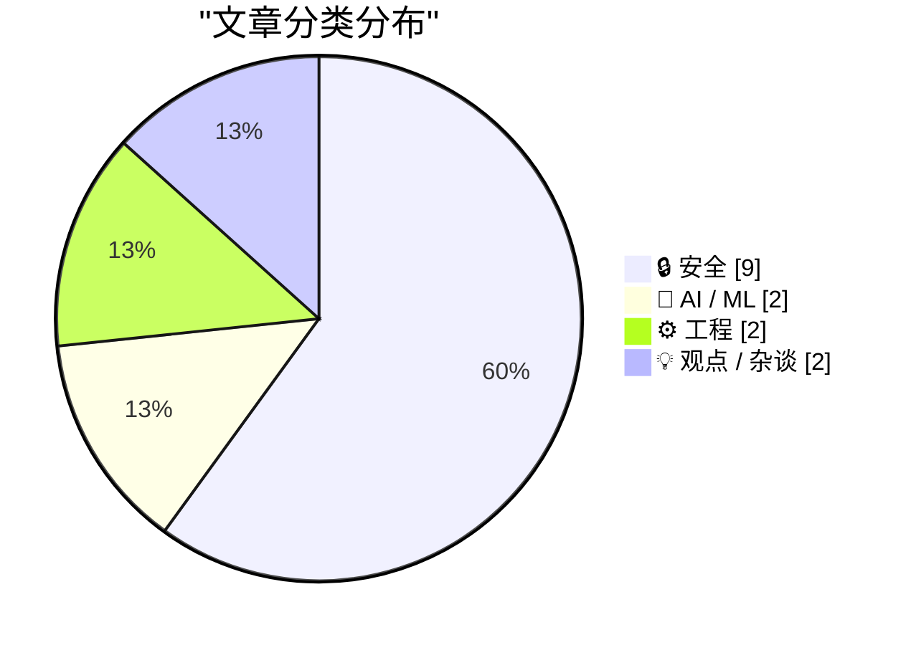
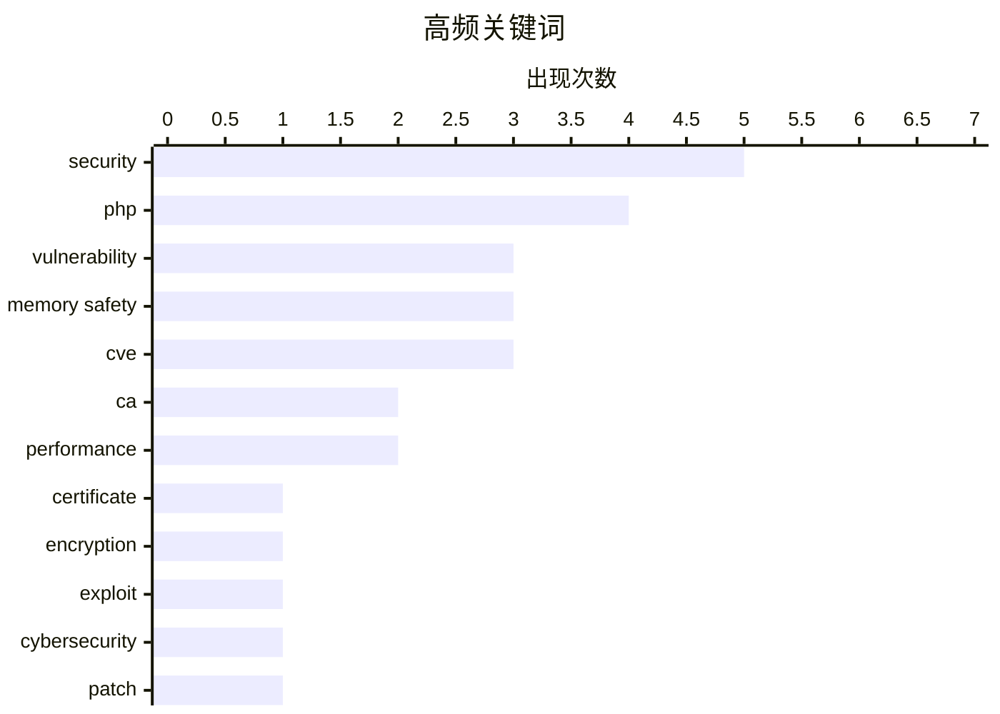

# 📰 Oct 22, 2026

> 来自 Karpathy 推荐的 92 个顶级技术博客，AI 精选 Top 15

## 📝 今日看点

今日技术圈正面临严峻的安全考验，PHP 爆发评分高达 9.2 的关键远程代码执行漏洞，叠加中级 CA 私钥泄露事件，迫使全球数百万服务器紧急重构信任防线。AI 领域则步入理性反思期，在“氛围编程”展现开发潜力的同时，业界开始严厉审视高额资本投入背后的真实商业回报。此外，针对信任库维护漏洞与平台垄断行为的讨论，再次敲响了底层基础设施安全与互联网生态健康的警钟。

---

## 🏆 今日必读

🥇 **eMudhra 中级 CA 私钥泄露事件**

[eMudhra Intermediate CA Compromise](https://simonwillison.net/2026/Oct/20/emudhra-certificates/) — simonwillison.net · 1 天前 · 🔒 安全

> eMudhra 的 8 个中级 CA 证书私钥已确认泄露，这些证书链向 Mozilla、微软、苹果和 Chrome 等主流根证书库。这意味着攻击者可以利用这些私钥签发看似合法的伪造证书，从而对全球用户发起中间人攻击。所有内置受信任证书列表（Trust Stores）的软件和操作系统都需要立即更新以撤销这些证书。目前已有专门网站在实时追踪各软件厂商的修复进度，受影响范围涵盖了几乎所有现代互联网基础设施。

💡 **为什么值得读**: 这是一个波及全球主流浏览器和操作系统的重大信任链危机，涉及网络安全底层基础设施的完整性。

🏷️ CA, certificate, security, encryption

🥈 **PHP 广泛漏洞可能导致今日大量网站瘫痪**

[Widespread PHP Flaw May Cause Many Site Outages Today](https://krebsonsecurity.com/2026/10/widespread-php-flaw-may-cause-many-site-outages-today/) — krebsonsecurity.com · 20 小时前 · 🔒 安全

> 全球近 70% 的网站面临核心软件更新压力，以修复两个允许攻击者完全控制服务器的关键漏洞。专家指出，目前已有针对这些漏洞的有效利用工具（Exploits），且攻击行为已在野外发生。受影响的服务器可能会出现大量的 404 或“页面未找到”错误。由于漏洞细节在协同披露过程中发生泄露，管理员必须在今日内完成补丁安装以防系统被接管。

💡 **为什么值得读**: 该漏洞影响范围极广且已有在野攻击，是运维人员当前最高优先级的安全任务。

🏷️ PHP, vulnerability, exploit, cybersecurity

🥉 **今日 PHP 安全发布：我们如何加强 PHP 安全性**

[Today's PHP Security Release, and How We're Strengthening PHP Security](https://simonwillison.net/2026/Oct/21/php-security-release/) — simonwillison.net · 16 小时前 · 🔒 安全

> PHP 官方紧急发布了覆盖整个 8.x 分支的安全更新，旨在修复两个严重的远程代码执行（RCE）漏洞。由于协同披露过程中的信息泄露，相关的攻击代码自昨晚起已在网络流传。除了发布补丁，PHP 基金会还讨论了未来如何通过改进披露流程和加强代码审计来提升整体安全性。所有运行 PHP 8.x 的环境必须立即升级，不得延误。

💡 **为什么值得读**: 提供了漏洞背景及 PHP 官方对未来安全策略的思考，是理解此次危机处理的关键。

🏷️ PHP, security, vulnerability, patch

---

## 📊 数据概览

| 扫描源 | 抓取文章 | 时间范围 | 精选 |
|:---:|:---:|:---:|:---:|
| 82/92 | 2507 篇 → 33 篇 | 48h | **15 篇** |

### 分类分布



### 高频关键词



<details>
<summary>📈 纯文本关键词图（终端友好）</summary>

```
security      │ ████████████████████ 5
php           │ ████████████████░░░░ 4
vulnerability │ ████████████░░░░░░░░ 3
memory safety │ ████████████░░░░░░░░ 3
cve           │ ████████████░░░░░░░░ 3
ca            │ ████████░░░░░░░░░░░░ 2
performance   │ ████████░░░░░░░░░░░░ 2
certificate   │ ████░░░░░░░░░░░░░░░░ 1
encryption    │ ████░░░░░░░░░░░░░░░░ 1
exploit       │ ████░░░░░░░░░░░░░░░░ 1
```

</details>

### 🏷️ 话题标签

**security**(5) · **php**(4) · **vulnerability**(3) · memory safety(3) · cve(3) · ca(2) · performance(2) · certificate(1) · encryption(1) · exploit(1) · cybersecurity(1) · patch(1) · rce(1) · server(1) · ai(1) · economics(1) · tech industry(1) · investment(1) · clickhouse(1) · database(1)

---

## 🔒 安全

### 1. eMudhra 中级 CA 私钥泄露事件

[eMudhra Intermediate CA Compromise](https://simonwillison.net/2026/Oct/20/emudhra-certificates/) — **simonwillison.net** · 1 天前 · ⭐ 27/30

> eMudhra 的 8 个中级 CA 证书私钥已确认泄露，这些证书链向 Mozilla、微软、苹果和 Chrome 等主流根证书库。这意味着攻击者可以利用这些私钥签发看似合法的伪造证书，从而对全球用户发起中间人攻击。所有内置受信任证书列表（Trust Stores）的软件和操作系统都需要立即更新以撤销这些证书。目前已有专门网站在实时追踪各软件厂商的修复进度，受影响范围涵盖了几乎所有现代互联网基础设施。

🏷️ CA, certificate, security, encryption

---

### 2. PHP 广泛漏洞可能导致今日大量网站瘫痪

[Widespread PHP Flaw May Cause Many Site Outages Today](https://krebsonsecurity.com/2026/10/widespread-php-flaw-may-cause-many-site-outages-today/) — **krebsonsecurity.com** · 20 小时前 · ⭐ 27/30

> 全球近 70% 的网站面临核心软件更新压力，以修复两个允许攻击者完全控制服务器的关键漏洞。专家指出，目前已有针对这些漏洞的有效利用工具（Exploits），且攻击行为已在野外发生。受影响的服务器可能会出现大量的 404 或“页面未找到”错误。由于漏洞细节在协同披露过程中发生泄露，管理员必须在今日内完成补丁安装以防系统被接管。

🏷️ PHP, vulnerability, exploit, cybersecurity

---

### 3. 今日 PHP 安全发布：我们如何加强 PHP 安全性

[Today's PHP Security Release, and How We're Strengthening PHP Security](https://simonwillison.net/2026/Oct/21/php-security-release/) — **simonwillison.net** · 16 小时前 · ⭐ 26/30

> PHP 官方紧急发布了覆盖整个 8.x 分支的安全更新，旨在修复两个严重的远程代码执行（RCE）漏洞。由于协同披露过程中的信息泄露，相关的攻击代码自昨晚起已在网络流传。除了发布补丁，PHP 基金会还讨论了未来如何通过改进披露流程和加强代码审计来提升整体安全性。所有运行 PHP 8.x 的环境必须立即升级，不得延误。

🏷️ PHP, security, vulnerability, patch

---

### 4. 立即升级 PHP 以防御 php2shell 漏洞

[Upgrade your PHP installs immediately to protect against php2shell](https://www.jeffgeerling.com/blog/2026/php-vulnerability-php2shell/) — **jeffgeerling.com** · 21 小时前 · ⭐ 26/30

> PHP 官方发布了两个评分高达 9.2/10 的关键安全公告，分别是 RCE via OOM corruption 和 RCE via stale global state。用户必须立即升级至 8.2.35、8.3.36、8.4.27 或 8.5.12 版本以获得保护。文章特别提醒使用 Remi 仓库的 RedHat 系用户检查更新，因为这些漏洞允许攻击者通过特定手段获取服务器 Shell。这是近年来 PHP 社区面临的最严重安全威胁之一。

🏷️ PHP, RCE, security, server

---

### 5. 信任库也是一种需要维护的依赖项

[Trust Stores Are Dependencies Too](https://nesbitt.io/2026/10/21/trust-stores-are-dependencies-too.html) — **nesbitt.io** · 19 小时前 · ⭐ 24/30

> 一项针对 29 个关键软件包的调查显示，其中 26 个 CA 证书包仍包含已被 Mozilla 移除的根证书。这揭示了开发者往往忽视了信任库（Trust Stores）作为软件依赖项的更新，导致系统面临过时或不安全证书的风险。文章强调，信任库不应被视为静态资源，而应像库代码一样进行版本管理和定期审计。这一发现对于构建安全的供应链和自动化更新流程具有重要警示意义。

🏷️ CA, trust store, security, dependencies

---

### 6. 别废话，立即修补你的 PHP 系统

[Jesus Christ patch your shit now](https://xeiaso.net/shitposts/no-way-to-prevent-this/memory-safety/CVE-2026-109618/) — **xeiaso.net** · 1 天前 · ⭐ 23/30

> 针对 CVE-2026-109618 漏洞，系统管理员和 SRE 正在紧急重建和修补受影响的 PHP 系统。该漏洞源于 PHP 底层 C 语言实现的内存安全问题，允许攻击者在服务器上执行任意代码。作者强调该漏洞无法通过简单的配置缓解，必须进行二进制级别的补丁更新。文章以极高的紧迫感呼吁所有开发者停止观望，立即采取行动以应对这一“无法规避”的安全危机。

🏷️ memory safety, PHP, CVE, vulnerability

---

### 7. 后门、无能与椭圆曲线

[Backdoors, Incompetence, and Elliptic Curves](https://www.johndcook.com/blog/2026/10/21/emudhra/) — **johndcook.com** · 20 小时前 · ⭐ 23/30

> 探讨了 NIST 椭圆曲线标准中长期存在的安全性争议，特别是近期关于曲线种子（seeds）生成透明度的讨论。文章结合 Anthropic 对 NIST 曲线种子的研究以及 eMudhra 证书破碎事件，分析了密码学标准中可能存在的 NSA 后门风险。作者对比了“蓄意设计后门”与“纯粹的技术无能”两种可能性，指出即便没有恶意后门，实现过程中的疏忽也会导致严重的安全漏洞。最终强调在加密算法选型中，透明度和可验证性比单纯信任权威机构更为重要。

🏷️ cryptography, NIST, ECC, security

---

### 8. “没办法预防”：BIND 9 内存安全漏洞分析

["No way to prevent this" say users of only language where this regularly happens](https://xeiaso.net/shitposts/no-way-to-prevent-this/memory-safety/CVE-2026-94300/) — **xeiaso.net** · 1 天前 · ⭐ 22/30

> 针对 BIND 9 域名服务器中发现的 CVE-2026-94300 内存损坏漏洞进行了深度剖析。该漏洞源于在处理重放的 GSS-TSIG 签名 UDP 消息时，由于内存管理不当，攻击者可结合精心构造的查询实现远程代码执行（RCE）。文章讽刺地指出，这类漏洞在 C 语言编写的项目中屡见不鲜，而社区往往将其视为不可避免的代价。作者呼吁开发者正视内存安全问题，并考虑向 Rust 等内存安全语言迁移以根治此类隐患。

🏷️ memory safety, C, CVE, BIND 9

---

### 9. “没办法预防”：Apache Traffic Server 的命令注入漏洞

["No way to prevent this" say users of only language where this regularly happens](https://xeiaso.net/shitposts/no-way-to-prevent-this/memory-safety/CVE-2026-111813/) — **xeiaso.net** · 1 天前 · ⭐ 22/30

> 详细介绍了 Apache Traffic Server 实验性 magick 插件中的严重漏洞 CVE-2026-111813。该插件使用 C++ 编写，在默认未签名配置下，允许未经身份验证的客户端控制传递给 ImageMagick convert 命令的参数，从而导致任意命令执行。文章通过此案例再次抨击了 C++ 在处理复杂输入时极易引入的安全风险。作者强调，即使是实验性功能，其带来的安全漏洞也会威胁整个系统的完整性，必须从开发语言层面进行反思。

🏷️ memory safety, C++, CVE, Apache

---

## 🤖 AI / ML

### 10. AI 必须证明其商业价值

[AI Had Better Work Out](https://www.wheresyoured.at/ai-had-better-work-out/) — **wheresyoured.at** · 1 天前 · ⭐ 26/30

> 本文深入探讨了 AI 产业的财务现状，质疑当前高昂的资本投入是否能转化为可持续的商业回报。作者分析了 AI 公司的资金流向，指出如果 AI 技术不能尽快在实际业务中产生规模化效益，行业将面临巨大的泡沫破裂风险。文章重点关注 AI 领域的财务健康度，而非单纯的技术进步。对于投资者和行业观察者来说，理解 AI 的“账本”比关注模型参数更具现实意义。

🏷️ AI, economics, tech industry, investment

---

### 11. Battle Drones：一款由 AI 辅助开发的音频多人 RTS 游戏

[Battle Drones - a vibe coded RTS with audio-based multiplayer](https://simonwillison.net/2026/Oct/20/battledrones/) — **simonwillison.net** · 1 天前 · ⭐ 23/30

> 开发者 Simon Willison 分享了利用 Claude 通过“氛围编程”（vibe coding）开发 RTS 游戏 Battle Drones 的实验过程。这款类似《命令与征服》的游戏不仅具备完整的即时战略要素，还实验性地加入了基于音频的多人对战模式。作者通过向 AI 下达“让它更有趣”等模糊指令，成功优化了原本枯燥的游戏机制。这证明了 AI 在快速原型设计和复杂游戏机制调优方面具有出色的辅助能力。

🏷️ RTS, vibe coding, LLM, game dev

---

## ⚙️ 工程

### 12. ClickHouse：让你在大规模数据下“错得离谱”

[ClickHouse Will Let You Be Wrong at Scale](https://matduggan.com/clickhouse-will-let-you-be-wrong-at-scale/) — **matduggan.com** · 1 天前 · ⭐ 25/30

> ClickHouse 凭借卓越的列式存储性能和极高的压缩比，在可观测性领域占据了领先地位。然而，其强大的处理能力也可能成为“双刃剑”，掩盖了低效的查询设计或错误的数据架构。作者指出，开发者往往因为引擎足够快而忽视了底层逻辑的正确性，导致在更大规模的数据上犯下难以挽回的错误。文章提醒，技术工具的强大不应成为忽视工程严谨性和架构设计的理由。

🏷️ ClickHouse, database, observability, performance

---

### 13. 对象、属性与映射：深入理解对象形状

[Objects, attributes, maps, oh my!](https://bernsteinbear.com/blog/object-shapes/?utm_source=rss) — **bernsteinbear.com** · 1 天前 · ⭐ 23/30

> 深入剖析了动态类型语言（如 Python 和 JavaScript）如何高效实现对象属性查找。文章解释了虽然对象在逻辑上表现为名称到值的映射，但现代虚拟机通过“对象形状”（Shapes/Maps）和内联缓存（Inline Caching, IC）技术来规避昂贵的哈希表查找。通过对比 Python 的 __dict__ 机制与 V8 引擎的隐藏类优化，展示了如何将动态属性访问转化为偏移量寻址。作者指出，理解这些底层机制对于编写高性能的动态语言代码至关重要。

🏷️ dynamic languages, hidden classes, inline cache, performance

---

## 💡 观点 / 杂谈

### 14. Pluralistic：史上最成功出版商的消亡（Google 的主角综合症）

[Pluralistic: The death of history's most successful publisher (20 Oct 2026)](https://pluralistic.net/2026/10/20/main-character-syndrome/) — **pluralistic.net** · 1 天前 · ⭐ 23/30

> Cory Doctorow 抨击了 Google 患有的“主角综合症”，即通过垄断地位控制信息流向，从而削弱了传统出版业的生存空间。作者认为 Google 已演变成历史上最成功的“出版商”，但这种成功是建立在破坏开放互联网生态基础之上的。文中还穿插了对追踪器监控、文化遗产保护等多个社会技术议题的讨论。核心观点呼吁公众重新审视科技巨头对信息传播权力的过度扩张。

🏷️ Google, publishing, monopoly, SEO

---

### 15. 对抗性互操作性是一项团队运动

[Pluralistic: Adversarial interoperability is a team sport (21 Oct 2026)](https://pluralistic.net/2026/10/21/brittle-individualism/) — **pluralistic.net** · 15 小时前 · ⭐ 22/30

> 探讨了在科技巨头垄断下，如何通过“对抗性互操作性”打破封闭生态系统。文章指出，虽然针对大模型的“氛围编码”（vibe-coded）越狱等个人行为很有趣，但无法从根本上解决平台锁定的问题。作者强调，真正的技术变革需要集体行动和政策支持，而非仅仅依赖零散的技术黑客手段。结论认为，只有通过法律保护和社区协作来保障互操作性，才能实现真正的数字自由和市场竞争。

🏷️ interoperability, policy, jailbreak, tech culture

---

*生成于 2026-10-22 11:34 | 扫描 82 源 → 获取 2507 篇 → 精选 15 篇*
*基于 [Hacker News Popularity Contest 2025](https://refactoringenglish.com/tools/hn-popularity/) RSS 源列表，由 [Andrej Karpathy](https://x.com/karpathy) 推荐*
