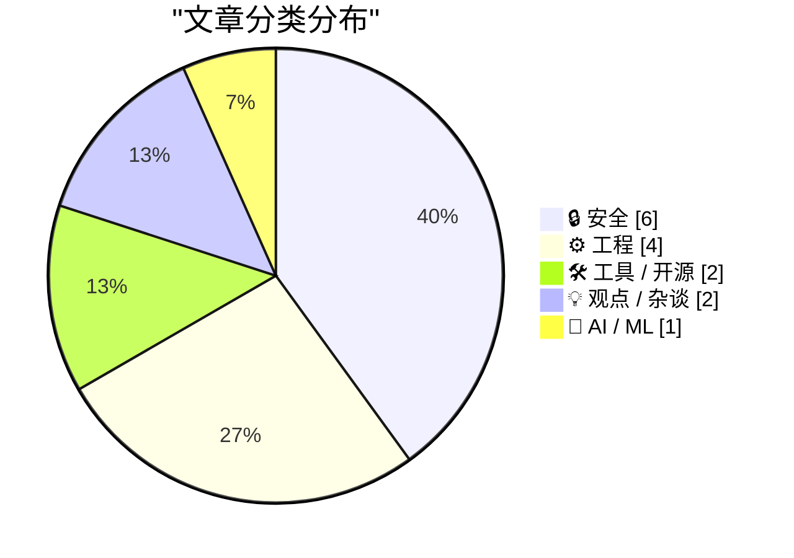
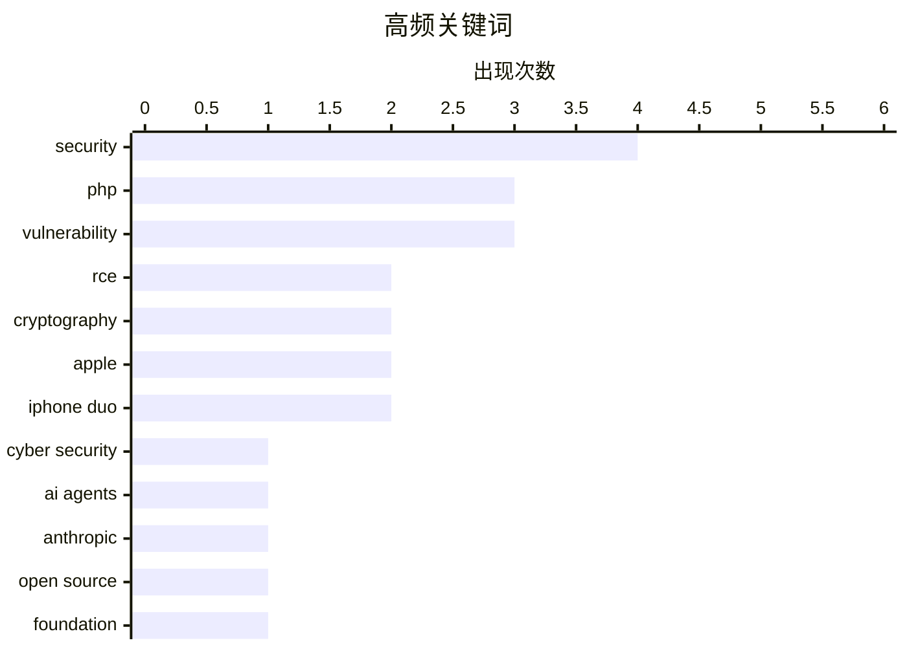

# 📰 Oct 23, 2026

> 来自 Karpathy 推荐的 92 个顶级技术博客，AI 精选 Top 15

## 📝 今日看点

全球互联网基础设施正面临严峻的安全挑战，PHP 爆发的 php2shell 高危漏洞与 NGINX 内存安全问题迫使全球大量网站紧急升级，同时证书机构的低级失误也引发了对加密信任链的深度担忧。与此同时，AI 领域正加速走向标准化与开放，Anthropic 捐赠 Agent Skills 标准旨在构建供应商中立的智能体生态。此外，技术圈开始反思软件性能与硬件演进的本质，强调优秀的架构设计才是解决系统瓶颈的关键，而非仅仅依赖编程语言的更迭。

---

## 🏆 今日必读

🥇 **广泛存在的 PHP 漏洞可能导致今日大量网站停机**

[Widespread PHP Flaw May Cause Many Site Outages Today](https://krebsonsecurity.com/2026/10/widespread-php-flaw-may-cause-many-site-outages-today/) — krebsonsecurity.com · 1 天前 · 🔒 安全

> 全球近 70% 的网站正面临两个关键 PHP 漏洞的威胁，这些漏洞允许攻击者获取受影响服务器的完全控制权。安全专家确认目前已有可用的漏洞利用程序，且这些漏洞已在野外被积极利用。受影响的网站可能会出现大量 404 或“页面未找到”错误，这通常是由于系统在遭受攻击或紧急维护时产生的。管理员需立即检查并更新核心软件以防止服务器被接管。目前修复工作正在全球范围内紧急展开，以应对这一波潜在的网站停机潮。

💡 **为什么值得读**: 揭示了当前互联网基础架构面临的重大安全危机，提醒开发者和运维人员紧急修复 PHP 核心漏洞。

🏷️ PHP, vulnerability, cyber security, RCE

🥈 **将 Agent Skills 捐赠给 Agentic AI 基金会**

[Donating Agent Skills to the Agentic AI Foundation](https://simonwillison.net/2026/Oct/22/donating-agent-skills/) — simonwillison.net · 17 小时前 · 🤖 AI / ML

> Anthropic 宣布将其开发的 Agent Skills 标准捐赠给 Linux 基金会旗下的 Agentic AI 基金会（AAIF）。此举旨在保持该标准的开放性、社区驱动和供应商中立，防止 AI 代理生态系统被单一厂商锁定。捐赠内容还包括模型上下文协议（MCP），这是实现不同 AI 模型与工具间互操作性的关键。通过建立行业标准，开发者可以更轻松地构建跨平台的自主代理应用。这一举措标志着 AI 代理技术正从闭源开发向开放协作的生态系统转型。

💡 **为什么值得读**: 关注 AI 代理标准化进程的必读新闻，展示了 Anthropic 在推动开放 AI 生态方面的战略布局。

🏷️ AI agents, Anthropic, open source, foundation

🥉 **立即升级 PHP 以防御 php2shell 漏洞**

[Upgrade your PHP installs immediately to protect against php2shell](https://www.jeffgeerling.com/blog/2026/php-vulnerability-php2shell/) — jeffgeerling.com · 1 天前 · 🔒 安全

> PHP 官方发布了两个评分为 9.2/10 的高危远程代码执行（RCE）漏洞，统称为 php2shell。漏洞成因包括内存溢出（OOM）导致的损坏以及全局状态陈旧问题，攻击者可借此执行任意指令。所有运行 PHP 服务的用户必须立即升级至 8.2.35、8.3.36、8.4.27 或 8.5.12 版本。对于使用 RedHat 衍生版及 Remi 仓库的用户，也需要同步关注特定包的更新以确保安全。这是近年来 PHP 社区面临的最严重安全威胁之一，延迟更新可能导致服务器被完全控制。

💡 **为什么值得读**: 提供了具体的漏洞编号和修复版本号，是 PHP 开发者和运维人员的紧急行动指南。

🏷️ PHP, RCE, security advisory, vulnerability

---

## 📊 数据概览

| 扫描源 | 抓取文章 | 时间范围 | 精选 |
|:---:|:---:|:---:|:---:|
| 83/92 | 2537 篇 → 33 篇 | 48h | **15 篇** |

### 分类分布



### 高频关键词



<details>
<summary>📈 纯文本关键词图（终端友好）</summary>

```
security       │ ████████████████████ 4
php            │ ███████████████░░░░░ 3
vulnerability  │ ███████████████░░░░░ 3
rce            │ ██████████░░░░░░░░░░ 2
cryptography   │ ██████████░░░░░░░░░░ 2
apple          │ ██████████░░░░░░░░░░ 2
iphone duo     │ ██████████░░░░░░░░░░ 2
cyber security │ █████░░░░░░░░░░░░░░░ 1
ai agents      │ █████░░░░░░░░░░░░░░░ 1
anthropic      │ █████░░░░░░░░░░░░░░░ 1
```

</details>

### 🏷️ 话题标签

**security**(4) · **php**(3) · **vulnerability**(3) · rce(2) · cryptography(2) · apple(2) · iphone duo(2) · cyber security(1) · ai agents(1) · anthropic(1) · open source(1) · foundation(1) · security advisory(1) · semiconductors(1) · intel(1) · hardware(1) · future tech(1) · patch(1) · memory safety(1) · nginx(1)

---

## 🔒 安全

### 1. 广泛存在的 PHP 漏洞可能导致今日大量网站停机

[Widespread PHP Flaw May Cause Many Site Outages Today](https://krebsonsecurity.com/2026/10/widespread-php-flaw-may-cause-many-site-outages-today/) — **krebsonsecurity.com** · 1 天前 · ⭐ 28/30

> 全球近 70% 的网站正面临两个关键 PHP 漏洞的威胁，这些漏洞允许攻击者获取受影响服务器的完全控制权。安全专家确认目前已有可用的漏洞利用程序，且这些漏洞已在野外被积极利用。受影响的网站可能会出现大量 404 或“页面未找到”错误，这通常是由于系统在遭受攻击或紧急维护时产生的。管理员需立即检查并更新核心软件以防止服务器被接管。目前修复工作正在全球范围内紧急展开，以应对这一波潜在的网站停机潮。

🏷️ PHP, vulnerability, cyber security, RCE

---

### 2. 立即升级 PHP 以防御 php2shell 漏洞

[Upgrade your PHP installs immediately to protect against php2shell](https://www.jeffgeerling.com/blog/2026/php-vulnerability-php2shell/) — **jeffgeerling.com** · 1 天前 · ⭐ 26/30

> PHP 官方发布了两个评分为 9.2/10 的高危远程代码执行（RCE）漏洞，统称为 php2shell。漏洞成因包括内存溢出（OOM）导致的损坏以及全局状态陈旧问题，攻击者可借此执行任意指令。所有运行 PHP 服务的用户必须立即升级至 8.2.35、8.3.36、8.4.27 或 8.5.12 版本。对于使用 RedHat 衍生版及 Remi 仓库的用户，也需要同步关注特定包的更新以确保安全。这是近年来 PHP 社区面临的最严重安全威胁之一，延迟更新可能导致服务器被完全控制。

🏷️ PHP, RCE, security advisory, vulnerability

---

### 3. 今日 PHP 安全发布：以及我们如何加强 PHP 安全性

[Today's PHP Security Release, and How We're Strengthening PHP Security](https://simonwillison.net/2026/Oct/21/php-security-release/) — **simonwillison.net** · 1 天前 · ⭐ 25/30

> PHP 基金会紧急发布了针对 PHP 8.x 全系版本的安全更新，修复了两个严重的远程代码执行（RCE）漏洞。由于协调披露过程发生泄露，相关漏洞利用程序已在官方补丁发布前开始流传，使得升级变得极其紧迫。除了发布补丁，官方还详细说明了未来将如何改进漏洞处理流程以防止类似泄露事件再次发生。所有 PHP 用户应视此为最高优先级任务，尽快完成生产环境的升级。文章还探讨了 PHP 基金会在提升核心代码安全性方面的长期投入和策略。

🏷️ PHP, security, vulnerability, patch

---

### 4. 后门、无能与椭圆曲线

[Backdoors, Incompetence, and Elliptic Curves](https://www.johndcook.com/blog/2026/10/21/emudhra/) — **johndcook.com** · 1 天前 · ⭐ 25/30

> 探讨了 NIST 椭圆曲线近期因 Anthropic 的研究和 eMudhra 证书故障而再次成为焦点的原因。文章分析了 NIST 曲线种子可能存在的 NSA 后门疑云，以及这些复杂数学标准在实际应用中面临的挑战。作者对比了理论上的密码学强度与现实中因实现“无能”导致的证书崩溃。这反映了现代加密体系在标准化透明度与实施可靠性之间的深层矛盾。文章提醒读者，即使是经过权威认证的算法，也可能在实现细节上存在致命缺陷。

🏷️ cryptography, NIST, elliptic curves, NSA

---

### 5. eMudhra 证书崩溃事件是如何发生的

[How the eMudrha certificate debacle might have happened](https://www.johndcook.com/blog/2026/10/22/certificate-debacle/) — **johndcook.com** · 21 小时前 · ⭐ 23/30

> 深入调查了 eMudhra 证书安全事故的技术细节，揭露了其在密钥生成上的低级错误。调查发现，该机构竟然使用如 4、56、115 等极小的整数作为加密密钥，这在现代密码学中是不可想象的失误。文章探讨了这种“业余”错误是如何绕过合规性检查并最终导致大规模证书失效的。这一事件成为了加密实施过程中因极度无能而导致灾难性后果的典型案例。它警示我们，即使是受信任的证书颁发机构，也可能在最基础的安全实践上出现溃败。

🏷️ cryptography, security, certificates

---

### 6. 信任库也是一种依赖项

[Trust Stores Are Dependencies Too](https://nesbitt.io/2026/10/21/trust-stores-are-dependencies-too.html) — **nesbitt.io** · 1 天前 · ⭐ 23/30

> 揭示了软件生态系统中一个被忽视的安全隐患：过时的根证书捆绑包（CA bundles）。研究发现，在 29 个关键软件包中，有 26 个仍包含已被 Mozilla 官方移除的根证书。这意味着许多系统在验证加密连接时，实际上是在信任已经不再安全的机构。文章呼吁开发者将信任库视为与库文件同等重要的依赖项，并建立自动化的更新机制以确保通信安全。忽视信任库的维护可能会导致中间人攻击等严重安全风险。

🏷️ certificate authority, trust stores, dependencies

---

## ⚙️ 工程

### 7. 2045 年的计算机芯片会是什么样子？

[What will computer chips look like in 2045?](https://www.dwarkesh.com/p/intel-tour) — **dwarkesh.com** · 20 小时前 · ⭐ 26/30

> 通过实地考察英特尔最先进的晶圆厂并与高层对话，探讨了半导体技术在未来二十年的演进方向。文章深入分析了光刻技术、新材料应用以及芯片架构在 2045 年可能达到的物理极限。作者结合英特尔的研发路线图，评估了摩尔定律在面对量子效应和散热瓶颈时的延续方式。这不仅是对硬件技术的预测，更是对全球算力基础设施未来形态的深度展望。读者可以从中了解到下一代半导体制造工艺如何影响从 AI 到超级计算的各个领域。

🏷️ semiconductors, Intel, hardware, future tech

---

### 8. “没办法预防”——某门频繁发生此类事故的语言用户如是说

["No way to prevent this" say users of only language where this regularly happens](https://xeiaso.net/shitposts/no-way-to-prevent-this/memory-safety/CVE-2026-93479/) — **xeiaso.net** · 1 天前 · ⭐ 25/30

> NGINX 近期披露的 CVE-2026-93479 漏洞引发了关于内存安全的大规模讨论，该漏洞涉及堆缓冲区溢出。漏洞由正则映射捕获或特定字符串表达式中的非缓存变量触发，可能导致工作进程重启甚至远程代码执行。文章以讽刺的口吻指出，尽管此类内存安全问题在 C 语言项目中屡见不鲜，社区却往往将其视为不可避免的代价。这再次引发了系统级软件是否应转向 Rust 等内存安全语言的争论。作者认为，如果不改变底层语言，类似的漏洞将永远无法从根本上消除。

🏷️ security, memory safety, NGINX, C++

---

### 9. 软件慢是因为设计糟糕，而非语言缓慢

[Software is slow because of bad design, not slow languages](https://seangoedecke.com/software-is-slow-because-of-bad-design-not-slow-languages/) — **seangoedecke.com** · 11 小时前 · ⭐ 23/30

> 针对“AI 将通过把软件重写为 Rust 或 C 来提速”的观点提出了质疑，认为大多数程序的性能瓶颈在于设计而非语言。尽管 C 可能比 Python 快 50 倍，但在 I/O 密集型或架构设计不合理的场景下，更换语言带来的收益微乎其微。文章强调，过度关注语言层面的微优化往往掩盖了算法效率低下和系统调用冗余等核心问题。真正的性能提升应源于对系统架构的深度优化，而非单纯依赖底层语言的执行速度。作者呼吁开发者回归设计本质，通过改进数据流和逻辑结构来解决性能问题。

🏷️ performance, software design, Rust, optimization

---

### 10. 他们会写函数吗？

[Can they write a function?](https://idiallo.com/blog/can-they-write-a-function) — **idiallo.com** · 1 天前 · ⭐ 21/30

> 在自动化投递简历泛滥的当下，传统的筛选标准已难以有效识别优秀的软件开发人才。作者主张回归最基础的工程实践能力测试，建议通过三个环节进行筛选：编写基础函数、现场进行 FizzBuzz 测试，以及将服务从本地环境部署到公网服务器。这种考核方式避开了复杂的面试技巧，直接验证候选人是否具备完成实际工作的核心技能。文章强调，与其纠结于简历背景，不如直接观察对方处理代码和解决部署问题的真实过程。

🏷️ hiring, recruitment, software development

---

## 🛠 工具 / 开源

### 11. 使用 Nix 管理脚本依赖

[Script dependencies with Nix](https://entropicthoughts.com/python-dependencies-with-nix) — **entropicthoughts.com** · 1 天前 · ⭐ 23/30

> Nix 提供了一种在非 NixOS 系统上管理脚本依赖的可靠方案，解决了简单脚本因环境变化而失效的痛点。通过在 Python 脚本中集成 Nix 表达式，开发者可以精确锁定解释器版本和第三方库，实现环境的完全隔离与重现。该方法不仅限于 Python，同样适用于任何编程语言，且无需用户深入学习 NixOS 系统配置。这种“随用随弃”的依赖管理模式，让开发者在执行自动化任务时无需担心系统升级破坏脚本运行环境。

🏷️ Nix, dependency management, Linux, Python

---

### 12. 苹果展示 50 多款已为 iPhone Duo 优化的应用

[Apple Highlights 50+ iPhone Apps That Have Already Been Optimized for the Duo](https://www.apple.com/newsroom/2026/10/developers-bring-incredible-new-app-experiences-to-iphone-duo/) — **daringfireball.net** · 16 小时前 · ⭐ 21/30

> 苹果宣布已有超过 50 款应用和游戏针对新款 iPhone Duo 完成了适配优化，并在 App Store 中推出了专属编辑精选集。为了方便用户识别，适配后的应用页面将展示“Made for iPhone Duo”徽章，后续还将有更多更新陆续推出。这次屏幕规格的重大转变延续了 2017 年 iPhone X 发布时的生态迁移模式，体现了苹果推动开发者快速跟进新硬件特性的策略。文章指出，每当苹果引入重大屏幕变更时，这种由官方引导的生态适配潮都是确保新设备用户体验的关键。

🏷️ Apple, iPhone Duo, App Store, mobile apps

---

## 💡 观点 / 杂谈

### 13. iPhone Duo 评测更新

[Updates to My iPhone Duo Review](https://daringfireball.net/2026/10/the_iphone_duo) — **daringfireball.net** · 16 小时前 · ⭐ 21/30

> Daring Fireball 对 iPhone Duo 的评测进行了补充更新，重点修正和细化了关于相机性能的描述。作者指出 iPhone Duo 的 1x/2x 主摄表现出色，虽然在技术规格上接近但仍未达到 iPhone 18 Pro 的顶级水准。评测通过对比不同机型的成像质量，明确了 Duo 在苹果手机产品线中的定位。这种持续更新的评测方式为读者提供了更精准的硬件细节，特别是针对首发用户关注的摄影能力差异。

🏷️ iPhone Duo, hardware review, Apple

---

### 14. Pluralistic：对抗性互操作性是一项团队运动

[Pluralistic: Adversarial interoperability is a team sport (21 Oct 2026)](https://pluralistic.net/2026/10/21/brittle-individualism/) — **pluralistic.net** · 1 天前 · ⭐ 21/30

> Cory Doctorow 探讨了“对抗性互操作性”的本质，认为仅靠个人化的技术破解（如 Vibe-coded 越狱）无法从根本上解决大公司的垄断问题。真正的互操作性是一场“团体赛”，需要法律、政策和集体行动的配合，而非孤立的技术手段。文章串联了 WIPO 秘密会议、商标法争议以及劳工权利等多个案例，揭示了技术封锁背后的结构性矛盾。作者呼吁通过集体协作来对抗封闭生态，从而实现真正的数字自由和技术兼容。

🏷️ interoperability, security, policy

---

## 🤖 AI / ML

### 15. 将 Agent Skills 捐赠给 Agentic AI 基金会

[Donating Agent Skills to the Agentic AI Foundation](https://simonwillison.net/2026/Oct/22/donating-agent-skills/) — **simonwillison.net** · 17 小时前 · ⭐ 26/30

> Anthropic 宣布将其开发的 Agent Skills 标准捐赠给 Linux 基金会旗下的 Agentic AI 基金会（AAIF）。此举旨在保持该标准的开放性、社区驱动和供应商中立，防止 AI 代理生态系统被单一厂商锁定。捐赠内容还包括模型上下文协议（MCP），这是实现不同 AI 模型与工具间互操作性的关键。通过建立行业标准，开发者可以更轻松地构建跨平台的自主代理应用。这一举措标志着 AI 代理技术正从闭源开发向开放协作的生态系统转型。

🏷️ AI agents, Anthropic, open source, foundation

---

*生成于 2026-10-23 11:23 | 扫描 83 源 → 获取 2537 篇 → 精选 15 篇*
*基于 [Hacker News Popularity Contest 2025](https://refactoringenglish.com/tools/hn-popularity/) RSS 源列表，由 [Andrej Karpathy](https://x.com/karpathy) 推荐*
