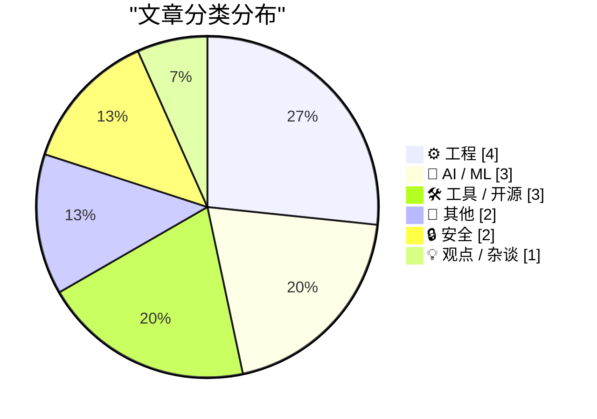
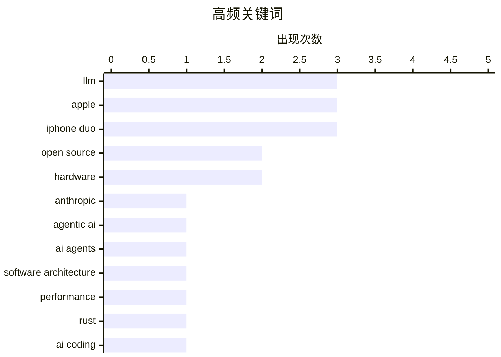

# 📰 Oct 24, 2026

> 来自 Karpathy 推荐的 92 个顶级技术博客，AI 精选 Top 15

## 📝 今日看点

AI 领域正加速迈向标准化与开放化，Anthropic 捐赠 Agent 技能标准与 Kimi 新模型的发布标志着智能体生态与大模型竞争进入新阶段。硬件市场因 iPhone Duo 的生态适配及未来半导体技术的展望而备受瞩目，折叠屏与底层算力的演进正重塑移动体验。与此同时，技术圈再次回归对工程本质的审视，从软件设计哲学到严峻的内存安全漏洞，强调了系统架构在性能与安全中的核心地位。

---

## 🏆 今日必读

🥇 **向 Agentic AI 基金会捐赠 Agent Skills 标准**

[Donating Agent Skills to the Agentic AI Foundation](https://simonwillison.net/2026/Oct/22/donating-agent-skills/) — simonwillison.net · 1 天前 · 🤖 AI / ML

> Anthropic 宣布将其 Agent Skills 标准捐赠给 Linux 基金会旗下的 Agentic AI 基金会 (AAIF)，旨在推动 AI 智能体能力的开放化和厂商中立。该标准与模型上下文协议 (MCP) 共同构成了智能体生态的基础设施，允许不同模型以统一方式调用工具。通过此次捐赠，Anthropic 希望建立一个由社区驱动的行业标准，避免生态碎片化。此举标志着大模型厂商开始从闭源竞争转向构建开放的互操作性框架。

💡 **为什么值得读**: 了解 AI 智能体行业标准化的最新进展以及 Anthropic 在开源生态中的战略布局。

🏷️ Anthropic, Agentic AI, Open Source, AI Agents

🥈 **软件运行慢源于糟糕的设计，而非编程语言**

[Software is slow because of bad design, not slow languages](https://seangoedecke.com/software-is-slow-because-of-bad-design-not-slow-languages/) — seangoedecke.com · 1 天前 · ⚙️ 工程

> 针对“AI 将通过把代码重写为 Rust 或 C 来提升软件速度”的观点，作者指出大多数程序的性能瓶颈在于系统设计而非语言本身。尽管 C 语言在计算任务上可能比 Python 快 50 倍，但现代应用通常受限于网络 I/O、数据库查询或低效的架构逻辑。单纯更换语言无法解决由于过度抽象或不合理的资源调度导致的延迟。作者认为，优化软件性能的核心应回归到算法改进和减少不必要的系统开销。

💡 **为什么值得读**: 深度反思软件性能优化的本质，打破“换个语言就能变快”的技术迷思。

🏷️ Software Architecture, Performance, Rust, AI Coding

🥉 **2045 年的计算机芯片会是什么样子？**

[What will computer chips look like in 2045?](https://www.dwarkesh.com/p/intel-tour) — dwarkesh.com · 1 天前 · ⚙️ 工程

> 作者在参观了英特尔最先进的晶圆厂并与领导层交流后，对未来 20 年的半导体技术进行了展望。文章探讨了摩尔定律在物理极限下的延续方式，重点关注 High-NA EUV 光刻技术、背面供电（PowerVia）以及先进的 3D 封装技术。随着传统缩放变得日益困难，芯片设计将转向异构集成和新材料的应用。作者预测到 2045 年，芯片将不再是单一的硅片，而是复杂的立体堆叠系统。

💡 **为什么值得读**: 深入了解半导体制造的最前沿技术以及未来二十年硬件发展的演进路线。

🏷️ semiconductors, Intel, hardware, future tech

---

## 📊 数据概览

| 扫描源 | 抓取文章 | 时间范围 | 精选 |
|:---:|:---:|:---:|:---:|
| 84/92 | 2564 篇 → 32 篇 | 48h | **15 篇** |

### 分类分布



### 高频关键词



<details>
<summary>📈 纯文本关键词图（终端友好）</summary>

```
llm                   │ ████████████████████ 3
apple                 │ ████████████████████ 3
iphone duo            │ ████████████████████ 3
open source           │ █████████████░░░░░░░ 2
hardware              │ █████████████░░░░░░░ 2
anthropic             │ ███████░░░░░░░░░░░░░ 1
agentic ai            │ ███████░░░░░░░░░░░░░ 1
ai agents             │ ███████░░░░░░░░░░░░░ 1
software architecture │ ███████░░░░░░░░░░░░░ 1
performance           │ ███████░░░░░░░░░░░░░ 1
```

</details>

### 🏷️ 话题标签

**llm**(3) · **apple**(3) · **iphone duo**(3) · open source(2) · hardware(2) · anthropic(1) · agentic ai(1) · ai agents(1) · software architecture(1) · performance(1) · rust(1) · ai coding(1) · semiconductors(1) · intel(1) · future tech(1) · kimi(1) · moonshot ai(1) · api(1) · ruby(1) · cve(1)

---

## ⚙️ 工程

### 1. 软件运行慢源于糟糕的设计，而非编程语言

[Software is slow because of bad design, not slow languages](https://seangoedecke.com/software-is-slow-because-of-bad-design-not-slow-languages/) — **seangoedecke.com** · 1 天前 · ⭐ 26/30

> 针对“AI 将通过把代码重写为 Rust 或 C 来提升软件速度”的观点，作者指出大多数程序的性能瓶颈在于系统设计而非语言本身。尽管 C 语言在计算任务上可能比 Python 快 50 倍，但现代应用通常受限于网络 I/O、数据库查询或低效的架构逻辑。单纯更换语言无法解决由于过度抽象或不合理的资源调度导致的延迟。作者认为，优化软件性能的核心应回归到算法改进和减少不必要的系统开销。

🏷️ Software Architecture, Performance, Rust, AI Coding

---

### 2. 2045 年的计算机芯片会是什么样子？

[What will computer chips look like in 2045?](https://www.dwarkesh.com/p/intel-tour) — **dwarkesh.com** · 1 天前 · ⭐ 26/30

> 作者在参观了英特尔最先进的晶圆厂并与领导层交流后，对未来 20 年的半导体技术进行了展望。文章探讨了摩尔定律在物理极限下的延续方式，重点关注 High-NA EUV 光刻技术、背面供电（PowerVia）以及先进的 3D 封装技术。随着传统缩放变得日益困难，芯片设计将转向异构集成和新材料的应用。作者预测到 2045 年，芯片将不再是单一的硅片，而是复杂的立体堆叠系统。

🏷️ semiconductors, Intel, hardware, future tech

---

### 3. “无法防范”：内存安全漏洞再次席卷 Ruby

["No way to prevent this" say users of only language where this regularly happens](https://xeiaso.net/shitposts/no-way-to-prevent-this/memory-safety/CVE-2026-89078/) — **xeiaso.net** · 1 天前 · ⭐ 25/30

> 针对 Ruby 语言发布的 CVE-2026-89078 漏洞，运维人员正紧急修复其 Onigmo 正则表达式解析器中的双重释放（Double Free）缺陷。该漏洞在解析失败后触发，可能导致内存损坏甚至远程代码执行（RCE）。文章以讽刺的口吻指出，这类内存安全问题在某些特定语言生态中频繁发生，却常被视为不可避免。这再次引发了技术社区对于在核心组件中使用内存安全语言（如 Rust）替代 C 语言的讨论。

🏷️ Ruby, CVE, memory safety

---

### 4. 苹果展示 50 多款已为 iPhone Duo 优化的应用

[Apple Highlights 50+ iPhone Apps That Have Already Been Optimized for the Duo](https://www.apple.com/newsroom/2026/10/developers-bring-incredible-new-app-experiences-to-iphone-duo/) — **daringfireball.net** · 1 天前 · ⭐ 23/30

> 苹果宣布已有超过 50 款主流应用和游戏针对 iPhone Duo 的双屏架构完成了优化，并将在 App Store 上线专题推荐。这些应用将获得“Made for iPhone Duo”专属徽章，方便用户识别。此次生态适配规模类似于 2017 年 iPhone X 发布时的转型期，旨在确保新硬件上市即有丰富的软件支持。苹果正通过开发者工具和编辑精选，加速推动第三方应用对折叠屏交互的适配。

🏷️ Apple, App Store, iOS Development, iPhone Duo

---

## 🤖 AI / ML

### 5. 向 Agentic AI 基金会捐赠 Agent Skills 标准

[Donating Agent Skills to the Agentic AI Foundation](https://simonwillison.net/2026/Oct/22/donating-agent-skills/) — **simonwillison.net** · 1 天前 · ⭐ 26/30

> Anthropic 宣布将其 Agent Skills 标准捐赠给 Linux 基金会旗下的 Agentic AI 基金会 (AAIF)，旨在推动 AI 智能体能力的开放化和厂商中立。该标准与模型上下文协议 (MCP) 共同构成了智能体生态的基础设施，允许不同模型以统一方式调用工具。通过此次捐赠，Anthropic 希望建立一个由社区驱动的行业标准，避免生态碎片化。此举标志着大模型厂商开始从闭源竞争转向构建开放的互操作性框架。

🏷️ Anthropic, Agentic AI, Open Source, AI Agents

---

### 6. Kimi K3.1 Pro 正式发布

[Introducing Kimi K3.1 Pro](https://simonwillison.net/2026/Oct/23/kimi-k31-pro/) — **simonwillison.net** · 15 小时前 · ⭐ 25/30

> 月之暗面（Moonshot AI）在 API 平台上推出了 Kimi K3.1 Pro 模型，并承诺将于 2026 年 11 月 4 日开源模型权重。该版本同步推出了“高速版”（Highspeed），其推理速度提升了 2-3 倍，但价格也相应翻倍。目前 API 定价为每百万输入/输出 Token 2.00 美元，且输入缓存命中部分的计费保持不变。这一更新旨在为开发者提供在高性能与高吞吐量之间灵活选择的能力。

🏷️ Kimi, Moonshot AI, LLM, API

---

### 7. 详解 RMSNorm：大模型中的归一化技术

[RMSNorm](https://www.gilesthomas.com/2026/10/rmsnorm) — **gilesthomas.com** · 16 小时前 · ⭐ 23/30

> 归一化是大型语言模型（LLM）架构中的核心组件，文章对比了 GPT-2 使用的 LayerNorm 与现代模型常用的 RMSNorm。RMSNorm 通过省略均值减法操作，仅保留均方根缩放，在保持模型性能的同时显著降低了计算开销。这种优化使得模型在训练和推理过程中更加高效，因此被 Llama 等主流开源模型广泛采用。文章通过代码和图表详细解释了其数学原理以及在 Transformer 块中的具体位置。

🏷️ LLM, normalization, RMSNorm, transformer

---

## 🛠 工具 / 开源

### 8. Quick Study：基于 AI 生成的快速绘画模拟工具

[Quick Study](https://simonwillison.net/2026/Oct/23/quick-study-painter/) — **simonwillison.net** · 13 小时前 · ⭐ 22/30

> Simon Willison 展示了一个名为 Quick Study 的实验性工具，该工具完全由 Claude 5.5 High 模型根据一段简单的提示词生成。用户上传照片后，该工具能在几秒钟内利用 HTML5 Canvas 元素模拟画笔笔触，将照片转化为绘画风格。这个项目展示了 AI Artifacts 在快速构建交互式原型方面的强大能力。它不仅是一个有趣的视觉工具，也体现了自然语言编程在前端开发中的应用潜力。

🏷️ Claude, LLM, Artifacts, Web Tool

---

### 9. Ubiquiti 售价 99 美元的电子烟探测器实测：表现出乎意料地好

[Ubiquiti's $99 Vape Detector is actually pretty good](https://www.jeffgeerling.com/blog/2026/ubiquiti-vape-detector-teardown/) — **jeffgeerling.com** · 21 小时前 · ⭐ 21/30

> 评测了 Ubiquiti 推出的售价 99 美元的空气质量与电子烟探测器。文章重点关注高浓度 CO2（超过 2000ppm）对认知能力的负面影响，并测试了该设备在家庭、工作室及旅途中的监测表现。通过拆解发现，该设备集成了高精度的空气质量传感器，能有效识别电子烟产生的特定气味和颗粒物。作者认为，相比动辄数千美元的工业级设备，这款产品在性价比和集成度上具有极强竞争力。对于需要监控室内空气质量或公共场所禁烟情况的用户来说，这是一个极具吸引力的方案。

🏷️ Ubiquiti, IoT, Sensor, Hardware

---

### 10. 包管理技术周报：2026 年 10 月 24 日

[This Week in Package Management: 24 October 2026](https://nesbitt.io/2026/10/24/this-week-in-package-management.html) — **nesbitt.io** · 42 分钟前 · ⭐ 21/30

> 汇总了 2026 年 10 月 24 日当周全球包管理领域的最新动态。内容涵盖了主流包管理器（如 npm、PyPI、Cargo 等）的新版本发布说明以及关键的安全预警（Advisories）。文章还精选了多篇关于依赖管理优化、供应链安全和包分发机制的深度技术文章。通过这份周报，开发者可以快速掌握包管理工具链的演进趋势及潜在的安全风险。这对于维护大型项目的依赖稳定性和安全性具有重要的参考价值。

🏷️ package management, security, open source

---

## 📝 其他

### 11. Joanna Stern 评测 iPhone Duo：优缺点并存且充满 Bug

[Joanna Stern Reviews the Duo: ‘The Good, the Bad, and the Buggy’](https://www.youtube.com/watch?v=bxDTWuL9GxY) — **daringfireball.net** · 20 小时前 · ⭐ 23/30

> 知名科技记者 Joanna Stern 发布了关于 iPhone Duo 的深度视频评测，涵盖了硬件耐用性与实际使用体验。她通过定制机器人对设备进行了超过 32,000 次的折叠测试，以验证铰链的可靠性。评测指出，虽然双屏设计带来了新颖的交互，但软件层面的 Bug 较多，且 Face ID 的缺失是重大遗憾。整体而言，这款折叠屏设备在硬件创新上表现出色，但在日常使用的稳定性上仍有待提高。

🏷️ Apple, iPhone Duo, Hardware Testing, Review

---

### 12. The Verge 评测：苹果折叠屏手机 iPhone Duo 是一款混乱、昂贵但有趣的佳作

[The Verge’s Duo Review: ‘Apple’s Folding Phone Is a Messy, Expensive Good Time’](https://www.theverge.com/tech/1015028/iphone-duo-review) — **daringfireball.net** · 17 小时前 · ⭐ 22/30

> 评测了苹果首款折叠屏手机 iPhone Duo 在实际使用中的交互逻辑与硬件表现。该设备在展开后存在直觉上的操作矛盾，用户需逆时针旋转才能让摄像头位于顶部、音量键位于左上角，这与常规手机使用习惯完全相反。尽管配备了特殊的保护壳（Bumper Case），但其人体工学设计仍显生涩，用户通常需要一周左右的适应期。作者认为这款产品虽然在硬件逻辑上显得“混乱”且价格昂贵，但其带来的新鲜感和折叠体验依然令人愉悦。这种“不完美但有趣”的评价反映了苹果在探索新形态硬件时的激进尝试。

🏷️ Apple, iPhone Duo, Folding Phone, Hardware Review

---

## 🔒 安全

### 13. eMudrha 证书安全事故背后的原因分析

[How the eMudrha certificate debacle might have happened](https://www.johndcook.com/blog/2026/10/22/certificate-debacle/) — **johndcook.com** · 1 天前 · ⭐ 23/30

> 文章探讨了 eMudrha 证书泄露事件中令人震惊的安全疏忽，指出该公司竟然使用极短的数字作为加密密钥。具体而言，调查发现 eMudrha 在关键环节使用了如 4、56、115 等简单的整数作为密钥，这在现代密码学中几乎等同于明文。这种低级错误导致了证书系统的全面崩溃，引发了对数字证书颁发机构（CA）监管的广泛质疑。作者分析了这种荒谬实践可能源于内部流程的极度匮乏或对安全标准的完全无视。

🏷️ cryptography, security breach, certificates

---

### 14. 警惕：通过 Booking.com 和诺富特酒店发起的精准网络钓鱼

[More phishing messages via Booking.com and Novotel](https://shkspr.mobi/blog/2026/10/more-phishing-messages-via-booking-com-and-novotel/) — **shkspr.mobi** · 23 小时前 · ⭐ 21/30

> 揭露了针对 Booking.com 用户的最新精准网络钓鱼手段。攻击者在用户预订诺富特（Novotel）酒店两天后，通过 WhatsApp 发送包含用户真实姓名、电话、入住地点和日期的欺诈信息。虽然攻击者使用的葡萄牙商业账号与酒店品牌不符，显得不够专业，但其掌握的订单数据极其精准。这表明 Booking.com 或相关酒店链的数据接口存在严重泄露风险，导致用户隐私被用于定制化诈骗。文章提醒用户在收到此类即时通讯信息时务必保持警惕，不要轻易点击链接或提供支付信息。

🏷️ phishing, WhatsApp, data breach

---

## 💡 观点 / 杂谈

### 15. Pluralistic：论评论与写作（2026 年 10 月 23 日）

[Pluralistic: Critique and writing (23 Oct 2026)](https://pluralistic.net/2026/10/23/better-to-give/) — **pluralistic.net** · 13 小时前 · ⭐ 20/30

> 探讨了写作研讨会的核心价值，即通过尝试修改他人的故事来提升自身的创作能力。文章同时汇集了多项技术与社会议题，包括美国邮政（USPS）对邮件隐私的影响、阿联酋的国际黑客组织、以及 Truecrypt 加密软件的安全性争议。作者还回顾了半导体历史上的“叛逆八人帮”（Traitorous Eight）并分享了最新的巡回演讲计划。整体内容融合了文学创作心得与对数字时代监控、加密技术的深度批判。这种跨界的视角为理解技术对社会的影响提供了独特的维度。

🏷️ writing, hacking, privacy

---

*生成于 2026-10-24 10:42 | 扫描 84 源 → 获取 2564 篇 → 精选 15 篇*
*基于 [Hacker News Popularity Contest 2025](https://refactoringenglish.com/tools/hn-popularity/) RSS 源列表，由 [Andrej Karpathy](https://x.com/karpathy) 推荐*
