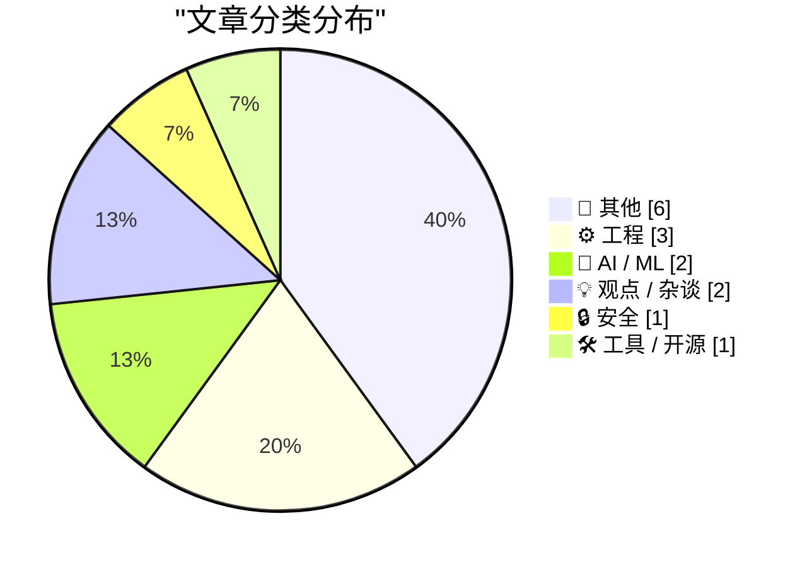
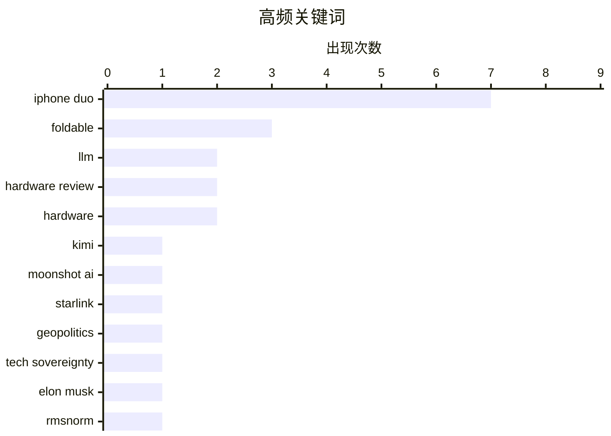

# 📰 Oct 25, 2026

> 来自 Karpathy 推荐的 92 个顶级技术博客，AI 精选 Top 15

## 📝 今日看点

苹果首款折叠屏 iPhone Duo 的正式亮相成为今日焦点，其创新的交互设计与首发即现的屏幕质量争议并存，引发了市场对折叠屏硬件成熟度的深度审视。AI 赛道热度不减，月之暗面 Kimi K3.1 Pro 的发布与底层架构技术的持续演进，标志着大模型正向更高效、更专业的阶段迈进。与此同时，地缘政治引发的技术主权讨论与针对性网络攻击，再次凸显了全球科技基础设施在安全与自主性上面临的严峻挑战。

---

## 🏆 今日必读

🥇 **Kimi K3.1 Pro 正式发布**

[Introducing Kimi K3.1 Pro](https://simonwillison.net/2026/Oct/23/kimi-k31-pro/) — simonwillison.net · 1 天前 · 🤖 AI / ML

> 月之暗面（Moonshot AI）今日在 Kimi API 上推出了 Kimi K3.1 Pro 模型。该模型目前尚未开源，但官方承诺将在 2026 年 11 月 4 日前发布完整模型权重。同步推出的 Highspeed 版本在推理速度上提升了 2-3 倍，其价格也相应翻倍，但输入 Token 缓存命中的计费标准保持不变。目前 API 的定价为每百万 Token 2.00 美元。Kimi 旨在通过高性能版本和明确的开源时间表，进一步吸引开发者生态。

💡 **为什么值得读**: 关注国产大模型进展的开发者可以第一时间了解 Kimi 最新旗舰模型的性能提升、定价策略及开源时间表。

🏷️ Kimi, LLM, Moonshot AI

🥈 **埃隆·马斯克给了欧洲一个取代美国技术的理由**

[Elon Musk Just Gave Europe a Reason to Replace American Technology](https://steveblank.com/2026/10/24/europe-gets-a-wake-up-call/) — steveblank.com · 22 小时前 · 💡 观点 / 杂谈

> 美国政府限制并切断了乌克兰使用的军用版星链（Starshield）情报服务，这一举动在欧洲政策制定者中引发了强烈震动。欧洲意识到，过度依赖由单一美国商业实体控制的关键基础设施存在巨大的地缘政治风险。这一事件被视为欧洲追求“技术主权”的转醒哨声，促使各国重新评估对美国技术的依赖。欧洲开始考虑加速研发本土替代方案，以确保在冲突时期拥有自主的技术“开关”。文章探讨了私人公司掌握全球安全命脉所引发的权力失衡问题。

💡 **为什么值得读**: 探讨了技术主权与地缘政治的深度博弈，对于理解全球供应链去美国化趋势具有启发意义。

🏷️ Starlink, geopolitics, tech sovereignty, Elon Musk

🥉 **深入理解 RMSNorm 归一化技术**

[RMSNorm](https://www.gilesthomas.com/2026/10/rmsnorm) — gilesthomas.com · 1 天前 · 🤖 AI / ML

> 归一化是现代大语言模型（LLM）架构中不可或缺的组件，而 RMSNorm 正逐渐取代传统的 LayerNorm。在 GPT-2 等早期模型中，LayerNorm 被广泛应用于 Transformer 块的注意力机制和前馈网络之前。RMSNorm 通过舍弃均值中心化并仅保留缩放属性，在保持模型性能的同时显著降低了计算开销。这种优化对于提升超大规模参数模型的训练效率和推理速度至关重要。文章通过对比 GPT-2 的实现，详细解析了这一技术演进的数学原理和工程优势。

💡 **为什么值得读**: 深入浅出地解析了现代大模型中关键的归一化技术演进，适合想要了解 Transformer 架构细节的开发者。

🏷️ LLM, RMSNorm, Transformer, deep learning

---

## 📊 数据概览

| 扫描源 | 抓取文章 | 时间范围 | 精选 |
|:---:|:---:|:---:|:---:|
| 84/92 | 2566 篇 → 31 篇 | 48h | **15 篇** |

### 分类分布



### 高频关键词



<details>
<summary>📈 纯文本关键词图（终端友好）</summary>

```
iphone duo       │ ████████████████████ 7
foldable         │ █████████░░░░░░░░░░░ 3
llm              │ ██████░░░░░░░░░░░░░░ 2
hardware review  │ ██████░░░░░░░░░░░░░░ 2
hardware         │ ██████░░░░░░░░░░░░░░ 2
kimi             │ ███░░░░░░░░░░░░░░░░░ 1
moonshot ai      │ ███░░░░░░░░░░░░░░░░░ 1
starlink         │ ███░░░░░░░░░░░░░░░░░ 1
geopolitics      │ ███░░░░░░░░░░░░░░░░░ 1
tech sovereignty │ ███░░░░░░░░░░░░░░░░░ 1
```

</details>

### 🏷️ 话题标签

**iphone duo**(7) · **foldable**(3) · **llm**(2) · hardware review(2) · hardware(2) · kimi(1) · moonshot ai(1) · starlink(1) · geopolitics(1) · tech sovereignty(1) · elon musk(1) · rmsnorm(1) · transformer(1) · deep learning(1) · hardware failure(1) · screen(1) · hardware testing(1) · robotics(1) · ui design(1) · animation(1)

---

## 📝 其他

### 1. iPhone Duo 遭遇首批屏幕碎裂问题

[Marion Barry Meets the iPhone Duo](https://www.theverge.com/tech/1017623/iphone-duo-broken-cracked-screen) — **daringfireball.net** · 13 小时前 · ⭐ 23/30

> 苹果新款折叠屏手机 iPhone Duo 在正式发售首日便遭遇了硬件质量质疑。根据 Reddit 上的用户反馈，部分新机内屏在铰链处出现了裂纹，并伴随横跨屏幕右侧的异常亮线。虽然目前该问题似乎并非大规模爆发，但故障位置在受影响机型中表现出高度的一致性。这反映出折叠屏技术在铰链与柔性面板结合部依然面临严峻的工程挑战。对于一款高价旗舰设备，首批用户的耐用性反馈将极大影响其市场口碑。

🏷️ iPhone Duo, hardware failure, screen

---

### 2. Tim Pan 的 iPhone Duo 深度评测

[Tim Pan’s iPhone Duo Review](https://www.youtube.com/watch?v=8pCccpKjjos) — **daringfireball.net** · 15 小时前 · ⭐ 23/30

> 科技博主 Tim Pan 发布了一段制作精良的 iPhone Duo 24 分钟深度评测视频。评测团队在极短的一周时间内，利用工业机器人对铰链进行了 10,000 次开合压力测试，以验证其结构强度。尽管测试次数少于某些长期耐用性实验，但在新机发布初期提供此类硬核数据具有极高参考价值。视频展现了极高的生产水准，对设备的工业设计和实际手感给出了中肯评价。该评测为用户理解这款复杂折叠设备的机械素质提供了直观视角。

🏷️ iPhone Duo, hardware testing, robotics

---

### 3. 《华尔街日报》Nicole Nguyen 的 iPhone Duo 评测

[Nicole Nguyen’s Duo Review for the WSJ](https://www.wsj.com/tech/personal-tech/iphone-duo-review-cafcbbe7?st=GaYVMf) — **daringfireball.net** · 12 小时前 · ⭐ 22/30

> 《华尔街日报》记者 Nicole Nguyen 在评测中重点批评了 iPhone Duo 的人体工程学设计。她指出该设备比 iPhone Pro 系列更宽、更厚且更重，甚至超过了市面上现有的竞品折叠屏手机。长时间单手握持会导致明显的肌肉疲劳，尤其是尝试触及屏幕远端边缘时。尽管苹果强调其钛金属框架带来了极高的耐用性，但这种结构强度是以牺牲便携性和握持舒适度为代价的。这反映了苹果在追求大屏体验与设备减重之间面临的权衡难题。

🏷️ iPhone Duo, foldable, hardware review

---

### 4. MKBHD 的 iPhone Duo 评测：精致的边缘与粗糙的中场

[MKBHD’s Duo Review](https://youtu.be/ESABTN4VtrA) — **daringfireball.net** · 14 小时前 · ⭐ 22/30

> 知名科技博主 MKBHD 将 iPhone Duo 评价为一款“边缘精致但中间粗糙”的产品。他认为 Face ID 的缺失是该设备最大的短板，严重影响了日常解锁的便捷性。此外，大量第三方应用（如 Discord 和 Google 日历）尚未针对双屏环境进行优化，导致软件体验支离破碎。尽管苹果自身的系统动画和工业设计非常出色，但生态系统的滞后使得这款昂贵的硬件在实用性上大打折扣。评测强调，折叠屏的成功不仅取决于硬件，更取决于第三方软件的深度适配。

🏷️ MKBHD, iPhone Duo, UX

---

### 5. Joanna Stern 评测 iPhone Duo：“优缺点并存，且 Bug 频出”

[Joanna Stern Reviews the Duo: ‘The Good, the Bad, and the Buggy’](https://www.youtube.com/watch?v=bxDTWuL9GxY) — **daringfireball.net** · 1 天前 · ⭐ 22/30

> 深度评测了苹果新款折叠屏手机 iPhone Duo 的实际表现。通过定制机器人进行了一周内超过 32,000 次的开合测试，以验证铰链的耐用性。在暗光环境和游艇等多种场景下实测了相机性能，并指出该机型缺失 Face ID 是一个显著遗憾。尽管硬件设计有亮点，但系统软件层面的 Bug 依然影响体验。评测认为这是一款极具野心但尚未完全成熟的产品。

🏷️ iPhone Duo, Hardware, Durability, Review

---

### 6. The Verge 评测 iPhone Duo：苹果折叠屏手机是“混乱且昂贵的快乐”

[The Verge’s Duo Review: ‘Apple’s Folding Phone Is a Messy, Expensive Good Time’](https://www.theverge.com/tech/1015028/iphone-duo-review) — **daringfireball.net** · 1 天前 · ⭐ 21/30

> The Verge 发布了长达 26 分钟的 iPhone Duo 深度评测视频。指出该机型在交互逻辑上存在挑战，用户通常需要逆时针旋转设备以确保摄像头位于顶部、音量键位于左上角。尽管这种操作逻辑在佩戴原装保护壳时显得有些怪异，但经过一周测试后会逐渐适应。评测认为这款折叠屏手机虽然价格昂贵且体验尚不成熟，但确实带来了独特的使用乐趣。

🏷️ iPhone Duo, Hardware Review, Foldable, Apple

---

## ⚙️ 工程

### 7. 苹果设计师解析 iPhone Duo 的开合过渡动画

[Chan Karunamuni on the Duo’s Open/Close Translucent Transition](https://x.com/chan_k/status/2113622379050246243) — **daringfireball.net** · 20 小时前 · ⭐ 23/30

> 苹果人机交互设计师 Chan Karunamuni 揭秘了 iPhone Duo 开合过渡动画的设计思路。该设计旨在通过“感知弯曲焦平面”而非简单弯曲内容，让两块物理屏幕在视觉上呈现出无缝的统一体验。这种处理方式让用户感觉像是打开一扇通往单一视图的窗户，从而消解了物理铰链带来的视觉割裂感。Karunamuni 在分享中特别感谢了多位工程师，强调了软硬件协同在实现这种细腻交互中的重要性。这种对细节的追求体现了苹果在折叠屏软件适配上的独特美学。

🏷️ iPhone Duo, UI Design, Foldable, Animation

---

### 8. 包管理周报：2026 年 10 月 24 日

[This Week in Package Management: 24 October 2026](https://nesbitt.io/2026/10/24/this-week-in-package-management.html) — **nesbitt.io** · 1 天前 · ⭐ 22/30

> 汇总了 2026 年 10 月第四周全球包管理领域的最新动态。内容涵盖了各大主流包管理器的版本发布、安全漏洞预警以及相关的技术深度文章。该周报旨在帮助开发者快速掌握依赖管理工具的更新频率和安全风险。通过整合跨平台的资讯，为维护项目供应链安全提供参考。

🏷️ package management, security, software releases

---

### 9. 为什么我们不使用 COM 静态存储来清理无法封送的委托？

[Why didn’t we use the COM static store to clean up the unmarshalable delegate?](https://devblogs.microsoft.com/oldnewthing/20261023-00/?p=112793/) — **devblogs.microsoft.com/oldnewthing** · 1 天前 · ⭐ 21/30

> 探讨了在 COM 编程中处理无法封送（unmarshalable）委托的清理机制。详细解释了为何不能依赖 COM 静态存储（static store）来执行此类清理任务，核心原因在于其清理时机不符合预期。如果清理发生得太晚，可能会导致资源竞争或内存访问冲突。文章通过底层原理解析了 COM 生命周期管理中的细微陷阱。

🏷️ Windows, COM, Memory Management, C++

---

## 🤖 AI / ML

### 10. Kimi K3.1 Pro 正式发布

[Introducing Kimi K3.1 Pro](https://simonwillison.net/2026/Oct/23/kimi-k31-pro/) — **simonwillison.net** · 1 天前 · ⭐ 26/30

> 月之暗面（Moonshot AI）今日在 Kimi API 上推出了 Kimi K3.1 Pro 模型。该模型目前尚未开源，但官方承诺将在 2026 年 11 月 4 日前发布完整模型权重。同步推出的 Highspeed 版本在推理速度上提升了 2-3 倍，其价格也相应翻倍，但输入 Token 缓存命中的计费标准保持不变。目前 API 的定价为每百万 Token 2.00 美元。Kimi 旨在通过高性能版本和明确的开源时间表，进一步吸引开发者生态。

🏷️ Kimi, LLM, Moonshot AI

---

### 11. 深入理解 RMSNorm 归一化技术

[RMSNorm](https://www.gilesthomas.com/2026/10/rmsnorm) — **gilesthomas.com** · 1 天前 · ⭐ 24/30

> 归一化是现代大语言模型（LLM）架构中不可或缺的组件，而 RMSNorm 正逐渐取代传统的 LayerNorm。在 GPT-2 等早期模型中，LayerNorm 被广泛应用于 Transformer 块的注意力机制和前馈网络之前。RMSNorm 通过舍弃均值中心化并仅保留缩放属性，在保持模型性能的同时显著降低了计算开销。这种优化对于提升超大规模参数模型的训练效率和推理速度至关重要。文章通过对比 GPT-2 的实现，详细解析了这一技术演进的数学原理和工程优势。

🏷️ LLM, RMSNorm, Transformer, deep learning

---

## 💡 观点 / 杂谈

### 12. 埃隆·马斯克给了欧洲一个取代美国技术的理由

[Elon Musk Just Gave Europe a Reason to Replace American Technology](https://steveblank.com/2026/10/24/europe-gets-a-wake-up-call/) — **steveblank.com** · 22 小时前 · ⭐ 25/30

> 美国政府限制并切断了乌克兰使用的军用版星链（Starshield）情报服务，这一举动在欧洲政策制定者中引发了强烈震动。欧洲意识到，过度依赖由单一美国商业实体控制的关键基础设施存在巨大的地缘政治风险。这一事件被视为欧洲追求“技术主权”的转醒哨声，促使各国重新评估对美国技术的依赖。欧洲开始考虑加速研发本土替代方案，以确保在冲突时期拥有自主的技术“开关”。文章探讨了私人公司掌握全球安全命脉所引发的权力失衡问题。

🏷️ Starlink, geopolitics, tech sovereignty, Elon Musk

---

### 13. 不要将大型科技公司人格化

[Don't anthropomorphize big tech companies](https://seangoedecke.com/dont-anthropomorphize-big-tech-companies/) — **seangoedecke.com** · 11 小时前 · ⭐ 22/30

> 开发者 Bryan Cantrill 提出，将大型科技公司及其领导者（如甲骨文的 Larry Ellison）视为具有人类情感的实体是一个错误。他建议将这些公司想象成“割草机”：它们是遵循特定逻辑和激励机制运行的机器，而非受道德或愿景驱动的个人。公司的所有行为本质上都是为了满足其商业模式和财务诉求。过度解读公司的“性格”往往会误导对其市场决策的判断。理解科技巨头的唯一有效方式是分析其背后的利益激励机制。

🏷️ tech industry, corporate culture, philosophy

---

## 🔒 安全

### 14. Booking.com 与诺富特酒店遭遇精准钓鱼攻击

[More phishing messages via Booking.com and Novotel](https://shkspr.mobi/blog/2026/10/more-phishing-messages-via-booking-com-and-novotel/) — **shkspr.mobi** · 1 天前 · ⭐ 23/30

> 近期出现了一系列针对 Booking.com 用户的精准网络钓鱼攻击，攻击者通过 WhatsApp 发送诈骗信息。这些信息准确掌握了用户的真实姓名、电话、入住酒店及具体的入住日期，显示出预订系统存在严重的数据泄露。尽管目前的诈骗话术尚显拙劣（如发件账号名称不符），但极高的数据精确度极具欺骗性。用户在收到此类涉及支付或订单确认的即时通讯消息时应保持高度警惕。文章提醒消费者，即使信息看起来完全真实，也必须通过官方 App 或电话核实。

🏷️ Phishing, Privacy, Booking.com, Cybersecurity

---

## 🛠 工具 / 开源

### 15. Ubiquiti 售价 99 美元的电子烟探测器表现出众

[Ubiquiti's $99 Vape Detector is actually pretty good](https://www.jeffgeerling.com/blog/2026/ubiquiti-vape-detector-teardown/) — **jeffgeerling.com** · 1 天前 · ⭐ 21/30

> 详细拆解并评测了 Ubiquiti 推出的售价 99 美元的电子烟探测器及空气质量监测仪。重点关注了高浓度 CO2（超过 2000ppm）对认知能力的负面影响，并实测了该设备在家庭和工作室中的监测精度。拆解过程展示了其内部传感器布局和硬件做工。作者认为该设备不仅能有效监测电子烟烟雾，也是一款极具性价比的空气质量管理工具。

🏷️ IoT, hardware, air quality

---

*生成于 2026-10-25 11:07 | 扫描 84 源 → 获取 2566 篇 → 精选 15 篇*
*基于 [Hacker News Popularity Contest 2025](https://refactoringenglish.com/tools/hn-popularity/) RSS 源列表，由 [Andrej Karpathy](https://x.com/karpathy) 推荐*
