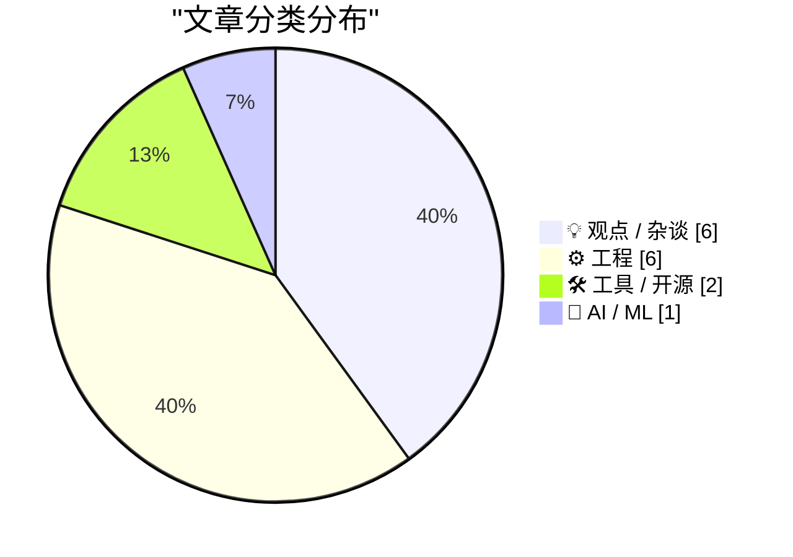
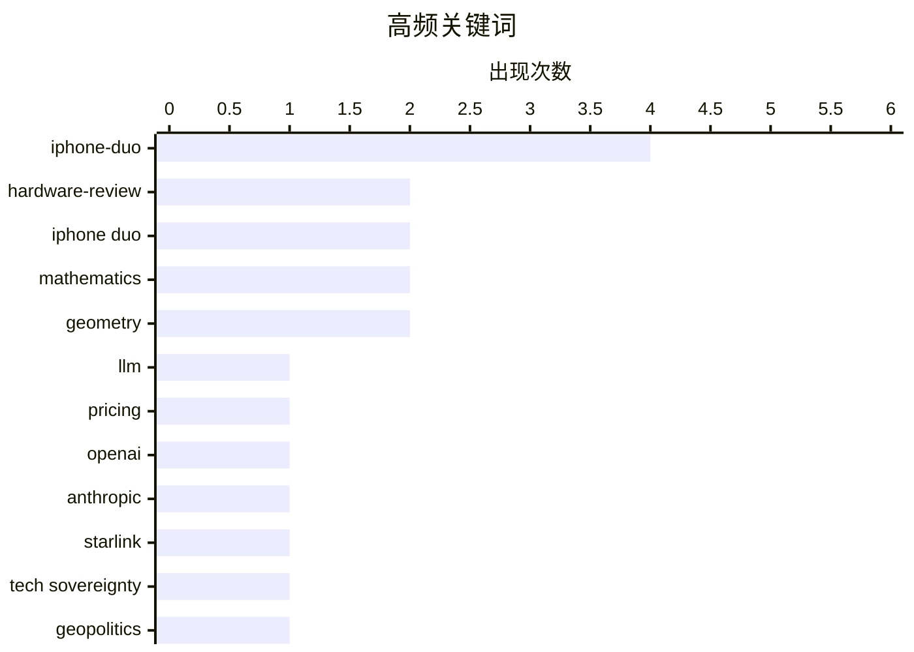

# 📰 Oct 26, 2026

> 来自 Karpathy 推荐的 92 个顶级技术博客，AI 精选 Top 15

## 📝 今日看点

苹果首款折叠屏 iPhone Duo 成为今日舆论风暴中心，其精湛的工业设计与首发遭遇的耐用性争议共同勾勒出硬件创新的阵痛。与此同时，大模型领域正经历激进的价格重塑，推理效率的提升正迫使业界重新审视 AI 生产力的收益分配与经济逻辑。此外，从欧洲寻求技术自主到对科技巨头逐利本质的警示，技术主权与企业权力的博弈正愈发深刻地影响着全球科技格局。

---

## 🏆 今日必读

🥇 **OpenAI 与 Anthropic 数月内降价 80%，LLM 价格战背后真相为何？**

[OpenAI and Anthropic cut their LLM prices by up to 80% within a few months. Why?](https://minimaxir.com/2026/10/cheap-llms/) — minimaxir.com · 15 小时前 · 🤖 AI / ML

> OpenAI 和 Anthropic 在短短几个月内将大模型 API 价格削减了高达 80%，引发了关于“Token 真实成本”的讨论。这种激进的降价并非简单的价格战，而是源于推理效率的指数级提升以及 H100 等硬件的大规模部署。文章分析了计算资源、电力消耗与研发成本在 Token 定价中的占比，指出推理成本正遵循类似于摩尔定律的下降曲线。随着模型架构优化和专用芯片的普及，低廉的 API 价格正成为吸引开发者构建生态系统的核心手段。最终，Token 价格将逼近由能源和硬件折旧决定的物理底价。

💡 **为什么值得读**: 深入分析了 AI 行业的价格战逻辑，帮助开发者和决策者理解大模型长期成本走势及商业护城河的变迁。

🏷️ LLM, pricing, OpenAI, Anthropic

🥈 **马斯克给了欧洲一个取代美国技术的理由**

[Elon Musk Just Gave Europe a Reason to Replace American Technology](https://steveblank.com/2026/10/24/europe-gets-a-wake-up-call/) — steveblank.com · 1 天前 · 💡 观点 / 杂谈

> 美国限制乌克兰使用“星盾”（Starshield）军事版星链的行为，在欧洲政界引发了剧烈震动。这一决策让欧洲意识到，过度依赖美国私人企业或政府控制的关键技术基础设施存在巨大的国家安全风险。文章指出，欧洲决策者正加速推动“技术主权”议程，旨在减少对美国卫星通信、云服务和半导体技术的依赖。这种信任危机可能导致欧洲在未来十年内投入巨资研发本土替代方案，以确保在冲突时期拥有自主决策权。马斯克的个人决策意外成为了欧洲科技独立运动的催化剂。

💡 **为什么值得读**: 探讨了地缘政治如何重塑全球技术供应链，是理解欧洲未来科技政策走向与技术主权争端的重要参考。

🏷️ Starlink, tech sovereignty, geopolitics

🥉 **iPhone Duo 首发遭遇“碎屏门”：折叠屏耐用性再遭质疑**

[Marion Barry Meets the iPhone Duo](https://www.theverge.com/tech/1017623/iphone-duo-broken-cracked-screen) — daringfireball.net · 1 天前 · ⚙️ 工程

> 苹果最新发布的折叠屏手机 iPhone Duo 在发售首日便遭遇屏幕故障报告。Reddit 用户反映，部分机型的内屏在铰链处出现了异常亮线或裂纹，且故障位置具有高度一致性。虽然目前受影响的设备数量尚不明确，但这引发了外界对苹果首款折叠设备耐用性的担忧。文章指出，尽管苹果在设计上做了诸多优化，但柔性屏在铰链处的物理应力依然是该品类难以逾越的技术障碍。这对于起售价高昂的初代产品来说，无疑是一个严峻的质量挑战。

💡 **为什么值得读**: 关注苹果首款折叠屏手机的初期质量反馈，对考虑购买该设备的读者具有重要的预警价值。

🏷️ iPhone-Duo, hardware-failure, foldable-display

---

## 📊 数据概览

| 扫描源 | 抓取文章 | 时间范围 | 精选 |
|:---:|:---:|:---:|:---:|
| 83/92 | 2538 篇 → 29 篇 | 48h | **15 篇** |

### 分类分布



### 高频关键词



<details>
<summary>📈 纯文本关键词图（终端友好）</summary>

```
iphone-duo      │ ████████████████████ 4
hardware-review │ ██████████░░░░░░░░░░ 2
iphone duo      │ ██████████░░░░░░░░░░ 2
mathematics     │ ██████████░░░░░░░░░░ 2
geometry        │ ██████████░░░░░░░░░░ 2
llm             │ █████░░░░░░░░░░░░░░░ 1
pricing         │ █████░░░░░░░░░░░░░░░ 1
openai          │ █████░░░░░░░░░░░░░░░ 1
anthropic       │ █████░░░░░░░░░░░░░░░ 1
starlink        │ █████░░░░░░░░░░░░░░░ 1
```

</details>

### 🏷️ 话题标签

**iphone-duo**(4) · **hardware-review**(2) · **iphone duo**(2) · mathematics(2) · geometry(2) · llm(1) · pricing(1) · openai(1) · anthropic(1) · starlink(1) · tech sovereignty(1) · geopolitics(1) · hardware-failure(1) · foldable-display(1) · computational-photography(1) · computer-vision(1) · iphone(1) · ai(1) · economics(1) · automation(1)

---

## 💡 观点 / 杂谈

### 1. 马斯克给了欧洲一个取代美国技术的理由

[Elon Musk Just Gave Europe a Reason to Replace American Technology](https://steveblank.com/2026/10/24/europe-gets-a-wake-up-call/) — **steveblank.com** · 1 天前 · ⭐ 25/30

> 美国限制乌克兰使用“星盾”（Starshield）军事版星链的行为，在欧洲政界引发了剧烈震动。这一决策让欧洲意识到，过度依赖美国私人企业或政府控制的关键技术基础设施存在巨大的国家安全风险。文章指出，欧洲决策者正加速推动“技术主权”议程，旨在减少对美国卫星通信、云服务和半导体技术的依赖。这种信任危机可能导致欧洲在未来十年内投入巨资研发本土替代方案，以确保在冲突时期拥有自主决策权。马斯克的个人决策意外成为了欧洲科技独立运动的催化剂。

🏷️ Starlink, tech sovereignty, geopolitics

---

### 2. 水涨租金高：AI 重塑经济后谁才是真正的赢家？

[A rising tide raises all rents](https://jyn.dev/rising-tide-raises-rents/) — **jyn.dev** · 1 天前 · ⭐ 22/30

> 探讨了 AI 技术变革对经济结构的深远影响，重点关注收益分配的不平等问题。文章借用“水涨船高”的隐喻指出，AI 带来的生产力提升可能最终被“寻租者”（如土地所有者或平台垄断者）以租金形式吸纳。通过回顾历史上的技术革命，作者分析了为何效率的提升并不总是转化为普通劳动者福利的增加。结论认为，如果缺乏有效的政策干预，AI 创造的财富将进一步向拥有核心算力和数据资产的少数群体集中。普通人可能在生产力大爆发的时代，依然面临生活成本上升的困境。

🏷️ AI, economics, automation

---

### 3. The Talk Show 播客：深入探讨 iPhone Duo 的设计细节

[The Talk Show: ‘Lubricate the Inside of the Hinge’](https://daringfireball.net/thetalkshow/2026/10/25/ep-456) — **daringfireball.net** · 17 小时前 · ⭐ 21/30

> 在最新一期的 The Talk Show 节目中，John Gruber 与 Joanna Stern 深入讨论了苹果新推出的 iPhone Duo。访谈重点聚焦于该设备的铰链机械结构及其内部润滑设计，探讨了苹果如何平衡折叠屏的耐用性与手感。此外，节目还涉及了折叠屏在实际使用中的多任务处理体验以及第三方应用的适配现状。两人一致认为，尽管硬件工艺达到了极高水准，但软件生态的完善仍需时日。对于追求极致硬件设计的用户来说，这款设备展现了苹果多年研发的成果。

🏷️ iPhone-Duo, podcast, hardware-review

---

### 4. MKBHD 评 iPhone Duo：精致的外壳与粗糙的内核

[MKBHD’s Duo Review](https://youtu.be/ESABTN4VtrA) — **daringfireball.net** · 1 天前 · ⭐ 21/30

> 知名科技博主 MKBHD 在对 iPhone Duo 的评测中指出，缺失 Face ID 是该设备最大的短板。他用“边缘极其精致，中间略显粗糙”来形容这款产品，既指代其出色的工业设计，也暗示了铰链处和软件体验的不成熟。评测特别强调了第三方应用（如 Discord 和 Google 日历）在折叠屏上的适配糟糕，严重影响了使用体验。尽管硬件令人惊叹，但对于大多数用户而言，目前的软件缺陷和高昂售价使其更像是一款实验性产品。他认为初代产品在打磨细节上仍有很长的路要走。

🏷️ iPhone-Duo, MKBHD, product-design

---

### 5. 别把科技巨头“人格化”：它们只是逐利的机器

[Don't anthropomorphize big tech companies](https://seangoedecke.com/dont-anthropomorphize-big-tech-companies/) — **seangoedecke.com** · 1 天前 · ⭐ 20/30

> 文章警示读者不要将大型科技公司及其 CEO 视为具有人类情感或道德准则的实体。作者引用了 Bryan Cantrill 的观点，建议将甲骨文 CEO 拉里·埃里森这类人物看作“割草机”——一种只会按照既定程序运行、没有同情心的机器。科技公司的行为完全由利润动机和市场激励驱动，而非出于对用户的关怀或社会责任。通过这种去人格化的视角，开发者和用户能更清醒地预判企业的商业决策，避免产生不切实际的期待。理解公司的本质是机器，有助于在技术选型中做出更理性的判断。

🏷️ tech-culture, industry-analysis, career

---

### 6. 华尔街日报评 iPhone Duo：沉重的手感挑战使用极限

[Nicole Nguyen’s Duo Review for the WSJ](https://www.wsj.com/tech/personal-tech/iphone-duo-review-cafcbbe7?st=GaYVMf) — **daringfireball.net** · 1 天前 · ⭐ 20/30

> 《华尔街日报》记者 Nicole Nguyen 在评测中强调了 iPhone Duo 在人体工程学上的挑战。由于采用了钛金属框架以确保耐用性，该设备比 iPhone Pro 系列更宽、更厚且更重，长时间单手使用会导致明显的手部疲劳。尽管苹果强调了其结构的坚固性，但在实际操作中，用户很难安全地握持设备并触及屏幕边缘。评测结论认为，这种物理上的沉重感和握持难度可能是阻碍其成为大众主力机的关键因素。对于手型较小的用户，这款折叠屏手机的使用门槛极高。

🏷️ iPhone-Duo, hardware-review, ergonomics

---

## ⚙️ 工程

### 7. iPhone Duo 首发遭遇“碎屏门”：折叠屏耐用性再遭质疑

[Marion Barry Meets the iPhone Duo](https://www.theverge.com/tech/1017623/iphone-duo-broken-cracked-screen) — **daringfireball.net** · 1 天前 · ⭐ 24/30

> 苹果最新发布的折叠屏手机 iPhone Duo 在发售首日便遭遇屏幕故障报告。Reddit 用户反映，部分机型的内屏在铰链处出现了异常亮线或裂纹，且故障位置具有高度一致性。虽然目前受影响的设备数量尚不明确，但这引发了外界对苹果首款折叠设备耐用性的担忧。文章指出，尽管苹果在设计上做了诸多优化，但柔性屏在铰链处的物理应力依然是该品类难以逾越的技术障碍。这对于起售价高昂的初代产品来说，无疑是一个严峻的质量挑战。

🏷️ iPhone-Duo, hardware-failure, foldable-display

---

### 8. iPhone 人像模式十周年：从数学计算到艺术渲染的演进

[iPhone Portrait Mode, 10 Years In](https://x.com/johnnie/status/2114007844605612167) — **daringfireball.net** · 18 小时前 · ⭐ 22/30

> 回顾 iPhone 人像模式诞生十周年的历程，该功能最初被视为一个纯粹的数学难题。早期版本依赖双传感器进行视差计算并生成深度图，但在缺乏纹理或细节极其复杂的区域（如发丝）表现欠佳，视觉效果生硬。随着算法演进，苹果引入了更复杂的 AI 模型来模拟真实镜头的光学特性，解决了低分辨率深度图导致的边缘过渡问题。如今的人像模式已从简单的背景虚化演变为一种结合了硬件感知与深度学习的综合摄影体验。这种进步标志着计算摄影从模拟物理规律转向了创造审美价值。

🏷️ computational-photography, computer-vision, iPhone

---

### 9. Chan Karunamuni 谈 iPhone Duo 的开合半透明过渡动画

[Chan Karunamuni on the Duo’s Open/Close Translucent Transition](https://x.com/chan_k/status/2113622379050246243) — **daringfireball.net** · 1 天前 · ⭐ 20/30

> iPhone Duo 的开合过渡动画旨在通过感知层面的“焦平面弯曲”（perceptually bending the focal plane）而非内容弯曲，将双屏体验无缝衔接。Apple 人机交互设计师 Chan Karunamuni 指出，这种设计让用户感觉像是打开了一扇通往单一视图的窗户，而非在折叠两个独立的屏幕。该方案巧妙地处理了视觉深度，避免了内容在物理折叠时的扭曲感，强调了硬件与软件交互的整体性。Karunamuni 在分享中罕见地公开致谢了参与该项目的多位工程师，这在 Apple 内部文化中并不多见。

🏷️ UI design, animation, iPhone Duo, UX

---

### 10. 极点与极线

[Poles and polars](https://www.johndcook.com/blog/2026/10/25/poles-and-polars/) — **johndcook.com** · 16 小时前 · ⭐ 19/30

> 球面几何中的“极点（Pole）”与“极线（Polar）”是理解球面三角形对偶性的基础概念。对于球面上的任意点，其极线是垂直于该点向量的平面与球面的交线（即大圆），而极点则是该大圆平面的法向量端点。极三角形的定义源于这种几何关系，即一个三角形的顶点是另一个三角形对应边的极点。本文深入探讨了这些几何对象在球面三角学中的定义及其背后的直观逻辑。通过这种几何构造，复杂的球面定理可以转化为更易处理的对偶形式。

🏷️ mathematics, geometry, sphere

---

### 11. 利用线性代数计算极三角形

[Computing polar triangles with linear algebra](https://www.johndcook.com/blog/2026/10/24/computing-polar-triangles/) — **johndcook.com** · 1 天前 · ⭐ 19/30

> 利用线性代数可以高效地计算球面三角形的极三角形（Polar Triangle）坐标。该方法通过将三角形的顶点视为单位向量，利用向量的外积和矩阵运算来精确确定对应极三角形的顶点位置。这种计算方案解决了仅有几何定义而缺乏具体坐标构造的问题，证明了极三角形在球面上的存在性与唯一性。相比传统的球面三角公式，线性代数方法在计算机图形学和地理信息系统（GIS）中更具可操作性。这种对偶构造使得在处理球面多边形时，可以将复杂的角度计算转化为直观的向量运算。

🏷️ linear algebra, geometry, algorithms

---

### 12. 球面三角学中的对偶性

[Duality in spherical trigonometry](https://www.johndcook.com/blog/2026/10/24/polar-triangle/) — **johndcook.com** · 1 天前 · ⭐ 19/30

> 球面三角学中存在着显著的对偶性（Duality），这在余弦定理中表现得尤为明显。球面余弦定理分为“边余弦定理”和“角余弦定理”，两者在数学形式上高度对称，仅需互换边长与角度的余弦/正弦值。通过极三角形的性质，任何关于球面三角形边长的定理都可以直接转化为关于角度的对应定理。这种对偶性极大地简化了球面几何的证明过程，使得研究者只需证明一个命题即可获得其对偶命题。本文通过公式对比展示了这种数学结构的美感与实用性。

🏷️ trigonometry, duality, mathematics

---

## 🛠 工具 / 开源

### 13. Seam Cutter：一款专门“切除”图片中间部分的奇特工具

[Seam Cutter](https://simonwillison.net/2026/Oct/25/seam-cutter/) — **simonwillison.net** · 21 小时前 · ⭐ 20/30

> 开发者 Simon Willison 构建了一款名为 Seam Cutter 的特定用途裁剪工具。该工具允许用户在图像上进行水平或垂直切割，并让两侧部分相对滑动，从而有效地“切除”图像的中间区域。作者开发此工具的初衷是为了优化 iPhone 上的长截图拼接体验，解决 Tailor 等应用在处理重复内容时的局限性。该工具目前已作为网页版小工具发布，支持简单的拖拽操作。它为处理那些中间包含冗余信息、但两头需要保留的特殊图片提供了极简方案。

🏷️ image-processing, web-tool, frontend

---

### 14. Tim Pan 的 iPhone Duo 深度评测

[Tim Pan’s iPhone Duo Review](https://www.youtube.com/watch?v=8pCccpKjjos) — **daringfireball.net** · 1 天前 · ⭐ 19/30

> Tim Pan (Mediastorm) 发布了一段制作水准极高的 iPhone Duo 24 分钟深度评测视频，其工业级的制作价值令人惊叹。评测团队在短短一周的测试周期内，使用工业机器人对设备铰链进行了 10,000 次开合压力测试，以验证其耐用性。尽管测试次数少于知名博主 Joanna Stern 使用 Hingey 机器人进行的 30,000 次测试，但其测试方法和视觉呈现极具专业度。该评测在极短的时间内完成了高质量的硬件压力分析与用户体验评估，被 Daring Fireball 评价为不可多得的佳作。

🏷️ iPhone Duo, hardware review, industrial design

---

## 🤖 AI / ML

### 15. OpenAI 与 Anthropic 数月内降价 80%，LLM 价格战背后真相为何？

[OpenAI and Anthropic cut their LLM prices by up to 80% within a few months. Why?](https://minimaxir.com/2026/10/cheap-llms/) — **minimaxir.com** · 15 小时前 · ⭐ 26/30

> OpenAI 和 Anthropic 在短短几个月内将大模型 API 价格削减了高达 80%，引发了关于“Token 真实成本”的讨论。这种激进的降价并非简单的价格战，而是源于推理效率的指数级提升以及 H100 等硬件的大规模部署。文章分析了计算资源、电力消耗与研发成本在 Token 定价中的占比，指出推理成本正遵循类似于摩尔定律的下降曲线。随着模型架构优化和专用芯片的普及，低廉的 API 价格正成为吸引开发者构建生态系统的核心手段。最终，Token 价格将逼近由能源和硬件折旧决定的物理底价。

🏷️ LLM, pricing, OpenAI, Anthropic

---

*生成于 2026-10-26 12:41 | 扫描 83 源 → 获取 2538 篇 → 精选 15 篇*
*基于 [Hacker News Popularity Contest 2025](https://refactoringenglish.com/tools/hn-popularity/) RSS 源列表，由 [Andrej Karpathy](https://x.com/karpathy) 推荐*
