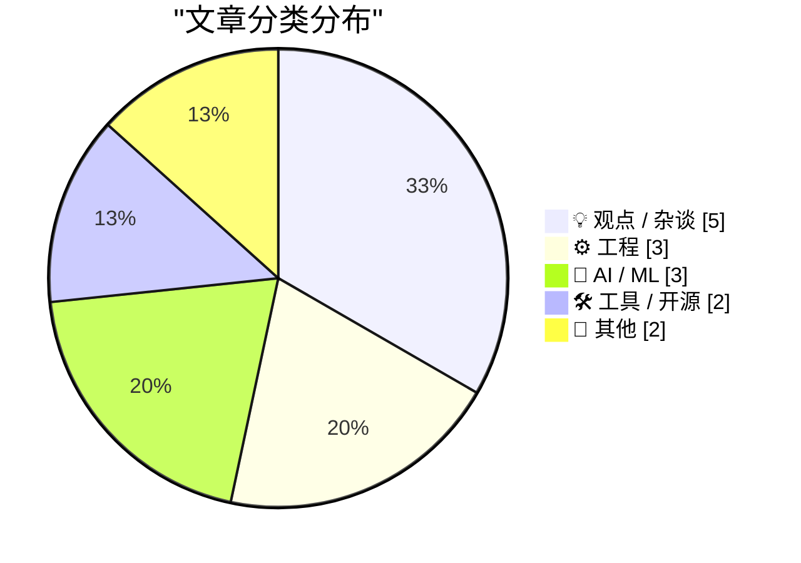
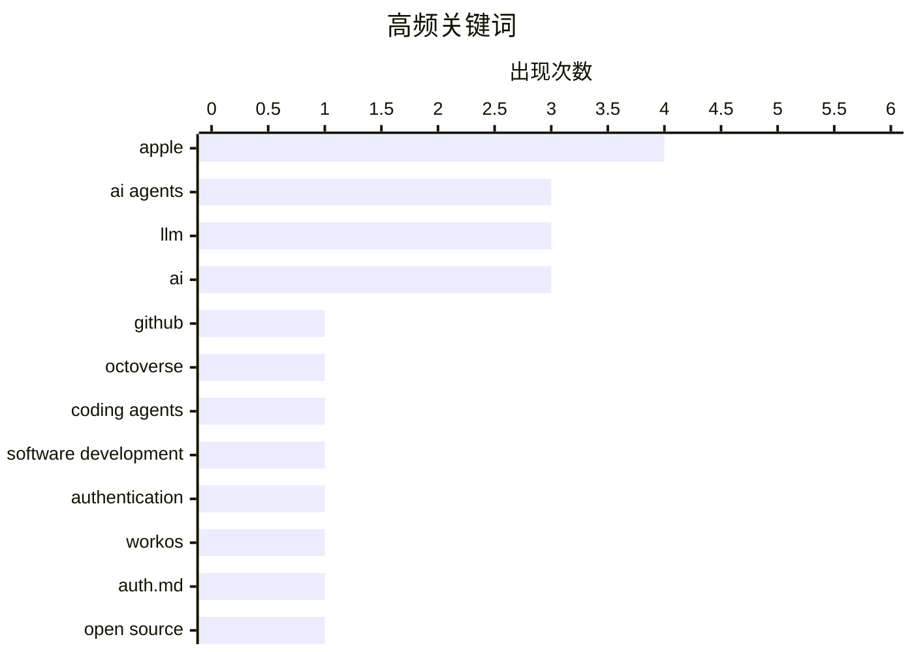

# 📰 Oct 29, 2026

> 来自 Karpathy 推荐的 92 个顶级技术博客，AI 精选 Top 15

## 📝 今日看点

AI Agent 正在重塑全球开发范式，不仅驱动代码产出创下历史新高，更催生了“氛围感编程”等全新创作模式。随着模型规模与能动性的持续突破，技术瓶颈正从 AI 能力转向人类的认知边界与应用直觉，对 AI 的精通已成为核心竞争力。此外，苹果硬件触屏化与 AI 创作工具的深度集成，标志着软硬件生态正全面向 AI 时代协同演进。

---

## 🏆 今日必读

🥇 **GitHub Octoverse 2026 报告：AI Agent 驱动下的开发者生产力新高**

[GitHub Octoverse 2026](https://simonwillison.net/2026/Oct/28/github-octoverse-2026/) — simonwillison.net · 19 小时前 · ⚙️ 工程

> GitHub 发布的 2026 年度 Octoverse 报告显示，开发者利用 AI Agent 进行构建已成为主流，代码提交（Commits）和推送（Pushes）数量均创下历史新高。报告重点展示了三张趋势图表，反映了 AI 深度介入开发流程后的生产力爆发。GitHub EVP Jay Parikh 指出，Agent 不再是辅助工具，而是开发生态的核心组成部分。开源社区的活跃度在 AI 驱动下呈现出指数级增长态势。这一数据证明了 AI 正在从根本上改变软件开发的规模和速度。

💡 **为什么值得读**: 了解全球最大代码托管平台在 AI Agent 时代的最新开发者趋势与生产力增长数据。

🏷️ GitHub, AI agents, Octoverse

🥈 **2026 年 10 月：氛围感游戏开发的拐点已至**

[The October inflection point for vibe game development](https://simonwillison.net/2026/Oct/28/vibe-game-development/) — simonwillison.net · 22 小时前 · ⚙️ 工程

> 继 2025 年 11 月 Opus 4.5 和 GPT-5.1 开启 AI 编程拐点后，2026 年 10 月标志着“氛围感游戏开发”（Vibe Game Development）的新拐点。当前的 AI Agent 已进化到能够根据模糊的意图描述（Vibe）直接生成可运行的电脑游戏，而不仅仅是辅助编写代码片段。这种转变意味着软件工程师可以像导演一样通过高层指令驱动 Agent 完成复杂的系统集成。这一阶段的 Agent 在逻辑可靠性和创意实现上跨越了实用化门槛。开发者现在可以仅凭“感觉”和自然语言描述，在极短时间内构建出完整的交互式作品。

💡 **为什么值得读**: 探讨 AI 如何从“辅助写代码”进化到“根据意图直接生成复杂游戏”的范式转移。

🏷️ coding agents, LLM, software development

🥉 **WorkOS：让 AI Agent 无需浏览器即可注册应用**

[[Sponsor] WorkOS: Let Agents Sign Up for Your App Without a Browser](https://workos.com/auth-md?utm_source=daringfireball&amp;utm_medium=newsletter&amp;utm_campaign=q42026) — daringfireball.net · 1 天前 · 🛠 工具 / 开源

> WorkOS 推出了针对 AI Agent 的身份验证方案 auth.md，旨在解决 Agent 无法操作人类图形界面进行注册的难题。开发者只需在应用中发布一个 auth.md 文件，Agent 即可读取该规范并自动完成注册，无需跳转浏览器登录。该方案支持发放受控的、短效的凭证，确保了 Agent 访问的安全性与合规性。用户在使用 Agent 时不会被中断流程去处理登录验证。这一举措标志着 Web 应用开始从“人机交互优先”向“机器可读优先”的架构转型。

💡 **为什么值得读**: 学习如何为你的应用构建“Agent 友好型”的自动化身份验证流程。

🏷️ AI Agents, Authentication, WorkOS, auth.md

---

## 📊 数据概览

| 扫描源 | 抓取文章 | 时间范围 | 精选 |
|:---:|:---:|:---:|:---:|
| 82/92 | 2508 篇 → 33 篇 | 48h | **15 篇** |

### 分类分布



### 高频关键词



<details>
<summary>📈 纯文本关键词图（终端友好）</summary>

```
apple                │ ████████████████████ 4
ai agents            │ ███████████████░░░░░ 3
llm                  │ ███████████████░░░░░ 3
ai                   │ ███████████████░░░░░ 3
github               │ █████░░░░░░░░░░░░░░░ 1
octoverse            │ █████░░░░░░░░░░░░░░░ 1
coding agents        │ █████░░░░░░░░░░░░░░░ 1
software development │ █████░░░░░░░░░░░░░░░ 1
authentication       │ █████░░░░░░░░░░░░░░░ 1
workos               │ █████░░░░░░░░░░░░░░░ 1
```

</details>

### 🏷️ 话题标签

**apple**(4) · **ai agents**(3) · **llm**(3) · ai(3) · github(1) · octoverse(1) · coding agents(1) · software development(1) · authentication(1) · workos(1) · auth.md(1) · open source(1) · career(1) · sustainability(1) · benchmarking(1) · evaluation(1) · ai agency(1) · prompt engineering(1) · productivity(1) · ai skills(1)

---

## 💡 观点 / 杂谈

### 1. 我正式成为一名全职开源开发者了

[I'm a Full-Time Open Source Developer Now](https://blog.miguelgrinberg.com/post/i-m-full-time-open-source-developer-now) — **miguelgrinberg.com** · 1 天前 · ⭐ 24/30

> 知名开发者 Miguel Grinberg 宣布正式转为全职开源维护者，目前独立负责包括 Flask-SocketIO 在内的 18 个开源项目。在结束了长期的全职工作后，他计划将全部精力投入到这些项目的维护与更新中。他通过此文向社区寻求赞助支持，以维持项目的可持续发展。这反映了顶级开源贡献者在职业路径选择上从企业雇佣向社区驱动的转变。他希望通过更专业的运营，提升这些支撑大量 Web 应用的基础库的质量。

🏷️ open source, career, sustainability

---

### 2. 精通 AI 需要时间和大量练习

[Getting good at AI takes time and practice](https://seangoedecke.com/getting-good-at-ai-takes-time-and-practice/) — **seangoedecke.com** · 1 天前 · ⭐ 23/30

> 尽管现代 AI 模型越来越易用，但“精通 AI”绝非易事，仍需要大量的实践与时间积累。虽然早期的特定提示词技巧可能已过时，但培养对模型行为的直觉和处理复杂边界情况的能力依然具有极高的门槛。高效使用 AI 需要在不断的交互中理解其逻辑偏好与局限性。这篇文章反驳了“AI 技能平庸化”的观点，强调了持续练习在 AI 时代的重要性。只有通过深度实践，才能在模型迭代中保持领先的协作效率。

🏷️ AI skills, learning, LLM

---

### 3. 寸进与千里：AI 初创公司的激进数据行为

[Inches & Miles](https://feed.tedium.co/link/15204/17507724/ai-startups-sketchy-behavior) — **tedium.co** · 1 天前 · ⭐ 23/30

> AI 时代的到来让初创公司变得更加激进，甚至在未征得用户同意的情况下擅自抓取数据以构建产品。这种“先斩后奏”的行为反映了当前 AI 行业在数据合规与隐私保护方面的乱象。许多公司为了在竞争中获胜，不惜跨越道德与法律的边界。文章对这种以牺牲用户权利为代价的扩张模式提出了严厉批评。这种行为虽然短期内推动了技术进步，但长期来看可能损害整个行业的信任基础。

🏷️ AI, data privacy, startups, ethics

---

### 4. 代理人 vs 电子商务：透明度缺失是刻意为之的功能而非缺陷

[Pluralistic: Agents vs ecommerce (28 Oct 2026)](https://pluralistic.net/2026/10/28/principle-agent-problem/) — **pluralistic.net** · 1 天前 · ⭐ 22/30

> 探讨了 AI 代理人与电子商务平台之间日益加剧的冲突，核心在于平台如何通过增加“不透明度”来对抗消费者的自动化决策。电商巨头利用复杂的定价策略、混淆的搜索结果和动态折扣来瓦解 AI 代理人的比价能力，从而维持其利润空间。这种现象本质上是“委托-代理问题”在算法时代的体现，平台通过技术手段剥夺用户的知情权。作者认为，透明度的缺失并非系统漏洞，而是平台为了防止用户获得最优交易而刻意设计的商业策略。

🏷️ AI Agents, E-commerce, Economics, Privacy

---

### 5. 亚马逊工程师准则：无法使用 AI 并非失败，而是发现

[Quoting Terk Terkowitz](https://simonwillison.net/2026/Oct/28/terk-terkowitz/) — **simonwillison.net** · 1 天前 · ⭐ 21/30

> 引用了亚马逊针对软件工程师角色的最新 AI 使用指南，明确了在开发流程中评估 AI 工具效能的标准。指南指出，如果当前 AI 工具无法为某项工作带来收益，这应被视为一种“发现”而非个人的“失败”。公司鼓励工程师记录并分享 AI 无法胜任的具体场景，并与团队及管理层沟通以寻找替代方案。这种做法旨在强调工程师的专业判断力，即识别 AI 能力边界的能力与使用 AI 同样重要。

🏷️ Amazon, AI tools, career development

---

## ⚙️ 工程

### 6. GitHub Octoverse 2026 报告：AI Agent 驱动下的开发者生产力新高

[GitHub Octoverse 2026](https://simonwillison.net/2026/Oct/28/github-octoverse-2026/) — **simonwillison.net** · 19 小时前 · ⭐ 26/30

> GitHub 发布的 2026 年度 Octoverse 报告显示，开发者利用 AI Agent 进行构建已成为主流，代码提交（Commits）和推送（Pushes）数量均创下历史新高。报告重点展示了三张趋势图表，反映了 AI 深度介入开发流程后的生产力爆发。GitHub EVP Jay Parikh 指出，Agent 不再是辅助工具，而是开发生态的核心组成部分。开源社区的活跃度在 AI 驱动下呈现出指数级增长态势。这一数据证明了 AI 正在从根本上改变软件开发的规模和速度。

🏷️ GitHub, AI agents, Octoverse

---

### 7. 2026 年 10 月：氛围感游戏开发的拐点已至

[The October inflection point for vibe game development](https://simonwillison.net/2026/Oct/28/vibe-game-development/) — **simonwillison.net** · 22 小时前 · ⭐ 26/30

> 继 2025 年 11 月 Opus 4.5 和 GPT-5.1 开启 AI 编程拐点后，2026 年 10 月标志着“氛围感游戏开发”（Vibe Game Development）的新拐点。当前的 AI Agent 已进化到能够根据模糊的意图描述（Vibe）直接生成可运行的电脑游戏，而不仅仅是辅助编写代码片段。这种转变意味着软件工程师可以像导演一样通过高层指令驱动 Agent 完成复杂的系统集成。这一阶段的 Agent 在逻辑可靠性和创意实现上跨越了实用化门槛。开发者现在可以仅凭“感觉”和自然语言描述，在极短时间内构建出完整的交互式作品。

🏷️ coding agents, LLM, software development

---

### 8. 为什么任务栏和任务管理器不以高优先级运行以保持响应？

[Why don’t we run the taskbar and Task Manager at high priority, so they can remain responsive?](https://devblogs.microsoft.com/oldnewthing/20261027-00/?p=112800/) — **devblogs.microsoft.com/oldnewthing** · 1 天前 · ⭐ 21/30

> 深入解释了 Windows 系统设计中任务栏（Taskbar）和任务管理器（Task Manager）不采用高进程优先级的技术原因。如果将这些 UI 组件设为高优先级，在系统资源紧张时它们会抢占关键系统驱动或后台服务的 CPU 时间，反而可能导致死锁或系统崩溃。文章指出，UI 响应缓慢通常是因为等待低优先级的资源锁，提高 UI 优先级并不能解决底层的同步阻塞问题。作者强调，系统的整体稳定性依赖于合理的优先级调度，而非简单地让管理工具“插队”。

🏷️ Windows, OS, scheduling, performance

---

## 🤖 AI / ML

### 9. 引用 Ted Sanders：LLM 性能的多维性与规模法则

[Quoting Ted Sanders](https://simonwillison.net/2026/Oct/28/ted-sanders/) — **simonwillison.net** · 13 小时前 · ⭐ 23/30

> Ted Sanders 指出大语言模型（LLM）的性能表现具有极其复杂的维度，擅长数学的模型未必擅长幽默。尽管维度众多，但模型规模（Model Size）依然是解释性能差异的核心变量。通常情况下，更大的模型意味着更强的可靠性、更高的 Token 成本以及更优秀的训练数据召回能力。这一观点提醒开发者在选型时应权衡规模带来的收益与成本开销。性能的提升并非线性的，理解不同模型在特定任务上的长短板至关重要。

🏷️ LLM, benchmarking, evaluation

---

### 10. 你可以直接要求 AI 去完成任务

[You can just ask AI to do things](https://seangoedecke.com/you-can-just-ask-ai-to-do-things/) — **seangoedecke.com** · 12 小时前 · ⭐ 23/30

> 使用 AI 的核心技能在于“能动性”（Agency），即勇于尝试用 AI 完成看似不可能的野心目标。随着模型能力的飞速提升，限制 AI 发挥的往往不是技术边界，而是人类对“AI 能做什么”的认知滞后。开发者应当摆脱旧有的工具思维，尝试直接向 AI 下达复杂的任务指令。这种从“如何构建”到“尝试构建什么”的思维转变是提升 AI 协作效率的关键。敢于突破常规的尝试往往能发现 AI 隐藏的强大能力。

🏷️ AI agency, prompt engineering, productivity

---

### 11. Siri AI 随 OS 27.2 扩展至更多语言，但仍无缘欧盟市场

[Siri AI Expands to More Languages in OS 27.2](https://nr.apple.com/Du9G9W8Nq1) — **daringfireball.net** · 1 天前 · ⭐ 21/30

> 苹果在 OS 27.2 软件更新中正式将全新架构的 Siri AI 扩展至法语、日语、韩语、葡萄牙语和西班牙语用户。这一代 Siri 具备更强的对话能力和个性化理解，标志着苹果生成式 AI 全球化布局的加速。然而，受限于监管政策，Siri AI 目前在欧盟地区的 iOS、iPadOS 和 watchOS 上仍无法使用。苹果表示正与欧盟监管机构进行建设性沟通，但短期内尚无明确的上线时间表。

🏷️ Siri, Apple, AI, NLP

---

## 🛠 工具 / 开源

### 12. WorkOS：让 AI Agent 无需浏览器即可注册应用

[[Sponsor] WorkOS: Let Agents Sign Up for Your App Without a Browser](https://workos.com/auth-md?utm_source=daringfireball&amp;utm_medium=newsletter&amp;utm_campaign=q42026) — **daringfireball.net** · 1 天前 · ⭐ 24/30

> WorkOS 推出了针对 AI Agent 的身份验证方案 auth.md，旨在解决 Agent 无法操作人类图形界面进行注册的难题。开发者只需在应用中发布一个 auth.md 文件，Agent 即可读取该规范并自动完成注册，无需跳转浏览器登录。该方案支持发放受控的、短效的凭证，确保了 Agent 访问的安全性与合规性。用户在使用 Agent 时不会被中断流程去处理登录验证。这一举措标志着 Web 应用开始从“人机交互优先”向“机器可读优先”的架构转型。

🏷️ AI Agents, Authentication, WorkOS, auth.md

---

### 13. Apple Creator Studio 更新：深度集成 AI 功能与 Keynote 开放 JSON 格式

[Apple Creator Studio Updated With a Slew of AI Features, Along With a New Open JSON File Format for Keynote](https://www.apple.com/newsroom/2026/10/apple-creator-studio-adds-powerful-new-ai-features-and-even-more-creative-tools/) — **daringfireball.net** · 1 天前 · ⭐ 22/30

> Apple 发布了 Creator Studio 系列应用的重大更新，为 Final Cut Pro 引入了深度集成的 AI 创作工具及 MotionVFX 视觉特效库。此次更新还实现了与 Pixelmator Pro 的无缝协作，并为 Keynote 推出了一种全新的开放式 JSON 文件格式。这些举措旨在通过 AI 自动化流程降低专业创作的门槛，同时增强跨平台工具的互操作性。Keynote 的 JSON 格式将极大方便开发者进行自动化演示文稿生成。这标志着 Apple 正在构建一套以 AI 为核心的专业创意工作流生态。

🏷️ Apple, AI, JSON, Keynote

---

## 📝 其他

### 14. Steven Levy 评新款 MacBook Pro：触摸屏终于来了

[Steven Levy on the New MacBook Pro, With, Yes, a Touchscreen](https://www.wired.com/story/the-inside-story-of-why-apple-finally-brought-a-touch-display-to-the-mac/) — **daringfireball.net** · 8 小时前 · ⭐ 23/30

> Apple 硬件工程副总裁 John Ternus 证实新款 MacBook Pro 将引入触摸屏设计，打破了 Mac 长期以来坚持非触摸屏的传统。尽管 Mac 仍以键盘和触控板的间接输入为核心，但 Apple 认为在特定场景下提供触摸交互能显著提升便利性。此举旨在平衡移动端产品的交互习惯与 Mac 42 年来的品牌身份，防止老用户感到身份迷失。这一转变标志着 macOS 与 iPadOS 在交互逻辑上的进一步融合。Apple 试图在保留 Mac 生产力基因的同时，吸收移动端的直观体验。

🏷️ Apple, MacBook Pro, touchscreen

---

### 15. 命名猜想：搭载触摸 OLED 屏的新款会叫 MacBook Studio 吗？

[Guessing the Name: MacBook Studio?](https://www.macrumors.com/2026/10/28/macbook-studio/) — **daringfireball.net** · 21 小时前 · ⭐ 21/30

> 讨论了苹果即将推出的搭载触摸式 OLED 显示屏的新款笔记本电脑的命名可能性，目前“MacBook Studio”成为热门候选。苹果 CEO John Ternus 在预热视频中暗示了这一新产品线，旨在区分于现有的 Air 和 Pro 系列。该机型预计将在洛杉矶的媒体体验活动中亮相，其定位可能侧重于创意工作室和好莱坞电影制作等专业场景。John Gruber 认为，随着触控功能的引入，苹果需要一个新的命名空间来平衡 iPad 与 Mac 之间的交互差异。

🏷️ Apple, MacBook Studio, rumors

---

*生成于 2026-10-29 12:44 | 扫描 82 源 → 获取 2508 篇 → 精选 15 篇*
*基于 [Hacker News Popularity Contest 2025](https://refactoringenglish.com/tools/hn-popularity/) RSS 源列表，由 [Andrej Karpathy](https://x.com/karpathy) 推荐*
