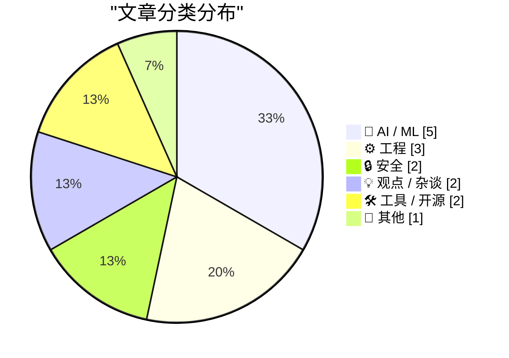
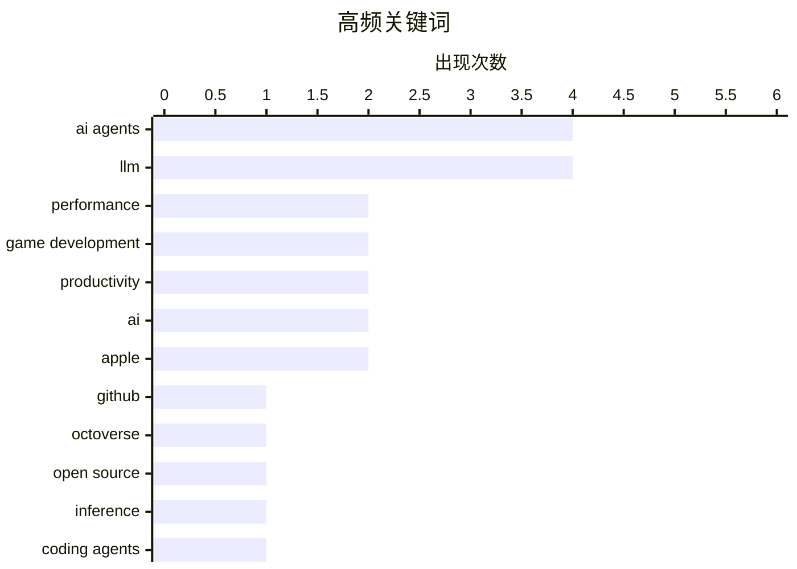

# 📰 Oct 30, 2026

> 来自 Karpathy 推荐的 92 个顶级技术博客，AI 精选 Top 15

## 📝 今日看点

今日技术圈见证了 AI Agent 从辅助工具向开发主体的全面跨越，GitHub 活跃度创下历史新高，标志着“氛围驱动型”开发时代的正式到来。在应用端，大模型正深度重塑游戏工业，通过自主 Agent 与个性化语音技术实现多人游戏世界的实时构建。与此同时，软件供应链安全与底层语言的内存安全缺陷依然是技术演进中不可忽视的核心挑战。

---

## 🏆 今日必读

🥇 **GitHub Octoverse 2026 报告：开发者正全面转向 Agent 驱动开发**

[GitHub Octoverse 2026](https://simonwillison.net/2026/Oct/28/github-octoverse-2026/) — simonwillison.net · 1 天前 · ⚙️ 工程

> GitHub 发布了 2026 年度 Octoverse 报告，显示受 AI Agent 驱动，平台上的 Commit 和 Push 数量创下历史新高。报告指出，开发者不再仅仅将 AI 作为辅助工具，而是开始构建能够自主执行任务的 Agent 流程。关键指标显示，AI 原生仓库的增长速度远超传统项目，协作模式正从“人与人”转向“人与 Agent”。GitHub EVP Jay Parikh 强调，这种转变正在重塑软件开发的生产力曲线。

💡 **为什么值得读**: 通过 GitHub 官方数据洞察全球开发者生态的剧变，了解 AI Agent 如何从辅助工具进化为开发核心。

🏷️ GitHub, Octoverse, AI agents, open source

🥈 **提升 Agent 速度：我过去 12 个月的实战经验总结**

[Making agents fast - what I've learnt over the last 12 months](https://martinalderson.com/posts/making-agents-fast/?utm_source=rss&amp;utm_medium=rss&amp;utm_campaign=feed) — martinalderson.com · 1 天前 · 🤖 AI / ML

> 优化 AI Agent 响应速度的核心在于平衡推理性能，特别是首字延迟 (TTFT) 与每秒 Token 数 (tok/s) 的权衡。作者分享了通过优化工具调用追踪 (tool call traces) 和构建 Agent 专用轻量化工具集来减少往返时间的方案。硬件选型与沙箱环境的配置对整体吞吐量有显著影响，尤其是在处理并发任务时。实战证明，减少不必要的上下文传递并采用流式输出是提升用户感知速度的关键。

💡 **为什么值得读**: 提供了极具实操性的 Agent 性能优化指南，适合正在解决 AI 应用延迟问题的开发者。

🏷️ AI agents, inference, performance, LLM

🥉 **2026 年 10 月：氛围驱动型游戏开发的转折点**

[The October inflection point for vibe game development](https://simonwillison.net/2026/Oct/28/vibe-game-development/) — simonwillison.net · 1 天前 · ⚙️ 工程

> 继 2025 年编程 Agent 爆发后，2026 年 10 月标志着“氛围驱动型 (Vibe Coding)”游戏开发的临界点。随着 Opus 4.5 和 GPT-5.1 的发布，模型能力已跨越阈值，使非专业开发者仅凭创意描述即可构建复杂游戏。这种模式将重点从编写底层代码转向了高层级的创意引导和迭代反馈。AI 模型的可靠性提升使得“即兴开发”成为可能，极大地缩短了从想法到可运行原型的距离。

💡 **为什么值得读**: 探讨了 AI 如何彻底降低游戏开发门槛，预示了“人人都是游戏制作人”时代的到来。

🏷️ coding agents, LLM, game development, productivity

---

## 📊 数据概览

| 扫描源 | 抓取文章 | 时间范围 | 精选 |
|:---:|:---:|:---:|:---:|
| 83/92 | 2540 篇 → 29 篇 | 48h | **15 篇** |

### 分类分布



### 高频关键词



<details>
<summary>📈 纯文本关键词图（终端友好）</summary>

```
ai agents        │ ████████████████████ 4
llm              │ ████████████████████ 4
performance      │ ██████████░░░░░░░░░░ 2
game development │ ██████████░░░░░░░░░░ 2
productivity     │ ██████████░░░░░░░░░░ 2
ai               │ ██████████░░░░░░░░░░ 2
apple            │ ██████████░░░░░░░░░░ 2
github           │ █████░░░░░░░░░░░░░░░ 1
octoverse        │ █████░░░░░░░░░░░░░░░ 1
open source      │ █████░░░░░░░░░░░░░░░ 1
```

</details>

### 🏷️ 话题标签

**ai agents**(4) · **llm**(4) · **performance**(2) · game development(2) · productivity(2) · ai(2) · apple(2) · github(1) · octoverse(1) · open source(1) · inference(1) · coding agents(1) · qwen3(1) · tts(1) · supply chain security(1) · package managers(1) · attestation(1) · signing(1) · cve(1) · memory safety(1)

---

## 🤖 AI / ML

### 1. 提升 Agent 速度：我过去 12 个月的实战经验总结

[Making agents fast - what I've learnt over the last 12 months](https://martinalderson.com/posts/making-agents-fast/?utm_source=rss&amp;utm_medium=rss&amp;utm_campaign=feed) — **martinalderson.com** · 1 天前 · ⭐ 27/30

> 优化 AI Agent 响应速度的核心在于平衡推理性能，特别是首字延迟 (TTFT) 与每秒 Token 数 (tok/s) 的权衡。作者分享了通过优化工具调用追踪 (tool call traces) 和构建 Agent 专用轻量化工具集来减少往返时间的方案。硬件选型与沙箱环境的配置对整体吞吐量有显著影响，尤其是在处理并发任务时。实战证明，减少不必要的上下文传递并采用流式输出是提升用户感知速度的关键。

🏷️ AI agents, inference, performance, LLM

---

### 2. 使用 Qwen3-TTS 定制个性化游戏配音

[Custom Voices With Qwen3-TTS](https://lucumr.pocoo.org/2026/10/29/qwen3-custom-voices/) — **lucumr.pocoo.org** · 1 天前 · ⭐ 26/30

> 在开发地牢爬行游戏时，作者利用 Qwen3-TTS 实现了非标准化的个性化语音叙事。该模型通过语音嵌入 (Voice Embeddings) 技术，允许用户仅凭少量音频样本即可克隆特定音色。相比于通用的 AI 语音，这种方案为游戏角色提供了更强的沉浸感和独特的辨识度。文章详细介绍了从音频采样、嵌入提取到最终模型集成的完整技术路径。

🏷️ Qwen3, TTS, game development, AI

---

### 3. 符合条件的 ChatGPT 订阅用户现可获赠 API 额度

[API credits benefit for eligible ChatGPT subscriptions](https://simonwillison.net/2026/Oct/29/api-credits/) — **simonwillison.net** · 13 小时前 · ⭐ 23/30

> OpenAI 效仿 Anthropic 的激励政策，为 ChatGPT Plus、Team 和 Enterprise 订阅用户提供每月 API 使用额度。不同等级的订阅者将获得 100 美元至 500 美元不等的信用点数，用于调用 OpenAI 的各类模型接口。这一举措旨在鼓励订阅用户从简单的聊天界面转向更深度的开发者应用场景。需要注意的是，这些赠送额度通常具有有效期限制，旨在促进活跃的开发尝试。

🏷️ OpenAI, API, ChatGPT, pricing

---

### 4. 利用自主 Fable 级模型构建多人游戏世界

[Building a multiplayer game world with autonomous Fable-class models](https://simonwillison.net/2026/Oct/29/how-i-built-the-most-ai-pilled-company-in-the-world/) — **simonwillison.net** · 19 小时前 · ⭐ 22/30

> Spawn 项目展示了如何利用前沿的 Agent 架构构建大规模多人在线游戏环境。玩家可以通过自然语言提示词与 Fable 级模型交互，实时生成游戏内容、逻辑和交互规则。该方案采用了高度自主的 Agent 协作模式，实现了从代码编写到资产生成的全链路自动化。这种“AI 驱动”的架构彻底改变了传统游戏引擎的运作方式，实现了真正的动态世界生成。

🏷️ AI agents, gaming, Fable, LLM

---

### 5. Ted Sanders 谈 LLM 性能：规模依然是核心变量

[Quoting Ted Sanders](https://simonwillison.net/2026/Oct/28/ted-sanders/) — **simonwillison.net** · 1 天前 · ⭐ 21/30

> Ted Sanders 指出 LLM 的性能是多维度的，擅长数学的模型在幽默感或创意写作上可能表现平平。尽管维度复杂，但模型规模 (Model Size) 依然是解释性能差异的最核心变量。大模型通常在可靠性、知识召回率和复杂推理能力上表现更优，但同时也伴随着更高的 Token 成本。理解这种性能与规模的非线性关系，对于开发者进行理性的模型选型和成本控制至关重要。

🏷️ LLM, benchmarking, performance, evaluation

---

## ⚙️ 工程

### 6. GitHub Octoverse 2026 报告：开发者正全面转向 Agent 驱动开发

[GitHub Octoverse 2026](https://simonwillison.net/2026/Oct/28/github-octoverse-2026/) — **simonwillison.net** · 1 天前 · ⭐ 27/30

> GitHub 发布了 2026 年度 Octoverse 报告，显示受 AI Agent 驱动，平台上的 Commit 和 Push 数量创下历史新高。报告指出，开发者不再仅仅将 AI 作为辅助工具，而是开始构建能够自主执行任务的 Agent 流程。关键指标显示，AI 原生仓库的增长速度远超传统项目，协作模式正从“人与人”转向“人与 Agent”。GitHub EVP Jay Parikh 强调，这种转变正在重塑软件开发的生产力曲线。

🏷️ GitHub, Octoverse, AI agents, open source

---

### 7. 2026 年 10 月：氛围驱动型游戏开发的转折点

[The October inflection point for vibe game development](https://simonwillison.net/2026/Oct/28/vibe-game-development/) — **simonwillison.net** · 1 天前 · ⭐ 26/30

> 继 2025 年编程 Agent 爆发后，2026 年 10 月标志着“氛围驱动型 (Vibe Coding)”游戏开发的临界点。随着 Opus 4.5 和 GPT-5.1 的发布，模型能力已跨越阈值，使非专业开发者仅凭创意描述即可构建复杂游戏。这种模式将重点从编写底层代码转向了高层级的创意引导和迭代反馈。AI 模型的可靠性提升使得“即兴开发”成为可能，极大地缩短了从想法到可运行原型的距离。

🏷️ coding agents, LLM, game development, productivity

---

### 8. 避免公有函数互相调用

[Avoid Public Functions Calling Other Public Functions](https://matklad.github.io/2026/10/29/pub-calls-pub.html) — **matklad.github.io** · 1 天前 · ⭐ 21/30

> 提出了一项关于 API 设计的小型经验法则：应避免让一个公有（Public）函数直接调用另一个公有函数。这种做法旨在减少 API 内部的耦合度，防止修改一个导出接口时意外影响到另一个接口的行为。虽然作者承认这只是一个经验法则且缺乏具体案例，但其核心逻辑在于保持公有接口作为独立入口点的纯粹性。通过将共享逻辑提取到私有辅助函数中，可以显著提升代码库的可重构性和接口的稳定性。

🏷️ API design, refactoring, software architecture

---

## 🔒 安全

### 9. 跨软件包仓库的签名与证明机制综述

[Signing and Attestations Across Package Registries](https://nesbitt.io/2026/10/30/signing-and-attestations-across-package-registries.html) — **nesbitt.io** · 2 小时前 · ⭐ 26/30

> 软件供应链安全的核心在于确保包的来源可靠，文章调研了各大包管理仓库的签名、来源证明 (Provenance Attestations) 和受信任发布机制。重点对比了 Sigstore 等工具在 npm、PyPI 等主流生态中的集成现状与差异。通过自动化证明，开发者可以验证构建过程是否在受控的 GitHub Actions 等环境中进行。建立跨平台的统一安全标准是防止恶意代码注入和供应链攻击的关键防御手段。

🏷️ supply chain security, package managers, attestation, signing

---

### 10. “没办法预防”——某常发此类事故语言的用户如是说

["No way to prevent this" say users of only language where this regularly happens](https://xeiaso.net/shitposts/no-way-to-prevent-this/memory-safety/CVE-2026-98432/) — **xeiaso.net** · 1 天前 · ⭐ 24/30

> 针对 Linux 内核中新发现的 CVE-2026-98432 漏洞，文章讽刺了 C 语言在内存安全方面的固有缺陷。该漏洞源于 use-after-kfree 错误，攻击者可通过精心构造的连接请求实现任意代码执行。尽管业界持续呼吁转向 Rust 等内存安全语言，但核心系统组件仍受困于 C 语言的手动指针管理。这种反复出现的安全危机再次引发了关于系统级编程语言转型的激烈讨论。

🏷️ CVE, memory safety, Linux, C

---

## 💡 观点 / 杂谈

### 11. 直接要求 AI 做事：打破开发者主体性的瓶颈

[You can just ask AI to do things](https://seangoedecke.com/you-can-just-ask-ai-to-do-things/) — **seangoedecke.com** · 1 天前 · ⭐ 22/30

> 与 AI 协作的核心能力在于“主体性 (Agency)”，即敢于尝试雄心勃勃的任务。随着模型能力的飞速提升，人类的瓶颈往往在于不敢想象 AI 能完成的工作，而非 AI 本身的能力限制。文章鼓励开发者打破思维定式，直接向 AI 提出复杂的架构设计或重构指令，而不是局限于简单的代码补全。通过不断的实践和尝试，用户可以发现 AI 在解决高难度工程问题上的惊人潜力。

🏷️ AI, agency, prompt engineering, productivity

---

### 12. 优雅与智力往往成反比

[Elegance and intelligence are anticorrelated](https://seangoedecke.com/elegance-and-intelligence-are-anticorrelated/) — **seangoedecke.com** · 12 小时前 · ⭐ 21/30

> 探讨了高智商开发者倾向于产出“不优雅”解决方案的心理学现象。由于聪明人具备极强的逻辑处理和暴力破解能力，他们更倾向于直接硬算复杂问题，而非寻找巧妙的捷径。文中以冯·诺依曼为例，他能瞬间心算无穷级数来解决“苍蝇与自行车”难题，而普通人则必须依赖物理直觉寻找优雅的简便算法。这种能力差异导致聪明人容易忽略代码的可维护性与简洁性，因为复杂逻辑对他们而言并不构成认知负担。

🏷️ software design, complexity, intelligence, coding style

---

## 🛠 工具 / 开源

### 13. 史蒂文·利维谈配备触摸屏的新款 MacBook Pro

[Steven Levy on the New MacBook Pro, With, Yes, a Touchscreen](https://www.wired.com/story/the-inside-story-of-why-apple-finally-brought-a-touch-display-to-the-mac/) — **daringfireball.net** · 1 天前 · ⭐ 21/30

> 报道了苹果公司打破多年传统，在新款 MacBook Pro 中引入触摸显示屏的重大转变。硬件工程副总裁 John Ternus 强调，Mac 依然是以触控板和键盘为主的间接输入设备，增加触控功能仅是为了在特定场景下提供便利。苹果试图在引入新交互方式的同时安抚忠实用户，确保 Mac 不会因为借鉴移动端特性而失去其作为生产力工具的独特性。这一决策标志着苹果在产品线融合与用户需求权衡上的策略调整。

🏷️ MacBook Pro, Apple, touchscreen, hardware

---

### 14. 引用 Ben Hylak：所有产品都应成为无头 MCP

[Quoting Ben Hylak](https://simonwillison.net/2026/Oct/29/ben-hylak/) — **simonwillison.net** · 22 小时前 · ⭐ 20/30

> 引用了 Ben Hylak 关于 AI 时代产品形态的讽刺性观点。他认为未来的理想产品应该演变为“无头”的模型上下文协议（MCP），直接对接 AI 智能体，让用户无需感知底层 UI。然而，这种“去 UI 化”的趋势存在一个普遍的认知偏差：每个开发者都认为自己的产品是个例外，坚信用户依然热爱并需要他们精心设计的界面。这反映了当前 AI Agent 浪潮下，开发者在自动化趋势与用户体验价值之间的矛盾心理。

🏷️ MCP, AI agents, UI, automation

---

## 📝 其他

### 15. 苹果将台湾地区 App Store 佣金比例下调 4%

[Apple Drops App Store Commission by a Whopping 4 Percentage Points in Taiwan](https://developer.apple.com/news/?id=w9mxlhek) — **daringfireball.net** · 15 小时前 · ⭐ 19/30

> 苹果公司宣布调整台湾地区 App Store 的佣金政策，以应对当地公平交易委员会的监管压力。自 2026 年 10 月 31 日起，标准应用内购买和付费应用的佣金率将从 30% 降至 26%。这一调整适用于 iOS 和 iPadOS 平台，是继日本市场之后，苹果在全球监管压力下做出的又一次局部让步。尽管降幅仅为 4 个百分点，但它预示着苹果封闭生态的抽成模式正在全球范围内受到持续挑战。

🏷️ Apple, App Store, regulation, Taiwan

---

*生成于 2026-10-30 12:35 | 扫描 83 源 → 获取 2540 篇 → 精选 15 篇*
*基于 [Hacker News Popularity Contest 2025](https://refactoringenglish.com/tools/hn-popularity/) RSS 源列表，由 [Andrej Karpathy](https://x.com/karpathy) 推荐*
