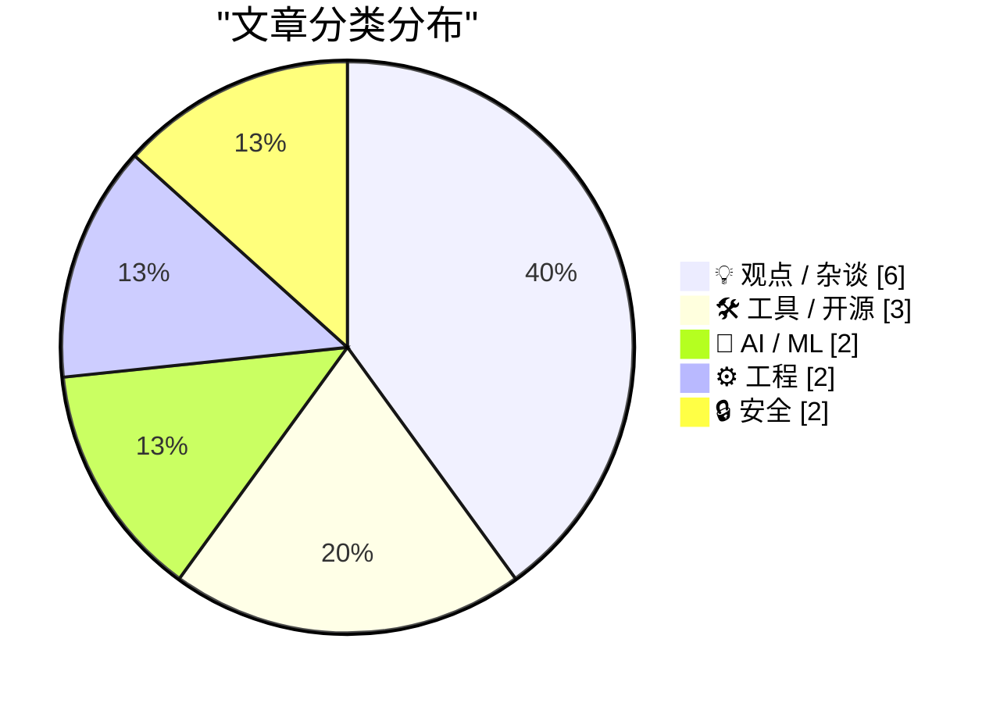
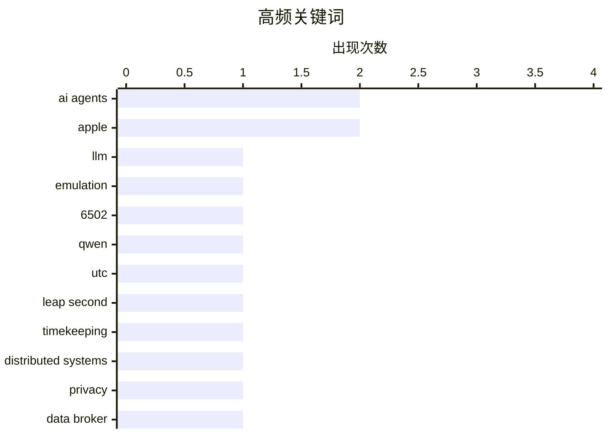

# 📰 Oct 31, 2026

> 来自 Karpathy 推荐的 92 个顶级技术博客，AI 精选 Top 15

## 📝 今日看点

今日技术圈见证了AI与底层逻辑的深度融合，从模型权重植入模拟器到自主智能体构建游戏世界，大模型正展现出更强的工程化潜力。基础设施领域迎来历史性变革，闰秒制度的终结将彻底消除计算机系统的同步隐患，而软件包供应链安全与签名机制正成为行业防御重点。与此同时，科技巨头正深陷监管与市场的双重博弈，苹果佣金下调与通用汽车的隐私重罚折射出合规压力的持续升级。

---

## 🏆 今日必读

🥇 **nesformer：将任天堂 NES 模拟器植入 Qwen 3.5 模型权重**

[dbreunig/nesformer](https://simonwillison.net/2026/Oct/30/nesformer/) — simonwillison.net · 14 小时前 · 🤖 AI / ML

> 开发者 Drew Breunig 受 qwenputer 项目启发，成功将任天堂 NES 游戏机的 6502 CPU 模拟器逻辑直接嵌入到 Qwen 3.5-4B 模型的权重中。该实验展示了大语言模型（LLM）不仅能处理文本，还能通过权重编码复杂的硬件指令集逻辑。目前该模拟器已能运行《超级马里奥兄弟》等经典 ROM，尽管运行速度极慢，但验证了模型作为通用计算引擎的潜力。这一探索模糊了传统软件模拟器与神经网络参数之间的界限，展示了“权重即代码”的可能性。

💡 **为什么值得读**: 这是一个极具黑客精神的实验，展示了 LLM 权重在模拟复杂硬件逻辑方面的惊人潜力。

🏷️ LLM, emulation, 6502, Qwen

🥈 **欢呼吧，UTC 闰秒制度正式宣告终结**

[Rejoice, leap seconds are dead!](https://www.jeffgeerling.com/blog/2026/rejoice-the-utc-leap-second-is-dead/) — jeffgeerling.com · 22 小时前 · ⚙️ 工程

> 国际计量大会（CGPM）通过第 5 号决议，正式决定停止在协调世界时（UTC）中引入闰秒。长期以来，闰秒为了对齐原子钟与地球自转，给计算机系统、电信网络和金融交易带来了巨大的同步风险与技术故障隐患。根据决议，未来将允许 UTC 与原子时之间存在更大的偏差，而不再进行频繁的秒级微调。这一决定标志着全球计时标准进入了一个更稳定、更适合数字时代的新阶段。开发者将不再需要担心因闰秒导致的系统崩溃或逻辑错误。

💡 **为什么值得读**: 闰秒曾是程序员的噩梦，了解这一历史性的技术标准变更对所有系统架构师都至关重要。

🏷️ UTC, leap second, timekeeping, distributed systems

🥉 **通用汽车因非法出售驾驶员隐私数据被罚 2.2 亿美元**

[GM to Pay $220 Million After Betraying Their Own Drivers’ Privacy](https://www.reuters.com/business/autos-transportation/gm-pay-220-million-settle-allegations-it-violated-consumers-privacy-2026-10-29/) — daringfireball.net · 18 小时前 · 🔒 安全

> 通用汽车（GM）同意支付 2.2 亿美元，以和解美国 35 个州及华盛顿特区对其非法出售驾驶员数据的指控。调查发现，通用汽车通过其 Smart Driver 程序收集了数百万驾驶员的行踪和驾驶习惯，并将其转卖给数据经纪人。这些数据最终流向保险公司，导致部分用户的保费被无故调高。该和解协议要求通用汽车停止此类未经授权的数据共享行为，并加强对用户隐私保护的透明度。此案例为车联网时代的数据合规性敲响了警钟。

💡 **为什么值得读**: 揭示了智能汽车时代个人隐私面临的严峻挑战，以及监管机构对数据滥用的重拳出击。

🏷️ privacy, data broker, automotive

---

## 📊 数据概览

| 扫描源 | 抓取文章 | 时间范围 | 精选 |
|:---:|:---:|:---:|:---:|
| 84/92 | 2565 篇 → 28 篇 | 48h | **15 篇** |

### 分类分布



### 高频关键词



<details>
<summary>📈 纯文本关键词图（终端友好）</summary>

```
ai agents           │ ████████████████████ 2
apple               │ ████████████████████ 2
llm                 │ ██████████░░░░░░░░░░ 1
emulation           │ ██████████░░░░░░░░░░ 1
6502                │ ██████████░░░░░░░░░░ 1
qwen                │ ██████████░░░░░░░░░░ 1
utc                 │ ██████████░░░░░░░░░░ 1
leap second         │ ██████████░░░░░░░░░░ 1
timekeeping         │ ██████████░░░░░░░░░░ 1
distributed systems │ ██████████░░░░░░░░░░ 1
```

</details>

### 🏷️ 话题标签

**ai agents**(2) · **apple**(2) · **llm**(1) · emulation(1) · 6502(1) · qwen(1) · utc(1) · leap second(1) · timekeeping(1) · distributed systems(1) · privacy(1) · data broker(1) · automotive(1) · package management(1) · software updates(1) · security(1) · supply chain security(1) · package registry(1) · attestation(1) · provenance(1)

---

## 💡 观点 / 杂谈

### 1. 迫于监管压力，苹果在台湾地区将 App Store 佣金降至 26%

[Apple Drops App Store Commission by a Whopping 4 Percentage Points in Taiwan](https://developer.apple.com/news/?id=w9mxlhek) — **daringfireball.net** · 1 天前 · ⭐ 23/30

> 苹果公司宣布调整台湾地区 App Store 的佣金政策，以应对台湾公平交易委员会的监管要求。自 2026 年 10 月 31 日起，标准的应用内购买（IAP）和付费应用交易佣金率将从原先的 30% 下调至 26%。这一变动适用于 iOS 和 iPadOS 平台，旨在缓解长期以来开发者对“苹果税”过高的不满。此举是继日本之后，苹果在全球范围内因反垄断压力而做出的又一次局部让步。尽管降幅仅为 4 个百分点，但反映了苹果封闭生态在监管压力下的松动趋势。

🏷️ Apple, App Store, Taiwan, antitrust

---

### 2. 华尔街日报：芯片供应商正从苹果严苛的供应链管理中“夺回主权”

[Rolfe Winkler at The WSJ: ‘The Beleaguered Chip Sellers Getting Their Revenge on Apple’](https://www.wsj.com/tech/apple-iphone-memory-chips-ai-c0084cc9?st=FNAyaT) — **daringfireball.net** · 1 天前 · ⭐ 23/30

> 《华尔街日报》报道了苹果公司与其芯片供应商之间权力天平的微妙变化。长期以来，苹果利用极端的谈判技巧（如深夜会议、挑拨竞争）压低成本，前高管 Tony Blevins 是这一风格的代表。然而，随着 AI 浪潮对高性能存储芯片需求的激增，供应商开始拥有更强的议价能力，甚至反向对苹果施压。文章揭示了在技术迭代周期中，即便是像苹果这样的供应链霸主也必须面对市场供需关系的重新洗牌。这种博弈将直接影响未来电子产品的成本结构和技术走向。

🏷️ Apple, supply chain, semiconductor, chips

---

### 3. 为什么聪明人往往会写出“不优雅”的代码？

[Elegance and intelligence are anticorrelated](https://seangoedecke.com/elegance-and-intelligence-are-anticorrelated/) — **seangoedecke.com** · 1 天前 · ⭐ 21/30

> 本文提出了一个有趣的观点：优雅的解决方案与智力水平之间往往存在负相关关系。作者认为，极度聪明的人（如冯·诺依曼）因为具备强大的大脑“暴力破解”能力，往往倾向于直接解决问题而非寻找巧妙的捷径。相比之下，普通人为了降低认知负荷，不得不发明各种优雅的抽象和助记手段。文章通过冯·诺依曼计算“苍蝇与自行车”问题的轶事，说明了智力过剩可能导致对简洁美学的忽视。这一观点挑战了“代码越优雅代表作者越聪明”的传统认知。

🏷️ software engineering, problem solving, coding style

---

### 4. 引用 Ben Hylak：当所有产品都变成 AI 代理的无头 MCP

[Quoting Ben Hylak](https://simonwillison.net/2026/Oct/29/ben-hylak/) — **simonwillison.net** · 1 天前 · ⭐ 19/30

> 探讨了软件产品在 AI 时代向“无头 MCP”（模型上下文协议）转型的讽刺性现状。核心观点认为，理想情况下用户希望所有工具都接入 AI 代理以消除底层复杂性，从而无需直接操作 UI。然而，开发者往往陷入“唯独我的产品例外”的认知偏差，坚信自己的 UI 依然是用户所热爱的。这种矛盾揭示了 AI 代理生态下传统软件交互界面的生存危机与定位尴尬。文章通过简短的引用，精准捕捉了技术转型期开发者对用户体验的盲目自信。

🏷️ MCP, AI agents, UI/UX

---

### 5. 大学教育将只需每月 20 美元

[College will only cost $20 a month](https://idiallo.com/blog/college-will-cost-20-dollars) — **idiallo.com** · 12 小时前 · ⭐ 19/30

> 剖析了计算机科学教育从 2020-2022 年的“招聘黄金时代”到当前就业寒冬的剧烈转变。随着科技公司招聘停滞，传统昂贵的计算机学位在就业市场上的投资回报率正面临严峻挑战。作者暗示，在招聘需求萎缩的背景下，教育模式必须向极低成本（如每月 20 美元）转型才能维持其合理性。这种转变反映了技术人才供需关系的结构性失衡以及 AI 对初级开发岗位的潜在冲击。文章表达了对即将毕业的学生在严峻市场中寻找职位的深度忧虑。

🏷️ education, computer science, hiring, career

---

### 6. 91 岁传记大师罗伯特·卡罗的职业生涯反思

[Robert Caro – The master biographer reflects at 91](https://www.dwarkesh.com/p/robert-caro) — **dwarkesh.com** · 19 小时前 · ⭐ 19/30

> 记录了 91 岁高龄的传奇传记作家罗伯特·卡罗（Robert Caro）对其写作生涯的深度回顾。卡罗分享了他在撰写《权力经纪人》等巨著时，如何通过极度详尽的调研挖掘历史真相。他特别提到，在成书过程中被迫删减的大量珍贵素材是极大的遗憾，因为这些内容可能永远不为人知。访谈展现了一位顶尖学者对权力运作逻辑的终身观察以及对非虚构写作严谨性的极致追求。这不仅是关于写作的讨论，更是关于如何通过研究揭示社会运行机制的教诲。

🏷️ biography, history, writing, Robert Caro

---

## 🛠 工具 / 开源

### 7. 包管理周报：2026 年 10 月 31 日

[This Week in Package Management: 31 October 2026](https://nesbitt.io/2026/10/31/this-week-in-package-management.html) — **nesbitt.io** · 2 小时前 · ⭐ 24/30

> 本周包管理领域汇总了各大主流生态系统的最新发布动态、安全通告及技术文章。内容涵盖了 npm、PyPI、Cargo 等包管理器的版本更新，以及针对近期发现的供应链攻击的防御建议。报告重点关注了包注册表在安全加固方面的进展，为开发者提供了维护项目依赖安全的一手信息。通过阅读本周报，开发者可以快速掌握软件供应链领域的最新趋势与风险预警。这是保持开发工具链安全与现代化的重要参考。

🏷️ package management, software updates, security

---

### 8. OpenAI 跟进：为 ChatGPT 订阅者提供 API 额度返还福利

[API credits benefit for eligible ChatGPT subscriptions](https://simonwillison.net/2026/Oct/29/api-credits/) — **simonwillison.net** · 1 天前 · ⭐ 22/30

> OpenAI 宣布为特定级别的 ChatGPT 订阅用户提供 API 额度福利，以应对 Anthropic 此前推出的竞争策略。根据订阅方案的不同，Max 和 Team 级别的用户每月可获得价值 100 至 500 美元不等的 API 使用额度。这些额度具有时效性，旨在鼓励订阅用户在开发自己的应用时更多地调用 OpenAI 的底层模型。这一举措标志着大模型厂商之间的竞争已从单纯的模型性能转向了开发者生态的深度绑定。对于开发者而言，这显著降低了构建 AI 应用的实验成本。

🏷️ OpenAI, API, ChatGPT, credits

---

### 9. M6、M5 Pro 及 M5 Max 版 MacBook Pro 价格与配置指南

[★ MacBook Pro Pricing and Configurations for M6, M5 Pro, and M5 Max](https://daringfireball.net/2026/10/macbook_pro_pricing_and_configurations_for_m6_m5_pro_and_m5_max) — **daringfireball.net** · 14 小时前 · ⭐ 21/30

> 汇总了搭载 M6、M5 Pro 和 M5 Max 芯片的新款 MacBook Pro 所有配置选项与定价表格。文章重点展示了重新设计的硬件规格，特别是针对 PROLED XDR 显示屏机型的选配差异。通过单一页面的表格化呈现，清晰对比了不同芯片层级的内存、存储起步配置及加价阶梯。这为消费者在阅读深度评测前提供了一个直观的选购参考工具。这种结构化的数据整理有助于用户快速识别各型号间的性价比差异。

🏷️ MacBook Pro, Apple Silicon, hardware

---

## 🤖 AI / ML

### 10. nesformer：将任天堂 NES 模拟器植入 Qwen 3.5 模型权重

[dbreunig/nesformer](https://simonwillison.net/2026/Oct/30/nesformer/) — **simonwillison.net** · 14 小时前 · ⭐ 27/30

> 开发者 Drew Breunig 受 qwenputer 项目启发，成功将任天堂 NES 游戏机的 6502 CPU 模拟器逻辑直接嵌入到 Qwen 3.5-4B 模型的权重中。该实验展示了大语言模型（LLM）不仅能处理文本，还能通过权重编码复杂的硬件指令集逻辑。目前该模拟器已能运行《超级马里奥兄弟》等经典 ROM，尽管运行速度极慢，但验证了模型作为通用计算引擎的潜力。这一探索模糊了传统软件模拟器与神经网络参数之间的界限，展示了“权重即代码”的可能性。

🏷️ LLM, emulation, 6502, Qwen

---

### 11. 打造 Spawn：利用自主智能体模型构建多人 AI 游戏世界

[Building a multiplayer game world with autonomous Fable-class models](https://simonwillison.net/2026/Oct/29/how-i-built-the-most-ai-pilled-company-in-the-world/) — **simonwillison.net** · 1 天前 · ⭐ 23/30

> Jacob Sansbury 介绍了如何利用前沿的“智能体工程”（Agentic Engineering）技术构建名为 Spawn 的多人在线游戏环境。在 Spawn 中，玩家可以通过自然语言提示词实时修改游戏世界，而底层的 Fable 级模型则负责自主执行复杂的逻辑变更。该项目探索了 LLM 在处理高并发、强状态一致性游戏场景中的极限能力。作者认为，这种“AI 驱动”的开发模式将彻底改变传统游戏的交互边界和内容生成效率。这为未来元宇宙和动态游戏世界的构建提供了新的技术范式。

🏷️ AI agents, gaming, autonomous models

---

## ⚙️ 工程

### 12. 欢呼吧，UTC 闰秒制度正式宣告终结

[Rejoice, leap seconds are dead!](https://www.jeffgeerling.com/blog/2026/rejoice-the-utc-leap-second-is-dead/) — **jeffgeerling.com** · 22 小时前 · ⭐ 26/30

> 国际计量大会（CGPM）通过第 5 号决议，正式决定停止在协调世界时（UTC）中引入闰秒。长期以来，闰秒为了对齐原子钟与地球自转，给计算机系统、电信网络和金融交易带来了巨大的同步风险与技术故障隐患。根据决议，未来将允许 UTC 与原子时之间存在更大的偏差，而不再进行频繁的秒级微调。这一决定标志着全球计时标准进入了一个更稳定、更适合数字时代的新阶段。开发者将不再需要担心因闰秒导致的系统崩溃或逻辑错误。

🏷️ UTC, leap second, timekeeping, distributed systems

---

### 13. 当费德里科·法金离开英特尔之时

[When Federico Faggin left Intel](https://dfarq.homeip.net/when-federico-faggin-left-intel/?utm_source=rss&#038;utm_medium=rss&#038;utm_campaign=when-federico-faggin-left-intel) — **dfarq.homeip.net** · 1 天前 · ⭐ 19/30

> 回顾了 1974 年 10 月 31 日早期 CPU 架构大师费德里科·法金（Federico Faggin）离开英特尔的历史转折点。法金曾主导了英特尔 4004、8008 和 8080 等开创性芯片的设计，是微处理器革命的核心人物。离职后，他创立了 Zilog 并开发出传奇的 Z-80 处理器，该芯片在 8 位计算机时代取得了巨大成功。这段历史展示了顶尖技术人才的流动如何催生出改变行业的竞争产品与技术演进。文章强调了法金在硅谷早期硬件创新中所扮演的不可替代的角色。

🏷️ Intel, CPU, Zilog, microprocessor

---

## 🔒 安全

### 14. 通用汽车因非法出售驾驶员隐私数据被罚 2.2 亿美元

[GM to Pay $220 Million After Betraying Their Own Drivers’ Privacy](https://www.reuters.com/business/autos-transportation/gm-pay-220-million-settle-allegations-it-violated-consumers-privacy-2026-10-29/) — **daringfireball.net** · 18 小时前 · ⭐ 24/30

> 通用汽车（GM）同意支付 2.2 亿美元，以和解美国 35 个州及华盛顿特区对其非法出售驾驶员数据的指控。调查发现，通用汽车通过其 Smart Driver 程序收集了数百万驾驶员的行踪和驾驶习惯，并将其转卖给数据经纪人。这些数据最终流向保险公司，导致部分用户的保费被无故调高。该和解协议要求通用汽车停止此类未经授权的数据共享行为，并加强对用户隐私保护的透明度。此案例为车联网时代的数据合规性敲响了警钟。

🏷️ privacy, data broker, automotive

---

### 15. 跨包注册表的签名与证明机制深度调研

[Signing and Attestations Across Package Registries](https://nesbitt.io/2026/10/30/signing-and-attestations-across-package-registries.html) — **nesbitt.io** · 1 天前 · ⭐ 24/30

> 本文对当前主流软件包注册表（如 npm, PyPI, RubyGems 等）的签名、来源证明（Provenance Attestations）和可信发布机制进行了全面调研。文章详细对比了各平台在防止供应链攻击方面采取的技术手段，包括 Sigstore 的应用以及 OIDC 身份验证的集成。研究发现，虽然各大注册表都在推进自动化签名，但在跨平台标准统一和用户易用性上仍存在显著差异。结论指出，建立端到端的透明供应链是提升开源生态安全性的关键路径。这对于构建高安全要求的软件系统具有重要指导意义。

🏷️ supply chain security, package registry, attestation, provenance

---

*生成于 2026-10-31 12:02 | 扫描 84 源 → 获取 2565 篇 → 精选 15 篇*
*基于 [Hacker News Popularity Contest 2025](https://refactoringenglish.com/tools/hn-popularity/) RSS 源列表，由 [Andrej Karpathy](https://x.com/karpathy) 推荐*
