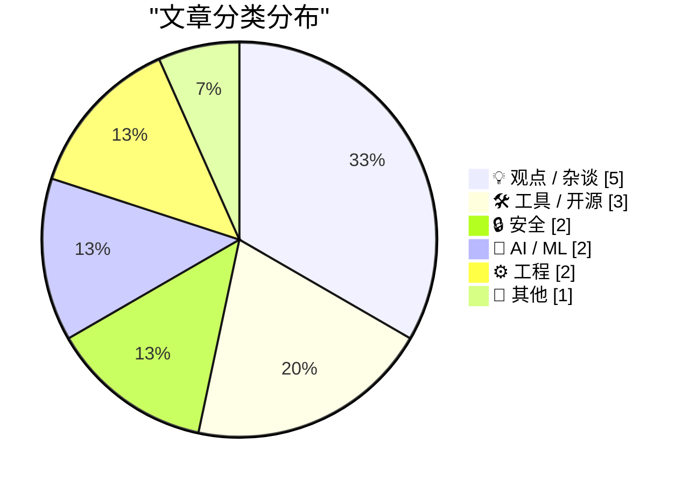
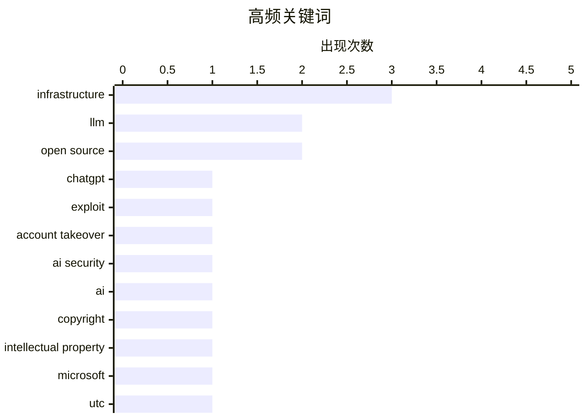

# 📰 Nov 1, 2026

> 来自 Karpathy 推荐的 92 个顶级技术博客，AI 精选 Top 15

## 📝 今日看点

AI 技术的深度渗透正全面重塑行业边界，从 ChatGPT 的安全漏洞到 AI 对版权法律与高等教育价值的颠覆性挑战，预示着智能化转型的阵痛与机遇并存。与此同时，全球计时标准迎来历史性变革，闰秒机制的正式终结标志着计算机基础设施向更高稳定性迈进。此外，通用汽车巨额隐私和解案与供应链安全动态，再次凸显了在硬件迭代与职场进阶之外，数据伦理与系统防御仍是技术演进的核心底色。

---

## 🏆 今日必读

🥇 **我们是如何接管 ChatGPT 账户的**

[How We Took Over ChatGPT Accounts](https://simonwillison.net/2026/Oct/31/how-we-took-over-chatgpt-accounts/) — simonwillison.net · 13 小时前 · 🔒 安全

> ChatGPT 的 HTML 预览功能（原名 Canvas/Artifacts）存在严重安全漏洞，允许攻击者接管用户账户。Parameter Labs 发现该功能在渲染交互式自定义 HTML 应用时，未能完全隔离沙箱环境。攻击者可以通过恶意构造的 HTML 代码绕过同源策略，窃取用户的会话令牌或敏感对话数据。OpenAI 已针对此漏洞进行了修复，但该案例揭示了 LLM 集成交互式 UI 组件时的潜在攻击面。这一发现强调了在 AI 助手内运行不受信任代码的巨大风险。

💡 **为什么值得读**: 深入剖析了 AI 助手集成交互式前端组件时面临的真实安全挑战，是 Web 安全和 AI 应用开发者的必读案例。

🏷️ ChatGPT, exploit, account takeover, AI security

🥈 **Pluralistic：形式主义（2026年10月31日）**

[Pluralistic: Formalities (31 Oct 2026)](https://pluralistic.net/2026/10/31/burn-berne/) — pluralistic.net · 21 小时前 · 🤖 AI / ML

> 美国版权局正在重新定义 AI 生成内容的版权地位，强调版权应是“通过劳动获得”而非自动赋予。文章探讨了在 AI 时代恢复版权法原始意图的必要性，防止大公司利用自动化工具进行无限制的版权扩张。作者 Cory Doctorow 结合历史案例（如 SOPA、Snowden 等）分析了技术监管与法律形式主义之间的博弈。核心观点认为，不应给予未经人类实质性创作的 AI 产出以法律保护，以维护创作者的真实利益。这种转变标志着法律正在从“保护机器产出”回归到“保护人类劳动”。

💡 **为什么值得读**: 著名科技评论家 Cory Doctorow 对 AI 版权争议的深度法律与伦理思考，适合关注数字权利和 AI 政策的读者。

🏷️ AI, Copyright, Intellectual Property, Microsoft

🥉 **欢呼吧，闰秒正式终结！**

[Rejoice, leap seconds are dead!](https://www.jeffgeerling.com/blog/2026/rejoice-the-utc-leap-second-is-dead/) — jeffgeerling.com · 1 天前 · ⚙️ 工程

> 国际计量大会（CGPM）通过第 5 号决议，正式宣布永久废除协调世界时（UTC）中的“闰秒”机制。长期以来，闰秒为了对齐地球自转速度而导致计算机系统、卫星导航和电信网络频繁出现同步故障。根据新规，UTC 与原子时（TAI）之间的偏差将被允许扩大，不再进行秒级修正。这一决定解决了困扰程序员数十年的时间同步难题，标志着全球计时标准向纯原子时迈进。未来几十年内，我们再也不需要担心因闰秒导致的系统崩溃或时间回跳问题。

💡 **为什么值得读**: 计算机科学领域的一个历史性时刻，彻底终结了让无数开发者头疼的闰秒 Bug 隐患。

🏷️ UTC, leap second, timekeeping, infrastructure

---

## 📊 数据概览

| 扫描源 | 抓取文章 | 时间范围 | 精选 |
|:---:|:---:|:---:|:---:|
| 82/92 | 2520 篇 → 23 篇 | 48h | **15 篇** |

### 分类分布



### 高频关键词



<details>
<summary>📈 纯文本关键词图（终端友好）</summary>

```
infrastructure        │ ████████████████████ 3
llm                   │ █████████████░░░░░░░ 2
open source           │ █████████████░░░░░░░ 2
chatgpt               │ ███████░░░░░░░░░░░░░ 1
exploit               │ ███████░░░░░░░░░░░░░ 1
account takeover      │ ███████░░░░░░░░░░░░░ 1
ai security           │ ███████░░░░░░░░░░░░░ 1
ai                    │ ███████░░░░░░░░░░░░░ 1
copyright             │ ███████░░░░░░░░░░░░░ 1
intellectual property │ ███████░░░░░░░░░░░░░ 1
```

</details>

### 🏷️ 话题标签

**infrastructure**(3) · **llm**(2) · **open source**(2) · chatgpt(1) · exploit(1) · account takeover(1) · ai security(1) · ai(1) · copyright(1) · intellectual property(1) · microsoft(1) · utc(1) · leap second(1) · timekeeping(1) · ai code(1) · proton(1) · engineering management(1) · solar economics(1) · nes emulator(1) · qwen(1)

---

## 💡 观点 / 杂谈

### 1. 每周更新 528：阅读 AI 生成的代码与太阳能经济学

[Weekly Update 528: Reading AI-generated Code & the Economics of Solar](https://www.troyhunt.com/weekly-update-528/) — **troyhunt.com** · 5 小时前 · ⭐ 24/30

> 网络安全专家 Troy Hunt 在本周更新中评述了 Proton 首席执行官发布的《AI 工程宣言》，指出其管理风格和对 AI 的激进态度引发了开发者社区的强烈反感。文章探讨了阅读和维护 AI 生成代码所带来的隐性技术债，质疑过度依赖 AI 辅助编程的长期可持续性。此外，内容还涵盖了太阳能经济学以及近期发生的重大数据泄露事件分析。作者强调，虽然 AI 能提高产出速度，但代码质量和工程文化的退化是不可忽视的代价。这种对“速度 vs 质量”的权衡在 AI 时代变得尤为紧迫。

🏷️ AI code, Proton, engineering management, solar economics

---

### 2. 提升职场声望的快慢之道

[Fast and slow ways to improve your reputation](https://seangoedecke.com/how-to-get-assigned-interesting-work/) — **seangoedecke.com** · 13 小时前 · ⭐ 22/30

> 程序员常陷入“没有好项目就没名声，没名声就接不到好项目”的死循环，本文提供了打破这一僵局的实用策略。作者区分了提升声望的“快路径”（如解决紧急线上故障、优化核心链路性能）和“慢路径”（如持续的技术分享、跨团队协作）。建议初级工程师通过承担高可见度的“脏活”或在关键时刻提供技术支持来快速建立信任。最终目标是让管理者意识到你不仅能完成任务，还能降低系统的整体风险。通过这种方式，工程师可以逐步获得分配核心、有趣项目的机会。

🏷️ career growth, software engineering, reputation

---

### 3. 大学教育将每月仅需 20 美元

[College will only cost $20 a month](https://idiallo.com/blog/college-will-cost-20-dollars) — **idiallo.com** · 1 天前 · ⭐ 21/30

> 随着 AI 编程能力的爆发和科技行业招聘市场的遇冷，传统的计算机科学（CS）高等教育正面临前所未有的价值重塑。作者指出，过去高昂的学费是为了换取高薪职位的门票，但在 AI 时代，学习成本可能降至每月 20 美元的订阅费。文章讨论了初级程序员岗位被 AI 大规模取代的现状，以及未来教育应如何转向培养 AI 无法替代的系统设计与复杂问题解决能力。核心观点认为，文凭的溢价正在消失，持续的自主学习将成为唯一的职业护城河。这种转变将彻底改变未来工程师的培养模式。

🏷️ Computer Science, Education, Tech Hiring, Career

---

### 4. 入驻 Mastodon 十周年感悟

[10 Years on Mastodon](https://shkspr.mobi/blog/2026/11/10-years-on-mastodon/) — **shkspr.mobi** · 28 分钟前 · ⭐ 18/30

> 作者回顾了在去中心化社交网络 Mastodon 上活跃十年的经历，探讨了社交平台的长寿秘诀。在许多商业社交软件迅速崛起又折戟沉沙的背景下，Mastodon 凭借其联邦制架构展现了极强的生命力。文章反思了用户在去中心化环境中对数字身份的所有权，以及社区驱动模式对长期留存的影响。作者认为，Mastodon 的十年历程证明了非营利性社交协议在对抗平台衰落方面的独特优势。

🏷️ Mastodon, Fediverse, Social Media, Decentralization

---

### 5. 传记大师罗伯特·卡洛：91 岁高龄的创作反思

[Robert Caro – The master biographer reflects at 91](https://www.dwarkesh.com/p/robert-caro) — **dwarkesh.com** · 1 天前 · ⭐ 18/30

> 91 岁高龄的顶级传记作家罗伯特·卡洛（Robert Caro）分享了他对权力、研究与写作的深刻见解。他详细描述了在撰写如林登·约翰逊等权力人物传记时，如何进行长达数年的档案挖掘与实地考察。卡洛特别提到，为了维持叙事结构，他不得不删减大量珍贵的研究素材，并对此感到遗憾。访谈揭示了大师级写作背后的匠人精神，以及对历史真相近乎偏执的追求。

🏷️ Biography, Writing, History

---

## 🛠 工具 / 开源

### 6. 包管理周报：2026年10月31日

[This Week in Package Management: 31 October 2026](https://nesbitt.io/2026/10/31/this-week-in-package-management.html) — **nesbitt.io** · 1 天前 · ⭐ 23/30

> 本周包管理领域动态汇总了各大主流生态系统（如 npm、PyPI、Cargo）的最新版本发布、安全公告及技术文章。内容涵盖了针对供应链攻击的新型防御机制，以及包管理器在处理大规模依赖树时的性能优化方案。报告重点关注了近期发现的恶意包注入事件，并提供了相应的修复建议。对于维护生产环境依赖安全的工程师来说，这是获取行业合规性和漏洞预警的关键信息源。通过这些更新，开发者可以更好地理解如何加固其软件供应链。

🏷️ Package Management, Security Advisories, Open Source

---

### 7. MacBook Pro 配置与价格表：M6、M5 Pro 与 M5 Max

[★ MacBook Pro Pricing and Configurations for M6, M5 Pro, and M5 Max](https://daringfireball.net/2026/10/macbook_pro_pricing_and_configurations_for_m6_m5_pro_and_m5_max) — **daringfireball.net** · 1 天前 · ⭐ 21/30

> 知名博主 John Gruber 整理了搭载 M6、M5 Pro 和 M5 Max 芯片的新款 MacBook Pro 详细配置与价格表。本次更新的亮点在于采用了全新的 PROLED XDR 显示技术，并对硬件外观进行了重新设计。文章通过对比不同芯片等级的内存带宽、核心数及起售价，为专业用户提供了直观的选型指南。作者特别指出，M6 系列在能效比和显示亮度上相比前代有显著提升，是自 M1 以来最大的架构跨越之一。这份表格涵盖了从入门级到顶配机型的所有关键参数。

🏷️ MacBook Pro, Apple Silicon, hardware, M5

---

### 8. datasette-llm 0.1a9 版本发布

[datasette-llm 0.1a9](https://simonwillison.net/2026/Oct/31/datasette-llm/) — **simonwillison.net** · 14 小时前 · ⭐ 18/30

> Datasette 生态中的核心插件 `datasette-llm` 发布了 0.1a9 预览版，重点改进了用户体验。该版本现在能够自动识别并调用 LLM 工具中配置的默认模型，简化了开发者的操作流程。这意味着用户在启动 Datasette Agent 时，无需再手动指定模型参数，即可实现无缝衔接。此次更新是为后续 Datasette Agent 的重大功能升级所做的铺垫。

🏷️ Datasette, LLM, open source, SQLite

---

## 🔒 安全

### 9. 我们是如何接管 ChatGPT 账户的

[How We Took Over ChatGPT Accounts](https://simonwillison.net/2026/Oct/31/how-we-took-over-chatgpt-accounts/) — **simonwillison.net** · 13 小时前 · ⭐ 26/30

> ChatGPT 的 HTML 预览功能（原名 Canvas/Artifacts）存在严重安全漏洞，允许攻击者接管用户账户。Parameter Labs 发现该功能在渲染交互式自定义 HTML 应用时，未能完全隔离沙箱环境。攻击者可以通过恶意构造的 HTML 代码绕过同源策略，窃取用户的会话令牌或敏感对话数据。OpenAI 已针对此漏洞进行了修复，但该案例揭示了 LLM 集成交互式 UI 组件时的潜在攻击面。这一发现强调了在 AI 助手内运行不受信任代码的巨大风险。

🏷️ ChatGPT, exploit, account takeover, AI security

---

### 10. 通用汽车因出卖驾驶员隐私支付 2.2 亿美元和解金

[GM to Pay $220 Million After Betraying Their Own Drivers’ Privacy](https://www.reuters.com/business/autos-transportation/gm-pay-220-million-settle-allegations-it-violated-consumers-privacy-2026-10-29/) — **daringfireball.net** · 1 天前 · ⭐ 21/30

> 通用汽车（GM）因非法向数据经纪商出售数百万驾驶员的私人行车行为和位置数据，同意支付 2.2 亿美元达成和解。这些数据被转卖给保险公司，导致部分用户的保费因驾驶习惯被评估而异常上涨。该和解协议涵盖了美国 35 个州，针对其 Smart Driver 项目在 2016 年至 2024 年间的违规行为。此案例标志着监管机构对汽车行业“车联网数据变现”乱象的严厉打击。它强调了车主对车辆数据的知情权和控制权，并对其他车企发出了明确警告。

🏷️ privacy, data ethics, automotive

---

## 🤖 AI / ML

### 11. Pluralistic：形式主义（2026年10月31日）

[Pluralistic: Formalities (31 Oct 2026)](https://pluralistic.net/2026/10/31/burn-berne/) — **pluralistic.net** · 21 小时前 · ⭐ 25/30

> 美国版权局正在重新定义 AI 生成内容的版权地位，强调版权应是“通过劳动获得”而非自动赋予。文章探讨了在 AI 时代恢复版权法原始意图的必要性，防止大公司利用自动化工具进行无限制的版权扩张。作者 Cory Doctorow 结合历史案例（如 SOPA、Snowden 等）分析了技术监管与法律形式主义之间的博弈。核心观点认为，不应给予未经人类实质性创作的 AI 产出以法律保护，以维护创作者的真实利益。这种转变标志着法律正在从“保护机器产出”回归到“保护人类劳动”。

🏷️ AI, Copyright, Intellectual Property, Microsoft

---

### 12. dbreunig/nesformer：在 Qwen 权重中运行 NES 模拟器

[dbreunig/nesformer](https://simonwillison.net/2026/Oct/30/nesformer/) — **simonwillison.net** · 1 天前 · ⭐ 23/30

> 开发者 Drew Breunig 成功将任天堂 NES 主机的 6502 CPU 模拟器逻辑直接“烘焙”到了 Qwen3.5-4B 模型的权重中。该项目名为 nesformer，实现了在模型内部运行《超级马里奥兄弟》等 NES ROM 的功能。虽然目前运行速度极慢，但它证明了大型语言模型具备模拟复杂硬件逻辑和状态机的潜力。这一实验展示了 Transformer 架构在文本生成之外，作为通用计算引擎的惊人边界。它揭示了模型权重不仅能存储知识，还能存储可执行的算法逻辑。

🏷️ LLM, NES emulator, Qwen, machine learning

---

## ⚙️ 工程

### 13. 欢呼吧，闰秒正式终结！

[Rejoice, leap seconds are dead!](https://www.jeffgeerling.com/blog/2026/rejoice-the-utc-leap-second-is-dead/) — **jeffgeerling.com** · 1 天前 · ⭐ 24/30

> 国际计量大会（CGPM）通过第 5 号决议，正式宣布永久废除协调世界时（UTC）中的“闰秒”机制。长期以来，闰秒为了对齐地球自转速度而导致计算机系统、卫星导航和电信网络频繁出现同步故障。根据新规，UTC 与原子时（TAI）之间的偏差将被允许扩大，不再进行秒级修正。这一决定解决了困扰程序员数十年的时间同步难题，标志着全球计时标准向纯原子时迈进。未来几十年内，我们再也不需要担心因闰秒导致的系统崩溃或时间回跳问题。

🏷️ UTC, leap second, timekeeping, infrastructure

---

### 14. 2026年10月随笔：网站架构迁移与优化

[Notes from October 2026](https://evanhahn.com/notes-from-october-2026/) — **evanhahn.com** · 1 天前 · ⭐ 21/30

> 个人网站架构完成了从基于 Apache 的 VPS 到“CDN 前端+对象存储”方案的重大迁移。这一转变显著降低了每月的托管费用，并大幅减少了服务器维护工作量。通过利用 CDN 的全球分发能力，网站在世界各地的加载速度均得到了提升。此外，迁移过程中彻底移除了原有的 PHP 代码，实现了全站静态化，使整体响应更加迅速。作者认为这种现代化的静态托管模式是个人博客提升性能与可靠性的理想选择。

🏷️ CDN, Web Hosting, Infrastructure, VPS

---

## 📝 其他

### 15. 2026年10月31日阅读清单

[Reading List 10/31/26](https://www.construction-physics.com/p/reading-list-103126) — **construction-physics.com** · 1 天前 · ⭐ 19/30

> 本期阅读清单聚焦于硬核工程与前沿科技，涵盖了太空光纤制造和核能区域供暖等关键领域。内容深入探讨了中国空天飞机的最新进展，并对西班牙高铁事故进行了技术性的回顾与分析。通过这些跨行业的案例，文章展示了基础设施建设与尖端技术在现实应用中的复杂性。这些精选素材为读者提供了关于能源、交通及航天工业发展的多维度视角。

🏷️ Infrastructure, Space Tech, Engineering

---

*生成于 2026-11-01 13:02 | 扫描 82 源 → 获取 2520 篇 → 精选 15 篇*
*基于 [Hacker News Popularity Contest 2025](https://refactoringenglish.com/tools/hn-popularity/) RSS 源列表，由 [Andrej Karpathy](https://x.com/karpathy) 推荐*
