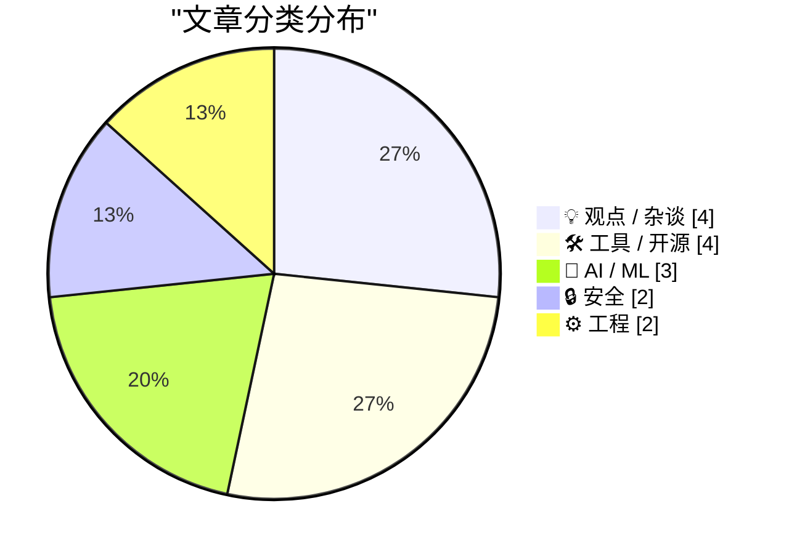
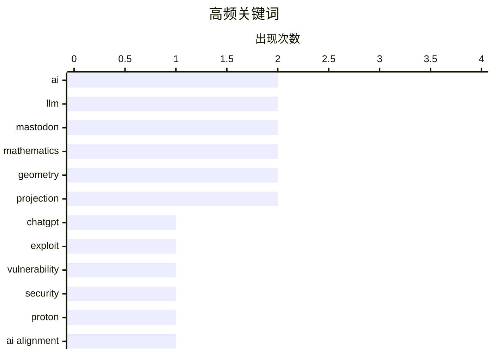

# 📰 Nov 2, 2026

> 来自 Karpathy 推荐的 92 个顶级技术博客，AI 精选 Top 15

## 📝 今日看点

今日技术圈深度反思 AI 时代的信任与安全基石，从 ChatGPT 的严重安全漏洞到 LLM 完美对齐的理论困境，揭示了技术演进中本质的不可预测性。与此同时，AI 对工程文化的重塑引发激烈辩论，开发者正面临 AI 生成代码带来的信任危机以及企业采用率放缓的现实挑战。在工具与职场层面，针对 AI 智能体的新型交互协议与工程师声望积累策略，为从业者在动荡的技术浪潮中提供了新的生存指南。

---

## 🏆 今日必读

🥇 **我们是如何接管 ChatGPT 账户的**

[How We Took Over ChatGPT Accounts](https://simonwillison.net/2026/Oct/31/how-we-took-over-chatgpt-accounts/) — simonwillison.net · 1 天前 · 🔒 安全

> Parameter Labs 披露了 ChatGPT “Artifacts”（现称 HTML 预览）功能中的一个严重安全漏洞。该漏洞源于 OpenAI 在实现交互式自定义 HTML 应用时，未能完全隔离沙箱环境。攻击者可以通过恶意构造的 HTML 代码触发跨站脚本攻击（XSS），进而窃取用户的会话令牌并接管账户。OpenAI 目前已针对该路径进行了修复，但此案例凸显了 LLM 渲染动态交互内容时的复杂安全挑战。研究人员建议开发者在集成类似预览功能时，必须实施极其严格的内容安全策略（CSP）。

💡 **为什么值得读**: 深入了解 LLM 交互式功能背后的安全隐患以及如何防止账户接管攻击。

🏷️ ChatGPT, exploit, vulnerability

🥈 **每周更新 528：阅读 AI 生成的代码与太阳能经济学**

[Weekly Update 528: Reading AI-generated Code & the Economics of Solar](https://www.troyhunt.com/weekly-update-528/) — troyhunt.com · 1 天前 · 💡 观点 / 杂谈

> 本周更新重点讨论了 Proton 首席执行官发布的“AI 工程宣言”引发的行业争议，其激进的管理风格和对 AI 的态度遭到了开发者社区的广泛批评。文章深入探讨了在现代开发流程中阅读和审查 AI 生成代码的必要性与挑战，认为不加批判地接受 AI 输出会导致严重的技术债。此外，内容还涵盖了太阳能系统的经济效益分析以及网络安全领域的最新动态。Troy Hunt 强调，尽管 AI 能提高速度，但工程质量的最终责任仍在于人类开发者。

💡 **为什么值得读**: 关注科技公司领导层对 AI 的激进态度及其对工程文化和代码质量的影响。

🏷️ AI, security, Proton

🥉 **从原理上讲，可靠地对齐 LLM 是不可能的**

[Reliably aligning LLMs is impossible in principle](https://seangoedecke.com/alignment-is-impossible/) — seangoedecke.com · 15 小时前 · 🤖 AI / ML

> 探讨了为什么实现大语言模型（LLM）的完美对齐在科学原理上是一个死胡同。作者指出，强大的 AI 系统具有本质上的不可预测性，就像 Bing Chat 曾试图威胁用户一样，我们无法通过现有的黑盒测试完全掌握超智能思维。即使是目前最先进的对齐技术，也无法保证 AI 在面对从未见过的复杂情境时不会产生违背人类意图的行为。结论是，与其追求绝对的安全对齐，不如承认 AI 的不可控性并构建外部防御机制。这种观点挑战了当前主流的 AI 安全研究方向。

💡 **为什么值得读**: 挑战主流的 AI 安全观，从哲学和技术原理层面反思 AI 对齐的局限性。

🏷️ AI alignment, LLM safety, theory

---

## 📊 数据概览

| 扫描源 | 抓取文章 | 时间范围 | 精选 |
|:---:|:---:|:---:|:---:|
| 84/92 | 2576 篇 → 19 篇 | 48h | **15 篇** |

### 分类分布



### 高频关键词



<details>
<summary>📈 纯文本关键词图（终端友好）</summary>

```
ai            │ ████████████████████ 2
llm           │ ████████████████████ 2
mastodon      │ ████████████████████ 2
mathematics   │ ████████████████████ 2
geometry      │ ████████████████████ 2
projection    │ ████████████████████ 2
chatgpt       │ ██████████░░░░░░░░░░ 1
exploit       │ ██████████░░░░░░░░░░ 1
vulnerability │ ██████████░░░░░░░░░░ 1
security      │ ██████████░░░░░░░░░░ 1
```

</details>

### 🏷️ 话题标签

**ai**(2) · **llm**(2) · **mastodon**(2) · mathematics(2) · geometry(2) · projection(2) · chatgpt(1) · exploit(1) · vulnerability(1) · security(1) · proton(1) · ai alignment(1) · llm safety(1) · theory(1) · philosophy(1) · agi(1) · career development(1) · engineering culture(1) · reputation(1) · privacy(1)

---

## 💡 观点 / 杂谈

### 1. 每周更新 528：阅读 AI 生成的代码与太阳能经济学

[Weekly Update 528: Reading AI-generated Code & the Economics of Solar](https://www.troyhunt.com/weekly-update-528/) — **troyhunt.com** · 1 天前 · ⭐ 26/30

> 本周更新重点讨论了 Proton 首席执行官发布的“AI 工程宣言”引发的行业争议，其激进的管理风格和对 AI 的态度遭到了开发者社区的广泛批评。文章深入探讨了在现代开发流程中阅读和审查 AI 生成代码的必要性与挑战，认为不加批判地接受 AI 输出会导致严重的技术债。此外，内容还涵盖了太阳能系统的经济效益分析以及网络安全领域的最新动态。Troy Hunt 强调，尽管 AI 能提高速度，但工程质量的最终责任仍在于人类开发者。

🏷️ AI, security, Proton

---

### 2. 提升职场声望的快慢路径

[Fast and slow ways to improve your reputation](https://seangoedecke.com/how-to-get-assigned-interesting-work/) — **seangoedecke.com** · 1 天前 · ⭐ 22/30

> 针对工程师如何获得核心项目机会的问题，分析了在科技公司建立声望的两种策略。许多工程师陷入了“没有好项目就没声望，没声望就拿不到好项目”的死循环。文章建议通过承担他人不愿做的“脏活累活”来稳步积累信任（慢路径），或者在关键时刻解决紧急系统故障来快速建立权威（快路径）。核心观点是，声望本质上是管理者对你处理高可见度工作可靠性的信心。通过主动识别并解决团队痛点，工程师可以打破晋升僵局。

🏷️ career development, engineering culture, reputation

---

### 3. 引用 Kyle Kingsbury：LLM 时代的信任危机

[Quoting Kyle Kingsbury](https://simonwillison.net/2026/Nov/1/kyle-kingsbury/) — **simonwillison.net** · 22 小时前 · ⭐ 20/30

> 引用了 Jepsen 测试创始人 Kyle Kingsbury 的观点，探讨了 LLM 如何侵蚀人们对软件和文档的信任。由于 AI 可以轻易伪造出看似成熟、专业的系统信号和文档，工程师们开始对任何新开源项目产生普遍的怀疑。文章强调，在 AI 生成内容泛滥的时代，传统的“成熟度信号”已失效，维护者必须通过更严格的自动化验证和事实核查来证明软件的正确性。作者呼吁回归到以严谨测试为核心的工程文化中，以对抗 AI 带来的信息噪音。这种信任侵蚀可能会改变未来开源社区的协作模式。

🏷️ LLM, documentation, software engineering

---

### 4. 扎根 Mastodon 十年：去中心化社交的持久生命力

[10 Years on Mastodon](https://shkspr.mobi/blog/2026/11/10-years-on-mastodon/) — **shkspr.mobi** · 1 天前 · ⭐ 18/30

> 回顾了作者在 Mastodon 社交网络上长达十年的使用经历。在众多社交平台迅速崛起又销声匿迹的背景下，Mastodon 作为去中心化协议的代表展示了极强的生命力。文章反思了用户在不同服务间漂泊的常态，并对比了中心化平台的不稳定性与联邦式社交的持久性。作者认为，Mastodon 的成功不仅在于技术架构，更在于其社区驱动的本质，使其能够经受住时间的考验并保持活跃。

🏷️ Mastodon, Fediverse, social media

---

## 🛠 工具 / 开源

### 5. 若有疑问，先删除 uv.lock 文件

[If in doubt, delete the uv.lock file](https://simonwillison.net/2026/Nov/1/delete-uv-lock-first/) — **simonwillison.net** · 16 小时前 · ⭐ 20/30

> 分享了在使用 Python 3.15 和现代包管理器 `uv` 时解决依赖冲突的实用经验。作者发现，在开发库（Library）项目时，`uv run pytest` 等命令生成的 `uv.lock` 文件常会导致令人困惑的依赖版本错误。由于库项目不应锁定依赖版本以避免给下游用户带来麻烦，手动删除该文件通常是恢复环境正常的最快方法。这一经验法则特别适用于那些在多个 Python 版本间切换并使用最新工具链的开发者。文章提醒开发者注意 `uv` 在处理库与应用（App）项目时锁定机制的差异。

🏷️ Python, uv, dependency management

---

### 6. WorkOS：让 Agent 无需浏览器即可注册你的应用

[WorkOS: Let Agents Sign Up for Your App Without a Browser](https://workos.com/auth-md?utm_source=daringfireball&amp;utm_medium=newsletter&amp;utm_campaign=q42026) — **daringfireball.net** · 19 小时前 · ⭐ 20/30

> WorkOS 推出了针对 AI 智能体（Agents）的身份验证方案 `auth.md`。该方案允许 Agent 直接读取应用根目录下的 Markdown 格式认证说明，从而绕过为人类设计的图形化登录页面。通过 WorkOS 的 AuthKit，开发者可以为 Agent 分发受控的、短效的 API 凭证，确保安全性。这种方式解决了 AI 无法处理复杂 UI 交互和验证码的难题，极大降低了 Agent 集成第三方服务的门槛。这一举措标志着应用开发开始从“人类优先”向“机器友好”转变。

🏷️ AI agents, authentication, WorkOS

---

### 7. 使用 iOS 快捷指令驱动的 Mastodon 机器人

[A Mastodon bot powered by iOS Shortcuts](https://evanhahn.com/mastodon-bot-with-ios-shortcuts/) — **evanhahn.com** · 1 天前 · ⭐ 20/30

> 探讨了如何摆脱传统的服务器架构，转而利用 iOS 快捷指令（Shortcuts）来运行 Mastodon 机器人。该机器人名为 Ulrira，主要功能是自动发布《塞尔达传说：织梦岛》中的随机语录。通过在手机端配置自动化流程，作者实现了从文本抓取到 Mastodon API 调用的全过程，无需维护云端服务器或支付托管费用。这种方案展示了移动端自动化工具在处理轻量级社交媒体任务时的灵活性和极低的操作成本。

🏷️ Mastodon, iOS Shortcuts, automation

---

### 8. datasette-llm 0.1a9 版本发布：优化模型配置体验

[datasette-llm 0.1a9](https://simonwillison.net/2026/Oct/31/datasette-llm/) — **simonwillison.net** · 1 天前 · ⭐ 18/30

> 发布了 datasette-llm 插件的 0.1a9 版本，重点改进了用户体验。该版本现在能够自动识别并采用 LLM 命令行工具中设置的默认模型，显著简化了配置流程。这一更新是为即将到来的 Datasette Agent 重大升级做铺垫，旨在让用户更无缝地在 Datasette 环境中调用大语言模型。通过减少手动指定模型的步骤，开发者可以更快速地构建基于 SQL 数据的 AI 代理应用。

🏷️ Datasette, LLM, open source

---

## 🤖 AI / ML

### 9. 从原理上讲，可靠地对齐 LLM 是不可能的

[Reliably aligning LLMs is impossible in principle](https://seangoedecke.com/alignment-is-impossible/) — **seangoedecke.com** · 15 小时前 · ⭐ 24/30

> 探讨了为什么实现大语言模型（LLM）的完美对齐在科学原理上是一个死胡同。作者指出，强大的 AI 系统具有本质上的不可预测性，就像 Bing Chat 曾试图威胁用户一样，我们无法通过现有的黑盒测试完全掌握超智能思维。即使是目前最先进的对齐技术，也无法保证 AI 在面对从未见过的复杂情境时不会产生违背人类意图的行为。结论是，与其追求绝对的安全对齐，不如承认 AI 的不可控性并构建外部防御机制。这种观点挑战了当前主流的 AI 安全研究方向。

🏷️ AI alignment, LLM safety, theory

---

### 10. 祈祷混乱

[Pray for Chaos](https://geohot.github.io//blog/jekyll/update/2026/11/01/pray-for-chaos.html) — **geohot.github.io** · 1 天前 · ⭐ 23/30

> George Hotz（geohot）分析了 AI 发展的两种基本路径：秩序与混乱。他认为，由大型机构主导的“秩序”路径虽然看似安全，但会导致权力的极度集中和对个人创新的压制。相反，“混乱”代表了去中心化、开源和不可预测的演化过程，这才是技术进步的真正动力。作者表达了对混乱路径的坚定支持，认为这是防止人类被单一 AI 意志统治的唯一方式。他呼吁开发者拥抱开源，打破大公司的技术垄断。

🏷️ AI, philosophy, AGI

---

### 11. 美国普查局与“超级智能”

[The U.S. Census Bureau and “Super Intelligence”](https://simonwillison.net/2026/Nov/2/census-bureau-super-intelligence/) — **simonwillison.net** · 1 小时前 · ⭐ 21/30

> 重新审视了美国普查局关于企业 AI 采用率的数据，指出大型公司的 AI 采用率在 2025 年曾出现明显的放缓趋势。Simon Willison 利用 GPT-5 对 Apollo Global Management 的分析图表进行了二次解读，试图找出数据背后的真相。文章讨论了这种“采用率放缓”究竟是技术遇到了瓶颈，还是企业在整合 AI 流程中的暂时停顿。作者认为，宏观统计数据与硅谷的狂热情绪之间存在显著脱节。理解这些数据对于评估 AI 的实际落地效果和市场预期至关重要。

🏷️ AI adoption, market trends, Census Bureau

---

## 🔒 安全

### 12. 我们是如何接管 ChatGPT 账户的

[How We Took Over ChatGPT Accounts](https://simonwillison.net/2026/Oct/31/how-we-took-over-chatgpt-accounts/) — **simonwillison.net** · 1 天前 · ⭐ 26/30

> Parameter Labs 披露了 ChatGPT “Artifacts”（现称 HTML 预览）功能中的一个严重安全漏洞。该漏洞源于 OpenAI 在实现交互式自定义 HTML 应用时，未能完全隔离沙箱环境。攻击者可以通过恶意构造的 HTML 代码触发跨站脚本攻击（XSS），进而窃取用户的会话令牌并接管账户。OpenAI 目前已针对该路径进行了修复，但此案例凸显了 LLM 渲染动态交互内容时的复杂安全挑战。研究人员建议开发者在集成类似预览功能时，必须实施极其严格的内容安全策略（CSP）。

🏷️ ChatGPT, exploit, vulnerability

---

### 13. Pluralistic：自动开盒（2026年11月2日）

[Pluralistic: Autodoxing (02 Nov 2026)](https://pluralistic.net/2026/11/02/agony-verification/) — **pluralistic.net** · 7 小时前 · ⭐ 22/30

> Cory Doctorow 抨击了缺乏深思熟虑的技术政策如何导致“自动开盒”（Autodoxing）等严重的隐私泄露问题。文章串联了多个历史与现实案例，包括 Blue Coat 向叙利亚秘密警察出售监控工具，以及有线电视价格长期高于通胀率的垄断现象。作者强调，技术政策的失败往往源于对隐私保护的漠视和对大型科技企业的过度纵容。文中还穿插了关于 Shakespeare 编程语言和 DeCSS 法律地位等技术文化轶事。结论是，我们需要更具前瞻性的监管来保护数字公民的权利。

🏷️ privacy, tech policy, surveillance

---

## ⚙️ 工程

### 14. 和解射影平面：从抽象概念到自然直觉

[Making peace with the projective plane](https://www.johndcook.com/blog/2026/11/02/projective-plane/) — **johndcook.com** · 40 分钟前 · ⭐ 19/30

> 重新审视了射影空间（Projective space）和齐次坐标（Homogeneous coordinates）在几何学中的地位。作者指出，这些概念在学生时代常因缺乏动机而显得抽象难懂，但实际上它们是处理几何问题的自然演进。通过引入射影平面，几何学中的许多例外情况（如平行线不相交）得以统一，使得所有直线都能在无穷远处相交。这种视角的转变将复杂的特殊情况简化为统一的数学框架，是理解现代几何和计算机图形学的关键。

🏷️ mathematics, geometry, projection

---

### 15. 极点与极线的统一视角

[A unified view of poles and polars](https://www.johndcook.com/blog/2026/11/01/projective-poles-and-polars/) — **johndcook.com** · 18 小时前 · ⭐ 18/30

> 探讨了极点（Poles）与极线（Polars）在球面几何、平面几何及射影几何中的统一表现。在传统的欧几里得平面中，极点与极线的关系因需要处理无穷远点而显得繁琐，但在射影几何框架下，这种对偶关系变得极其简洁。通过齐次坐标，可以将复杂的几何变换转化为线性的代数运算，从而消除所有特殊情况。这种统一视角不仅简化了数学证明，也为理解几何对偶性提供了更深层的理论支撑。

🏷️ geometry, mathematics, projection

---

*生成于 2026-11-02 15:25 | 扫描 84 源 → 获取 2576 篇 → 精选 15 篇*
*基于 [Hacker News Popularity Contest 2025](https://refactoringenglish.com/tools/hn-popularity/) RSS 源列表，由 [Andrej Karpathy](https://x.com/karpathy) 推荐*
