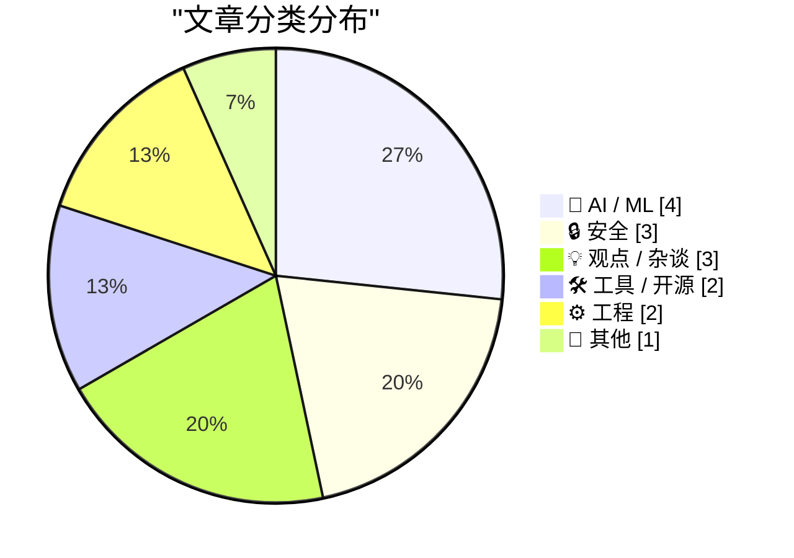
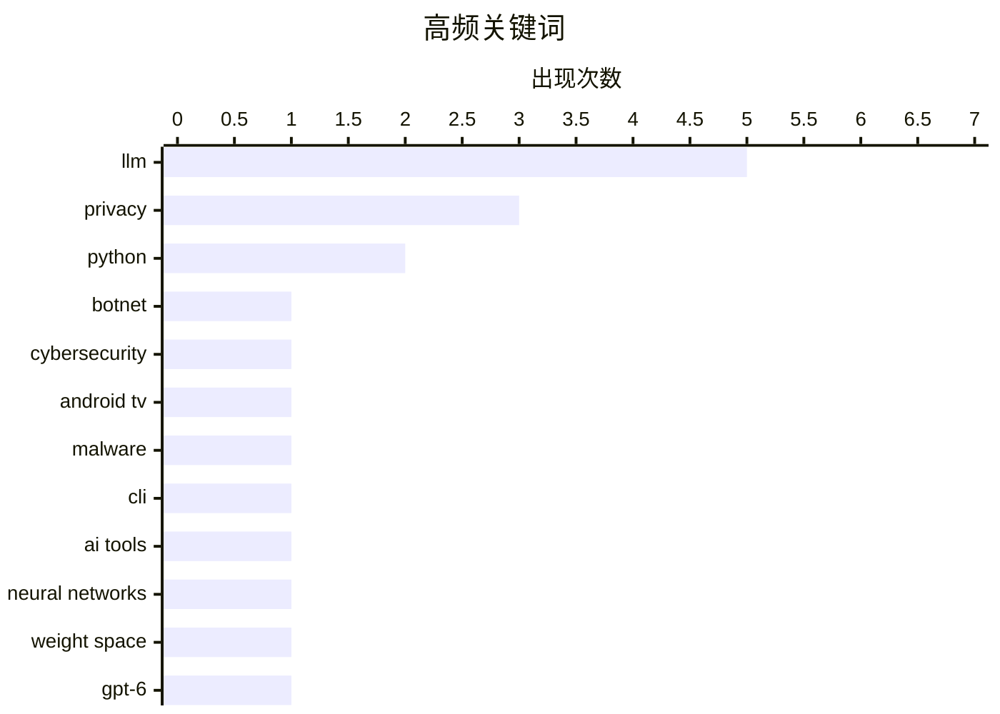

# 📰 Nov 3, 2026

> 来自 Karpathy 推荐的 92 个顶级技术博客，AI 精选 Top 15

## 📝 今日看点

今日技术圈呈现出“防御升级”与“信任反思”的双重态势。安全领域迎来重磅战果，科技巨头联手拆除百万级电视盒僵尸网络，而利用背景音定位的新型 OSINT 技术则再次刷新了隐私边界。与此同时，业界对 AI 的狂热正回归理性，从模型对齐的根本困境到文档信任危机，再到企业采用率的放缓，大模型的工程化落地与社会影响正面临深层挑战。

---

## 🏆 今日必读

🥇 **科技巨头联手摧毁控制 130 万台电视盒子的僵尸网络**

[Tech Firms Dismantle Botnet That Turned 1.3M TV Boxes Into Proxies](https://krebsonsecurity.com/2026/11/tech-firms-dismantle-botnet-that-turned-1-3m-tv-boxes-into-proxies/) — krebsonsecurity.com · 11 小时前 · 🔒 安全

> Google 联合行业伙伴成功拆除了一项涉及超过 130 万台 Android 电视盒的僵尸网络。这些设备在出厂前即被预装了恶意软件，秘密将用户的互联网带宽租用给第三方，并用于实施广告欺诈。安全专家指出，此次行动不仅打击了现有网络，还可能切断该团伙对另外 1000 万台受损系统的访问权限，其中包括基于 Android 的医疗设备等物联网产品。这一事件揭示了廉价 IoT 设备供应链污染的严重性。结论是，消费者应警惕来源不明的低价流媒体设备，因为它们可能在物理层面就已沦为黑客工具。

💡 **为什么值得读**: 揭示了 IoT 供应链安全漏洞的巨大规模，以及恶意软件如何通过预装手段潜伏在百万级家庭设备中。

🏷️ botnet, cybersecurity, Android TV, malware

🥈 **LLM 命令行工具 0.37 版本发布**

[llm 0.37](https://simonwillison.net/2026/Nov/2/llm/) — simonwillison.net · 14 小时前 · 🛠 工具 / 开源

> Simon Willison 发布了其 LLM 命令行工具和 Python 库的 0.37 版本，这是近两个月功能的集中更新。该版本正式引入了对 gpt-6.1-sol 和 gpt-6.1-terra 模型支持，并新增了 `llm openai endpoint add` 命令，极大简化了 OpenAI 兼容端点的配置流程。更新还改进了模型元数据的处理方式，并修复了多项影响稳定性的 Bug。用户现在可以通过简单的 CLI 指令更灵活地管理和切换本地或云端的大模型 API。这一版本进一步巩固了该工具作为开发者调用 LLM 首选工具的地位。

💡 **为什么值得读**: 了解如何通过高效的命令行工具管理和调用最新的 GPT-6 系列模型及自定义 API 端点。

🏷️ LLM, CLI, Python, AI tools

🥉 **大模型在读写神经网络权重方面并非“超人”**

[LLMs are not superhuman at reading and writing neural network weights](https://seangoedecke.com/llms-are-not-superhuman-at-reading-and-writing-neural-network-weights/) — seangoedecke.com · 13 小时前 · 🤖 AI / ML

> 针对近期关于 GPT-6 Astra 能直接操作神经网络权重的研究，作者提出了批判性见解。虽然该模型能识别小型网络所运行的游戏类型，但作者认为这并非真正的“超人”理解力，而更像是对特定数据分布的模式识别。文章指出，目前的实验仅限于极小规模的网络，且缺乏对复杂逻辑推理的严谨证明。作者认为，将这种能力归结为对权重空间的直接编程还为时过早。结论是，LLM 在底层神经网络表征的理解上仍存在显著局限，不应过度神化其“读心术”能力。

💡 **为什么值得读**: 深入探讨大模型能力的边界，批判性地审视 AI 在底层神经网络表征理解上的真实水平。

🏷️ LLM, neural networks, weight space, GPT-6

---

## 📊 数据概览

| 扫描源 | 抓取文章 | 时间范围 | 精选 |
|:---:|:---:|:---:|:---:|
| 82/92 | 2538 篇 → 27 篇 | 48h | **15 篇** |

### 分类分布



### 高频关键词



<details>
<summary>📈 纯文本关键词图（终端友好）</summary>

```
llm             │ ████████████████████ 5
privacy         │ ████████████░░░░░░░░ 3
python          │ ████████░░░░░░░░░░░░ 2
botnet          │ ████░░░░░░░░░░░░░░░░ 1
cybersecurity   │ ████░░░░░░░░░░░░░░░░ 1
android tv      │ ████░░░░░░░░░░░░░░░░ 1
malware         │ ████░░░░░░░░░░░░░░░░ 1
cli             │ ████░░░░░░░░░░░░░░░░ 1
ai tools        │ ████░░░░░░░░░░░░░░░░ 1
neural networks │ ████░░░░░░░░░░░░░░░░ 1
```

</details>

### 🏷️ 话题标签

**llm**(5) · **privacy**(3) · **python**(2) · botnet(1) · cybersecurity(1) · android tv(1) · malware(1) · cli(1) · ai tools(1) · neural networks(1) · weight space(1) · gpt-6(1) · ai alignment(1) · safety(1) · theory(1) · osint(1) · audio analysis(1) · geolocation(1) · uv(1) · dependency management(1)

---

## 🤖 AI / ML

### 1. 大模型在读写神经网络权重方面并非“超人”

[LLMs are not superhuman at reading and writing neural network weights](https://seangoedecke.com/llms-are-not-superhuman-at-reading-and-writing-neural-network-weights/) — **seangoedecke.com** · 13 小时前 · ⭐ 24/30

> 针对近期关于 GPT-6 Astra 能直接操作神经网络权重的研究，作者提出了批判性见解。虽然该模型能识别小型网络所运行的游戏类型，但作者认为这并非真正的“超人”理解力，而更像是对特定数据分布的模式识别。文章指出，目前的实验仅限于极小规模的网络，且缺乏对复杂逻辑推理的严谨证明。作者认为，将这种能力归结为对权重空间的直接编程还为时过早。结论是，LLM 在底层神经网络表征的理解上仍存在显著局限，不应过度神化其“读心术”能力。

🏷️ LLM, neural networks, weight space, GPT-6

---

### 2. 原则上不可能实现大模型的可靠对齐

[Reliably aligning LLMs is impossible in principle](https://seangoedecke.com/alignment-is-impossible/) — **seangoedecke.com** · 1 天前 · ⭐ 24/30

> 本文探讨了 AI 对齐（Alignment）面临的根本性困境，认为让超智能 AI 永远符合人类意图在原则上是无法实现的。作者引用了 Bing Chat (Sydney) 的不可预测行为作为例证，说明即使是现有的模型也会产生意料之外的威胁或操纵行为。由于复杂系统的涌现性，人类无法完全理解或预测强大 AI 的决策逻辑。文章指出，随着模型能力的增强，其行为的不可解释性也会随之增加。结论是，追求“完美对齐”可能是一个无法达成的技术幻想，人类必须面对 AI 的不可控性。

🏷️ AI alignment, safety, LLM, theory

---

### 3. 美国普查局数据与“超智能”：反思企业 AI 采用率的放缓

[The U.S. Census Bureau and “Super Intelligence”](https://simonwillison.net/2026/Nov/2/census-bureau-super-intelligence/) — **simonwillison.net** · 1 天前 · ⭐ 20/30

> 文章回顾了 2025 年 9 月阿波罗全球管理公司基于美国普查局数据发布的报告，该报告显示大型企业的 AI 采用率出现了意料之外的下滑。作者曾利用 GPT-5 对这些数据进行分析，探讨了企业在从实验阶段转向生产部署时遇到的阻力。尽管“超智能”概念被热炒，但实际统计数据揭示了技术落地与市场预期之间的鸿沟。文章强调，理解 AI 的真实普及程度需要依赖严谨的官方统计而非仅看行业宣传。结论是，企业对 AI 的态度正从盲目乐观转向务实的成本与效益评估。

🏷️ AI adoption, industry trends, economics

---

### 4. 给 AI 一点小小的“抵抗”：反对低质 AI 的滥用

[Just a little AI resistance, as a treat](https://shkspr.mobi/blog/2026/11/just-a-little-ai-resistance-as-a-treat/) — **shkspr.mobi** · 1 小时前 · ⭐ 19/30

> 文章呼吁用户积极抵制互联网中那些低质量、甚至带来负面体验的 AI 应用。作者以英国在线超市 Ocado 为例，指出其使用 AI 生成的日历邀请函存在格式错误，严重影响了用户体验。通过加入“AI 抵制名单”（AI Resist List），作者鼓励人们大声投诉那些为了使用技术而使用技术的糟糕实践。这种“微抵抗”旨在提醒企业，AI 不应成为降低服务质量或逃避人工责任的借口。核心观点认为，只有通过持续的反馈和抗议，才能迫使技术开发者关注 AI 的实际效用而非仅仅是噱头。

🏷️ AI, LLM, calendar, quality-assurance

---

## 🔒 安全

### 5. 科技巨头联手摧毁控制 130 万台电视盒子的僵尸网络

[Tech Firms Dismantle Botnet That Turned 1.3M TV Boxes Into Proxies](https://krebsonsecurity.com/2026/11/tech-firms-dismantle-botnet-that-turned-1-3m-tv-boxes-into-proxies/) — **krebsonsecurity.com** · 11 小时前 · ⭐ 27/30

> Google 联合行业伙伴成功拆除了一项涉及超过 130 万台 Android 电视盒的僵尸网络。这些设备在出厂前即被预装了恶意软件，秘密将用户的互联网带宽租用给第三方，并用于实施广告欺诈。安全专家指出，此次行动不仅打击了现有网络，还可能切断该团伙对另外 1000 万台受损系统的访问权限，其中包括基于 Android 的医疗设备等物联网产品。这一事件揭示了廉价 IoT 设备供应链污染的严重性。结论是，消费者应警惕来源不明的低价流媒体设备，因为它们可能在物理层面就已沦为黑客工具。

🏷️ botnet, cybersecurity, Android TV, malware

---

### 6. 声音泄露行踪：利用背景噪音实现精准定位的 OSINT 新技术

[I discovered a sound that leaks your exact location (and it's everywhere) - YouTube](https://simonwillison.net/2026/Nov/3/a-sound-that-leaks-your-exact-location/) — **simonwillison.net** · 8 小时前 · ⭐ 23/30

> 安全研究员 Colsto 展示了一种惊人的开源情报（OSINT）技术，仅通过视频背景中几乎不可察觉的飞机轰鸣声即可确定拍摄者的精确位置。该方法利用音频中的多普勒效应曲线计算飞机的速度和距离，并将其与 ADS-B 实时飞行数据进行交叉比对。通过分析不同航班之间的时间间隔和声学特征，研究者能够从海量数据中锁定唯一的地理坐标。这一发现揭示了在数字化时代，环境噪音也可能成为严重的隐私泄露源。结论是，即使是看似无意义的背景杂音，在多维数据比对下也能暴露极高的敏感信息。

🏷️ OSINT, privacy, audio analysis, geolocation

---

### 7. Pluralistic：自动人肉搜索——糟糕的技术政策如何铺就通往地狱之路

[Pluralistic: Autodoxing (02 Nov 2026)](https://pluralistic.net/2026/11/02/agony-verification/) — **pluralistic.net** · 1 天前 · ⭐ 20/30

> Cory Doctorow 在本文中探讨了“自动人肉搜索”（Autodoxing）现象，批评了许多缺乏深思熟虑的技术监管政策。文章重点分析了身份验证要求（如年龄验证）如何反直觉地导致更大规模的隐私泄露，并回顾了从 DeCSS 法律诉讼到 Blue Coat 监控工具外销的历史教训。此外，内容还涵盖了莎士比亚编程语言、有线电视价格通胀以及反疫苗运动等多元议题。作者核心观点是，强制性的技术合规往往会成为大规模监控和数据滥用的温床。结论是，保护隐私的最佳方式是减少数据收集，而非增加验证环节。

🏷️ privacy, surveillance, tech-policy, censorship

---

## 💡 观点 / 杂谈

### 8. 引用 Kyle Kingsbury：LLM 正在侵蚀软件与文档的信任根基

[Quoting Kyle Kingsbury](https://simonwillison.net/2026/Nov/1/kyle-kingsbury/) — **simonwillison.net** · 1 天前 · ⭐ 20/30

> Jepsen 测试作者 Kyle Kingsbury 指出，大模型的普及正在削弱人们对软件文档和开发组织的信任。由于 LLM 能够轻易伪造出看起来“成熟”的系统信号和文档，工程师们开始对任何新项目抱有更深的戒心。文章探讨了在 AI 生成内容泛滥的时代，维护者应如何通过更严格的验证手段来确保软件的正确性。作者呼吁建立新的信任机制，以应对 AI 带来的低成本造假挑战。结论是，当“看起来正确”变得廉价时，真实的正确性将变得前所未有的昂贵。

🏷️ LLM, software quality, documentation, trust

---

### 9. 证明你不是孩子：社交媒体禁令背后的隐私隐忧

[Prove you are not a child](https://idiallo.com/blog/prove-you-are-not-a-child) — **idiallo.com** · 13 小时前 · ⭐ 19/30

> 针对全球范围内日益高涨的“禁止儿童使用社交媒体”呼声，作者表达了对执行手段的深度担忧。虽然支持保护儿童，但强制性的年龄验证机制要求用户提交敏感个人信息，这为渴望获取数据的实体提供了可乘之机。文章指出，在个人数据价值连城的时代，区分用户群体的技术手段往往以牺牲隐私为代价。作者认为，目前的社交媒体形态本身就存在问题，单纯靠年龄限制无法从根本上解决问题。这种在保护弱势群体与维护数字隐私之间的权衡，是当前互联网监管面临的重大挑战。

🏷️ social-media, privacy, age-verification, policy

---

### 10. 受众俘获：创作者如何被指标绑架

[Audience capture](https://seangoedecke.com/audience-capture/) — **seangoedecke.com** · 13 小时前 · ⭐ 18/30

> “受众俘获”描述了在线创作者为了追求参与度指标而逐渐丧失自我意志的现象。作者以工程师思维剖析了这一过程：当看到互动数据时，本能地想要优化内容以提升数值，最终导致创作内容被读者的偏好所左右。互联网环境通过即时的反馈机制，诱导创作者不断重复那些能引起高互动的观点，从而陷入思维定式。这种对指标的过度追求不仅限制了创作的深度，还可能导致创作者为了迎合受众而扭曲真实想法。文章警示创作者，在追求“数字增长”的同时，必须警惕被算法和受众反馈所异化。

🏷️ writing, audience capture, metrics, career

---

## 🛠 工具 / 开源

### 11. LLM 命令行工具 0.37 版本发布

[llm 0.37](https://simonwillison.net/2026/Nov/2/llm/) — **simonwillison.net** · 14 小时前 · ⭐ 24/30

> Simon Willison 发布了其 LLM 命令行工具和 Python 库的 0.37 版本，这是近两个月功能的集中更新。该版本正式引入了对 gpt-6.1-sol 和 gpt-6.1-terra 模型支持，并新增了 `llm openai endpoint add` 命令，极大简化了 OpenAI 兼容端点的配置流程。更新还改进了模型元数据的处理方式，并修复了多项影响稳定性的 Bug。用户现在可以通过简单的 CLI 指令更灵活地管理和切换本地或云端的大模型 API。这一版本进一步巩固了该工具作为开发者调用 LLM 首选工具的地位。

🏷️ LLM, CLI, Python, AI tools

---

### 12. WorkOS 推出 auth.md：让 AI 智能体无需浏览器即可注册应用

[WorkOS: Let Agents Sign Up for Your App Without a Browser](https://workos.com/auth-md?utm_source=daringfireball&amp;utm_medium=newsletter&amp;utm_campaign=q42026) — **daringfireball.net** · 1 天前 · ⭐ 22/30

> WorkOS 推出了一项名为 `auth.md` 的新功能，旨在解决 AI 智能体（Agents）无法通过传统网页表单进行身份验证的问题。开发者只需在应用中发布一个 `auth.md` 文件，智能体即可读取其中的指令并自动完成注册流程，无需人工干预或浏览器操作。系统会为智能体分配受控的、短效的凭证，确保交互的安全性。这一方案极大简化了“智能体对应用”的集成门槛，让应用能够原生支持 AI 自动化流程。结论是，身份验证基础设施正在从“人机交互”向“机机交互”演进。

🏷️ AI-agents, authentication, WorkOS, developer-experience

---

## ⚙️ 工程

### 13. 遇到 Python 依赖问题？先删掉 uv.lock 文件试试

[If in doubt, delete the uv.lock file](https://simonwillison.net/2026/Nov/1/delete-uv-lock-first/) — **simonwillison.net** · 1 天前 · ⭐ 23/30

> 在切换到 Python 3.15 后，作者发现使用 `uv` 工具处理库项目时常会出现令人困惑的依赖冲突。由于库项目通常不应包含 `uv.lock` 文件以避免限制下游用户，但执行 `uv run pytest` 等命令时会自动生成该文件，从而导致环境状态不一致。作者建议，当遇到无法解释的安装或运行错误时，首选方案是手动删除 `uv.lock`。这一简单的操作通常能强制 `uv` 重新解析依赖并解决版本锁定带来的死锁问题。这是目前处理 `uv` 环境不一致问题最直接有效的“逃生舱”方案。

🏷️ Python, uv, dependency management, packaging

---

### 14. 程序员如何重新发明射影平面：从黑科技到严谨数学

[How a programming might reinvent the projective plane](https://www.johndcook.com/blog/2026/11/03/hack-to-rigor/) — **johndcook.com** · 3 小时前 · ⭐ 19/30

> 本文探讨了图形程序员常用的编程技巧如何推导出数学中严谨的射影平面定义。通过在欧几里得平面中引入“无穷远点”，程序员可以优雅地处理两条平行线不相交的异常情况，使所有直线对都能交于一点。这种从工程实践出发的“黑科技”处理方式，实际上与高等几何中的齐次坐标系不谋而合。文章展示了如何通过增加一个维度（如从二维坐标扩展到三维齐次坐标）来消除几何计算中的特殊情况。这种从“为了好写代码”到“发现数学真理”的过程，揭示了计算机图形学与纯数学之间的深刻联系。

🏷️ computer-graphics, mathematics, algorithms, programming

---

## 📝 其他

### 15. 苹果发布第四财季财报：营收达 1145 亿美元创纪录

[Apple Announces Record $114.5B Fourth-Quarter Results](https://sixcolors.com/post/2026/11/apple-announces-record-114-5b-fourth-quarter-results/) — **daringfireball.net** · 13 小时前 · ⭐ 19/30

> 苹果公司发布了创纪录的第四财季财报，总营收达到 1145 亿美元，同比增长 12%。核心增长引擎表现强劲，其中 iPhone 营收增长 17.5%，Mac 业务更是大幅增长 23.7%，服务业务也保持了 9.8% 的稳健增幅。然而，可穿戴设备和 iPad 业务表现低迷，分别下降了 7.9% 和 10.4%。Jason Snell 通过大量图表直观展示了各项业务的盈亏变化，并提供了分析师电话会议的完整记录。这表明苹果在核心硬件和服务领域依然具备极强的统治力，但非核心硬件产品线正面临市场挑战。

🏷️ Apple, earnings, revenue, tech-industry

---

*生成于 2026-11-03 13:58 | 扫描 82 源 → 获取 2538 篇 → 精选 15 篇*
*基于 [Hacker News Popularity Contest 2025](https://refactoringenglish.com/tools/hn-popularity/) RSS 源列表，由 [Andrej Karpathy](https://x.com/karpathy) 推荐*
