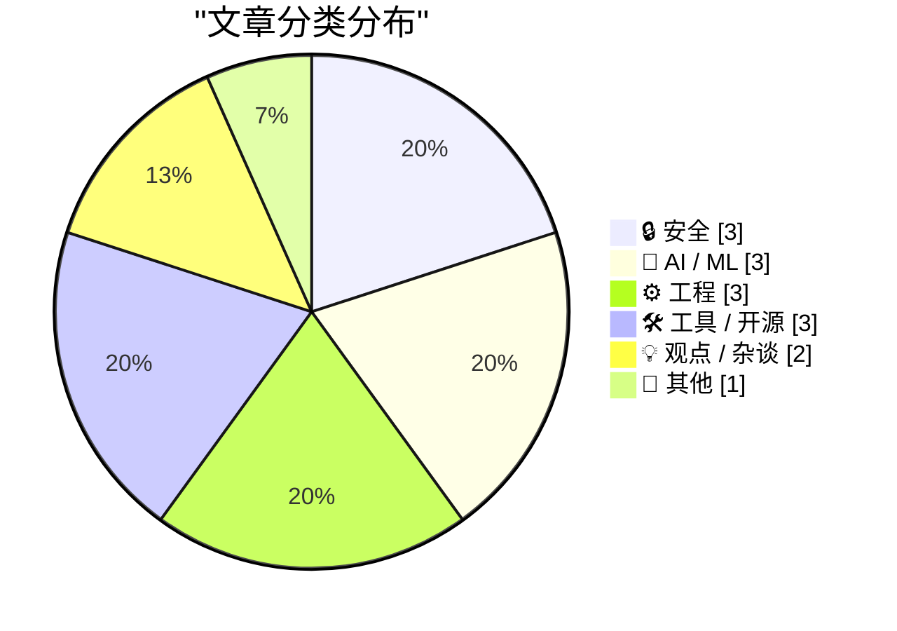
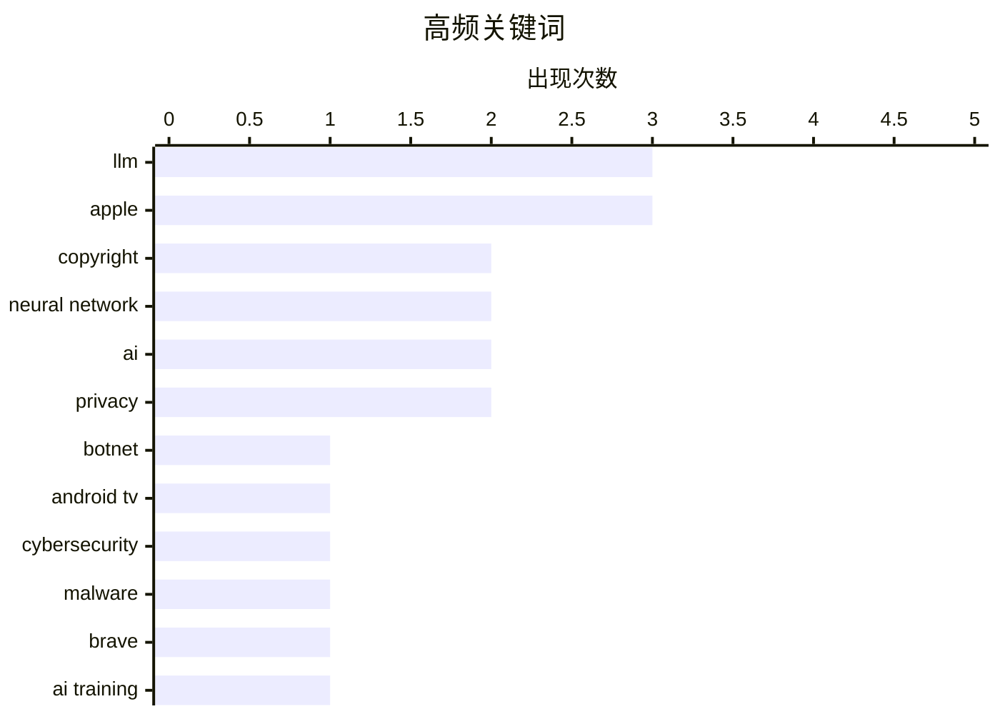

# 📰 Nov 4, 2026

> 来自 Karpathy 推荐的 92 个顶级技术博客，AI 精选 Top 15

## 📝 今日看点

今日技术圈聚焦于 AI 深度集成引发的版权博弈与产品体验反思，苹果正式开放 Siri 接口的同时，Brave 浏览器正因 AI 抓取数据面临出版业的集体诉讼。底层技术上，关于大模型是否具备理解神经网络权重的“超能力”引发热议，揭示了权重空间编程在工程验证与模型认知上的新争议。安全领域同样波澜不断，从百万级电视盒僵尸网络的成功拆除，到利用环境噪音进行地理定位的奇思妙想，隐私边界在技术演进中正面临前所未有的挑战。

---

## 🏆 今日必读

🥇 **科技巨头联手拆除控制 130 万台电视盒子的僵尸网络**

[Tech Firms Dismantle Botnet That Turned 1.3M TV Boxes Into Proxies](https://krebsonsecurity.com/2026/11/tech-firms-dismantle-botnet-that-turned-1-3m-tv-boxes-into-proxies/) — krebsonsecurity.com · 1 天前 · 🔒 安全

> 谷歌联合多家行业伙伴成功拆除了一个由超过 130 万台 Android TV 机顶盒组成的僵尸网络。这些受感染的设备预装了恶意软件，秘密将用户的互联网连接出租给陌生人，并被用于大规模广告欺诈。安全专家指出，此次行动切断了该网络对另外 1000 多万个潜在受害系统的访问权限，其中包括基于 Android 的医疗设备等物联网产品。这一事件揭示了廉价智能硬件供应链中存在的严重安全隐患。通过此次协同打击，科技公司旨在遏制利用 IoT 设备进行的网络犯罪基础设施。

💡 **为什么值得读**: 揭示了智能家居设备供应链污染带来的大规模网络安全威胁，以及跨国科技公司联合反击的实战案例。

🏷️ botnet, Android TV, cybersecurity, malware

🥈 **《纽约时报》等媒体起诉 Brave 浏览器侵犯版权并向 AI 公司出售抓取内容**

[The New York Times (et al.) Sues Brave for Copyright Infringement, Selling Scraped Content to AI Companies for Model Training](https://www.theverge.com/tech/1024588/brave-lawsuit-ai-scraping-new-york-times) — daringfireball.net · 22 小时前 · 🤖 AI / ML

> 《纽约时报》、芝加哥论坛报等多家出版机构对 Brave 浏览器开发商提起诉讼，指控其非法抓取内容用于训练 AI 并允许用户绕过付费墙。起诉书指出，Brave 将其抓取的网站索引货币化，向 AI 公司提供付费的“实时”访问权限以进行模型训练。原告认为这种行为超出了搜索引擎的合理使用范围，直接损害了内容生产者的商业利益。此案反映了媒体行业对浏览器厂商转型数据供应商的强烈抵制。该诉讼将成为界定 AI 时代数据抓取与版权保护边界的关键法律案例。

💡 **为什么值得读**: 探讨了浏览器厂商在 AI 浪潮中转型数据供应商所引发的法律冲突，是内容版权方与 AI 平台博弈的风向标。

🏷️ Brave, AI training, copyright, lawsuit

🥉 **Hillel Wayne 加入 Antithesis：确定性仿真测试与形式化方法的权衡**

[New Article, Annual LFP Charity Discount](https://buttondown.com/hillelwayne/archive/new-article-annual-lfp-charity-discount/) — buttondown.com/hillelwayne · 20 小时前 · ⚙️ 工程

> 著名软件工程专家 Hillel Wayne 宣布加入系统可靠性公司 Antithesis，并发表长文探讨了确定性仿真测试（DST）与形式化方法的相对优劣。文章核心观点认为，在软件验证中存在输入覆盖率与代码保真度之间的本质权衡。DST 能够在保持极高代码保真度的同时提供强大的错误发现能力，而形式化方法则在逻辑覆盖率上更具优势。这篇 2000 字的深度分析为追求高可靠性系统的开发者提供了关于测试策略选型的专业见解。作者旨在通过 DST 技术降低构建复杂、无错系统的门槛。

💡 **为什么值得读**: 软件可靠性领域的顶级专家对现代测试技术与形式化验证关系的深度剖析，适合对系统架构和质量保证有高要求的开发者。

🏷️ formal methods, testing, simulation, software quality

---

## 📊 数据概览

| 扫描源 | 抓取文章 | 时间范围 | 精选 |
|:---:|:---:|:---:|:---:|
| 84/92 | 2577 篇 → 39 篇 | 48h | **15 篇** |

### 分类分布



### 高频关键词



<details>
<summary>📈 纯文本关键词图（终端友好）</summary>

```
llm            │ ████████████████████ 3
apple          │ ████████████████████ 3
copyright      │ █████████████░░░░░░░ 2
neural network │ █████████████░░░░░░░ 2
ai             │ █████████████░░░░░░░ 2
privacy        │ █████████████░░░░░░░ 2
botnet         │ ███████░░░░░░░░░░░░░ 1
android tv     │ ███████░░░░░░░░░░░░░ 1
cybersecurity  │ ███████░░░░░░░░░░░░░ 1
malware        │ ███████░░░░░░░░░░░░░ 1
```

</details>

### 🏷️ 话题标签

**llm**(3) · **apple**(3) · **copyright**(2) · neural network(2) · ai(2) · privacy(2) · botnet(1) · android tv(1) · cybersecurity(1) · malware(1) · brave(1) · ai training(1) · lawsuit(1) · formal methods(1) · testing(1) · simulation(1) · software quality(1) · weight-space(1) · analysis(1) · siri(1)

---

## 🔒 安全

### 1. 科技巨头联手拆除控制 130 万台电视盒子的僵尸网络

[Tech Firms Dismantle Botnet That Turned 1.3M TV Boxes Into Proxies](https://krebsonsecurity.com/2026/11/tech-firms-dismantle-botnet-that-turned-1-3m-tv-boxes-into-proxies/) — **krebsonsecurity.com** · 1 天前 · ⭐ 27/30

> 谷歌联合多家行业伙伴成功拆除了一个由超过 130 万台 Android TV 机顶盒组成的僵尸网络。这些受感染的设备预装了恶意软件，秘密将用户的互联网连接出租给陌生人，并被用于大规模广告欺诈。安全专家指出，此次行动切断了该网络对另外 1000 多万个潜在受害系统的访问权限，其中包括基于 Android 的医疗设备等物联网产品。这一事件揭示了廉价智能硬件供应链中存在的严重安全隐患。通过此次协同打击，科技公司旨在遏制利用 IoT 设备进行的网络犯罪基础设施。

🏷️ botnet, Android TV, cybersecurity, malware

---

### 2. 我发现了一种会泄露你精确位置的声音

[I discovered a sound that leaks your exact location (and it's everywhere) - YouTube](https://simonwillison.net/2026/Nov/3/a-sound-that-leaks-your-exact-location/) — **simonwillison.net** · 1 天前 · ⭐ 24/30

> 这是一个关于开源情报（OSINT）技术的惊人案例，展示了如何通过视频背景中几乎察觉不到的飞机噪音进行地理定位。研究者 Colsto 通过分析噪音中的多普勒曲线，推算出飞机的速度、距离以及不同航班之间的时间间隔。随后，将这些数据与 ADS-B 实时飞行数据进行交叉比对，从而精确锁定视频拍摄的具体位置。这一发现揭示了在数字时代，环境背景声音可能成为极其危险的隐私泄露源。即使视频画面不包含地标，声音也可能出卖你的位置。

🏷️ OSINT, privacy, geolocation, audio-analysis

---

### 3. 证明你不是孩子：社交媒体年龄验证的困境

[Prove you are not a child](https://idiallo.com/blog/prove-you-are-not-a-child) — **idiallo.com** · 1 天前 · ⭐ 23/30

> 作者虽然支持限制儿童使用社交媒体，但强烈反对目前主流的身份验证强制手段。文章指出，为了区分用户年龄，平台往往需要收集极其敏感的个人身份数据，这引发了巨大的隐私风险。在个人信息高度价值化的今天，许多实体正觊觎这些验证数据，强制验证可能演变成一种变相的全民监控。作者呼吁在保护儿童的同时，必须寻找不牺牲个人隐私的替代方案。这种政策执行成本不应由全体公民的隐私权来承担。

🏷️ age verification, privacy, social media, regulation

---

## 🤖 AI / ML

### 4. 《纽约时报》等媒体起诉 Brave 浏览器侵犯版权并向 AI 公司出售抓取内容

[The New York Times (et al.) Sues Brave for Copyright Infringement, Selling Scraped Content to AI Companies for Model Training](https://www.theverge.com/tech/1024588/brave-lawsuit-ai-scraping-new-york-times) — **daringfireball.net** · 22 小时前 · ⭐ 26/30

> 《纽约时报》、芝加哥论坛报等多家出版机构对 Brave 浏览器开发商提起诉讼，指控其非法抓取内容用于训练 AI 并允许用户绕过付费墙。起诉书指出，Brave 将其抓取的网站索引货币化，向 AI 公司提供付费的“实时”访问权限以进行模型训练。原告认为这种行为超出了搜索引擎的合理使用范围，直接损害了内容生产者的商业利益。此案反映了媒体行业对浏览器厂商转型数据供应商的强烈抵制。该诉讼将成为界定 AI 时代数据抓取与版权保护边界的关键法律案例。

🏷️ Brave, AI training, copyright, lawsuit

---

### 5. 大模型在读写神经网络权重方面并非“超人”

[LLMs are not superhuman at reading and writing neural network weights](https://seangoedecke.com/llms-are-not-superhuman-at-reading-and-writing-neural-network-weights/) — **seangoedecke.com** · 1 天前 · ⭐ 25/30

> 针对近期关于 GPT-6 Astra 能够直接操作神经网络权重的研究，作者提出了质疑。原论文认为 Astra 识别小型网络功能的能力超出了人类和传统算法的范畴，展现了“权重空间编程”的潜力。然而，作者指出这种能力并非真正的“超人”表现，可能源于模型对特定数据模式的记忆或处理方式，而非真正的逻辑理解。文章通过分析实验细节，试图还原 LLM 在理解底层模型权重时的真实水平。作者警示不要过度神化 frontier 模型的底层操作能力。

🏷️ LLM, neural network, weight-space, analysis

---

### 6. 在笔记本上运行的 Qwen 3.8 27B 也能解读模型权重

[Qwen 3.8 27B on my laptop can interpret model weights, too](https://simonwillison.net/2026/Nov/3/qwen-can-interpret-model-weights/) — **simonwillison.net** · 21 小时前 · ⭐ 24/30

> Simon Willison 验证了关于 LLM 具备“权重空间编程”能力的发现，并证明这并非 GPT-6 Astra 的专利。他在本地笔记本上运行 Qwen 3.8 27B 模型，发现该模型同样能够理解并修改机器学习模型的原始权重描述。这一实验表明，中等规模的开源模型已经具备了深入理解神经网络底层结构的能力。这降低了研究模型自解释性和权重操作的门槛，不再局限于顶级闭源模型。这一发现对于模型可解释性研究具有重要意义。

🏷️ LLM, neural network, Qwen, local-inference

---

## ⚙️ 工程

### 7. Hillel Wayne 加入 Antithesis：确定性仿真测试与形式化方法的权衡

[New Article, Annual LFP Charity Discount](https://buttondown.com/hillelwayne/archive/new-article-annual-lfp-charity-discount/) — **buttondown.com/hillelwayne** · 20 小时前 · ⭐ 26/30

> 著名软件工程专家 Hillel Wayne 宣布加入系统可靠性公司 Antithesis，并发表长文探讨了确定性仿真测试（DST）与形式化方法的相对优劣。文章核心观点认为，在软件验证中存在输入覆盖率与代码保真度之间的本质权衡。DST 能够在保持极高代码保真度的同时提供强大的错误发现能力，而形式化方法则在逻辑覆盖率上更具优势。这篇 2000 字的深度分析为追求高可靠性系统的开发者提供了关于测试策略选型的专业见解。作者旨在通过 DST 技术降低构建复杂、无错系统的门槛。

🏷️ formal methods, testing, simulation, software quality

---

### 8. 苹果开始向开发者开放 Siri AI 接口

[Apple Begins Opening Siri AI to Developers](https://developer.apple.com/news/?id=gdk2umrf) — **daringfireball.net** · 14 小时前 · ⭐ 25/30

> 苹果在 iOS 27.3、macOS 27.3 等系统的最新测试版中，正式向开发者开放了 Siri AI 的集成能力。通过全新的 App Intents 开发者预览版，第三方应用可以直接与 Siri AI 交互，实现更复杂的语音控制和自动化功能。这一举措旨在让开发者利用苹果的端侧智能技术提升用户体验，并为企业提供接触客户的新途径。开发者现在可以预览并测试其应用如何通过 Siri AI 执行特定任务。这标志着苹果 AI 生态系统从封闭走向开放的关键一步。

🏷️ Apple, Siri, API, developer-preview

---

### 9. 当没有随机访问外部存储时，如何实现随机访问数据库？

[How do you implement a random-access database when you don’t have random-access external storage?](https://devblogs.microsoft.com/oldnewthing/20261103-00/?p=112825/) — **devblogs.microsoft.com/oldnewthing** · 23 小时前 · ⭐ 22/30

> 探讨在缺乏随机访问外部存储（如磁带机或受限环境）的硬件条件下，构建具备随机访问能力数据库的工程方案。核心解决方案是将所有数据直接加载并存储在程序自身的内存空间中，利用内存的随机寻址特性来规避外部存储的顺序读写局限。这种方法虽然受限于物理内存容量，但在特定历史背景或嵌入式场景下是实现高性能查询的有效途径。文章强调了在底层资源受限时，软件架构设计如何通过改变数据驻留位置来解决硬件瓶颈。

🏷️ database, memory management, systems programming, history

---

## 🛠 工具 / 开源

### 10. LLM 0.37 版本发布

[llm 0.37](https://simonwillison.net/2026/Nov/2/llm/) — **simonwillison.net** · 1 天前 · ⭐ 22/30

> LLM 命令行工具和 Python 库发布 0.37 版本，汇总了过去两个月的功能更新与修复。新版本正式支持 gpt-6.1-sol 和 gpt-6.1-terra 模型，并引入了 llm openai endpoint add 命令，大幅简化了 OpenAI 兼容端点的配置流程。该工具旨在通过统一的界面管理不同厂商的语言模型，提升开发者在终端调用 AI 的效率。通过新的配置命令，用户可以更快速地接入本地运行的或第三方托管的推理服务。

🏷️ CLI, LLM, Python, release

---

### 11. 版本控制周报：2026 年 11 月 4 日

[This Week in Source Control: 4 November 2026](https://nesbitt.io/2026/11/04/this-week-in-source-control.html) — **nesbitt.io** · 4 小时前 · ⭐ 22/30

> 汇总了 2026 年 11 月第一周版本控制系统和代码托管平台的最新动态。内容涵盖了主流工具的发布说明、安全公告以及开发者社区内的深度技术文章。该周报旨在帮助开发者和 DevOps 工程师快速掌握 Git、GitHub 等生态系统的技术演进。通过整合散落在各处的更新信息，为技术团队提供一站式的行业情报参考。

🏷️ git, version control, devops, source control

---

### 12. Safari 27.3 Beta 新增垂直标签页与自适应深色模式

[Safari 27.3 Beta Adds Vertical Tabs and Adaptive Dark Mode](https://www.macrumors.com/2026/11/03/ios-27-3-safari/) — **daringfireball.net** · 18 小时前 · ⭐ 21/30

> 苹果在 iOS、iPadOS 和 macOS 27.3 Beta 版本中对 Safari 浏览器进行了重大更新。最显著的变化是引入了垂直标签页布局，用户可以将标签页从顶部移至屏幕左侧，默认以图标形式显示以节省空间。该设计特别适配了 iPhone Duo 的大屏幕显示需求，同时在 iPad 和 Mac 上也提供了更灵活的多任务切换体验。此外，新版本还增强了自适应深色模式的表现，提升了跨设备的视觉一致性。

🏷️ Safari, browser, UI, Apple

---

## 💡 观点 / 杂谈

### 13. AI 误触经济：当好用的工具被强行塞入 AI

[Pluralistic: The AI fatfinger economy has come for my receipts app (04 Nov 2026)](https://pluralistic.net/2026/11/04/genius-scan-is-neither/) — **pluralistic.net** · 2 小时前 · ⭐ 25/30

> 科技评论家 Cory Doctorow 批评了当前软件行业将 AI 强行整合进成熟产品的趋势，并称之为“AI 误触经济”。以收据扫描应用 Genius Scan 为例，原本高效的功能按钮被替换成了毫无用处的 AI 助手。作者认为这种做法不仅没有提升效率，反而破坏了工具的易用性和可靠性，增加了用户的认知负担。文章警示开发者不要为了追逐 AI 热点而牺牲核心用户体验。这种“AI 优先”的设计倾向正在导致许多优秀工具的退化。

🏷️ AI, UX, enshittification, product design

---

### 14. 可分离性：AI 带来的创作脱钩

[Pluralistic: Separable (03 Nov 2026)](https://pluralistic.net/2026/11/03/nobody-is-home/) — **pluralistic.net** · 23 小时前 · ⭐ 23/30

> Cory Doctorow 探讨了 AI 如何使创作内容与其人类创作者分离，产生了“没有画家的画作”和“没有作家的文字”。这种“可分离性”挑战了现有的版权体系和对数学、艺术等领域的传统认知。文章通过多个历史案例分析了技术如何重塑所有权和控制权，以及这种脱钩对文化生产的影响。作者认为，当内容可以脱离人类意图而大规模生成时，社会必须重新思考价值分配。这种现象正在深刻改变人类社会的文化生产逻辑和法律框架。

🏷️ AI, copyright, creativity, philosophy

---

## 📝 其他

### 15. 苹果公布第四季度财报：营收达创纪录的 1145 亿美元

[Apple Announces Record $114.5B Fourth-Quarter Results](https://sixcolors.com/post/2026/11/apple-announces-record-114-5b-fourth-quarter-results/) — **daringfireball.net** · 1 天前 · ⭐ 21/30

> 苹果公司发布 2026 财年第四季度财报，总营收达到创纪录的 1145 亿美元，同比增长 12%。核心业务表现强劲，其中 iPhone 营收增长 17.5%，Mac 业务凭借新机型推动大幅增长 23.7%，服务业务持续稳健增长 9.8%。然而，可穿戴设备和 iPad 业务出现下滑，分别下降 7.9% 和 10.4%。财报数据反映了苹果在高端硬件市场的持续统治力以及服务转型带来的长尾效应。

🏷️ Apple, revenue, financials, tech industry

---

*生成于 2026-11-04 14:12 | 扫描 84 源 → 获取 2577 篇 → 精选 15 篇*
*基于 [Hacker News Popularity Contest 2025](https://refactoringenglish.com/tools/hn-popularity/) RSS 源列表，由 [Andrej Karpathy](https://x.com/karpathy) 推荐*
