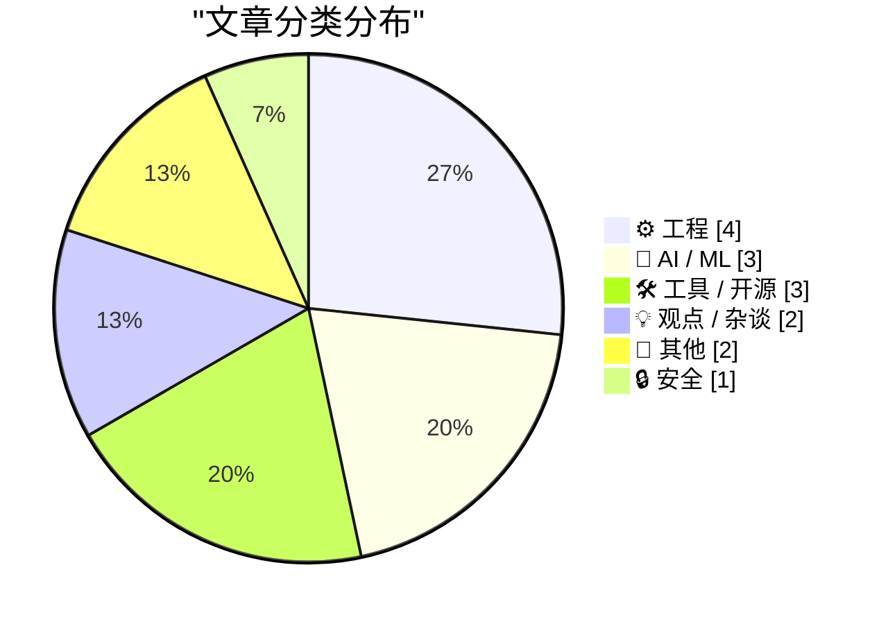
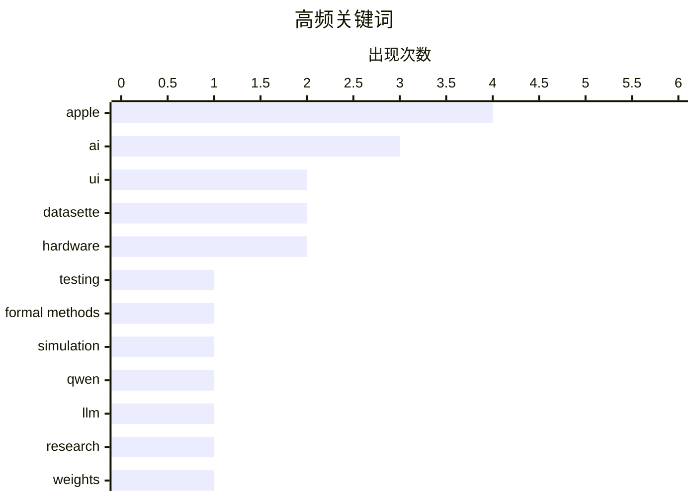

# 📰 Nov 5, 2026

> 来自 Karpathy 推荐的 92 个顶级技术博客，AI 精选 Top 15

## 📝 今日看点

今日技术圈聚焦 AI 深度集成的双刃剑效应：苹果开放 Siri 接口推动生态进化的同时，AI 抓取版权争议与功能过载引发的“误触经济”正成为行业反思焦点。工程领域持续探索可靠性边界，确定性模拟测试与权重空间编程展现了从系统架构到模型理解的新范式。此外，住宅代理引发的高级安全隐患与互联网监管法案的存废讨论，再次敲响了数字安全与治理的警钟。

---

## 🏆 今日必读

🥇 **为什么选择 Antithesis：确定性模拟测试与形式化方法的权衡**

[New Article, Annual LFP Charity Discount](https://buttondown.com/hillelwayne/archive/new-article-annual-lfp-charity-discount/) — buttondown.com/hillelwayne · 1 天前 · ⚙️ 工程

> 探讨了在保障软件可靠性时，确定性模拟测试（DST）与形式化方法（Formal Methods）之间的核心权衡。DST 通过在受控的确定性环境中运行实际代码来发现错误，而形式化方法则侧重于数学证明。两者之间存在输入覆盖范围与代码保真度之间的本质权衡：形式化方法覆盖广但模型抽象，DST 保真度高但受限于搜索空间。Antithesis 平台利用 DST 技术为复杂分布式系统提供自动化测试，旨在填补传统测试与证明之间的空白。理解这种权衡对于为特定系统选择合适的验证工具至关重要。

💡 **为什么值得读**: 深入分析了系统可靠性领域两大主流技术路径的优劣，适合对分布式系统测试和形式化验证感兴趣的开发者。

🏷️ testing, formal methods, simulation

🥈 **Qwen 3.8 27B 模型也能在笔记本上解读神经网络权重**

[Qwen 3.8 27B on my laptop can interpret model weights, too](https://simonwillison.net/2026/Nov/3/qwen-can-interpret-model-weights/) — simonwillison.net · 1 天前 · 🤖 AI / ML

> 探讨了“权重空间编程”（Weight-Space Programming）的可能性，即 LLM 原生读取和修改神经网络权重的能力。基于《权重空间编程的火花》一文，不仅 GPT-6 Astra 等顶级模型具备此能力，作者在本地运行的 Qwen 3.8 27B 模型也展现出了理解模型权重文本描述的潜力。这种能力意味着模型可以分析自身的参数分布，甚至根据指令调整权重以改变行为。研究表明，LLM 对数值权重的理解超出了简单的模式匹配，为模型自我优化和可解释性研究开辟了新路径。这一发现暗示了未来模型可能具备自我修复或动态调整参数的进化能力。

💡 **为什么值得读**: 揭示了 LLM 一项令人惊讶的“隐藏技能”，即直接理解和操作神经网络底层的数值权重。

🏷️ Qwen, LLM, research, weights

🥉 **想租用白宫的 IP 地址吗？住宅代理服务引发的安全隐患**

[Want to Rent an Internet Address at the White House?](https://krebsonsecurity.com/2026/11/want-to-rent-an-internet-address-at-the-white-house/) — krebsonsecurity.com · 9 小时前 · 🔒 安全

> 揭露了多名白宫工作人员在个人设备上安装了住宅代理（Residential Proxy）服务，导致白宫内部网络地址被出租给外部用户。安全专家警告称，其中一家代理服务商为俄罗斯公司，其创始人曾涉及 2016 年针对美国选举系统的网络攻击。这些服务通常通过免费应用或插件诱导用户分享带宽，从而将用户的 IP 变成黑客或爬虫的跳板。这种行为严重威胁了政府机构的网络边界安全，可能导致敏感流量被拦截或伪造。作者呼吁加强对政府雇员设备使用代理服务的监管和审查，以防范潜在的国家级安全风险。

💡 **为什么值得读**: 警示了住宅代理服务如何成为国家级安全漏洞，是了解现代网络攻击链路和内网安全的重要案例。

🏷️ proxy, cybersecurity, privacy

---

## 📊 数据概览

| 扫描源 | 抓取文章 | 时间范围 | 精选 |
|:---:|:---:|:---:|:---:|
| 84/92 | 2577 篇 → 32 篇 | 48h | **15 篇** |

### 分类分布



### 高频关键词



<details>
<summary>📈 纯文本关键词图（终端友好）</summary>

```
apple          │ ████████████████████ 4
ai             │ ███████████████░░░░░ 3
ui             │ ██████████░░░░░░░░░░ 2
datasette      │ ██████████░░░░░░░░░░ 2
hardware       │ ██████████░░░░░░░░░░ 2
testing        │ █████░░░░░░░░░░░░░░░ 1
formal methods │ █████░░░░░░░░░░░░░░░ 1
simulation     │ █████░░░░░░░░░░░░░░░ 1
qwen           │ █████░░░░░░░░░░░░░░░ 1
llm            │ █████░░░░░░░░░░░░░░░ 1
```

</details>

### 🏷️ 话题标签

**apple**(4) · **ai**(3) · **ui**(2) · datasette(2) · hardware(2) · testing(1) · formal methods(1) · simulation(1) · qwen(1) · llm(1) · research(1) · weights(1) · proxy(1) · cybersecurity(1) · privacy(1) · siri(1) · api(1) · copyright(1) · web scraping(1) · brave(1)

---

## ⚙️ 工程

### 1. 为什么选择 Antithesis：确定性模拟测试与形式化方法的权衡

[New Article, Annual LFP Charity Discount](https://buttondown.com/hillelwayne/archive/new-article-annual-lfp-charity-discount/) — **buttondown.com/hillelwayne** · 1 天前 · ⭐ 27/30

> 探讨了在保障软件可靠性时，确定性模拟测试（DST）与形式化方法（Formal Methods）之间的核心权衡。DST 通过在受控的确定性环境中运行实际代码来发现错误，而形式化方法则侧重于数学证明。两者之间存在输入覆盖范围与代码保真度之间的本质权衡：形式化方法覆盖广但模型抽象，DST 保真度高但受限于搜索空间。Antithesis 平台利用 DST 技术为复杂分布式系统提供自动化测试，旨在填补传统测试与证明之间的空白。理解这种权衡对于为特定系统选择合适的验证工具至关重要。

🏷️ testing, formal methods, simulation

---

### 2. 苹果向开发者开放 Siri AI 接口：iOS 27.3 引入全新 App Intents

[Apple Begins Opening Siri AI to Developers](https://developer.apple.com/news/?id=gdk2umrf) — **daringfireball.net** · 1 天前 · ⭐ 26/30

> 苹果在 iOS 27.3、macOS 27.3 等系统的最新开发者预览版中，正式开放了 Siri AI 的集成接口。开发者现在可以通过全新的 App Intents 框架，让第三方应用直接与 Siri 的智能逻辑进行交互。这一更新允许 Siri 更好地理解应用内的上下文，并执行跨应用的复杂指令，从而提升用户的自动化体验。此次预览旨在让开发者提前适配即将到来的 AI 功能，优化业务触达客户的方式。这标志着苹果在 AI 生态构建上迈出了关键一步，将 Siri 从简单的语音助手转型为系统级的 AI 调度器。

🏷️ Apple, Siri, AI, API

---

### 3. 在没有随机访问外部存储的情况下，如何实现随机访问数据库？

[How do you implement a random-access database when you don’t have random-access external storage?](https://devblogs.microsoft.com/oldnewthing/20261103-00/?p=112825/) — **devblogs.microsoft.com/oldnewthing** · 1 天前 · ⭐ 22/30

> 探讨了在受限环境下实现数据库功能的工程策略，核心问题是如何在仅支持顺序访问的存储介质上模拟随机访问。作者 Raymond Chen 提出的解决方案是将整个数据库加载到程序的内存空间中进行操作。通过在内存中构建索引和数据结构，程序可以实现极高的随机访问性能，而外部存储仅作为持久化的备份。这种方法虽然受限于内存容量，但在特定历史硬件或嵌入式场景下非常有效。文章通过这种极简的视角，揭示了数据库系统底层存储与内存管理的本质关系，强调了内存作为高速缓存的核心地位。

🏷️ database, memory management, architecture

---

### 4. 虽有等级之分，但等级的含义往往并不明确

[There are things with ranks, but it’s not always clear what the ranks mean](https://devblogs.microsoft.com/oldnewthing/20261104-00/?p=112830/) — **devblogs.microsoft.com/oldnewthing** · 23 小时前 · ⭐ 20/30

> 探讨了技术文档编写中常见的一个陷阱：由过于熟悉特性的专家编写的文档往往缺乏对基础概念的解释。文章指出，许多系统或 API 中存在“等级（ranks）”或“优先级”设定，但文档经常忽略解释这些数值的具体含义或权重逻辑。这种信息不对称导致外部开发者在调用接口时难以预测系统行为。作者强调，文档应清晰定义每个等级的边界条件，而非假设读者拥有与开发者同等的背景知识。良好的文档应该能让新手准确理解不同等级之间的功能差异。

🏷️ documentation, API design, software engineering

---

## 🤖 AI / ML

### 5. Qwen 3.8 27B 模型也能在笔记本上解读神经网络权重

[Qwen 3.8 27B on my laptop can interpret model weights, too](https://simonwillison.net/2026/Nov/3/qwen-can-interpret-model-weights/) — **simonwillison.net** · 1 天前 · ⭐ 26/30

> 探讨了“权重空间编程”（Weight-Space Programming）的可能性，即 LLM 原生读取和修改神经网络权重的能力。基于《权重空间编程的火花》一文，不仅 GPT-6 Astra 等顶级模型具备此能力，作者在本地运行的 Qwen 3.8 27B 模型也展现出了理解模型权重文本描述的潜力。这种能力意味着模型可以分析自身的参数分布，甚至根据指令调整权重以改变行为。研究表明，LLM 对数值权重的理解超出了简单的模式匹配，为模型自我优化和可解释性研究开辟了新路径。这一发现暗示了未来模型可能具备自我修复或动态调整参数的进化能力。

🏷️ Qwen, LLM, research, weights

---

### 6. 《纽约时报》等媒体起诉 Brave 浏览器：指控其非法抓取内容训练 AI 并绕过付费墙

[The New York Times (et al.) Sues Brave for Copyright Infringement, Selling Scraped Content to AI Companies for Model Training](https://www.theverge.com/tech/1024588/brave-lawsuit-ai-scraping-new-york-times) — **daringfireball.net** · 1 天前 · ⭐ 24/30

> 《纽约时报》、芝加哥论坛报等多家媒体联合起诉 Brave 浏览器母公司，指控其非法抓取新闻内容用于 AI 模型训练。诉状指出，Brave 通过索引抓取的网站内容并向 AI 公司提供付费的“实时搜索”访问权限来牟利。此外，Brave 还被指控利用其技术手段帮助用户绕过媒体的付费订阅墙，损害了出版商的合法收入。原告认为这种行为构成了严重的版权侵权，并破坏了新闻行业的商业模式。此案反映了内容创作者与 AI 技术服务商之间日益尖锐的版权矛盾，可能对未来的 AI 数据获取方式产生深远影响。

🏷️ AI, copyright, web scraping, Brave

---

### 7. Datasette Agent 0.5a0 发布：引入侧边栏对话面板

[datasette-agent 0.5a0](https://simonwillison.net/2026/Nov/3/datasette-agent/) — **simonwillison.net** · 1 天前 · ⭐ 20/30

> Datasette Agent 发布 0.5a0 版本，核心更新是引入了名为“面板（panel）”的新功能。该功能允许 AI 对话框与 Datasette 的数据表或查询页面并排显示，显著提升了交互式数据分析的体验。通过与 datasette-apps 插件结合，用户可以直接在对话中要求 Agent 修改或生成自定义 HTML 应用。这一版本标志着 Datasette 从单纯的数据查看工具向由 AI 驱动的低代码应用开发平台迈进。开发者现在可以更直观地观察 AI 如何操作数据库并实时查看结果。

🏷️ Datasette, AI-agent, UI

---

## 🛠 工具 / 开源

### 8. 版本控制周报：2026 年 11 月 4 日

[This Week in Source Control: 4 November 2026](https://nesbitt.io/2026/11/04/this-week-in-source-control.html) — **nesbitt.io** · 1 天前 · ⭐ 23/30

> 汇总了本周版本控制系统及代码托管平台（如 Git、GitHub、GitLab 等）的最新动态。内容涵盖了各大工具的版本发布说明、新发现的安全漏洞预警以及行业内的深度技术文章。该周报旨在为开发者和运维工程师提供一站式的信息更新，确保其开发工作流的安全性与高效性。通过阅读此类摘要，技术团队可以快速评估是否需要更新其内部工具链或修复已知的安全隐患。文章还包含了一些关于 Forge 平台 API 变更的讨论，对自动化集成流程具有参考价值。

🏷️ Git, source control, version control

---

### 9. Safari 27.3 Beta 版发布：引入垂直标签页与自适应暗黑模式

[Safari 27.3 Beta Adds Vertical Tabs and Adaptive Dark Mode](https://www.macrumors.com/2026/11/03/ios-27-3-safari/) — **daringfireball.net** · 1 天前 · ⭐ 22/30

> 苹果在 iOS 27.3 和 macOS Golden Gate 27.3 的测试版中为 Safari 浏览器带来了重大更新。最显著的变化是新增了垂直标签页（Vertical Tabs）布局，用户可以选择在屏幕左侧以图标或扩展列表形式管理标签，这在宽屏设备上尤为实用。此外，新版本还引入了自适应暗黑模式，能够根据网页内容智能调整显示效果。这些改进旨在提升多任务处理效率，并优化在大尺寸屏幕（如 iPhone Duo）上的浏览体验。目前这些功能已向开发者开放测试，预计将在正式版中全面推送。

🏷️ Safari, browser, UI, Apple

---

### 10. Datasette Apps 0.3a0 发布：增强 AI 驱动的应用构建能力

[datasette-apps 0.3a0](https://simonwillison.net/2026/Nov/4/datasette-apps/) — **simonwillison.net** · 1 天前 · ⭐ 18/30

> Datasette Apps 发布 0.3a0 版本，该插件支持在 Datasette 内部托管和编辑自定义 HTML 应用程序。新版本重点优化了与 Datasette Agent 的集成，允许用户在 AI 对话中直接引用和修改特定的 App。用户现在可以通过自然语言指令让 LLM 生成可视化图表或数据仪表板，并将其保存为独立应用。这一更新进一步降低了数据可视化的门槛，实现了“对话即编程”的开发模式。它为非专业开发者提供了一种快速将原始数据转化为交互式工具的途径。

🏷️ Datasette, web-apps, HTML

---

## 💡 观点 / 杂谈

### 11. AI “误触经济”：当实用工具被无用的 AI 功能侵占

[Pluralistic: The AI fatfinger economy has come for my receipts app (04 Nov 2026)](https://pluralistic.net/2026/11/04/genius-scan-is-neither/) — **pluralistic.net** · 1 天前 · ⭐ 24/30

> 科技评论家 Cory Doctorow 批评了 Genius Scan 等实用工具软件过度集成 AI 功能的趋势。他指出，原本简洁高效的收据扫描应用现在到处充斥着容易误触的 AI 按钮，而这些功能往往并不能解决实际问题。作者将这种现象称为“AI 误触经济”，即开发者为了追逐 AI 热潮而牺牲用户体验，强行加入低价值的生成式功能。文章还讨论了这种趋势如何导致软件臃肿和核心功能的退化。作者呼吁回归以用户为中心的设计，而非盲目堆砌 AI 噱头，以保持工具软件的纯粹性。

🏷️ AI, UX, product design, AI washing

---

### 12. 失去 CDA 230 保护，Facebook 将永久统治互联网

[Pluralistic: Without CDA 230, Facebook will own the internet forever (05 Nov 2026)](https://pluralistic.net/2026/11/05/see-you-in-court/) — **pluralistic.net** · 5 小时前 · ⭐ 23/30

> 深入探讨了美国《通信规范法》第 230 条（CDA 230）对互联网生态的重要性。作者认为，如果废除该条款中关于平台免责的保护，小型和管理良好的在线社区将因无法承担潜在的法律诉讼风险而消失。相比之下，像 Facebook 这样的大型科技巨头拥有庞大的法律团队和资金储备，能够承受诉讼压力，从而形成事实上的垄断。文章强调，CDA 230 是保护互联网多样性和言论自由的基石，而非仅仅是巨头的避风港。结论是，修改该法律必须极其谨慎，以防意外扼杀竞争对手并巩固巨头的地位。

🏷️ Section 230, regulation, Big Tech, internet

---

## 📝 其他

### 13. iPad Mini (A20 Pro) 评测汇总

[iPad Mini (A20 Pro) Review Roundup](https://www.techmeme.com/261103/p15#a261103p15) — **daringfireball.net** · 1 天前 · ⭐ 19/30

> 汇总了多家媒体对搭载 A20 Pro 芯片的新款 iPad Mini 的评价，重点关注其创新的“声学显示屏（Acoustic Display）”技术。该技术通过屏幕面板而非传统的扬声器孔发声，虽然音质提升有限，但增强了设备的防水防尘性能并使声音直面用户。The Verge 指出其低音略有增强，但整体听感变化不大，主要是为了耐用性做出的折中。Stephen Robles 等评论者则从不同维度分析了这款小尺寸平板在专业场景下的表现。总体而言，这是一款在保持经典外形下进行内部硬件稳步升级的产品。

🏷️ iPad-mini, hardware, Apple

---

### 14. MKBHD 评新款 A20 Pro iPad Mini

[MKBHD on the New A20 Pro iPad Mini](https://www.youtube.com/watch?v=g6Die8gVFn0) — **daringfireball.net** · 1 天前 · ⭐ 18/30

> 知名科技博主 MKBHD 对新款 iPad Mini 进行了深度测评，对“声学显示屏”给出了复杂评价：虽然声音指向性更好，但高音量时会导致整个机身剧烈震动。他推测苹果可能在未来的高端 iPhone 上采用此技术以实现无孔化设计，但也批评了该机型仍未配备 120Hz 高刷屏幕。此外，他对 A20 Pro 芯片的性能表示认可，但质疑苹果在 OLED 屏幕供应链上的选型策略。文章反映了该产品在追求极致便携与硬件配置之间的权衡。对于追求极致视听的用户来说，60Hz 屏幕和机身震动可能是主要槽点。

🏷️ iPad Mini, Apple, hardware, A20 Pro

---

## 🔒 安全

### 15. 想租用白宫的 IP 地址吗？住宅代理服务引发的安全隐患

[Want to Rent an Internet Address at the White House?](https://krebsonsecurity.com/2026/11/want-to-rent-an-internet-address-at-the-white-house/) — **krebsonsecurity.com** · 9 小时前 · ⭐ 26/30

> 揭露了多名白宫工作人员在个人设备上安装了住宅代理（Residential Proxy）服务，导致白宫内部网络地址被出租给外部用户。安全专家警告称，其中一家代理服务商为俄罗斯公司，其创始人曾涉及 2016 年针对美国选举系统的网络攻击。这些服务通常通过免费应用或插件诱导用户分享带宽，从而将用户的 IP 变成黑客或爬虫的跳板。这种行为严重威胁了政府机构的网络边界安全，可能导致敏感流量被拦截或伪造。作者呼吁加强对政府雇员设备使用代理服务的监管和审查，以防范潜在的国家级安全风险。

🏷️ proxy, cybersecurity, privacy

---

*生成于 2026-11-05 14:28 | 扫描 84 源 → 获取 2577 篇 → 精选 15 篇*
*基于 [Hacker News Popularity Contest 2025](https://refactoringenglish.com/tools/hn-popularity/) RSS 源列表，由 [Andrej Karpathy](https://x.com/karpathy) 推荐*
