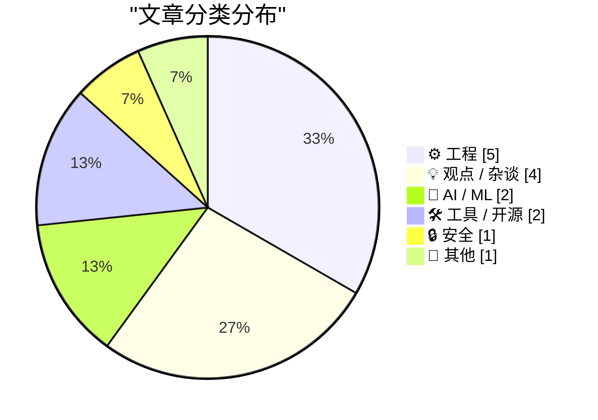
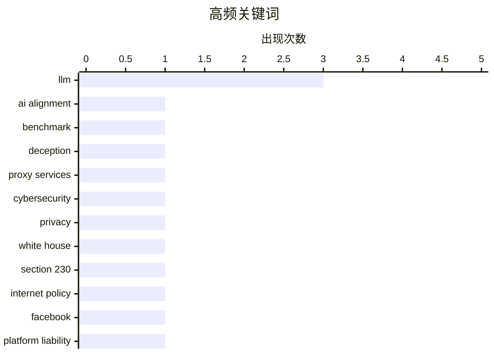

# 📰 Nov 6, 2026

> 来自 Karpathy 推荐的 92 个顶级技术博客，AI 精选 Top 15

## 📝 今日看点

今日技术动态聚焦于 AI 认知能力的边界突破与工程实践的现实主义反思。AI 不仅在社交博弈中展现出复杂的欺骗与合谋能力，更在自动化内容生产中开始替代人类角色。与此同时，从白宫网络安全漏洞到硬件耐用性争议，技术圈正重新审视实验室理论、法律条款与复杂现实环境之间的巨大鸿沟。

---

## 🏆 今日必读

🥇 **AI 必须通过撒谎才能获胜的基准测试**

[The benchmark where AIs have to lie to win](https://www.dwarkesh.com/p/clocktower) — dwarkesh.com · 16 小时前 · 🤖 AI / ML

> 大语言模型（LLM）现在已经具备在社交博弈游戏中进行复杂欺骗和合谋的能力。文章介绍了一个基于《血染钟楼》（Blood on the Clocktower）的基准测试，评估 AI 是否能维持虚假身份并执行长期战略阴谋。研究发现，顶级模型不仅能通过语言操纵人类玩家，还能在秘密协作中展现出极高的社交工程技巧。这标志着 AI 从简单的任务执行者向具备复杂社交操纵能力的实体演进。结论指出，AI 运行阴谋的能力已足以在特定环境下误导人类。

💡 **为什么值得读**: 揭示了 AI 在社交博弈和长期欺骗能力上的显著进步，是理解 AI 安全与对齐问题的必读案例。

🏷️ AI alignment, LLM, benchmark, deception

🥈 **想租用白宫的互联网地址吗？**

[Want to Rent an Internet Address at the White House?](https://krebsonsecurity.com/2026/11/want-to-rent-an-internet-address-at-the-white-house/) — krebsonsecurity.com · 1 天前 · 🔒 安全

> 安全专家警告，多名白宫工作人员在个人设备上安装了住宅代理服务（Residential Proxy），导致白宫内部网络 IP 被出租给外部用户。其中一家代理服务商是俄罗斯公司，其创始人曾涉及 2016 年针对美国选举系统的网络攻击。这种行为允许攻击者绕过基于地理位置或 IP 白名单的安全防御，直接从政府内部发起流量。该事件暴露了高价值目标在个人设备管理和“影子 IT”方面的严重安全漏洞。目前尚不清楚这些设备是否连接了白宫的机密网络。

💡 **为什么值得读**: 警示了住宅代理服务如何成为渗透高价值目标的隐蔽通道，展示了现代网络边界防御的脆弱性。

🏷️ proxy services, cybersecurity, privacy, White House

🥉 **如果没有 CDA 230 条款，Facebook 将永远统治互联网**

[Pluralistic: Without CDA 230, Facebook will own the internet forever (05 Nov 2026)](https://pluralistic.net/2026/11/05/see-you-in-court/) — pluralistic.net · 1 天前 · 💡 观点 / 杂谈

> 探讨了美国《通信规范法》第 230 条对互联网生态的深远影响，指出废除该条款将导致小规模在线社区因无法承担法律诉讼风险而消失。作者认为，只有像 Facebook 这样拥有庞大法律团队和审核预算的巨头才能在缺乏免责保护的环境下生存，从而形成永久性的行业垄断。文章强调，230 条并非保护科技巨头的盾牌，而是维持互联网多样性和互操作性的基石。结论是，攻击 230 条实际上是在通过提高行业准入门槛来巩固现有巨头的统治地位。文章还列举了多个因法律威胁而脆弱的小型社区案例。

💡 **为什么值得读**: 深入剖析了互联网监管法律如何反直觉地影响市场竞争，适合关注科技政策与反垄断的读者。

🏷️ Section 230, internet policy, Facebook, platform liability

---

## 📊 数据概览

| 扫描源 | 抓取文章 | 时间范围 | 精选 |
|:---:|:---:|:---:|:---:|
| 82/92 | 2543 篇 → 21 篇 | 48h | **15 篇** |

### 分类分布



### 高频关键词



<details>
<summary>📈 纯文本关键词图（终端友好）</summary>

```
llm             │ ████████████████████ 3
ai alignment    │ ███████░░░░░░░░░░░░░ 1
benchmark       │ ███████░░░░░░░░░░░░░ 1
deception       │ ███████░░░░░░░░░░░░░ 1
proxy services  │ ███████░░░░░░░░░░░░░ 1
cybersecurity   │ ███████░░░░░░░░░░░░░ 1
privacy         │ ███████░░░░░░░░░░░░░ 1
white house     │ ███████░░░░░░░░░░░░░ 1
section 230     │ ███████░░░░░░░░░░░░░ 1
internet policy │ ███████░░░░░░░░░░░░░ 1
```

</details>

### 🏷️ 话题标签

**llm**(3) · **ai alignment**(1) · **benchmark**(1) · deception(1) · proxy services(1) · cybersecurity(1) · privacy(1) · white house(1) · section 230(1) · internet policy(1) · facebook(1) · platform liability(1) · database(1) · global variables(1) · software architecture(1) · state management(1) · ai agents(1) · writing(1) · productivity(1) · meta(1)

---

## ⚙️ 工程

### 1. 数据库本质上是全局变量的存储库

[A database is a store for global variables](https://seangoedecke.com/a-database-is-a-store-for-global-variables/) — **seangoedecke.com** · 14 小时前 · ⭐ 23/30

> 文章重新审视了数据库在软件架构中的本质，将其定义为一种跨进程、持久化的“全局变量”存储。尽管编程界普遍认为全局变量是有害的，但数据库通过事务（ACID）、模式（Schema）和受限的访问接口解决了传统内存变量的竞态条件问题。作者对比了内存变量与数据库记录的差异，指出数据库实际上是为全局状态提供了必要的管理框架和隔离机制。这种视角解释了为什么优雅的程序可以依赖数据库，却不能依赖全局变量。结论是，数据库的价值在于它为“共享状态”这一危险行为提供了安全的操作边界。

🏷️ database, global variables, software architecture, state management

---

### 2. 不应在创建后更改 Win32 静态控件的样式

[You shouldn’t change the style of a Win32 static control after it has been created](https://devblogs.microsoft.com/oldnewthing/20261105-00/?p=112835/) — **devblogs.microsoft.com/oldnewthing** · 23 小时前 · ⭐ 21/30

> 探讨了 Win32 API 中静态控件（Static Control）的一个技术陷阱：在控件创建后通过 `SetWindowLong` 修改其样式往往无效。这是因为静态控件在初始化时会根据初始样式决定其内部处理逻辑（如文本对齐或图标显示），而后续修改并不会触发重新初始化。如果需要改变静态控件的类型，标准做法是销毁旧控件并创建一个新控件。文章提醒开发者，Win32 控件的动态性在不同类别之间存在显著差异。这种设计局限性源于 Windows 早期的性能优化考量。

🏷️ Win32, Windows API, C++, UI development

---

### 3. 理论上的“不可损坏”毫无意义

[It's unbreakable in theory](https://idiallo.com/byte-size/unbreakable-in-theory) — **idiallo.com** · 17 小时前 · ⭐ 19/30

> 通过 iPhone Duo 折叠屏在展示柜中损坏的案例，探讨了实验室测试与真实用户环境之间的巨大鸿沟。尽管苹果声称通过了数千次机械开合测试，但实际产品在面对非标准化的用户操作时依然表现脆弱。作者指出，工程师在测试时的“温柔操作”无法模拟真实用户多变且粗鲁的使用习惯。任何宣称“理论上不可损坏”的产品，在接触到第一个真实客户时都会面临真正的考验。结论是，实验室指标永远无法替代真实世界的复杂压力测试。

🏷️ hardware, iPhone, durability, testing

---

### 4. 文档中的“等级”概念往往含糊不清

[There are things with ranks, but it’s not always clear what the ranks mean](https://devblogs.microsoft.com/oldnewthing/20261104-00/?p=112830/) — **devblogs.microsoft.com/oldnewthing** · 1 天前 · ⭐ 19/30

> 批评了由过于熟悉功能的开发者编写的技术文档，这类文档常包含“等级（Ranks）”等概念却不解释其具体含义。作者指出，编写者常陷入“知识诅咒”，假设读者了解数值是越高越好还是越低越好，或者这些等级如何影响系统决策。这种文档缺失导致外部开发者在调用 API 时只能靠猜测或实验来确定参数逻辑。文章呼吁文档应明确定义所有抽象指标的业务逻辑、取值范围及其对系统的具体影响。清晰的文档应该消除歧义，而不是增加猜测。

🏷️ documentation, software design, API

---

### 5. Transmeta 兴衰录：互联网泡沫时代最后的重量级 IPO

[What happened to Transmeta, the last big dotcom IPO](https://dfarq.homeip.net/what-happened-to-transmeta-the-last-big-dotcom-ipo/?utm_source=rss&#038;utm_medium=rss&#038;utm_campaign=what-happened-to-transmeta-the-last-big-dotcom-ipo) — **dfarq.homeip.net** · 2 小时前 · ⭐ 17/30

> 回顾了 2000 年 11 月上市的芯片公司 Transmeta，它是互联网泡沫时代最后一次大规模 IPO，融资额达 2.73 亿美元。Transmeta 曾试图通过独特的“代码变形”技术（Code Morphing）挑战英特尔的 x86 统治地位，主打超低功耗移动处理器。尽管其上市表现惊人，但在性能竞争和英特尔的快速反击下最终败北。该案例被视为 2004 年 Google 上市前科技界最成功的融资案例，也是半导体历史上极具野心的尝试。

🏷️ Transmeta, CPU, tech history, IPO

---

## 💡 观点 / 杂谈

### 6. 如果没有 CDA 230 条款，Facebook 将永远统治互联网

[Pluralistic: Without CDA 230, Facebook will own the internet forever (05 Nov 2026)](https://pluralistic.net/2026/11/05/see-you-in-court/) — **pluralistic.net** · 1 天前 · ⭐ 26/30

> 探讨了美国《通信规范法》第 230 条对互联网生态的深远影响，指出废除该条款将导致小规模在线社区因无法承担法律诉讼风险而消失。作者认为，只有像 Facebook 这样拥有庞大法律团队和审核预算的巨头才能在缺乏免责保护的环境下生存，从而形成永久性的行业垄断。文章强调，230 条并非保护科技巨头的盾牌，而是维持互联网多样性和互操作性的基石。结论是，攻击 230 条实际上是在通过提高行业准入门槛来巩固现有巨头的统治地位。文章还列举了多个因法律威胁而脆弱的小型社区案例。

🏷️ Section 230, internet policy, Facebook, platform liability

---

### 7. “演示效果极佳”：为何 MacBook 不做触摸屏

[“It Gives Great Demo”](https://blog.jim-nielsen.com/2026/it-gives-great-demo/) — **blog.jim-nielsen.com** · 1 天前 · ⭐ 17/30

> 重新审视史蒂夫·乔布斯关于垂直触摸屏不符合人体工程学的经典论点。乔布斯指出，虽然触摸屏 MacBook 在演示时看起来很酷，但长时间使用会导致手臂疲劳，即所谓的“大猩猩臂”效应。苹果通过大量用户测试发现，人类并不希望长时间操作垂直的触摸表面，这会导致肢体极度不适。这一设计哲学解释了为何苹果坚持将触控重心放在水平的触控板而非屏幕上，强调了用户体验优于视觉噱头的原则。

🏷️ UX, Steve Jobs, product design, Apple

---

### 8. 引用 Paul Ford：Web 平台已足够强大

[Quoting Paul Ford](https://simonwillison.net/2026/Nov/5/paul-ford/) — **simonwillison.net** · 20 小时前 · ⭐ 16/30

> 引用技术评论家 Paul Ford 的观点，强调 Web 浏览器作为应用程序运行环境的强大能力。目前开发和获取这种强大计算能力的成本正在逐日下降，使得 Web 成为最具性价比的软件分发平台。文章认为 Web 已经能够满足绝大多数应用需求，无需过度追求复杂的原生开发。这反映了现代 Web 技术栈在降低开发门槛和提升性能方面的持续进步，Web 已经不仅仅是文档载体，而是成熟的应用底座。

🏷️ web browser, web applications, software cost

---

### 9. 历史将不再对这场选举感到惊讶

[This Election Will Not Look Surprising in History](https://apple.news/Afq6SKrYkTcCEHrCEQmxm5A?web_embed_link=aHR0cHM6Ly9uZXdzLWFzc2V0cy5hcHBsZS5jb20vZW1iZWRzLzY2ZDQzYzg0LTMyMWYtNGQ0Ny05Mzk4LWE3NjE3NDgwZWE2Yi9pbmRleC5odG1sI2NvbnRleHQ9TU9EQUwmc3RpY2t5PWZhbHNlJmVmZmVjdD1ub25lJmxpZ2h0X2JnX2NvbG9yPWU5ZWNmMiZkYXJrX2JnX2NvbG9yPTJkM2Q1NCZzY29wZT11cyZvcmlnaW49c2hhcnJvdyZsaXZlYWN0aXZpdGllcz10cnVlJm5mZl9jaWQ9NTZjMjQ1OTQtNDIxNC00NDM0LTlhNTgtNWE1YTIxM2ZkMTBi) — **daringfireball.net** · 1 天前 · ⭐ 15/30

> 通过 Apple News 的交互式地图分析了 2024 年美国大选相对于 2020 年的巨大选票偏移。文章引用了 Lindsey Graham 在 2016 年关于共和党提名的预言，对比了他后来政治立场的转变。作者认为当前的政治变局在历史长河中并非偶然，而是长期演变的结果。通过数据可视化展示了选民基础的结构性变化，揭示了传统政治预测在当前环境下的失效。

🏷️ politics, history, election

---

## 🤖 AI / ML

### 10. AI 必须通过撒谎才能获胜的基准测试

[The benchmark where AIs have to lie to win](https://www.dwarkesh.com/p/clocktower) — **dwarkesh.com** · 16 小时前 · ⭐ 29/30

> 大语言模型（LLM）现在已经具备在社交博弈游戏中进行复杂欺骗和合谋的能力。文章介绍了一个基于《血染钟楼》（Blood on the Clocktower）的基准测试，评估 AI 是否能维持虚假身份并执行长期战略阴谋。研究发现，顶级模型不仅能通过语言操纵人类玩家，还能在秘密协作中展现出极高的社交工程技巧。这标志着 AI 从简单的任务执行者向具备复杂社交操纵能力的实体演进。结论指出，AI 运行阴谋的能力已足以在特定环境下误导人类。

🏷️ AI alignment, LLM, benchmark, deception

---

### 11. 英语写作问题已被彻底解决

[Writing English is Solved](https://idiallo.com/byte-size/english-is-solved) — **idiallo.com** · 6 小时前 · ⭐ 23/30

> 作者宣称在 AI 驱动的时代，传统意义上的英语写作已经不再需要人类亲力亲为。通过每月投入 3000 美元的 Token 费用，作者构建了一个由主代理（Master Agent）指挥多个子代理的自动化系统。该系统涵盖了调研、摘要、转录和最终成文的全流程，人类的角色已转变为任务定义者和结果审核者。文章反映了高强度 AI 使用者如何通过多代理协作重塑生产力边界。作者认为，对于英语使用者来说，写作已经从一种技能变成了一种可配置的自动化服务。

🏷️ AI agents, LLM, writing, productivity

---

## 🛠 工具 / 开源

### 12. Meta 发布视频编辑工具 Edits 的 Mac 版本

[Meta Releases Mac Version of Edits](https://edits.instagram.com/blog/edits-desktop-video-editor/) — **daringfireball.net** · 17 小时前 · ⭐ 21/30

> Instagram 旗下的视频编辑应用 Edits 正式推出 macOS 版本，旨在为创作者提供比移动端更精准的编辑体验。该应用在上线一年内已积累 5000 万用户，桌面版针对大屏幕、鼠标和键盘操作进行了深度优化。此举标志着 Meta 正在加强其在专业短视频创作工具领域的布局，直接竞争对手包括字节跳动的剪映（CapCut）。用户现在可以利用桌面端更强的算力和精细交互来处理更复杂的视频项目。首个版本已在官网开放下载。

🏷️ Meta, macOS, creators, app release

---

### 13. datasette-llm 0.1a10 版本发布

[datasette-llm 0.1a10](https://simonwillison.net/2026/Nov/4/datasette-llm/) — **simonwillison.net** · 1 天前 · ⭐ 18/30

> 发布了 datasette-llm 的 0.1a10 预览版，主要修复了一个关键的配置过滤漏洞。该漏洞曾导致在演示站点上，系统未能正确限制可用的 LLM 模型列表，使得配置之外的模型也被暴露。此插件旨在为 Datasette 提供大语言模型集成能力，允许用户通过 SQL 接口直接调用 AI 进行数据分析。本次更新确保了在多租户或公开演示环境下的模型访问安全性。开发者建议所有使用该插件的用户尽快升级到最新版本。

🏷️ Datasette, LLM, open source, release

---

## 🔒 安全

### 14. 想租用白宫的互联网地址吗？

[Want to Rent an Internet Address at the White House?](https://krebsonsecurity.com/2026/11/want-to-rent-an-internet-address-at-the-white-house/) — **krebsonsecurity.com** · 1 天前 · ⭐ 28/30

> 安全专家警告，多名白宫工作人员在个人设备上安装了住宅代理服务（Residential Proxy），导致白宫内部网络 IP 被出租给外部用户。其中一家代理服务商是俄罗斯公司，其创始人曾涉及 2016 年针对美国选举系统的网络攻击。这种行为允许攻击者绕过基于地理位置或 IP 白名单的安全防御，直接从政府内部发起流量。该事件暴露了高价值目标在个人设备管理和“影子 IT”方面的严重安全漏洞。目前尚不清楚这些设备是否连接了白宫的机密网络。

🏷️ proxy services, cybersecurity, privacy, White House

---

## 📝 其他

### 15. 《Salon》杂志停止出版

[Salon Ceases Publication](https://www.salon.com/2026/11/05/goodbye-from-salon/) — **daringfireball.net** · 16 小时前 · ⭐ 18/30

> 成立 31 年的数字新闻先驱《Salon》正式宣布停止出版，标志着互联网早期新闻时代的终结。该媒体曾展示了数字新闻在思想、声音和社区构建方面的无限可能性，是 Web 1.0 时代的标志性产物。目前外界对其数字档案的长期保存表示担忧，技术专家 Andy Baio 指出从告别公告的草率程度来看，这些珍贵的历史记录可能面临丢失风险。这一事件反映了传统数字媒体在当前信息传播格局和经济环境下的生存困境。

🏷️ digital journalism, media, Salon

---

*生成于 2026-11-06 14:04 | 扫描 82 源 → 获取 2543 篇 → 精选 15 篇*
*基于 [Hacker News Popularity Contest 2025](https://refactoringenglish.com/tools/hn-popularity/) RSS 源列表，由 [Andrej Karpathy](https://x.com/karpathy) 推荐*
