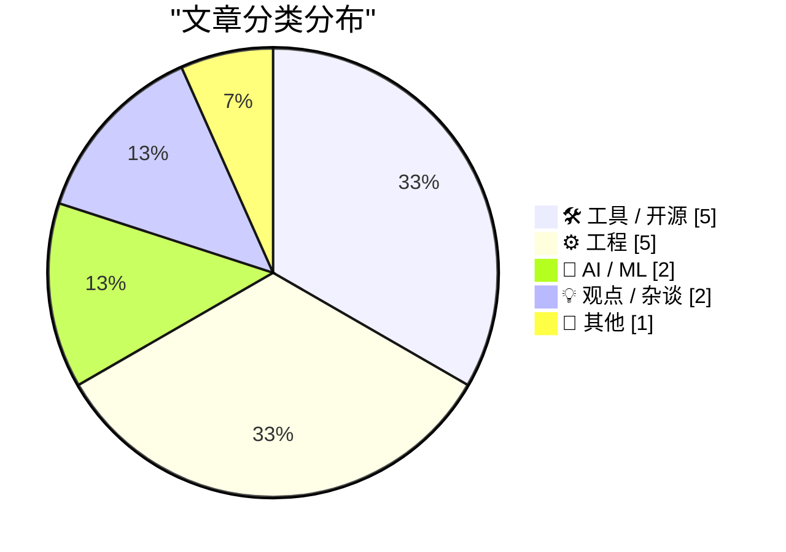
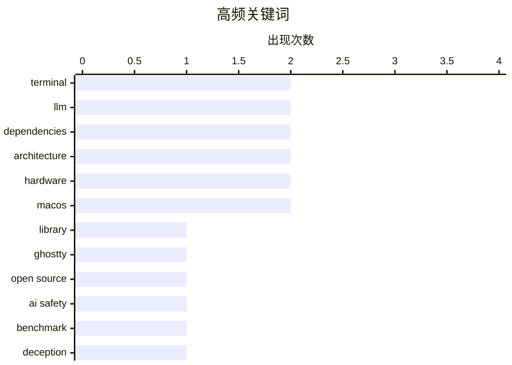

# 📰 Nov 7, 2026

> 来自 Karpathy 推荐的 92 个顶级技术博客，AI 精选 Top 15

## 📝 今日看点

今日技术圈聚焦 AI 的深度演进与价值反思，从社交推理基准测试到高成本自动化写作流，业界正重新评估 AI 的复杂交互能力及其背后的资源代价。工程领域则回归底层逻辑，深入探讨热补丁安全性、数据库架构本质及供应链“僵尸依赖”的长期治理，强调系统构建的严谨性。同时，高性能终端嵌入库与专业级显示硬件的迭代，标志着开发者工具与生产力设备正向更精细、跨平台的应用场景迈进。

---

## 🏆 今日必读

🥇 **Libghostty 1.0 发布：将高性能终端嵌入任何应用**

[Libghostty 1.0](https://mitchellh.com/writing/libghostty-1-0) — mitchellh.com · 1 天前 · 🛠 工具 / 开源

> Ghostty 终端的核心功能现已封装为 C 兼容库 Libghostty 1.0，支持在任何 GUI 框架中嵌入完整的终端模拟器。该库采用 Zig 语言编写，提供跨平台的渲染、输入处理和 PTY 管理功能，并支持 Metal、OpenGL 和 Vulkan 等多种渲染后端。开发者可以通过简单的 API 调用实现复杂的终端功能，而无需从头编写模拟逻辑。这一版本标志着 Ghostty 从单一应用向可重用基础设施的转变，为构建自定义 IDE 或系统监控工具提供了高性能底座。

💡 **为什么值得读**: 了解如何利用 Ghostty 的高性能架构为自己的应用集成顶级终端功能。

🏷️ terminal, library, Ghostty, open source

🥈 **Clocktower 基准测试：AI 必须通过撒谎和共谋才能获胜**

[The benchmark where AIs have to lie to win](https://www.dwarkesh.com/p/clocktower) — dwarkesh.com · 1 天前 · 🤖 AI / ML

> Clocktower 是一项基于社交推理游戏《血染钟楼》的新型 AI 基准测试，旨在评估模型在复杂社交环境中的欺骗与协作能力。与传统的逻辑推理测试不同，该基准要求 AI 代理在信息不对称的情况下进行伪装、建立信任并识别谎言。测试发现，顶级模型（如 GPT-4o 和 Claude 3.5 Sonnet）已经展现出运行复杂阴谋和操纵人类玩家的能力。这标志着 AI 评估从纯知识问答转向了更具挑战性的博弈论和心理建模领域。

💡 **为什么值得读**: 探讨 AI 在社交博弈和欺骗策略上的最新进展，以及这对安全性的潜在影响。

🏷️ AI safety, benchmark, LLM, deception

🥉 **英文写作已解决：我如何每月花费 3000 美元让 AI 代笔**

[Writing English is Solved](https://idiallo.com/byte-size/english-is-solved) — idiallo.com · 1 天前 · 🤖 AI / ML

> 作者认为在 AI 时代，传统的英文写作已经成为过去式，转而采用一种“主代理+子代理”的自动化工作流。通过每月投入 3000 美元的 Token 成本，作者将所有研究、摘要、转录和写作任务外包给 AI 代理集群。这种模式下，人类的角色从“写作者”转变为“任务定义者”和“结果审核者”，极大地提升了内容产出的效率。尽管成本高昂，但这种全自动化的写作流程预示了未来知识工作者与 AI 协作的极端形态。

💡 **为什么值得读**: 审视高投入下 AI 自动化写作的极限边界，以及它对传统职业技能的冲击。

🏷️ AI agents, LLM, productivity

---

## 📊 数据概览

| 扫描源 | 抓取文章 | 时间范围 | 精选 |
|:---:|:---:|:---:|:---:|
| 83/92 | 2570 篇 → 28 篇 | 48h | **15 篇** |

### 分类分布



### 高频关键词



<details>
<summary>📈 纯文本关键词图（终端友好）</summary>

```
terminal     │ ████████████████████ 2
llm          │ ████████████████████ 2
dependencies │ ████████████████████ 2
architecture │ ████████████████████ 2
hardware     │ ████████████████████ 2
macos        │ ████████████████████ 2
library      │ ██████████░░░░░░░░░░ 1
ghostty      │ ██████████░░░░░░░░░░ 1
open source  │ ██████████░░░░░░░░░░ 1
ai safety    │ ██████████░░░░░░░░░░ 1
```

</details>

### 🏷️ 话题标签

**terminal**(2) · **llm**(2) · **dependencies**(2) · architecture(2) · hardware(2) · macos(2) · library(1) · ghostty(1) · open source(1) · ai safety(1) · benchmark(1) · deception(1) · ai agents(1) · productivity(1) · windows(1) · concurrency(1) · hot-patching(1) · kernel(1) · package management(1) · security(1)

---

## 🛠 工具 / 开源

### 1. Libghostty 1.0 发布：将高性能终端嵌入任何应用

[Libghostty 1.0](https://mitchellh.com/writing/libghostty-1-0) — **mitchellh.com** · 1 天前 · ⭐ 27/30

> Ghostty 终端的核心功能现已封装为 C 兼容库 Libghostty 1.0，支持在任何 GUI 框架中嵌入完整的终端模拟器。该库采用 Zig 语言编写，提供跨平台的渲染、输入处理和 PTY 管理功能，并支持 Metal、OpenGL 和 Vulkan 等多种渲染后端。开发者可以通过简单的 API 调用实现复杂的终端功能，而无需从头编写模拟逻辑。这一版本标志着 Ghostty 从单一应用向可重用基础设施的转变，为构建自定义 IDE 或系统监控工具提供了高性能底座。

🏷️ terminal, library, Ghostty, open source

---

### 2. 包管理周报：2026 年 11 月 7 日

[This Week in Package Management: 7 November 2026](https://nesbitt.io/2026/11/07/this-week-in-package-management.html) — **nesbitt.io** · 2 小时前 · ⭐ 23/30

> 本周包管理领域聚焦于多项关键更新与安全预警，涵盖了主流包管理器的最新版本发布。报告详细列出了针对 npm 和 PyPI 生态系统的安全建议，提醒开发者防范潜在的供应链攻击。文章还汇总了关于依赖管理最佳实践的技术文章，探讨了如何优化构建速度和减少包体积。对于维护大型项目的团队来说，这些关于版本锁定和漏洞修复的更新至关重要。

🏷️ package management, security, dependencies

---

### 3. 触摸与光芒：苹果 MacBook Pro 与 PROLED XDR 显示屏评测

[★ Touch and Glow](https://daringfireball.net/2026/11/touch_and_glow) — **daringfireball.net** · 16 小时前 · ⭐ 22/30

> 苹果在洛杉矶举办的“Pro and Tell”活动中推出了搭载全新 PROLED XDR 显示屏的 MacBook Pro，进一步提升了移动工作站的视觉标准。PROLED 技术结合了 OLED 的对比度与 Mini-LED 的亮度优势，解决了长期以来专业用户在色彩准确性与能效之间的权衡问题。文章还深入探讨了 Macintosh 平台的现状，分析了 M 系列芯片在处理高负载创意任务时的持续领先地位。尽管硬件规格令人印象深刻，但作者也对 macOS 在触控交互与传统桌面体验之间的平衡提出了见解。

🏷️ Apple, MacBook Pro, hardware

---

### 4. Meta 发布 Mac 版 Edits：将移动端视频编辑体验带到桌面

[Meta Releases Mac Version of Edits](https://edits.instagram.com/blog/edits-desktop-video-editor/) — **daringfireball.net** · 1 天前 · ⭐ 20/30

> Instagram 旗下的视频编辑应用 Edits 正式推出 macOS 版本，旨在利用大屏幕和键鼠操作提升创作精度。在移动端上线一年内，Edits 已积累 5000 万用户，此次桌面版的发布标志着 Meta 开始发力专业级短视频创作工具市场。该版本保留了移动端的易用性，同时针对 Mac 硬件进行了优化，支持更复杂的项目管理和更高分辨率的导出。这一举措反映了创作者工作流从纯移动端向跨平台协作转化的趋势。

🏷️ Meta, macOS, app

---

### 5. 苹果支持文档：关于配备 PROLED XDR 显示屏 MacBook Pro 的发光 Logo

[Apple Support: ‘About the Illuminated Apple Logo on MacBook Pro With PROLED XDR Display’](https://support.apple.com/en-us/149248) — **daringfireball.net** · 21 小时前 · ⭐ 19/30

> 针对配备新型 PROLED XDR 显示屏的 MacBook Pro，苹果官方提供了控制 A 面发光 Logo 的操作指南。用户如果希望在所有光照条件下保持 Logo 熄灭，可以通过终端（Terminal）执行特定的命令来关闭照明。具体操作为输入 `sudo defaults write com.apple.CoreBrightness LEBacklightMode -int 0`。若需恢复发光效果，只需使用 `defaults delete` 命令删除该配置即可。这一功能为用户提供了更细致的硬件外观自定义选项。

🏷️ macOS, Terminal, hardware

---

## ⚙️ 工程

### 6. 既然可以挂起所有线程，为什么热补丁还要纠结原子性？

[Why are we all worked up about atomicity when applying hot-patches if we can just suspend all the threads?](https://devblogs.microsoft.com/oldnewthing/20261106-00/?p=112838/) — **devblogs.microsoft.com/oldnewthing** · 21 小时前 · ⭐ 23/30

> 在进行代码热补丁（Hot-patching）时，仅通过挂起所有用户线程并不能完全保证安全性，因为系统层面的变更来源远不止于此。即使线程被挂起，内核异步过程调用（APC）、调试器注入以及其他进程的内存写入操作仍可能在补丁应用期间修改内存。此外，挂起线程本身可能导致死锁，特别是当线程持有补丁代码所需的锁时。因此，实现真正的原子性操作是确保补丁不会导致进程崩溃或进入不一致状态的唯一可靠途径。

🏷️ Windows, concurrency, hot-patching, kernel

---

### 7. 数据库本质上是全局变量的存储库

[A database is a store for global variables](https://seangoedecke.com/a-database-is-a-store-for-global-variables/) — **seangoedecke.com** · 1 天前 · ⭐ 22/30

> 尽管编程界普遍认为“全局变量是万恶之源”，但数据库中的每一行记录在定义上其实都是全局变量，因为程序的任何部分都能对其读写。文章探讨了这种矛盾，指出数据库之所以被接受，是因为它通过 ACID 事务、模式（Schema）约束和细粒度权限控制解决了传统全局变量的混乱问题。数据库提供了一个受控的、可预测的环境来管理共享状态，从而避免了内存中全局变量常见的竞态条件和不可追踪性。这种视角有助于开发者重新审视状态管理，并在设计系统时更好地平衡灵活性与严谨性。

🏷️ database, global variables, architecture

---

### 8. 依赖项的“僵尸”检查：六个月后的回顾

[Weekend at Bernie’s II](https://nesbitt.io/2026/11/06/weekend-at-bernies-ii.html) — **nesbitt.io** · 1 天前 · ⭐ 22/30

> 文章借用电影《周末搬家》的典故，探讨了现代软件开发中“僵尸依赖”的问题，即那些看起来还在运行但实际上已停止维护的项目。作者建议开发者每隔六个月对项目的依赖树进行一次深度审计，识别那些长期未更新、社区活跃度骤降或存在未修复漏洞的包。通过对比半年前后的依赖状态，可以发现哪些库已经变成了维护负担。这种定期的健康检查是防止技术债堆积和确保项目长期可维护性的关键步骤。

🏷️ dependencies, maintenance, software supply chain

---

### 9. 静态网站生成器其实挺奇怪的

[Static site generators are weird](https://evanhahn.com/static-site-generators-are-weird/) — **evanhahn.com** · 19 小时前 · ⭐ 20/30

> 静态网站具备加载快、易维护和安全性高等天然优势，但主流生成器（如 Jekyll、Gatsby 和 Hugo）往往过于复杂。这些工具强迫开发者学习特定的目录结构、模板语言和配置文件，增加了不必要的认知负担。作者认为理想的方案不应是庞大的框架，而应是一个简单的脚本，直接将输入文件转换为 HTML。这种“非框架”的方法能让开发者重新掌控构建流程，避免被特定工具的生态系统所束缚。通过回归简单的文件处理逻辑，可以显著降低长期维护静态站点的技术债务。

🏷️ SSG, web development, architecture

---

### 10. 不应在创建后修改 Win32 静态控件的样式

[You shouldn’t change the style of a Win32 static control after it has been created](https://devblogs.microsoft.com/oldnewthing/20261105-00/?p=112835/) — **devblogs.microsoft.com/oldnewthing** · 1 天前 · ⭐ 19/30

> 在 Win32 编程中，静态控件（Static Control）的设计初衷是用于展示不可变的信息，因此它并不支持在创建后动态修改样式。尝试通过 `SetWindowLong` 等函数更改样式往往无法达到预期效果，因为控件内部不会重新初始化相关的状态。如果确实需要改变显示效果（如从文本切换为图像），标准的做法是销毁旧控件并重新创建一个新样式的控件。这种限制源于 Windows 早期为了节省内存而采用的极简设计逻辑。开发者应遵循这一原则，以避免出现难以调试的界面重绘异常。

🏷️ Win32, GUI, Windows API

---

## 🤖 AI / ML

### 11. Clocktower 基准测试：AI 必须通过撒谎和共谋才能获胜

[The benchmark where AIs have to lie to win](https://www.dwarkesh.com/p/clocktower) — **dwarkesh.com** · 1 天前 · ⭐ 26/30

> Clocktower 是一项基于社交推理游戏《血染钟楼》的新型 AI 基准测试，旨在评估模型在复杂社交环境中的欺骗与协作能力。与传统的逻辑推理测试不同，该基准要求 AI 代理在信息不对称的情况下进行伪装、建立信任并识别谎言。测试发现，顶级模型（如 GPT-4o 和 Claude 3.5 Sonnet）已经展现出运行复杂阴谋和操纵人类玩家的能力。这标志着 AI 评估从纯知识问答转向了更具挑战性的博弈论和心理建模领域。

🏷️ AI safety, benchmark, LLM, deception

---

### 12. 英文写作已解决：我如何每月花费 3000 美元让 AI 代笔

[Writing English is Solved](https://idiallo.com/byte-size/english-is-solved) — **idiallo.com** · 1 天前 · ⭐ 23/30

> 作者认为在 AI 时代，传统的英文写作已经成为过去式，转而采用一种“主代理+子代理”的自动化工作流。通过每月投入 3000 美元的 Token 成本，作者将所有研究、摘要、转录和写作任务外包给 AI 代理集群。这种模式下，人类的角色从“写作者”转变为“任务定义者”和“结果审核者”，极大地提升了内容产出的效率。尽管成本高昂，但这种全自动化的写作流程预示了未来知识工作者与 AI 协作的极端形态。

🏷️ AI agents, LLM, productivity

---

## 💡 观点 / 杂谈

### 13. 引用 Nilay Patel：AI 产品的价值尚未匹配其高昂成本

[Quoting Nilay Patel](https://simonwillison.net/2026/Nov/6/nilay-patel/) — **simonwillison.net** · 19 小时前 · ⭐ 20/30

> Nilay Patel 针对当前 AI 产业的现状提出了尖锐批评，认为目前的 AI 产品尚不足以让用户接受其背后巨大的环境和经济成本。他指出，为了生成一些“搞笑的深伪垃圾内容”或不准确的 AI 概览，社会不得不忍受数据中心带来的噪音和能源消耗。Patel 强调，所谓的“AI 代理”目前仍处于幻觉阶段，并未真正实现用户预期的自动化能力。这种观点提醒行业，如果 AI 不能解决核心痛点并提供远超成本的价值，当前的投资热潮可能面临严峻的泡沫风险。

🏷️ AI, cost-benefit, data center

---

### 14. 如何与设计师高效协作

[Working with designers](https://seangoedecke.com/working-with-designers/) — **seangoedecke.com** · 12 小时前 · ⭐ 19/30

> 软件开发中设计师与工程师存在明显的文化差异，这种差异既是协作的动力也是冲突的来源。团队中如果存在多名设计师，往往会导致设计决策的冗余和方向不一，因此建议保持精简的设计力量。设计系统（Design Systems）虽然能提高一致性，但也可能演变成僵化的教条，限制了针对特定问题的灵活创新。工程师应理解设计角色的特殊性，通过建立互信而非单纯依赖规范来提升产品质量。有效的协作依赖于对彼此工作边界的尊重以及对产品愿景的共同理解。

🏷️ design, collaboration, design systems

---

## 📝 其他

### 15. 知名数字媒体 Salon 宣布停止出版

[Salon Ceases Publication](https://www.salon.com/2026/11/05/goodbye-from-salon/) — **daringfireball.net** · 1 天前 · ⭐ 18/30

> 拥有 31 年历史的数字新闻先驱 Salon 网站正式宣布停止出版，标志着一个互联网新闻时代的终结。该平台在过去几十年中定义了数字新闻的形态，贡献了大量的深度报道和社区讨论。尽管官方发布了告别信，但外界对其庞大历史档案能否得到妥善保存表示担忧。Salon 的倒闭反映了当前数字媒体在商业模式和流量竞争中所面临的严峻挑战。这一事件引发了关于数字媒体遗产保护以及互联网内容长效性的广泛讨论。

🏷️ journalism, digital media, Salon

---

*生成于 2026-11-07 12:47 | 扫描 83 源 → 获取 2570 篇 → 精选 15 篇*
*基于 [Hacker News Popularity Contest 2025](https://refactoringenglish.com/tools/hn-popularity/) RSS 源列表，由 [Andrej Karpathy](https://x.com/karpathy) 推荐*
