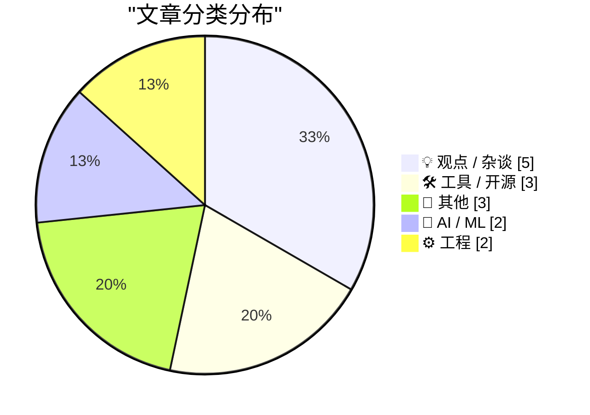
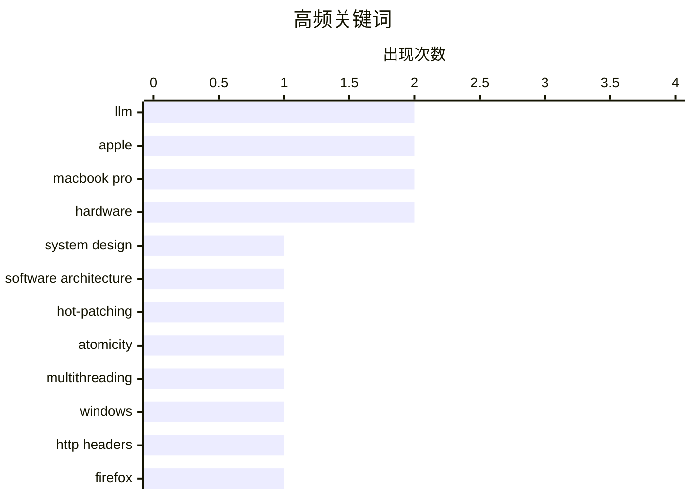

# 📰 Nov 8, 2026

> 来自 Karpathy 推荐的 92 个顶级技术博客，AI 精选 Top 15

## 📝 今日看点

今日技术圈正经历从 AI 狂热向理性回归的深度反思，业界开始审视大模型在复杂系统设计中的局限性，并对 AI 产品的成本效益及潜在泡沫提出警示。工程领域则持续深耕底层细节，聚焦热补丁安全、浏览器预取优化及供应链安全，力求在不确定的技术环境中构建稳定性。此外，以新款 MacBook Pro 为代表的硬件革新与针对科技巨头垄断的行业治理讨论，共同展现了技术演进与社会责任的交织。

---

## 🏆 今日必读

🥇 **大语言模型在设计 AI 系统方面表现糟糕**

[LLMs are terrible at designing AI systems](https://seangoedecke.com/llms-are-terrible-at-designing-ai-systems/) — seangoedecke.com · 13 小时前 · 🤖 AI / ML

> 大语言模型虽然擅长编写常规程序，但在设计涉及自身的 AI 系统架构时往往会失败。它们倾向于套用确定性的符号逻辑，忽略了 LLM 本质上的非确定性、幻觉风险以及上下文窗口限制。许多模型生成的方案在处理 RAG（检索增强生成）或 Agent 流程时过于理想化，无法应对现实中的延迟和准确性挑战。开发者必须意识到，构建 AI 系统需要从“确定性编程”转向“概率性思维”，而这正是目前 LLM 的短板。

💡 **为什么值得读**: 揭示了“用 AI 设计 AI”的局限性，帮助开发者避开过度工程化和不切实际的架构陷阱。

🏷️ LLM, system design, software architecture

🥈 **既然可以挂起所有线程，为什么热补丁更新还要纠结原子性？**

[Why are we all worked up about atomicity when applying hot-patches if we can just suspend all the threads?](https://devblogs.microsoft.com/oldnewthing/20261106-00/?p=112838/) — devblogs.microsoft.com/oldnewthing · 1 天前 · ⚙️ 工程

> 在进行热补丁（Hot-patching）时，仅靠挂起所有线程并不能完全保证安全。挂起操作只能阻止当前已存在的线程，却无法拦截新线程的创建或外部驱动程序对内存的访问。此外，如果线程恰好在被修改的代码指令中间被挂起，或者 CPU 的指令缓存（I-cache）未同步，都会导致系统崩溃。因此，实现真正的原子操作是确保在线更新不破坏系统一致性的唯一可靠途径。

💡 **为什么值得读**: 深入探讨了 Windows 底层机制中热补丁的复杂性，是理解并发与系统稳定性的极佳案例。

🏷️ hot-patching, atomicity, multithreading, Windows

🥉 **Datasette 修复：停止向 Firefox 的 HTML 页面发送 link: rel=next 响应头**

[datasette #3046: Don't serve link: rel=next HTTP headers to Firefox for HTML pages](https://simonwillison.net/2026/Nov/7/link-rel-next/) — simonwillison.net · 13 小时前 · ⚙️ 工程

> Datasette 在处理表格分页时发现，Firefox 浏览器会根据 HTTP 响应头中的 link: rel=next 自动触发预取（Prefetch）请求。这种行为导致服务器在用户尚未点击下一页时就承受了额外的负载，甚至可能引发非预期的副作用。为了解决这一问题，Datasette 在 #3046 号 Issue 中决定针对 Firefox 客户端禁用该响应头。这一案例提醒开发者，不当的预取指令可能会在特定浏览器环境下演变成变相的“拒绝服务攻击”。

💡 **为什么值得读**: 展示了一个细微的 Web 标准实现差异如何导致生产环境的性能问题，对优化 Web 服务器负载有参考价值。

🏷️ HTTP headers, Firefox, prefetching, Datasette

---

## 📊 数据概览

| 扫描源 | 抓取文章 | 时间范围 | 精选 |
|:---:|:---:|:---:|:---:|
| 82/92 | 2545 篇 → 21 篇 | 48h | **15 篇** |

### 分类分布



### 高频关键词



<details>
<summary>📈 纯文本关键词图（终端友好）</summary>

```
llm                   │ ████████████████████ 2
apple                 │ ████████████████████ 2
macbook pro           │ ████████████████████ 2
hardware              │ ████████████████████ 2
system design         │ ██████████░░░░░░░░░░ 1
software architecture │ ██████████░░░░░░░░░░ 1
hot-patching          │ ██████████░░░░░░░░░░ 1
atomicity             │ ██████████░░░░░░░░░░ 1
multithreading        │ ██████████░░░░░░░░░░ 1
windows               │ ██████████░░░░░░░░░░ 1
```

</details>

### 🏷️ 话题标签

**llm**(2) · **apple**(2) · **macbook pro**(2) · hardware(2) · system design(1) · software architecture(1) · hot-patching(1) · atomicity(1) · multithreading(1) · windows(1) · http headers(1) · firefox(1) · prefetching(1) · datasette(1) · ai bubble(1) · market trends(1) · ai(1) · tech industry(1) · critique(1) · tech labor(1)

---

## 💡 观点 / 杂谈

### 1. 引用 Nilay Patel：AI 产品的价值尚不足以抵消其成本

[Quoting Nilay Patel](https://simonwillison.net/2026/Nov/6/nilay-patel/) — **simonwillison.net** · 1 天前 · ⭐ 22/30

> Nilay Patel 尖锐地指出，目前的 AI 产品质量还不足以让用户接受其背后的巨大代价。为了换取一些平庸的 AI 搜索概览或低质量的深度伪造内容，社会不应该忍受数据中心带来的噪音和能源消耗。他认为所谓的“AI Agent”目前仍是空中楼阁，并未以用户需要的方式落地。各大科技公司投入巨额资金，却产出了大量被其称为“Slop”的无用信息。

🏷️ AI, tech industry, critique

---

### 2. 反对技术寡头：为科技行业发明新的劳动手册

[Pluralistic: JS Tan and Clarissa Redwine's "Against Tech Oligarchy" (07 Nov 2026)](https://pluralistic.net/2026/11/07/aeiou-but-sometimes-why/) — **pluralistic.net** · 1 天前 · ⭐ 22/30

> 本文评述了 JS Tan 和 Clarissa Redwine 的著作《反对技术寡头》，探讨了在科技巨头垄断下如何构建新的劳动者抗争策略。文章深入分析了“平台腐烂化”（Enshittification）如何从产品延伸至劳动领域，以及股东至上主义如何驱动 Google 等公司走向平庸。此外，内容还涉及了内核崩溃、版权虚假宣传等多个技术与社会交织的议题。作者呼吁通过集体行动来制衡科技巨头对互联网生态和劳动市场的侵蚀。

🏷️ tech labor, oligarchy, ethics

---

### 3. 触碰与光芒：新款 MacBook Pro 与 PROLED XDR 显示屏评测

[★ Touch and Glow](https://daringfireball.net/2026/11/touch_and_glow) — **daringfireball.net** · 1 天前 · ⭐ 21/30

> John Gruber 评价了苹果在洛杉矶举行的“Pro and Tell”活动，重点关注搭载 PROLED XDR 显示屏的新款 MacBook Pro。文章详细讨论了新款显示技术在亮度、对比度及色彩表现上的提升，并审视了当前 Macintosh 平台的整体发展状态。作者认为这些更新进一步巩固了 MacBook Pro 作为专业创意工具的领先地位。通过对硬件细节的深度剖析，展现了苹果在高端笔记本市场的最新策略。

🏷️ Apple, MacBook Pro, Macintosh

---

### 4. 与设计师协作的艺术与挑战

[Working with designers](https://seangoedecke.com/working-with-designers/) — **seangoedecke.com** · 1 天前 · ⭐ 19/30

> 工程师与设计师在文化背景和思维方式上存在显著差异，这种互补性是高效产品团队的基石。然而，一个团队中若存在多名设计师往往会导致决策冲突和效率下降，因此建议保持“一队一师”的配置。文章对过度推崇的“设计系统（Design Systems）”持保留意见，认为其可能限制创意并增加不必要的维护成本。有效的协作依赖于明确的职责边界和对彼此专业领域的尊重，而非单纯依靠流程工具。这种跨职能的动态平衡决定了最终产品的用户体验质量。

🏷️ design, collaboration, engineering culture

---

### 5. 关于餐厅 QR 码菜单及酒店电子房卡的思考

[Some thoughts on restaurant menu QR codes](https://shkspr.mobi/blog/2026/11/some-thoughts-on-restaurant-menu-qr-codes/) — **shkspr.mobi** · 34 分钟前 · ⭐ 15/30

> 数字化浪潮正强行改变餐饮与住宿体验，餐厅普及的 QR 码菜单和酒店推行的塑料电子房卡引发了用户体验的反思。作者批评这些技术剥夺了物理交互的质感，且在安全性与便利性上未必优于传统实体钥匙。电子系统不仅增加了对智能设备的依赖，还在紧急情况下（如防身或断电）显得脆弱无用。文章呼吁在追求数字化的过程中，应保留那些经过时间验证、更具人性化的物理设计。这种对“技术侵入”的抵制，反映了用户对简单、可靠生活方式的回归渴望。

🏷️ QR codes, UX, privacy

---

## 🛠 工具 / 开源

### 6. 软件包管理周报：2026 年 11 月 7 日

[This Week in Package Management: 7 November 2026](https://nesbitt.io/2026/11/07/this-week-in-package-management.html) — **nesbitt.io** · 1 天前 · ⭐ 21/30

> 本周软件包管理领域汇总了多个主流生态系统的更新动态与安全预警。内容涵盖了 npm、Cargo 等包管理器的最新版本发布说明，以及针对供应链攻击的专项安全建议。文章还精选了多篇关于依赖管理最佳实践的技术文章，旨在帮助开发者应对日益复杂的软件供应链风险。这是跟踪包管理工具演进和安全漏洞的重要信息源。

🏷️ package management, security advisories, ecosystem

---

### 7. 苹果支持：关于配备 PROLED XDR 显示屏的 MacBook Pro 发光 Logo 设置

[Apple Support: ‘About the Illuminated Apple Logo on MacBook Pro With PROLED XDR Display’](https://support.apple.com/en-us/149248) — **daringfireball.net** · 1 天前 · ⭐ 19/30

> 针对配备新型 PROLED XDR 显示屏的 MacBook Pro，苹果提供了控制机身背面 Apple Logo 发光状态的官方指南。用户可以通过终端（Terminal）输入特定的 defaults 命令来彻底关闭 Logo 照明，以适应全黑环境或特定光照需求。该功能涉及 com.apple.CoreBrightness 域下的 LEBacklightMode 参数，将其设为 0 即可熄灭，删除该配置即可恢复默认。这一技术细节揭示了苹果在硬件灯效控制上为专业用户留出的自定义空间。操作过程需具备管理员权限，且仅适用于特定显示技术的机型。

🏷️ macOS, Terminal, hardware

---

### 8. 静态网站生成器为何如此“古怪”

[Static site generators are weird](https://evanhahn.com/static-site-generators-are-weird/) — **evanhahn.com** · 1 天前 · ⭐ 19/30

> 静态网站具备速度快、易维护和安全性高等天然优势，但主流生成器（SSG）如 Jekyll、Gatsby 和 Hugo 的实现方式往往过于复杂。开发者被迫学习特定框架的模板语法、文件目录结构以及数据处理逻辑，这增加了不必要的认知负担。文章指出，许多 SSG 试图将简单的文件转换过程抽象成复杂的黑盒系统，背离了静态站点的简洁初衷。作者呼吁回归更直观、更符合直觉的构建方式，减少对特定工具链的深度依赖。这种对“过度工程化”的反思，促使我们重新审视 Web 开发的本质。

🏷️ SSG, web development, Jekyll

---

## 📝 其他

### 9. 访谈录：在 Full Stack Creator 节目中畅谈新款 MacBook Pro

[Yours Truly on Full Stack Creator, Talking About the New MacBook Pros With PROLED XDR Displays](https://www.youtube.com/watch?v=f2GZtWuUPl0) — **daringfireball.net** · 15 小时前 · ⭐ 20/30

> John Gruber 在 Full Stack Creator 节目中与 Tyler Stalman 等人探讨了配备 PROLED XDR 显示屏的新款 MacBook Pro。访谈不仅涉及硬件参数，还穿插了对理光（Ricoh）GR 系列紧凑型相机的致敬。Gruber 分享了他在 2010 年使用初代 GR-D 拍摄史蒂夫·乔布斯与沃尔特·莫斯伯格合影的轶事。通过这些跨越时空的科技故事，展现了专业工具对创作者的持久价值。

🏷️ MacBook Pro, Apple, hardware

---

### 10. 《杀出重围》（Deus Ex）：沃伦·斯佩克特的传奇与未来预言

[Deus Ex](https://www.filfre.net/2026/11/deus-ex/) — **filfre.net** · 1 天前 · ⭐ 20/30

> 本文回顾了经典游戏《杀出重围》（Deus Ex）的开发历程及其核心主创沃伦·斯佩克特（Warren Spector）的故事。文章探讨了该作在 2000 年发布时引起的轰动，以及它如何通过沉浸式模拟（Immersive Sim）玩法定义了一个时代。主创团队分享了关于游戏叙事与现实世界走向惊人一致的看法，特别是关于阴谋论和技术统治的探讨。时至今日，其深邃的世界观和高自由度的设计依然是游戏设计界的标杆。

🏷️ Deus Ex, game design, tech history

---

### 11. 建筑物理阅读清单：2026年11月7日

[Reading List 11/7/2026](https://www.construction-physics.com/p/reading-list-1172026) — **construction-physics.com** · 23 小时前 · ⭐ 18/30

> 本期阅读清单聚焦于跨行业的宏观趋势与技术瓶颈，涵盖了佛罗里达州房产税回滚政策及其对建筑业的影响。技术层面分析了全球印制电路板（PCB）的预期短缺危机，以及特斯拉 Cybertruck 项目可能面临的终结。文章还深度审视了碳捕集与封存（CCS）技术进展缓慢的现状，探讨了环保目标与工程落地之间的巨大鸿沟。这是一份结合了政策、供应链与前沿能源技术的综合情报汇总。通过这些碎片化的信息，读者可以拼凑出未来几年工业发展的复杂图景。

🏷️ PCB, Tesla, carbon storage

---

## 🤖 AI / ML

### 12. 大语言模型在设计 AI 系统方面表现糟糕

[LLMs are terrible at designing AI systems](https://seangoedecke.com/llms-are-terrible-at-designing-ai-systems/) — **seangoedecke.com** · 13 小时前 · ⭐ 27/30

> 大语言模型虽然擅长编写常规程序，但在设计涉及自身的 AI 系统架构时往往会失败。它们倾向于套用确定性的符号逻辑，忽略了 LLM 本质上的非确定性、幻觉风险以及上下文窗口限制。许多模型生成的方案在处理 RAG（检索增强生成）或 Agent 流程时过于理想化，无法应对现实中的延迟和准确性挑战。开发者必须意识到，构建 AI 系统需要从“确定性编程”转向“概率性思维”，而这正是目前 LLM 的短板。

🏷️ LLM, system design, software architecture

---

### 13. AI 泡沫正在破裂吗？

[Is AI crashing?](https://dfarq.homeip.net/is-ai-crashing/?utm_source=rss&#038;utm_medium=rss&#038;utm_campaign=is-ai-crashing) — **dfarq.homeip.net** · 1 小时前 · ⭐ 23/30

> 文章探讨了 AI 行业是否正面临类似当年互联网泡沫（Dotcom crash）的崩盘危机。作者回顾了技术史上的兴衰周期，指出当前市场对 AI 的预期与实际产出之间存在巨大鸿沟。尽管 AI 在某些领域表现出色，但其高昂的算力成本和尚未明确的盈利模式引发了广泛质疑。目前尚无法断定泡沫是否已经破裂，但行业内的焦虑情绪正在显著上升。

🏷️ AI bubble, market trends, LLM

---

## ⚙️ 工程

### 14. 既然可以挂起所有线程，为什么热补丁更新还要纠结原子性？

[Why are we all worked up about atomicity when applying hot-patches if we can just suspend all the threads?](https://devblogs.microsoft.com/oldnewthing/20261106-00/?p=112838/) — **devblogs.microsoft.com/oldnewthing** · 1 天前 · ⭐ 26/30

> 在进行热补丁（Hot-patching）时，仅靠挂起所有线程并不能完全保证安全。挂起操作只能阻止当前已存在的线程，却无法拦截新线程的创建或外部驱动程序对内存的访问。此外，如果线程恰好在被修改的代码指令中间被挂起，或者 CPU 的指令缓存（I-cache）未同步，都会导致系统崩溃。因此，实现真正的原子操作是确保在线更新不破坏系统一致性的唯一可靠途径。

🏷️ hot-patching, atomicity, multithreading, Windows

---

### 15. Datasette 修复：停止向 Firefox 的 HTML 页面发送 link: rel=next 响应头

[datasette #3046: Don't serve link: rel=next HTTP headers to Firefox for HTML pages](https://simonwillison.net/2026/Nov/7/link-rel-next/) — **simonwillison.net** · 13 小时前 · ⭐ 23/30

> Datasette 在处理表格分页时发现，Firefox 浏览器会根据 HTTP 响应头中的 link: rel=next 自动触发预取（Prefetch）请求。这种行为导致服务器在用户尚未点击下一页时就承受了额外的负载，甚至可能引发非预期的副作用。为了解决这一问题，Datasette 在 #3046 号 Issue 中决定针对 Firefox 客户端禁用该响应头。这一案例提醒开发者，不当的预取指令可能会在特定浏览器环境下演变成变相的“拒绝服务攻击”。

🏷️ HTTP headers, Firefox, prefetching, Datasette

---

*生成于 2026-11-08 13:08 | 扫描 82 源 → 获取 2545 篇 → 精选 15 篇*
*基于 [Hacker News Popularity Contest 2025](https://refactoringenglish.com/tools/hn-popularity/) RSS 源列表，由 [Andrej Karpathy](https://x.com/karpathy) 推荐*
