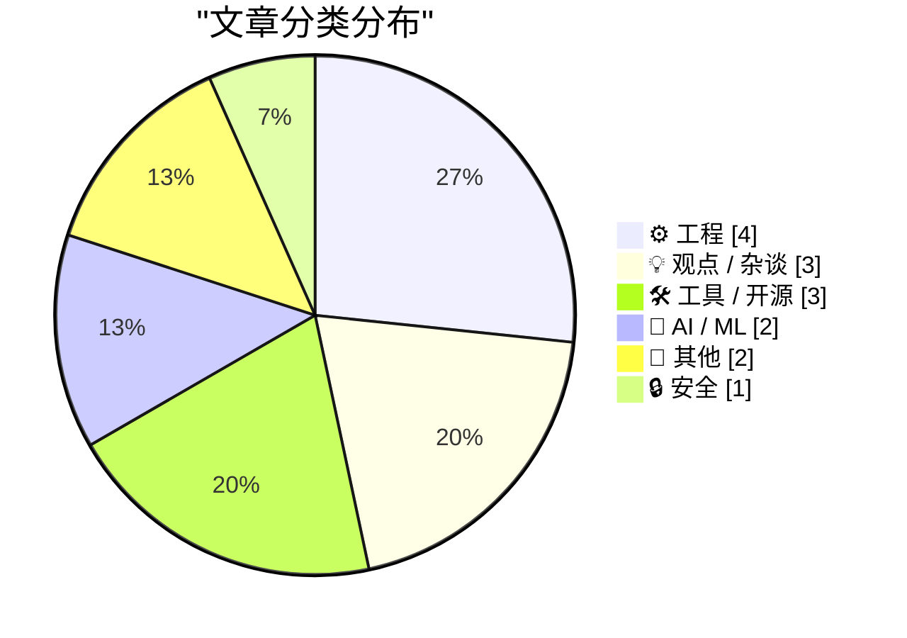
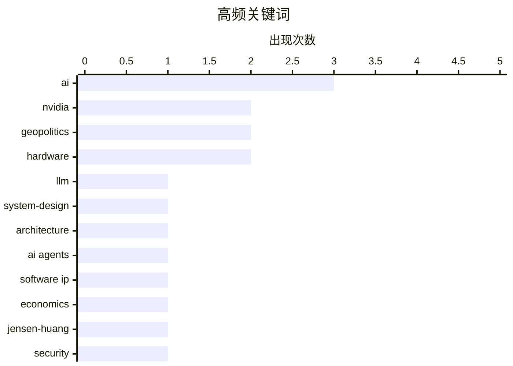

# 📰 Nov 9, 2026

> 来自 Karpathy 推荐的 92 个顶级技术博客，AI 精选 Top 15

## 📝 今日看点

AI 浪潮正从狂热转向深度反思，业界开始警惕 AI 泡沫破裂及软件知识产权因开发门槛降低而面临的估值危机。开发者在实战中愈发关注 LLM 在复杂系统设计中的局限性，并针对 AI 爬虫和冗余信息展开技术防御。与此同时，关于核心硬件厂商的舆论波动与移动生态的封闭化困局，进一步加剧了技术圈对未来安全与开放性的不确定感。

---

## 🏆 今日必读

🥇 **LLM 并不擅长设计 AI 系统**

[LLMs are terrible at designing AI systems](https://seangoedecke.com/llms-are-terrible-at-designing-ai-systems/) — seangoedecke.com · 1 天前 · 🤖 AI / ML

> LLM 在编写传统确定性程序时表现出色，但在设计涉及自身的 AI 系统架构时往往会失败。它们倾向于套用符号逻辑和硬编码规则，而忽视了 AI 系统核心的概率性特征和非确定性输出。开发者常发现 LLM 无法处理长上下文窗口的延迟权衡，也难以构建必要的评估反馈循环。这种局限性源于训练数据中缺乏高质量的 AI 系统设计模式，导致模型在面对需要“AI 思维”的问题时依然沿用旧有的软件工程范式。

💡 **为什么值得读**: 揭示了 LLM 在处理非确定性系统设计时的认知盲点，帮助开发者避开“用传统思维做 AI”的坑。

🏷️ LLM, system-design, AI, architecture

🥈 **软件知识产权的大减值**

[The great software IP writedown](https://martinalderson.com/posts/the-great-software-ip-writedown/?utm_source=rss&amp;utm_medium=rss&amp;utm_campaign=feed) — martinalderson.com · 1 天前 · 💡 观点 / 杂谈

> 软件行业长期以来的高毛利建立在开发人才稀缺性的基础之上，而 AI Agent 的崛起正在打破这一壁垒。随着代码生成成本趋近于零，传统软件知识产权（IP）的护城河正迅速瓦解，导致现有软件资产面临大规模估值减记。文章指出，当构建软件不再是难题时，代码本身的价值将大幅缩水，市场竞争将从“谁能写出代码”转向“谁拥有分发渠道和独特数据”。这种范式转移预示着软件商业模式将从卖许可转向更深层次的服务与集成。

💡 **为什么值得读**: 深刻分析了 AI 如何从经济学底层逻辑重塑软件行业的价值分配与商业护城河。

🏷️ AI agents, software IP, economics

🥉 **黄仁勋背叛了英伟达，而不仅仅是他的家人**

[Jensen Huang Betrayed Nvidia, Not Just His Family](https://www.nytimes.com/2026/11/06/us/politics/chinese-spy-agency-nvidia-jensen-huang.html?unlocked_article_code=1.O1E.DRyO.9mNcxhaxhtlI) — daringfireball.net · 15 小时前 · 📝 其他

> 据《纽约时报》2026 年的虚构/预测性报道，英伟达首席执行官黄仁勋因涉嫌与一名被美国情报部门认定为中国间谍的女性保持亲密关系而面临审查。英伟达发言人对此予以否认，强调公司并未向客户分享机密信息，也未受客户指使向美国政府施压以改变对华芯片销售政策。然而，报道指出中国政府一直在积极推广华为等国产替代方案，并严格限制英伟达产品的进口。这一事件引发了华盛顿对半导体巨头与地缘政治风险之间关联的高度关注。

💡 **为什么值得读**: 关注半导体巨头英伟达在复杂地缘政治背景下可能面临的极端领导层风险与政策冲击。

🏷️ Nvidia, Jensen-Huang, geopolitics

---

## 📊 数据概览

| 扫描源 | 抓取文章 | 时间范围 | 精选 |
|:---:|:---:|:---:|:---:|
| 83/92 | 2571 篇 → 26 篇 | 48h | **15 篇** |

### 分类分布



### 高频关键词



<details>
<summary>📈 纯文本关键词图（终端友好）</summary>

```
ai            │ ████████████████████ 3
nvidia        │ █████████████░░░░░░░ 2
geopolitics   │ █████████████░░░░░░░ 2
hardware      │ █████████████░░░░░░░ 2
llm           │ ███████░░░░░░░░░░░░░ 1
system-design │ ███████░░░░░░░░░░░░░ 1
architecture  │ ███████░░░░░░░░░░░░░ 1
ai agents     │ ███████░░░░░░░░░░░░░ 1
software ip   │ ███████░░░░░░░░░░░░░ 1
economics     │ ███████░░░░░░░░░░░░░ 1
```

</details>

### 🏷️ 话题标签

**ai**(3) · **nvidia**(2) · **geopolitics**(2) · hardware(2) · llm(1) · system-design(1) · architecture(1) · ai agents(1) · software ip(1) · economics(1) · jensen-huang(1) · security(1) · bot-blocking(1) · scraping(1) · web-traffic(1) · pull-request(1) · claude(1) · workflow(1) · sqlite(1) · rust(1)

---

## ⚙️ 工程

### 1. 强力封禁工具：以简单陷阱击退基础爬虫

[Blunt Banhammer Blocks Basic Bots Ballistically](https://shkspr.mobi/blog/2026/11/blunt-banhammer-blocks-basic-bots-ballistically/) — **shkspr.mobi** · 3 小时前 · ⭐ 24/30

> 针对个人网站 OpenBenches.org 每月因 AI 爬虫抓取数据和图片而产生的 2.5TB 巨额流量，作者开发了一套名为 B 的简单陷阱工具。该工具通过识别并拦截非人类访问行为，成功将恶意机器人流量降低了 80% 以上。这种“简单粗暴”的防御机制有效遏制了那些无视 robots.txt 协议的“寄生式”AI 爬虫。实验证明，在 AI 疯狂抓取数据的当下，开发者需要更主动的手段来保护服务器资源。

🏷️ bot-blocking, scraping, web-traffic

---

### 2. SQLite 扩展 parse_number() 实现对比：C 与 Rust

[parse_number() as a SQLite extension: C vs Rust](https://simonwillison.net/2026/Nov/8/sqlite-parse-number-c-vs-rust/) — **simonwillison.net** · 17 小时前 · ⭐ 23/30

> 作者探索了为 SQLite 编写自定义扩展以解析 -$1,234.56 或 12.5% 等复杂格式字符串为数字的方法。通过对比 C 语言和 Rust 语言的实现，发现 C 语言版本在二进制体积和集成便捷性上更具优势，而 Rust 则提供了更强的内存安全性。在 Claude 3.5 Sonnet 的辅助下，即使不精通这两种语言的开发者也能快速生成高性能的数据库扩展。实验最终产出了可直接用于数据清洗和聚合的 SQLite 插件。

🏷️ SQLite, Rust, C, extension

---

### 3. 最优毒力与安卓系统的封闭化困局

[Optimal virulence and the Android lockdown](https://dynomight.net/android/) — **dynomight.net** · 15 小时前 · ⭐ 20/30

> 文章借用生物学中的“最优毒力”概念，探讨了安卓系统在通用计算能力上日益严苛的限制与封锁。作者指出，平台方正在通过锁定权限和限制侧载来削弱用户的控制权，试图在榨取商业价值与维持用户留存之间寻找平衡点。这种“温水煮青蛙”式的封闭化趋势，导致移动设备逐渐背离了通用计算机的初衷，转变为受控的消费终端。文章深入分析了这种生态演化对开发者自由度和软件多样性的长远负面影响。

🏷️ Android, computing, lockdown

---

### 4. 逆向工程一款老式二极管-晶体管逻辑（DTL）芯片

[Reverse engineering a vintage diode-transistor logic chip](http://www.righto.com/feeds/7533579802505281921/comments/default) — **righto.com** · 23 小时前 · ⭐ 20/30

> 这篇文章详细记录了对 1965 年 Signetics 600 系列 ST680A 芯片的逆向工程过程。作者通过显微镜观察芯片内部结构，确认其采用了过时的二极管-晶体管逻辑（DTL）技术来实现四个与非门（NAND gates）。DTL 是 TTL 逻辑流行之前的关键技术，该芯片展示了早期集成电路如何利用分立元件的逻辑思路进行微缩化。通过电路图还原，读者可以清晰看到二极管、晶体管和电阻在硅片上的布局与连接方式，揭示了半导体工业早期的设计哲学。

🏷️ reverse-engineering, hardware, IC

---

## 💡 观点 / 杂谈

### 5. 软件知识产权的大减值

[The great software IP writedown](https://martinalderson.com/posts/the-great-software-ip-writedown/?utm_source=rss&amp;utm_medium=rss&amp;utm_campaign=feed) — **martinalderson.com** · 1 天前 · ⭐ 26/30

> 软件行业长期以来的高毛利建立在开发人才稀缺性的基础之上，而 AI Agent 的崛起正在打破这一壁垒。随着代码生成成本趋近于零，传统软件知识产权（IP）的护城河正迅速瓦解，导致现有软件资产面临大规模估值减记。文章指出，当构建软件不再是难题时，代码本身的价值将大幅缩水，市场竞争将从“谁能写出代码”转向“谁拥有分发渠道和独特数据”。这种范式转移预示着软件商业模式将从卖许可转向更深层次的服务与集成。

🏷️ AI agents, software IP, economics

---

### 6. “剃羊毛”过载：AI 时代下的技术琐事困境

[Yak-Shaving Overload](https://feed.tedium.co/link/15204/17518143/yak-shaving-ai-mental-health-effects) — **tedium.co** · 13 小时前 · ⭐ 19/30

> 作者探讨了在处理过时硬件（如旧款 Linux 平板）时陷入“剃羊毛”（Yak-Shaving）式技术琐事的心理与实践困境。文章指出，尽管 AI 工具本应提高效率，但在处理冷门或复杂的调试场景时，AI 提供的错误引导反而可能让开发者进入更深的技术死胡同。这种现象引发了对技术人员心理健康和生产力陷阱的深刻反思。作者警示，在 AI 辅助编程时代，识别并拒绝无效的技术探索变得比以往任何时候都更加困难。

🏷️ yak-shaving, Linux, productivity

---

### 7. Web 的潜力已绰绰有余：基于 Three.js 的创意实践

[The Web Is More Than Enough, by Paul Ford](https://simonwillison.net/2026/Nov/9/hn-50421091/) — **simonwillison.net** · 11 小时前 · ⭐ 18/30

> Simon Willison 响应了 Paul Ford 关于“Web 性能已足以承载复杂应用”的观点，并展示了其快速开发的实践成果。他利用 Three.js 库在短时间内构建了一个以裸鳃类动物为主题的法贝热彩蛋 3D 交互模型。该案例证明了现代浏览器在处理复杂图形和 3D 渲染方面的强大能力，无需原生应用支持即可实现极高的创意上限。文章强调了 Web 技术栈作为通用开发平台的成熟度，鼓励开发者重新审视浏览器的技术边界。

🏷️ web, development, browser

---

## 🛠 工具 / 开源

### 8. 使用 details 标签隐藏 AI 生成的冗长 PR 描述

[Hide your slop PR descriptions behind <details><summary>](https://simonwillison.net/2026/Nov/9/details-summary/) — **simonwillison.net** · 11 小时前 · ⭐ 23/30

> 随着 Claude Code 和 Codex 等 AI 编程工具的普及，自动生成的 Pull Request (PR) 描述虽然详尽，但往往因篇幅过长而变成“信息垃圾”。作者建议利用 HTML 的 <details> 和 <summary> 标签将这些 AI 生成的内容折叠起来。这样既能保持 PR 列表的整洁，方便审阅者快速获取核心变更，又保留了详细的文档供深入查阅。这种做法平衡了自动化文档的便利性与人类阅读的效率需求。

🏷️ AI, pull-request, Claude, workflow

---

### 9. 对话 Full Stack Creator：聊聊配备 PROLED XDR 显示屏的新款 MacBook Pro

[Yours Truly on Full Stack Creator, Talking About the New MacBook Pros With PROLED XDR Displays](https://www.youtube.com/watch?v=f2GZtWuUPl0) — **daringfireball.net** · 1 天前 · ⭐ 19/30

> 资深苹果评论家 John Gruber 在 Full Stack Creator 节目中分享了对新款 M4 系列 MacBook Pro 的深度见解。讨论重点围绕新款屏幕的视觉表现、SDR 亮度提升以及在实际专业创作流中的体验。节目中还穿插了对理光 GR 系列经典相机的致敬，并回顾了作者 20 年前拍摄史蒂夫·乔布斯的珍贵往事。通过对硬件细节的感性描述，揭示了苹果最新笔记本电脑在专业市场中的技术迭代与产品定位。

🏷️ MacBook-Pro, Apple, hardware

---

### 10. Ninety 平台发布：开源项目价值交换新尝试

[Introducing Ninety](https://nesbitt.io/2026/11/09/introducing-ninety.html) — **nesbitt.io** · 3 小时前 · ⭐ 19/30

> Ninety 是一个新推出的平台，旨在探索开源软件资产的价值化与管理新模式。目前该平台已支持 curl、OpenSSL、lodash 和 PHP 等核心开源库的“交易”或治理参与。虽然具体运行机制尚待进一步披露，但其目标显然是为这些关键基础设施提供新的财务支持或所有权激励。这种尝试反映了开发者社区在面对开源可持续性挑战时，正试图引入更具市场化色彩的解决方案。

🏷️ open-source, trading, ecosystem

---

## 🤖 AI / ML

### 11. LLM 并不擅长设计 AI 系统

[LLMs are terrible at designing AI systems](https://seangoedecke.com/llms-are-terrible-at-designing-ai-systems/) — **seangoedecke.com** · 1 天前 · ⭐ 26/30

> LLM 在编写传统确定性程序时表现出色，但在设计涉及自身的 AI 系统架构时往往会失败。它们倾向于套用符号逻辑和硬编码规则，而忽视了 AI 系统核心的概率性特征和非确定性输出。开发者常发现 LLM 无法处理长上下文窗口的延迟权衡，也难以构建必要的评估反馈循环。这种局限性源于训练数据中缺乏高质量的 AI 系统设计模式，导致模型在面对需要“AI 思维”的问题时依然沿用旧有的软件工程范式。

🏷️ LLM, system-design, AI, architecture

---

### 12. AI 泡沫正在破裂吗？

[Is AI crashing?](https://dfarq.homeip.net/is-ai-crashing/?utm_source=rss&#038;utm_medium=rss&#038;utm_campaign=is-ai-crashing) — **dfarq.homeip.net** · 1 天前 · ⭐ 22/30

> 站在 2026 年的时间点上，作者回顾并探讨了 AI 行业是否正面临类似当年互联网泡沫（dot-com crash）的崩盘。文章分析了市场对大模型预期过高与实际落地产出之间的落差，以及算力投入与收益不成正比的现状。尽管目前尚难定论这是否是一次彻底的崩溃，但行业内的悲观情绪和增长放缓已初见端倪。作者通过对比历史周期，警示开发者和投资者关注技术热潮背后的经济规律。

🏷️ AI bubble, market trends, AI

---

## 📝 其他

### 13. 黄仁勋背叛了英伟达，而不仅仅是他的家人

[Jensen Huang Betrayed Nvidia, Not Just His Family](https://www.nytimes.com/2026/11/06/us/politics/chinese-spy-agency-nvidia-jensen-huang.html?unlocked_article_code=1.O1E.DRyO.9mNcxhaxhtlI) — **daringfireball.net** · 15 小时前 · ⭐ 24/30

> 据《纽约时报》2026 年的虚构/预测性报道，英伟达首席执行官黄仁勋因涉嫌与一名被美国情报部门认定为中国间谍的女性保持亲密关系而面临审查。英伟达发言人对此予以否认，强调公司并未向客户分享机密信息，也未受客户指使向美国政府施压以改变对华芯片销售政策。然而，报道指出中国政府一直在积极推广华为等国产替代方案，并严格限制英伟达产品的进口。这一事件引发了华盛顿对半导体巨头与地缘政治风险之间关联的高度关注。

🏷️ Nvidia, Jensen-Huang, geopolitics

---

### 14. 英伟达 CEO 黄仁勋因涉间谍丑闻接受调查

[Nvidia CEO Jensen Huang Was Banging a Chinese Spy, Who Was Feeding Information Back to Beijing](https://www.nytimes.com/2026/11/08/technology/nvidia-investigation-jensen-huang-china.html?unlocked_article_code=1.O1E.Soow.6UjrM7Ch-C8L) — **daringfireball.net** · 18 小时前 · ⭐ 24/30

> 英伟达董事会已正式启动对首席执行官黄仁勋的内部调查，此前他承认与一名名为 Alice Huang 的商业高管存在亲密关系。美国情报机构监测发现，该女性实际上是为北京提供信息的间谍，这引发了严重的国家安全担忧。调查的核心在于黄仁勋是否在交往过程中无意间泄露了关键的技术机密或政策信息。目前英伟达正努力应对这一可能对其全球业务和政府关系产生毁灭性影响的丑闻。

🏷️ Nvidia, security, geopolitics

---

## 🔒 安全

### 15. 糟糕的公钥奇招：反思 SSL/TLS 的复杂性

[Horible public key tricks:](https://maurycyz.com/projects/badcert/) — **maurycyz.com** · 1 天前 · ⭐ 22/30

> 文章抨击了当前 SSL/TLS 体系中 ACME 协议的繁琐性，指出证书定期过期和复杂的自动化配置给网站维护带来了巨大负担。作者认为，现有的证书颁发机制依赖明文连接，本身就存在安全逻辑上的讽刺。文中探讨了一些非传统的公钥处理技巧，试图寻找一种比现行 CA 体系更简洁、更持久的身份验证方案。这反映了开发者对现代 Web 安全基础设施中“维护陷阱”的深度不满。

🏷️ SSL, TLS, cryptography, public-key

---

*生成于 2026-11-09 15:52 | 扫描 83 源 → 获取 2571 篇 → 精选 15 篇*
*基于 [Hacker News Popularity Contest 2025](https://refactoringenglish.com/tools/hn-popularity/) RSS 源列表，由 [Andrej Karpathy](https://x.com/karpathy) 推荐*
