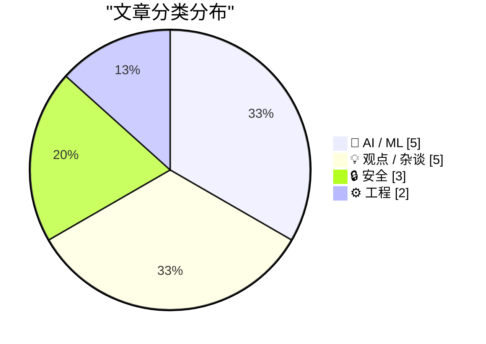
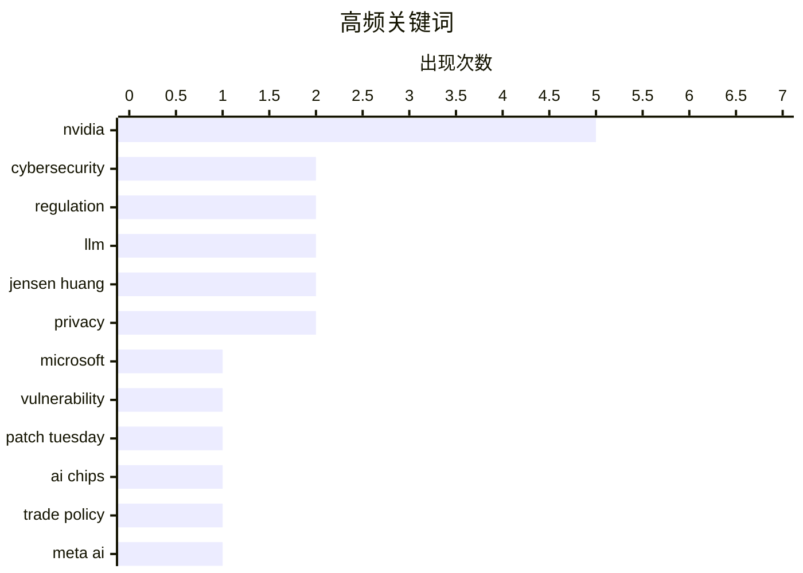

# 📰 Nov 11, 2026

> 来自 Karpathy 推荐的 92 个顶级技术博客，AI 精选 Top 15

## 📝 今日看点

今日技术圈的核心被英伟达卷入的地缘政治风暴占据，CEO黄仁勋的私人关系与芯片走私调查引发了国家安全层面的广泛震动。在AI领域，Meta推出轻量化模型Muse Ember标志着算力竞争正向极致效率转型，而开发者也在反思AI时代下“粘合剂工作”的价值重构。与此同时，微软与苹果分别通过大规模漏洞修复和隐私标准升级，再次加固了基础软件的安全防线。

---

## 🏆 今日必读

🥇 **微软修复近 1,100 个安全漏洞**

[Microsoft Fixes Nearly 1,100 Security Vulnerabilities](https://krebsonsecurity.com/2026/11/microsoft-fixes-nearly-1100-security-vulnerabilities/) — krebsonsecurity.com · 16 小时前 · 🔒 安全

> 微软在本次“补丁星期二”发布了大规模安全更新，修复了 Windows 操作系统及相关软件中近 1,100 个安全漏洞。更新重点解决了 63 个严重（Critical）缺陷，其中包括一个已在野外被利用的 Microsoft Outlook 零日漏洞。与此同时，Adobe、苹果、谷歌和 Mozilla 等主流厂商也同步发布了关键安全补丁。这是微软再次发布四位数数量的补丁包，反映出当前软件生态面临的漏洞压力依然巨大。建议用户尽快完成系统更新以防范潜在的远程代码执行和提权攻击。

💡 **为什么值得读**: 了解微软史上最大规模补丁更新的详情，特别是针对 Outlook 零日漏洞的紧急修复建议。

🏷️ Microsoft, Vulnerability, Patch Tuesday, Cybersecurity

🥈 **英伟达提及特朗普任命官员后，美国商务部对 Megaspeed 的调查中止**

[U.S. Commerce Dept. Inquiry Into Megaspeed Was Halted After Nvidia Name-Dropped Trump Appointee](https://www.nytimes.com/2026/11/09/business/economy/nvidia-megaspeed-investigation-huang.html?unlocked_article_code=1.PVE.GxBL.iBpBoc8Y4tnb) — daringfireball.net · 23 小时前 · 🤖 AI / ML

> 美国商务部此前对新加坡公司 Megaspeed 涉嫌向中国走私英伟达 AI 芯片的调查在去年底突然停滞。调查人员怀疑 Megaspeed 的一名高管是与中国安全部门有关联的间谍，并已深入调查数月。然而，在英伟达方面向监管机构提及一名特朗普时期的政府官员后，该调查工作被要求停止。此事件揭示了地缘政治背景下，科技巨头如何利用政治关系影响针对其供应链的敏感安全审查。目前，关于该调查为何突然转向仍存在诸多争议。

💡 **为什么值得读**: 揭秘英伟达芯片走私调查背后的政治干预与间谍疑云，涉及中美科技战的敏感内幕。

🏷️ Nvidia, regulation, AI chips, trade policy

🥉 **Meta 发布体积最小、效率最高的模型：Muse Ember**

[Introducing Our Smallest, Most Efficient Model: Muse Ember](https://simonwillison.net/2026/Nov/10/muse-ember/) — simonwillison.net · 1 天前 · 🤖 AI / ML

> Meta AI 推出了其对标 Claude Haiku 和 GPT Luna 的轻量级模型 Muse Ember。该模型专为复杂推理执行和高频 Agent 任务设计，优化了工具调用（tool calls）、代码子任务、路由分发、数据提取以及长文档解析等功能。Muse Ember 旨在处理那些需要全天候重复运行的自动化任务，在保持低延迟的同时显著降低了推理成本。这是 Meta 在小参数高性能模型领域的重要布局，进一步丰富了其 Llama 系列之外的专用模型矩阵。开发者现在可以利用该模型构建更经济高效的 AI 智能体工作流。

💡 **为什么值得读**: 关注 Meta 最新发布的轻量级模型，了解其在 Agent 自动化和长文本处理方面的性能优势。

🏷️ Meta AI, LLM, Efficiency, Muse Ember

---

## 📊 数据概览

| 扫描源 | 抓取文章 | 时间范围 | 精选 |
|:---:|:---:|:---:|:---:|
| 83/92 | 2561 篇 → 47 篇 | 48h | **15 篇** |

### 分类分布



### 高频关键词



<details>
<summary>📈 纯文本关键词图（终端友好）</summary>

```
nvidia        │ ████████████████████ 5
cybersecurity │ ████████░░░░░░░░░░░░ 2
regulation    │ ████████░░░░░░░░░░░░ 2
llm           │ ████████░░░░░░░░░░░░ 2
jensen huang  │ ████████░░░░░░░░░░░░ 2
privacy       │ ████████░░░░░░░░░░░░ 2
microsoft     │ ████░░░░░░░░░░░░░░░░ 1
vulnerability │ ████░░░░░░░░░░░░░░░░ 1
patch tuesday │ ████░░░░░░░░░░░░░░░░ 1
ai chips      │ ████░░░░░░░░░░░░░░░░ 1
```

</details>

### 🏷️ 话题标签

**nvidia**(5) · **cybersecurity**(2) · **regulation**(2) · llm(2) · jensen huang(2) · privacy(2) · microsoft(1) · vulnerability(1) · patch tuesday(1) · ai chips(1) · trade policy(1) · meta ai(1) · efficiency(1) · muse ember(1) · chip smuggling(1) · trade restrictions(1) · ai hardware(1) · geopolitics(1) · ai industry(1) · surveillance(1)

---

## 🤖 AI / ML

### 1. 英伟达提及特朗普任命官员后，美国商务部对 Megaspeed 的调查中止

[U.S. Commerce Dept. Inquiry Into Megaspeed Was Halted After Nvidia Name-Dropped Trump Appointee](https://www.nytimes.com/2026/11/09/business/economy/nvidia-megaspeed-investigation-huang.html?unlocked_article_code=1.PVE.GxBL.iBpBoc8Y4tnb) — **daringfireball.net** · 23 小时前 · ⭐ 26/30

> 美国商务部此前对新加坡公司 Megaspeed 涉嫌向中国走私英伟达 AI 芯片的调查在去年底突然停滞。调查人员怀疑 Megaspeed 的一名高管是与中国安全部门有关联的间谍，并已深入调查数月。然而，在英伟达方面向监管机构提及一名特朗普时期的政府官员后，该调查工作被要求停止。此事件揭示了地缘政治背景下，科技巨头如何利用政治关系影响针对其供应链的敏感安全审查。目前，关于该调查为何突然转向仍存在诸多争议。

🏷️ Nvidia, regulation, AI chips, trade policy

---

### 2. Meta 发布体积最小、效率最高的模型：Muse Ember

[Introducing Our Smallest, Most Efficient Model: Muse Ember](https://simonwillison.net/2026/Nov/10/muse-ember/) — **simonwillison.net** · 1 天前 · ⭐ 25/30

> Meta AI 推出了其对标 Claude Haiku 和 GPT Luna 的轻量级模型 Muse Ember。该模型专为复杂推理执行和高频 Agent 任务设计，优化了工具调用（tool calls）、代码子任务、路由分发、数据提取以及长文档解析等功能。Muse Ember 旨在处理那些需要全天候重复运行的自动化任务，在保持低延迟的同时显著降低了推理成本。这是 Meta 在小参数高性能模型领域的重要布局，进一步丰富了其 Llama 系列之外的专用模型矩阵。开发者现在可以利用该模型构建更经济高效的 AI 智能体工作流。

🏷️ Meta AI, LLM, Efficiency, Muse Ember

---

### 3. 彭博社：英伟达干预美国对 Megaspeed 芯片走私案的调查

[Bloomberg: ‘Nvidia Intervened in U.S. Probe of Megaspeed Chip Smuggling’](https://www.bloomberg.com/news/articles/2026-11-09/nvidia-intervened-in-us-probe-of-megaspeed-chip-smuggling) — **daringfireball.net** · 20 小时前 · ⭐ 25/30

> 据彭博社报道，英伟达在应对美国工业和安全局（BIS）关于 Megaspeed 芯片走私的调查时，提供了不完整的业务记录。尽管英伟达在实地考察了东南亚 3 个国家的 12 个设施后声称库存合规，但调查显示其在配合监管方面存在保留。英伟达曾于 2025 年 11 月公开宣称一切正常，但随后的证据挑战了这一说法。报道指出，英伟达的干预行为可能延误了政府对非法转运高性能 AI 芯片的打击进度。这起事件凸显了半导体巨头在遵守出口管制与维持全球分销网络之间的利益冲突。

🏷️ Nvidia, chip smuggling, trade restrictions, AI hardware

---

### 4. Claude Code Token 成本资源管理器

[Claude Code token cost explorer](https://entropicthoughts.com/claude-code-token-cost-explorer) — **entropicthoughts.com** · 1 天前 · ⭐ 24/30

> 开发者在利用 Claude Code 的子代理（subagents）工作流时，发现现有的 `/context` 命令无法有效分解子代理的 Token 消耗。为了解决这一诊断难题，作者在尝试了 ccusage 等工具无果后，自行开发了一个 Token 成本资源管理器。该工具能够提供更细致的 Token 使用明细，帮助开发者精准定位并优化 LLM 编码代理的运行成本。这对于频繁使用多代理协作进行复杂开发的工程师具有极高的实用价值。通过该工具，用户可以更清晰地了解不同子任务对 API 额度的具体消耗情况。

🏷️ Claude Code, LLM, token usage, subagents

---

### 5. Claude Fable 5.2 提示词技巧：代码所有权的影响

[Quoting Prompting Claude Fable 5.2](https://simonwillison.net/2026/Nov/10/prompting-claude-fable-52/) — **simonwillison.net** · 1 天前 · ⭐ 23/30

> Anthropic 在 Claude Fable 5.2 的文档中披露了一个关键的提示词工程发现：模型对代码“所有权”的描述非常敏感。测试表明，如果提示词未指明所有权，模型在处理小型编程任务时倾向于在现有结构上进行冗余堆砌。相反，如果明确告诉模型“这是你的代码”或“你拥有这段代码”，它会表现出更强的重构意愿，主动优化结构而非简单追加。这一特性要求开发者在编写 Prompt 时必须明确定义角色，以获得更高质量的代码重构效果。

🏷️ Claude, Prompt Engineering, Anthropic, Coding

---

## 💡 观点 / 杂谈

### 6. “处于经济中心的丑闻”

[‘A Scandal at the Center of the Economy’](https://www.theatlantic.com/technology/2026/11/jensen-huang-chinese-spy/689357/?gift=aQyUJR7AIw1mJWdQ6Ed6yPI8n1FlV88MR9f9IZruvFA&amp;) — **daringfireball.net** · 23 小时前 · ⭐ 25/30

> 《大西洋月刊》报道了英伟达 CEO 黄仁勋与一名被指为中国国安部资产的女性商人之间存在私人关系，引发了硅谷与华盛顿的震动。尽管涉及国家安全风险，但比尔·阿克曼等硅谷权势人物对此反应平淡，甚至公开表示支持黄仁勋。文章探讨了这种“非典型”反应背后的原因，即英伟达在当前 AI 经济中的核心地位使其获得了某种程度的“豁免权”。这种个人关系与地缘政治风险的交织，挑战了公众对科技巨头监管和国家安全审查的传统认知。这起丑闻不仅是个人私事，更反映了顶级科技领袖在复杂政治环境下的脆弱性。

🏷️ Nvidia, Jensen Huang, geopolitics, AI industry

---

### 7. AI 时代，“粘合剂工作”依然有害

[Glue work is still harmful in the age of AI](https://seangoedecke.com/glue-work-is-still-harmful-in-the-age-of-ai/) — **seangoedecke.com** · 13 小时前 · ⭐ 24/30

> 作者认为，依靠工程师牺牲个人利益来维持的“粘合剂工作”（Glue work，如协调、流程维护等非编码核心任务）在 AI 时代依然有害且应被淘汰。尽管 LLM 承担了大部分代码编写，但这并不意味着人类应该被释放去处理更多的粘合剂工作。文章指出，这类工作对公司的实际价值正在下降，且往往无法获得职业晋升的回报。如果一个流程只能靠工程师未获补偿的付出来维持，那么该流程本身就存在缺陷。在 AI 驱动的开发流程中，重新评估人力投入的优先级比以往任何时候都更加重要。

🏷️ Engineering Culture, Glue Work, Career Development, AI Productivity

---

### 8. 黄仁勋的奇妙冒险

[Jensen's Bizarre Adventure](https://www.wheresyoured.at/jensens-bizarre-adventure/) — **wheresyoured.at** · 20 小时前 · ⭐ 24/30

> 本文是针对英伟达 CEO 黄仁勋近期风波的深度财务与背景分析，探讨了 AI 产业巨头背后的资金流向与地缘政治风险。作者通过付费订阅专栏的形式，详细剖析了英伟达在当前 AI 热潮中的财务表现及其面临的潜在危机。文章旨在揭示科技新闻背后的深层经济逻辑，为读者提供超越表面报道的行业洞察。通过对 Jensen Huang 个人及企业行为的追踪，展现了 AI 时代顶级企业家的复杂处境。该内容适合对 AI 行业投融资和宏观政治经济学感兴趣的读者。

🏷️ Nvidia, AI finance, industry analysis

---

### 9. 做空机构 Culper Research 披露英伟达黄仁勋相关信息及对华业务指控

[Short-Seller Culper Research Published Information on Jensen Huang’s Affair Back in May](https://culperresearch.com/wp-content/uploads/2026/05/Culper_NVDA_5-13-2026.pdf) — **daringfireball.net** · 1 天前 · ⭐ 23/30

> 做空机构 Culper Research 发布报告指控英伟达在 2025 年 4 月美国贸易限制后，依然通过非法渠道维持对华业务。报告称，英伟达 2026 财年计算收入中仍有超过 20% 来自中国市场，这与官方宣称的“归零”不符。这些收入据称是通过非法 GPU 转移以及 Megaspeed 等东南亚中介机构实现的。报告详细列举了供应链中的违规证据，挑战了英伟达在合规性和财务透明度方面的说法。此举引发了市场对半导体巨头在复杂地缘政治下监管风险的关注。

🏷️ Nvidia, short-selling, Jensen Huang, China

---

### 10. 每周更新 529：青少年社交媒体禁令及其争议

[Weekly Update 529: Kids Social Media Bans (and Everything Else)](https://www.troyhunt.com/weekly-update-529/) — **troyhunt.com** · 1 天前 · ⭐ 23/30

> 网络安全专家 Troy Hunt 对澳大利亚政府强制推行的“16 岁以下禁用社交媒体”法律进行了深度批判。他指出该政策在技术执行层面存在严重缺陷，政府未能明确界定身份验证的责任归属。讨论核心在于，这种禁令忽视了互联网的无国界特性以及技术绕过的简易性。Hunt 认为，将社会问题的解决寄希望于无法落地的技术封锁是极其荒谬的。文章呼吁回归家庭教育和更务实的数字素养培养，而非依赖政治化的禁令。

🏷️ Social Media, Regulation, Cybersecurity

---

## 🔒 安全

### 11. 微软修复近 1,100 个安全漏洞

[Microsoft Fixes Nearly 1,100 Security Vulnerabilities](https://krebsonsecurity.com/2026/11/microsoft-fixes-nearly-1100-security-vulnerabilities/) — **krebsonsecurity.com** · 16 小时前 · ⭐ 26/30

> 微软在本次“补丁星期二”发布了大规模安全更新，修复了 Windows 操作系统及相关软件中近 1,100 个安全漏洞。更新重点解决了 63 个严重（Critical）缺陷，其中包括一个已在野外被利用的 Microsoft Outlook 零日漏洞。与此同时，Adobe、苹果、谷歌和 Mozilla 等主流厂商也同步发布了关键安全补丁。这是微软再次发布四位数数量的补丁包，反映出当前软件生态面临的漏洞压力依然巨大。建议用户尽快完成系统更新以防范潜在的远程代码执行和提权攻击。

🏷️ Microsoft, Vulnerability, Patch Tuesday, Cybersecurity

---

### 12. 重审 Leander 诉瑞典案与“老大哥”监控

[Revisiting Leander v Sweden and Big Brother Watch](https://berthub.eu/articles/posts/revisiting-leander-and-big-brother/) — **berthub.eu** · 18 小时前 · ⭐ 25/30

> 欧洲各国政府正计划提升大规模监控能力，而《欧洲人权公约》成为制约此类权力的关键法律框架。文章重新审视了欧洲人权法院（ECtHR）的最新判例，并结合当前的网路安全和人工智能发展进行了深度解读。作者指出，几年前看似合理的监控措施在如今 AI 驱动的数据分析环境下可能已不再适用。这些法律解释将对未来评估信号情报（SIGINT）和其他大规模数据收集计划的合法性产生深远影响。文章强调，法律框架必须随着技术手段的进化而不断更新，以防止政府权力过度扩张。

🏷️ Surveillance, Privacy, ECHR, Policy

---

### 13. Safari 27.3 增加对全球隐私控制（GPC）的支持

[Safari 27.3 Adds Support for Global Privacy Control](https://pxlnv.com/linklog/safari-global-privacy-control/) — **daringfireball.net** · 23 小时前 · ⭐ 24/30

> 苹果在 Safari 27.3 更新中悄然加入了对全球隐私控制（Global Privacy Control, GPC）标准的支持。GPC 被视为“请勿追踪”（Do Not Track）的继任者，但具备更强的法律约束力，允许用户一次性设置追踪偏好。理论上，支持 GPC 的网站应自动遵循用户意愿，从而免去用户反复点击 Cookie 同意横幅的困扰。虽然该功能未出现在官方 Beta 版说明中，但其加入标志着苹果在用户隐私保护自动化方面迈出了重要一步。这一更新将显著提升用户的网页浏览体验并加强隐私合规性。

🏷️ Safari, privacy, GPC, web standards

---

## ⚙️ 工程

### 14. 2026 年如何构建网站

[Making a Website in 2026](https://blog.jim-nielsen.com/2026/making-websites-in-2026/) — **blog.jim-nielsen.com** · 18 小时前 · ⭐ 24/30

> 本文探讨了在 2026 年利用 AI 工具（如 v0、Bolt、Lovable 等）全自动生成网站的现状与趋势。Pete Millspaugh 通过实验发现，AI 不仅能生成基础页面，还能处理带评论系统的复杂功能。值得关注的是，AI 建站工具正演变为一种“分销渠道”，在生成代码时会倾向于推荐 Clerk（身份验证）或 Supabase（数据库）等付费合作伙伴的服务。这种模式预示着未来网页开发将从手动编码转向对 AI 集成生态的管理。开发者需要警惕 AI 工具在技术选型中可能存在的商业偏见。

🏷️ web development, AI tools, Val Town

---

### 15. Windows 热补丁机制：如何处理多个补丁的冲突？

[If the Windows Update hot patcher checks that the function hasn’t already been patched, does that mean you can’t install two hot-patches?](https://devblogs.microsoft.com/oldnewthing/20261109-00/?p=112841/) — **devblogs.microsoft.com/oldnewthing** · 1 天前 · ⭐ 23/30

> Raymond Chen 解释了 Windows Update 热补丁（Hot Patching）在检测到函数已被修补时的处理逻辑。热补丁器在安装前会检查目标函数是否处于原始状态，但这并不意味着无法安装第二个补丁。实际上，Windows 要求后续补丁必须是“累积性”的，即新补丁必须包含之前所有补丁的修复内容。系统通过维护补丁级别（Patch Level）来确保最新的逻辑覆盖旧逻辑，而不是简单的堆叠。这种机制保证了在不重启系统的情况下，内核函数能够安全地进行多次迭代更新。

🏷️ Windows, kernel, patching, operating systems

---

*生成于 2026-11-11 13:57 | 扫描 83 源 → 获取 2561 篇 → 精选 15 篇*
*基于 [Hacker News Popularity Contest 2025](https://refactoringenglish.com/tools/hn-popularity/) RSS 源列表，由 [Andrej Karpathy](https://x.com/karpathy) 推荐*
