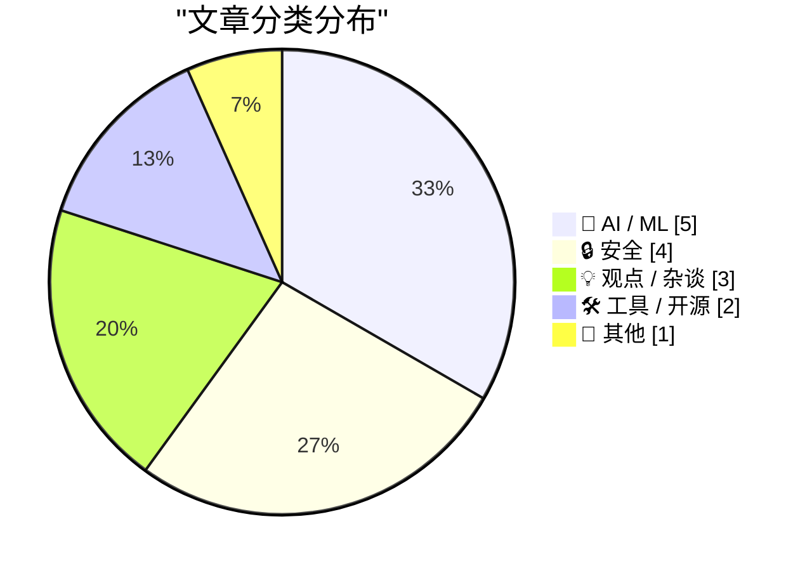
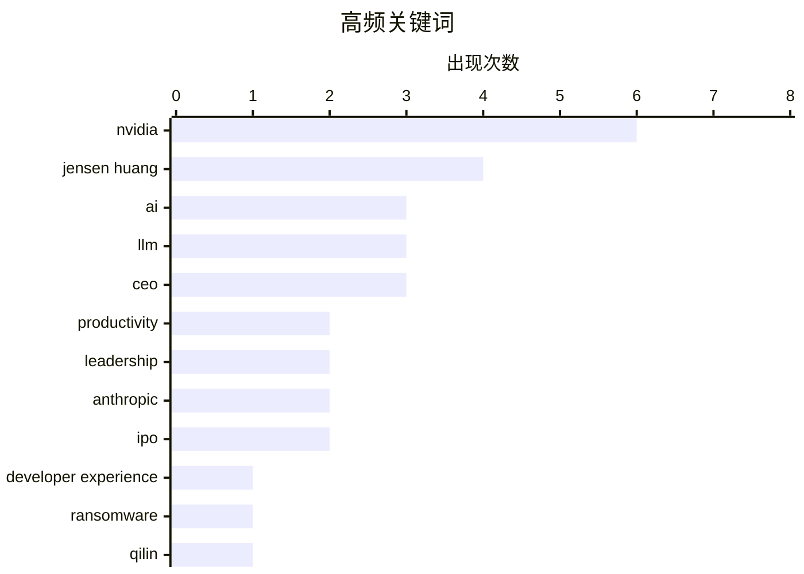

# 📰 Nov 12, 2026

> 来自 Karpathy 推荐的 92 个顶级技术博客，AI 精选 Top 15

## 📝 今日看点

英伟达陷入前所未有的治理风暴，董事会因多起个人丑闻及潜在安全风险计划罢免创始人黄仁勋，引发半导体行业的剧烈震荡。AI 领域在 Anthropic 启动 IPO 的同时，正深度反思“效率悖论”带来的认知疲劳，以及大模型商业模式护城河缺失的隐忧。此外，微软发布创纪录的系统补丁，配合对顶级勒索组织的深度追踪，揭示了当前网络安全攻防战的白热化态势。

---

## 🏆 今日必读

🥇 **既然 AI 做了所有工作，为什么我还是这么累？**

[Why Am I So Tired If AI Is Doing All the Work?](https://terriblesoftware.org/2026/11/11/why-am-i-so-tired-if-ai-is-doing-all-the-work/) — terriblesoftware.org · 20 小时前 · 🤖 AI / ML

> AI 显著降低了启动工作的门槛，导致待处理任务量呈指数级增长，但人类仍需投入大量时间和注意力进行审核与验证。这种从“创作”到“策展”的转变并未减轻认知负担，反而因为需要不断纠错和决策而导致严重的心理疲劳。AI 生成内容的低成本掩盖了高质量交付所需的高昂审核成本。最终，这种“审查疲劳”成为了 AI 时代生产力悖论的核心原因。人类的注意力已成为系统中最稀缺且最易过载的资源。

💡 **为什么值得读**: 深刻揭示了 AI 提效背后的认知陷阱，帮助知识工作者理解为何工具越先进人越疲惫。

🏷️ AI, productivity, LLM, developer experience

🥈 **谁在掌管勒索软件组织 Qilin？**

[Who Runs the Ransomware Group Qilin?](https://krebsonsecurity.com/2026/11/who-runs-the-ransomware-group-qilin/) — krebsonsecurity.com · 20 小时前 · 🔒 安全

> 勒索软件组织 Qilin 已成为全球最活跃的犯罪团伙，仅在过去三个月内就攻击了至少 365 家受害者机构。尽管该组织技术高超，但其管理员在过去十年的运营中犯下了关键的运维安全（OpSec）错误。通过对这些数字足迹的追踪，调查指向了一名居住在俄罗斯圣彼得堡的 36 岁男子。这一发现揭示了即便是顶尖网络犯罪分子，其身份也可能因长期的微小疏忽而暴露。目前安全界正密切关注该线索对打击勒索软件生态的影响。

💡 **为什么值得读**: 典型的网络安全侦查案例，展示了如何通过长期的数字足迹追踪锁定顶级黑客身份。

🏷️ ransomware, Qilin, cybercrime, OPSEC

🥉 **微软修复近 1100 个安全漏洞**

[Microsoft Fixes Nearly 1,100 Security Vulnerabilities](https://krebsonsecurity.com/2026/11/microsoft-fixes-nearly-1100-security-vulnerabilities/) — krebsonsecurity.com · 1 天前 · 🔒 安全

> 微软在本次“补丁星期二”发布了规模空前的更新，修复了 Windows 系统及相关软件中近 1100 个安全漏洞。此次更新涵盖 63 个严重级别（Critical）的缺陷，其中包括一个已被利用的 Microsoft Outlook 零日漏洞。与此同时，Adobe、Apple、Google 和 Mozilla 等厂商也发布了重要的安全补丁。面对如此高密度的漏洞修复，企业和个人用户需尽快完成系统升级以防范潜在攻击。这是微软历史上单次修复漏洞数量最多的月份之一。

💡 **为什么值得读**: 了解本月关键安全动态，特别是针对 Outlook 零日漏洞的紧急防御提醒。

🏷️ Microsoft, Patch Tuesday, vulnerability, zero-day

---

## 📊 数据概览

| 扫描源 | 抓取文章 | 时间范围 | 精选 |
|:---:|:---:|:---:|:---:|
| 83/92 | 2561 篇 → 44 篇 | 48h | **15 篇** |

### 分类分布



### 高频关键词



<details>
<summary>📈 纯文本关键词图（终端友好）</summary>

```
nvidia               │ ████████████████████ 6
jensen huang         │ █████████████░░░░░░░ 4
ai                   │ ██████████░░░░░░░░░░ 3
llm                  │ ██████████░░░░░░░░░░ 3
ceo                  │ ██████████░░░░░░░░░░ 3
productivity         │ ███████░░░░░░░░░░░░░ 2
leadership           │ ███████░░░░░░░░░░░░░ 2
anthropic            │ ███████░░░░░░░░░░░░░ 2
ipo                  │ ███████░░░░░░░░░░░░░ 2
developer experience │ ███░░░░░░░░░░░░░░░░░ 1
```

</details>

### 🏷️ 话题标签

**nvidia**(6) · **jensen huang**(4) · **ai**(3) · llm(3) · ceo(3) · productivity(2) · leadership(2) · anthropic(2) · ipo(2) · developer experience(1) · ransomware(1) · qilin(1) · cybercrime(1) · opsec(1) · microsoft(1) · patch tuesday(1) · vulnerability(1) · zero-day(1) · espionage(1) · ethics(1)

---

## 🤖 AI / ML

### 1. 既然 AI 做了所有工作，为什么我还是这么累？

[Why Am I So Tired If AI Is Doing All the Work?](https://terriblesoftware.org/2026/11/11/why-am-i-so-tired-if-ai-is-doing-all-the-work/) — **terriblesoftware.org** · 20 小时前 · ⭐ 27/30

> AI 显著降低了启动工作的门槛，导致待处理任务量呈指数级增长，但人类仍需投入大量时间和注意力进行审核与验证。这种从“创作”到“策展”的转变并未减轻认知负担，反而因为需要不断纠错和决策而导致严重的心理疲劳。AI 生成内容的低成本掩盖了高质量交付所需的高昂审核成本。最终，这种“审查疲劳”成为了 AI 时代生产力悖论的核心原因。人类的注意力已成为系统中最稀缺且最易过载的资源。

🏷️ AI, productivity, LLM, developer experience

---

### 2. Gary Marcus：对 Anthropic 的 IPO 说“不”

[Gary Marcus: ‘Just Say No to Anthropic’s IPO’](https://garymarcus.substack.com/p/just-say-no-to-anthropics-ipo?r=3k69a0) — **daringfireball.net** · 1 天前 · ⭐ 26/30

> 知名 AI 评论家 Gary Marcus 强烈建议投资者拒绝 Anthropic 的 IPO，认为其商业模式存在根本性缺陷。他指出 AI 模型领域缺乏护城河，公司需要投入指数级增长的资本才能换取微小的质量提升。目前 Anthropic 的债务远超其收入，且面临极其激烈的市场竞争。Marcus 甚至预言该公司可能面临破产，其估值逻辑与当年的 WeWork 类似。他认为当前 AI 独角兽的上市热潮更多是出于套现需求而非健康的业务增长。

🏷️ Anthropic, AI, IPO, business model

---

### 3. Anthropic IPO 路演视频发布

[Anthropic's IPO roadshow video](https://simonwillison.net/2026/Nov/11/anthropic-ipo-roadshow/) — **simonwillison.net** · 23 小时前 · ⭐ 25/30

> Anthropic 正式启动 IPO 路演，并发布了包含大量未公开业务信息的路演视频。视频重点介绍了其“计算方法”，由联合创始人 Tom Brown 讲解如何跨平台训练和部署 Claude 模型。技术栈涵盖了 AWS Trainium、Google TPU、NVIDIA GPU 以及 AMD GPU，展示了其在异构计算资源调度上的能力。这些细节揭示了顶级 AI 实验室在应对算力短缺和供应商锁定方面的底层策略。视频还首次披露了公司在提升推理效率方面的部分核心指标。

🏷️ Anthropic, IPO, AI business, LLM

---

### 4. 黄仁勋的奇妙冒险

[Jensen's Bizarre Adventure](https://www.wheresyoured.at/jensens-bizarre-adventure/) — **wheresyoured.at** · 1 天前 · ⭐ 24/30

> 本文深入探讨了英伟达（Nvidia）及其首席执行官黄仁勋在当前 AI 浪潮中的财务逻辑与战略布局。文章分析了英伟达如何通过复杂的供应链管理和市场策略，在面临监管压力和市场竞争时维持其在 AI 芯片领域的统治地位。作者对 AI 行业的财务泡沫以及英伟达在其中扮演的核心角色提出了批判性见解。重点关注了该公司在高速增长背后所隐藏的合规挑战与市场泡沫风险。

🏷️ Nvidia, AI economics, GPU

---

### 5. Google 发布 Gemini Decisions API

[Gemini Decisions API](https://simonwillison.net/2026/Nov/11/gemini-decisions-api/) — **simonwillison.net** · 16 小时前 · ⭐ 23/30

> Google 推出全新的 Gemini Decision 1 模型 API，正式进军由 Jev 和 OpenAI 开创的专用决策模型领域。该 API 的功能设计与 Jev 高度相似，专门优化了逻辑判断任务，旨在提供比通用 LLM 更稳定的结构化输出。它支持三种核心查询类型：是/否判断、多项选择以及基于评分标准的量化打分。通过提供这种高度确定性的决策接口，开发者可以更轻松地将 AI 集成到自动化工作流和复杂的业务逻辑判断中。

🏷️ Gemini, API, LLM, decision-making

---

## 🔒 安全

### 6. 谁在掌管勒索软件组织 Qilin？

[Who Runs the Ransomware Group Qilin?](https://krebsonsecurity.com/2026/11/who-runs-the-ransomware-group-qilin/) — **krebsonsecurity.com** · 20 小时前 · ⭐ 26/30

> 勒索软件组织 Qilin 已成为全球最活跃的犯罪团伙，仅在过去三个月内就攻击了至少 365 家受害者机构。尽管该组织技术高超，但其管理员在过去十年的运营中犯下了关键的运维安全（OpSec）错误。通过对这些数字足迹的追踪，调查指向了一名居住在俄罗斯圣彼得堡的 36 岁男子。这一发现揭示了即便是顶尖网络犯罪分子，其身份也可能因长期的微小疏忽而暴露。目前安全界正密切关注该线索对打击勒索软件生态的影响。

🏷️ ransomware, Qilin, cybercrime, OPSEC

---

### 7. 微软修复近 1100 个安全漏洞

[Microsoft Fixes Nearly 1,100 Security Vulnerabilities](https://krebsonsecurity.com/2026/11/microsoft-fixes-nearly-1100-security-vulnerabilities/) — **krebsonsecurity.com** · 1 天前 · ⭐ 26/30

> 微软在本次“补丁星期二”发布了规模空前的更新，修复了 Windows 系统及相关软件中近 1100 个安全漏洞。此次更新涵盖 63 个严重级别（Critical）的缺陷，其中包括一个已被利用的 Microsoft Outlook 零日漏洞。与此同时，Adobe、Apple、Google 和 Mozilla 等厂商也发布了重要的安全补丁。面对如此高密度的漏洞修复，企业和个人用户需尽快完成系统升级以防范潜在攻击。这是微软历史上单次修复漏洞数量最多的月份之一。

🏷️ Microsoft, Patch Tuesday, vulnerability, zero-day

---

### 8. 黄仁勋被曝与英伟达副总裁存在不正当关系

[Jensen Huang Was Banging an Nvidia Vice President Too](https://www.nytimes.com/2026/11/11/technology/jensen-huang-nvidia-affair.html?unlocked_article_code=1.P1E.pIe6.C65KRlbTa4MW) — **daringfireball.net** · 11 小时前 · ⭐ 26/30

> 《纽约时报》报道指出，英伟达 CEO 黄仁勋除了此前被调查的涉嫌“中国间谍”身份的女性外，还与公司内部一名直接向其汇报的高管存在婚外情。多名员工证实，该高管为英伟达医疗保健业务副总裁 Kimberly Powell。目前美国情报部门已介入调查第一起丑闻中的女性身份，而第二起内部关系的曝光进一步加剧了董事会对黄仁勋领导地位的质疑。这种多重丑闻交织的情况使英伟达面临前所未有的合规与声誉危机。公司内部士气因高层私生活丑闻受到显著打击。

🏷️ Nvidia, Jensen Huang, espionage, ethics

---

### 9. 彭博社：英伟达干预美国对 Megaspeed 芯片走私案的调查

[Bloomberg: ‘Nvidia Intervened in U.S. Probe of Megaspeed Chip Smuggling’](https://www.bloomberg.com/news/articles/2026-11-09/nvidia-intervened-in-us-probe-of-megaspeed-chip-smuggling) — **daringfireball.net** · 1 天前 · ⭐ 24/30

> 彭博社披露英伟达在美方调查 Megaspeed 芯片走私案期间，向美国工业和安全局（BIS）提供了不完整的业务往来报告。尽管英伟达曾派员实地考察 Megaspeed 位于东南亚三个国家的 12 处数据中心，但其在 2025 年 11 月向监管机构声称库存核查一切正常。调查显示，英伟达在合规审查中可能存在掩盖或误导行为，以维持其在敏感地区的业务链条。此事件引发了外界对半导体巨头在出口管制政策下合规透明度的深度质疑。

🏷️ Nvidia, smuggling, chips, regulation

---

## 💡 观点 / 杂谈

### 10. 英伟达正通过外部公司寻找 CEO 候选人

[Nvidia Working With Outside Firm to Identify CEO Candidates](https://www.bloomberg.com/news/articles/2026-11-11/nvidia-working-with-outside-firm-to-identify-ceo-candidates) — **daringfireball.net** · 11 小时前 · ⭐ 25/30

> 彭博社报道称，英伟达董事会已聘请外部猎头公司，开始为黄仁勋寻找潜在的继任者。此前黄仁勋被曝出多起婚外情，其中一名女性被怀疑为中国从事间谍活动，引发了严重的治理危机。董事会目前正在权衡先任命一名临时 CEO，同时在全球范围内搜寻长期领导人。这一举措表明董事会已在实质性推动权力交接，以应对日益恶化的品牌声誉风险。目前尚不清楚是否有外部候选人已进入初步筛选名单。

🏷️ Nvidia, Jensen Huang, CEO, leadership

---

### 11. 华尔街日报：英伟达准备罢免 CEO 黄仁勋

[WSJ: ‘Nvidia Is Preparing to Oust CEO Jensen Huang’](https://www.wsj.com/business/nvidia-is-preparing-to-oust-nvidia-ceo-jensen-huang-30f421ad?st=S84MQZ) — **daringfireball.net** · 11 小时前 · ⭐ 25/30

> 《华尔街日报》证实英伟达董事会正准备罢免黄仁勋，原因是其涉及与一名疑似中国间谍及一名公司内部员工的两起婚外情。董事会计划于周三召开会议，正式决定这位创始人的去留。黄仁勋的离职可能标志着英伟达一个时代的结束，并给当前火热的 AI 芯片市场带来巨大的不确定性。作为公司的灵魂人物，他的退出可能引发核心技术人才的流失。市场正屏息以待董事会的最终官方声明。

🏷️ Nvidia, Jensen Huang, CEO, corporate governance

---

### 12. AI 时代，“胶水工作”依然有害

[Glue work is still harmful in the age of AI](https://seangoedecke.com/glue-work-is-still-harmful-in-the-age-of-ai/) — **seangoedecke.com** · 1 天前 · ⭐ 23/30

> 尽管大语言模型（LLM）已经承担了大部分代码编写工作，但作者认为工程师不应因此转向更多的“胶水工作”（即维持团队运行但往往不被认可的协调性任务）。文章指出，依赖工程师无偿牺牲来维持的流程应当被淘汰，而非通过 AI 释放的生产力来延续。在 AI 时代，胶水工作的价值反而有所下降，因为企业更需要能直接利用 AI 产出核心价值的人才。作者呼吁重新评估工程角色的职责，避免让技术人才陷入低价值的行政和流程泥潭。

🏷️ glue work, engineering culture, AI, productivity

---

## 🛠 工具 / 开源

### 13. Austin Mann 的 iPhone Duo 评测

[Austin Mann’s iPhone Duo Review](https://www.austinmann.com/trek/iphone-duo) — **daringfireball.net** · 19 小时前 · ⭐ 25/30

> 著名摄影师 Austin Mann 发布了对折叠屏 iPhone Duo 的评测，改变了其此前对折叠设备的偏见。虽然 iPhone 18 Pro 仍拥有最强大的相机硬件，但 Duo 在照片的规划、后期编辑和分享环节表现卓越。折叠大屏为摄影工作流提供了独特的空间优势，使其成为创作全流程的利器。Mann 认为这款设备并非单纯追求屏幕尺寸，而是通过形态创新提升了生产力体验。对于专业创作者而言，Duo 提供的多任务处理能力远超传统直板手机。

🏷️ iPhone Duo, Apple, foldable, hardware

---

### 14. AWS 官方模拟器 (aws-emulator)

[aws-emulator](https://simonwillison.net/2026/Nov/11/aws-emulator/) — **simonwillison.net** · 17 小时前 · ⭐ 24/30

> AWS 推出官方模拟器 aws-emulator，允许开发者在本地克隆并运行多种 AWS 服务，无需配置付费 API 密钥即可进行测试。该项目采用 Rust 编写，其开发过程极具实验性，由大量 AI 代理（Agents）在短短三周内完成了 29,684 次提交。这种“AI 代理集群”开发模式展示了未来软件工程在处理大规模代码构建时的高效潜力。通过该工具，开发者可以显著降低云端测试成本，并实现更快速的本地开发闭环。

🏷️ AWS, emulator, Rust, testing

---

## 📝 其他

### 15. Semafor：英伟达董事会准备罢免 CEO 黄仁勋，并任命临时 CEO

[Semafor: ‘Nvidia Board Preparing to Oust CEO Jensen Huang, Name Interim CEO’](https://www.semafor.com/article/11/11/2026/nvidia-board-preparing-to-oust-ceo-huang-wsj) — **daringfireball.net** · 9 小时前 · ⭐ 26/30

> 英伟达董事会正计划最快于周三罢免创始人兼 CEO 黄仁勋，起因是媒体曝光其涉及多起婚外情丑闻。部分董事会成员倾向于任命现任首席财务官（CFO）Colette Kress 担任临时 CEO，以稳定这家深陷困境的芯片巨头。此次动荡发生在英伟达面临严峻舆论压力之际，管理层的更迭可能对公司股价和战略方向产生重大影响。目前董事会内部对于接班人选仍存在细节分歧。这一突发事件震动了整个半导体行业。

🏷️ Nvidia, Jensen Huang, CEO, leadership

---

*生成于 2026-11-12 14:58 | 扫描 83 源 → 获取 2561 篇 → 精选 15 篇*
*基于 [Hacker News Popularity Contest 2025](https://refactoringenglish.com/tools/hn-popularity/) RSS 源列表，由 [Andrej Karpathy](https://x.com/karpathy) 推荐*
