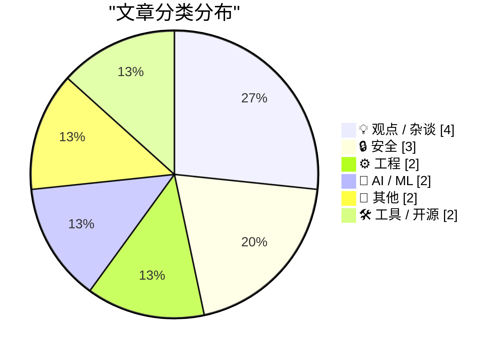
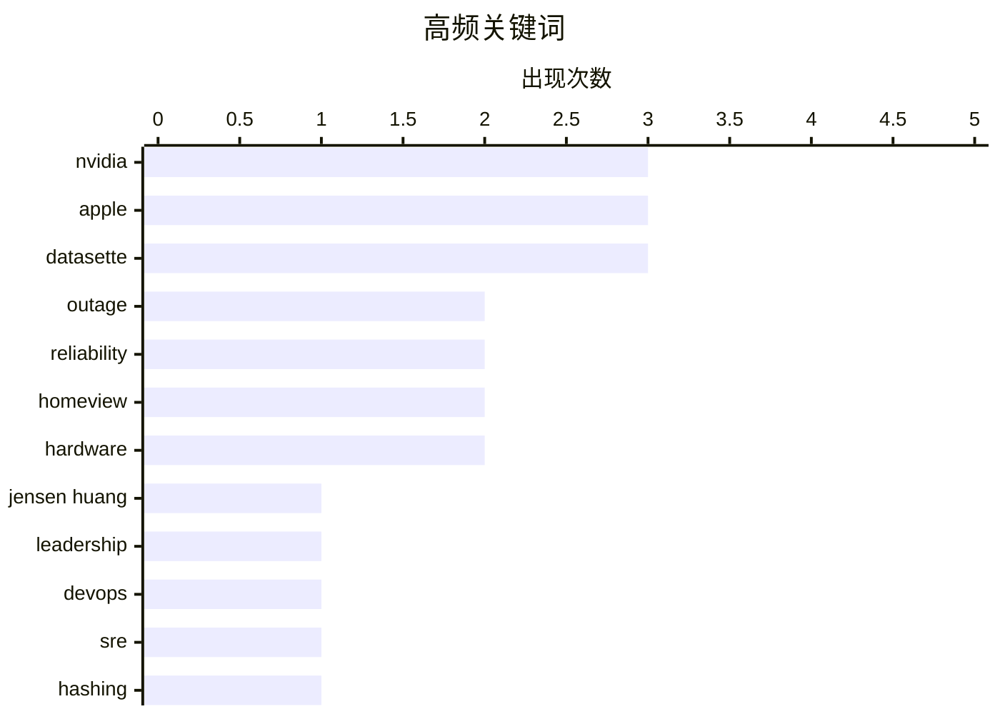

# 📰 Nov 16, 2026

> 来自 Karpathy 推荐的 92 个顶级技术博客，AI 精选 Top 15

## 📝 今日看点

今日技术圈的核心焦点在于英伟达灵魂人物黄仁勋辞职引发的行业巨震，以及AI领域高层人事变动背后的泡沫隐忧。与此同时，微软等巨头的大规模服务中断促使业界反思过度自动化的风险，强调在追求部署速度的同时必须保留系统稳定性的“摩擦力”。此外，关于人工超智能的不可预测性与基础数据隐私的讨论，再次警示了技术演进中安全与透明度的重要性。

---

## 🏆 今日必读

🥇 **英伟达的下一步：后黄仁勋时代的挑战**

[What’s Next For Nvidia?](https://steveblank.com/2026/11/15/whats-next-for-nvidia/) — steveblank.com · 17 小时前 · 💡 观点 / 杂谈

> 联合创始人黄仁勋在执掌英伟达 33 年后宣布辞职，公司正面临失去远见型领导者的关键转折点。历史经验表明，当灵魂人物离开后，企业往往会陷入创新停滞，仅依靠品牌惯性和过往势头维持增长。文章深入探讨了英伟达如何避免重蹈覆辙，分析了在 AI 浪潮巅峰期更换统帅对半导体行业格局的潜在冲击。核心挑战在于新管理层能否在维持现有市场统治力的同时，持续推动颠覆性技术研发。结论认为，英伟达必须在制度化管理与保持创始人式的冒险精神之间找到危险的平衡。

💡 **为什么值得读**: 探讨顶级科技巨头在失去灵魂人物后的生存法则，对理解企业治理与创新周期具有启发意义。

🏷️ Nvidia, Jensen Huang, leadership

🥈 **运维需要“摩擦力”：从微软与 FAA 停摆看系统稳定性**

[Ops needs friction](https://www.jeffgeerling.com/blog/2026/ops-needs-friction/) — jeffgeerling.com · 1 天前 · 💡 观点 / 杂谈

> 2026 年微软长达两天的服务中断和 FAA 地面停飞事件暴露了现代自动化运维中缺乏“摩擦力”的隐患。过度追求部署速度和无缝自动化可能导致配置错误迅速扩散，造成难以挽回的大规模系统崩溃。作者主张在关键基础设施操作中引入必要的验证环节和人为干预点，以减缓变更速度并增加容错空间。这种运维心态的转变强调了在效率与稳定性之间寻找平衡，防止单一故障点引发连锁反应。核心观点是，有时“慢”即是“稳”，技术团队需要重新审视自动化的边界。

💡 **为什么值得读**: 重新审视自动化运维的边界，提醒技术人员在追求极致效率时不可忽视系统的安全边界。

🏷️ DevOps, SRE, Outage, Reliability

🥉 **出租车数据与哈希函数：隐私保护的教训**

[Taxis and hash functions](https://www.johndcook.com/blog/2026/11/16/taxis-and-hash-functions/) — johndcook.com · 41 分钟前 · 🔒 安全

> 2014 年纽约市公开的出租车行程数据中，尽管对驾驶员执照和奖章编号进行了 MD5 哈希处理，但仍因输入空间有限而导致隐私泄露。由于出租车编号遵循特定格式且总数较少，攻击者可以通过穷举法轻松破解哈希值，从而追踪特定司机的行踪。文章分析了在处理低熵数据时仅依赖简单哈希函数的局限性，强调了加盐（Salting）和使用更强加密算法的重要性。这一案例提醒数据发布者，脱敏技术的有效性取决于对数据分布和计算复杂度的准确评估。结论指出，不当的加密实现往往比不加密更具误导性。

💡 **为什么值得读**: 通过真实案例揭示数据脱敏中的常见误区，是学习密码学应用与隐私保护的经典教材。

🏷️ hashing, MD5, privacy, data

---

## 📊 数据概览

| 扫描源 | 抓取文章 | 时间范围 | 精选 |
|:---:|:---:|:---:|:---:|
| 81/92 | 2517 篇 → 26 篇 | 48h | **15 篇** |

### 分类分布



### 高频关键词



<details>
<summary>📈 纯文本关键词图（终端友好）</summary>

```
nvidia       │ ████████████████████ 3
apple        │ ████████████████████ 3
datasette    │ ████████████████████ 3
outage       │ █████████████░░░░░░░ 2
reliability  │ █████████████░░░░░░░ 2
homeview     │ █████████████░░░░░░░ 2
hardware     │ █████████████░░░░░░░ 2
jensen huang │ ███████░░░░░░░░░░░░░ 1
leadership   │ ███████░░░░░░░░░░░░░ 1
devops       │ ███████░░░░░░░░░░░░░ 1
```

</details>

### 🏷️ 话题标签

**nvidia**(3) · **apple**(3) · **datasette**(3) · outage(2) · reliability(2) · homeview(2) · hardware(2) · jensen huang(1) · leadership(1) · devops(1) · sre(1) · hashing(1) · md5(1) · privacy(1) · data(1) · ai bubble(1) · tech policy(1) · industry trends(1) · semiconductor(1) · johny srouji(1)

---

## 💡 观点 / 杂谈

### 1. 英伟达的下一步：后黄仁勋时代的挑战

[What’s Next For Nvidia?](https://steveblank.com/2026/11/15/whats-next-for-nvidia/) — **steveblank.com** · 17 小时前 · ⭐ 28/30

> 联合创始人黄仁勋在执掌英伟达 33 年后宣布辞职，公司正面临失去远见型领导者的关键转折点。历史经验表明，当灵魂人物离开后，企业往往会陷入创新停滞，仅依靠品牌惯性和过往势头维持增长。文章深入探讨了英伟达如何避免重蹈覆辙，分析了在 AI 浪潮巅峰期更换统帅对半导体行业格局的潜在冲击。核心挑战在于新管理层能否在维持现有市场统治力的同时，持续推动颠覆性技术研发。结论认为，英伟达必须在制度化管理与保持创始人式的冒险精神之间找到危险的平衡。

🏷️ Nvidia, Jensen Huang, leadership

---

### 2. 运维需要“摩擦力”：从微软与 FAA 停摆看系统稳定性

[Ops needs friction](https://www.jeffgeerling.com/blog/2026/ops-needs-friction/) — **jeffgeerling.com** · 1 天前 · ⭐ 27/30

> 2026 年微软长达两天的服务中断和 FAA 地面停飞事件暴露了现代自动化运维中缺乏“摩擦力”的隐患。过度追求部署速度和无缝自动化可能导致配置错误迅速扩散，造成难以挽回的大规模系统崩溃。作者主张在关键基础设施操作中引入必要的验证环节和人为干预点，以减缓变更速度并增加容错空间。这种运维心态的转变强调了在效率与稳定性之间寻找平衡，防止单一故障点引发连锁反应。核心观点是，有时“慢”即是“稳”，技术团队需要重新审视自动化的边界。

🏷️ DevOps, SRE, Outage, Reliability

---

### 3. PCAST 的变动：大卫·萨克斯与 AI 泡沫的阴影

[The Legion of PCAST](https://www.whitehouse.gov/ostp/presidents-council-of-advisors-on-science-and-technology/) — **daringfireball.net** · 22 小时前 · ⭐ 23/30

> 特朗普政府的“AI 沙皇”大卫·萨克斯（David Sacks）在任职 130 天后宣布卸任总统科学技术顾问委员会（PCAST）联合主席。此次人事变动正值英伟达（Nvidia）丑闻可能引发 AI 行业泡沫破裂的敏感时期，引发了市场对政策导向的猜测。文章揭示了政府顾问角色在政策制定与行业危机中的复杂关系，特别是当核心技术公司面临监管压力时的人事动向。作者暗示，萨克斯的离职可能预示着政府对 AI 产业支持态度的转变或对潜在风险的规避。这一变动可能成为 AI 投资热潮降温的先行信号。

🏷️ AI Bubble, Nvidia, Tech Policy, Industry Trends

---

### 4. 苹果芯片主管 Johny Srouji 会接手英伟达吗？

[Patrick McGee on Johny Srouji and Nvidia](https://x.com/patrickmcgee_/status/2120799867140550999) — **daringfireball.net** · 1 天前 · ⭐ 22/30

> 市场传闻英伟达正考虑邀请苹果硬件技术高级副总裁 Johny Srouji 出任 CEO，以接替辞职的黄仁勋。Srouji 作为苹果自研芯片（M 系列及 A 系列）的核心功臣，在芯片设计与产品路线图整合方面拥有卓越声誉。分析认为，他在苹果已触及职业天花板且无缘 CEO 之位，而英伟达的平台能为其提供更大的野心施展空间。若此项任命达成，将标志着英伟达从纯芯片设计向更深层次的软硬一体化架构转型。作者认为 Srouji 是极少数具备领导英伟达所需技术威望和管理能力的候选人之一。

🏷️ Nvidia, Apple, semiconductor, Johny Srouji

---

## 🔒 安全

### 5. 出租车数据与哈希函数：隐私保护的教训

[Taxis and hash functions](https://www.johndcook.com/blog/2026/11/16/taxis-and-hash-functions/) — **johndcook.com** · 41 分钟前 · ⭐ 24/30

> 2014 年纽约市公开的出租车行程数据中，尽管对驾驶员执照和奖章编号进行了 MD5 哈希处理，但仍因输入空间有限而导致隐私泄露。由于出租车编号遵循特定格式且总数较少，攻击者可以通过穷举法轻松破解哈希值，从而追踪特定司机的行踪。文章分析了在处理低熵数据时仅依赖简单哈希函数的局限性，强调了加盐（Salting）和使用更强加密算法的重要性。这一案例提醒数据发布者，脱敏技术的有效性取决于对数据分布和计算复杂度的准确评估。结论指出，不当的加密实现往往比不加密更具误导性。

🏷️ hashing, MD5, privacy, data

---

### 6. Troy Hunt 周更 530 期：电子邮件的依赖性与应用安全

[Weekly Update 530: Email Dependencies & Apps](https://www.troyhunt.com/weekly-update-530/) — **troyhunt.com** · 8 小时前 · ⭐ 22/30

> 电子邮件已演变成类似水电的基础设施，用户往往默认其永远可用，却忽视了其背后的复杂依赖链。本期更新探讨了当邮件服务商出现故障或账户被封禁时，个人和企业数字生活的脆弱性。作者通过分析近期发生的邮件服务中断案例，强调了在关键业务流程中建立冗余机制的必要性。此外，文章还涉及了现代应用程序在集成第三方邮件 API 时面临的安全挑战与最佳实践。结论提醒开发者，过度依赖单一服务商（如 Gmail 或 Outlook）可能构成重大的业务连续性风险。

🏷️ email, infrastructure, reliability

---

### 7. Datasette 0.65.6 发布：修复数据库下载权限绕过漏洞

[datasette 0.65.6](https://simonwillison.net/2026/Nov/15/datasette-2/) — **simonwillison.net** · 16 小时前 · ⭐ 20/30

> Datasette 发布了 0.65.6 安全更新版本，主要从 1.0a43 开发分支回传了一个关键的安全修复。该漏洞存在于 `add_database(db, name=..., route=...)` 函数中，当开发者定义的路由（route）与数据库名称不一致时，权限控制会出现失效。未授权的访问者可以通过直接访问 `/<route>.db` 路径绕过权限检查并下载完整的数据库文件。此版本专门针对该路径解析漏洞进行了加固，确保所有自定义路由下的数据库访问都受到严格的 Actor 权限校验。建议所有在生产环境中使用自定义路由功能的 Datasette 用户立即升级。

🏷️ Datasette, Security, Vulnerability, SQLite

---

## ⚙️ 工程

### 8. 微软澄清云服务中断原因：非网络攻击或 AI 代理故障

[Microsoft Says Cloud Outage Was ‘Not Related to Cyber or AI / Agents’](https://x.com/microsoft/status/2121282013600907325) — **daringfireball.net** · 1 天前 · ⭐ 22/30

> 针对近期引发广泛关注的大规模云服务中断，微软官方声明该事故并非由网络攻击或 AI 代理错误引起。调查显示，故障根源在于早前进行的网络容量升级过程中引入的技术缺陷，该问题在最近一次网络变更后被触发。目前微软已修复底层架构问题，并逐步恢复受影响地区和客户的服务。这一事件再次引发了业界对超大规模云基础设施在进行底层网络调整时脆弱性的讨论。微软强调，尽管引入了 AI 监控，但传统的基础设施变更管理依然是保障稳定性的核心。

🏷️ Microsoft, Azure, outage, networking

---

### 9. datasette-apps 0.4a0 发布：在 Datasette 中运行沙箱应用

[datasette-apps 0.4a0](https://simonwillison.net/2026/Nov/15/datasette-apps/) — **simonwillison.net** · 1 天前 · ⭐ 21/30

> 新发布的 datasette-apps 0.4a0 允许用户在 Datasette 环境中运行沙箱化的 HTML 和 JavaScript 应用程序，功能类似于 Claude Artifacts。这些应用可以直接对底层数据执行 SQL 查询，实现了数据展示与交互的深度集成。0.4a0 版本重点增加了对 URL 锚点（#fragments）的支持，使应用能够读取并利用 URL 参数进行状态管理。此外，该版本还改进了应用对支持的 URL 方案的反馈机制。这一更新显著增强了 Datasette 作为轻量级数据应用平台的扩展能力和用户体验。

🏷️ Datasette, Sandboxing, Web Apps, SQL

---

## 🤖 AI / ML

### 10. 作为黑盒的人工超智能（ASI）

[ASI as a Black Box](https://borretti.me/article/asi-as-a-black-box) — **borretti.me** · 1 天前 · ⭐ 22/30

> 人类目前对“人工超智能”（ASI）的本质和行为模式几乎一无所知，它在很大程度上仍是一个不可预测的黑盒。文章指出，现有的 AI 发展路径并不能直接推导出超智能的逻辑，盲目乐观或恐惧都缺乏实质性的技术依据。作者呼吁研究界承认认知的局限性，不要试图用人类的思维框架去预设超智能的道德或目标。核心观点认为，在 ASI 真正出现之前，任何关于其社会影响的详细预测都只是科幻式的推测。我们应当关注可解释性研究，而非沉溺于对终极智能的臆想。

🏷️ ASI, superintelligence, AI safety

---

### 11. Datasette Agent 0.6a0 发布：支持主页 Prompt 与表名 Hash 引用

[datasette-agent 0.6a0](https://simonwillison.net/2026/Nov/15/datasette-agent/) — **simonwillison.net** · 1 天前 · ⭐ 20/30

> Datasette Agent 发布了 0.6a0 预览版，进一步增强了这款基于 AI 智能体的插件功能。新版本最显著的变化是在 Datasette 主页直接集成了 Agent 输入框，用户无需跳转即可开始对话式数据查询。功能上新增了对表（tables）和查询（queries）的“Hash 引用”支持，用户可以通过 `#` 符号在 Prompt 中精准指定数据上下文。此外，该版本还累积修复了多项小错误，优化了智能体在处理复杂 SQL 转换时的稳定性。这一更新显著提升了 Datasette 作为 AI 数据分析工具的交互效率。

🏷️ AI Agent, Datasette, LLM, Data Analysis

---

## 📝 其他

### 12. 最长的多项式水平集：埃尔德什猜想的证明

[The longest polynomial level set](https://www.johndcook.com/blog/2026/11/14/erdos-lemniscate/) — **johndcook.com** · 1 天前 · ⭐ 21/30

> 数学家埃尔德什（Erdős）曾猜想，在所有首一多项式中，水平集 {z : |p(z)| = 1} 的最大长度由 p(z) = z^n - 1 取得。这一困扰数学界多年的猜想近期由张腾（Teng Zhang）正式证明。文章解释了多项式度数 n 与曲线长度之间的几何关系，并展示了相关数学证明的核心逻辑。这一发现不仅解决了复分析领域的一个重要理论问题，也为理解多项式动力系统提供了新的视角。结论确认了埃尔德什在半个世纪前的直觉在数学上是完全成立的。

🏷️ mathematics, polynomial, Erdős, complex analysis

---

### 13. 轨道力学注记：矮行星 ED138 的周期推算

[Orbital footnote](https://www.johndcook.com/blog/2026/11/15/orbital-footnote/) — **johndcook.com** · 13 小时前 · ⭐ 20/30

> 本文是关于新发现的候选矮行星 ED138 轨道特性的数学补充说明。该天体目前的观测数据显示其公转周期约为 281.1 年，与太阳的距离约为日地距离的 46 倍。作者利用开普勒第三定律（Kepler’s third law）演示了如何通过轨道半长轴数据推导出公转周期。这种数学推导验证了新闻报道中数据的科学准确性，并解释了轨道半径与周期之间的立方平方比例关系。文章简洁地展示了经典物理定律在现代天文发现验证中的实际应用价值。

🏷️ astronomy, math, Kepler, physics

---

## 🛠 工具 / 开源

### 14. Joanna Stern 评测 HomeView：兼具信息量与趣味性的深度视频

[Joanna Stern Reviews the HomeView](https://www.youtube.com/watch?v=yVTcVtLn2o4) — **daringfireball.net** · 1 天前 · ⭐ 20/30

> 知名科技记者 Joanna Stern 发布了针对 Apple 新硬件 HomeView 的深度评测视频。评测内容详尽且充满幽默感，通过高质量的视觉演示介绍了该设备的硬件设计与实际操作体验。视频不仅涵盖了核心功能测试，还附带了一段精彩的幕后花絮，展示了产品在真实家居环境中的表现。作为首批深度体验，该评测为读者提供了关于 HomeView 屏幕素质、交互逻辑以及在 Apple 生态中定位的第一手资料。对于关注 Apple 智能家居布局的读者来说，这是目前最生动直观的参考资料。

🏷️ Apple, HomeView, hardware, review

---

### 15. Jason Snell 评测 HomeView：硬件扎实但软件仍显割裂

[Jason Snell’s HomeView Review](https://sixcolors.com/post/2026/11/homeview-review-a-late-arrival-with-promise-but-still-showing-some-seams/) — **daringfireball.net** · 1 天前 · ⭐ 20/30

> Jason Snell 在 Six Colors 上发表了对 Apple HomeView 的深度评测，指出该设备硬件做工扎实，屏幕触控与倾斜体验极佳。然而，软件层面被描述为 Apple 现有产品的“奇特混合体”，界面风格在 Apple Watch 表盘与 iPhone 待机模式（StandBy）之间摇摆。部分应用表现得像是从 iPad 或 iPhone 直接移植，导致整体系统体验仍存在明显的“缝隙感”。评测结论认为这是一款具有潜力但软件尚未完全打磨成熟的“迟到者”。这种硬件先行、软件补齐的策略反映了 Apple 在新形态设备探索中的现状。

🏷️ Apple, HomeView, UI, hardware

---

*生成于 2026-11-16 15:27 | 扫描 81 源 → 获取 2517 篇 → 精选 15 篇*
*基于 [Hacker News Popularity Contest 2025](https://refactoringenglish.com/tools/hn-popularity/) RSS 源列表，由 [Andrej Karpathy](https://x.com/karpathy) 推荐*
