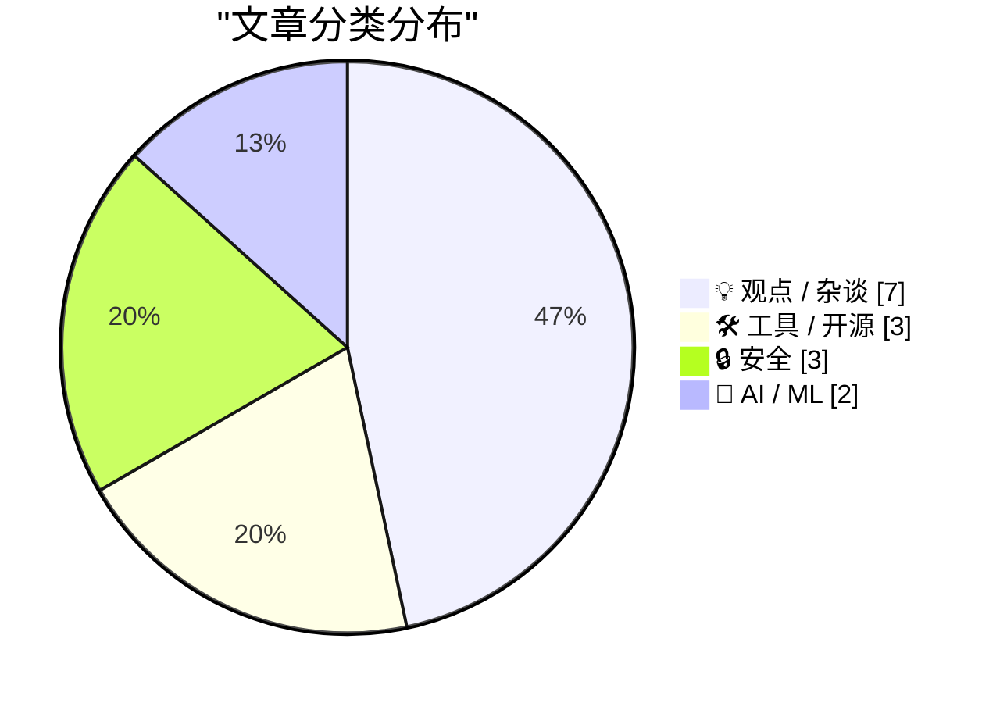
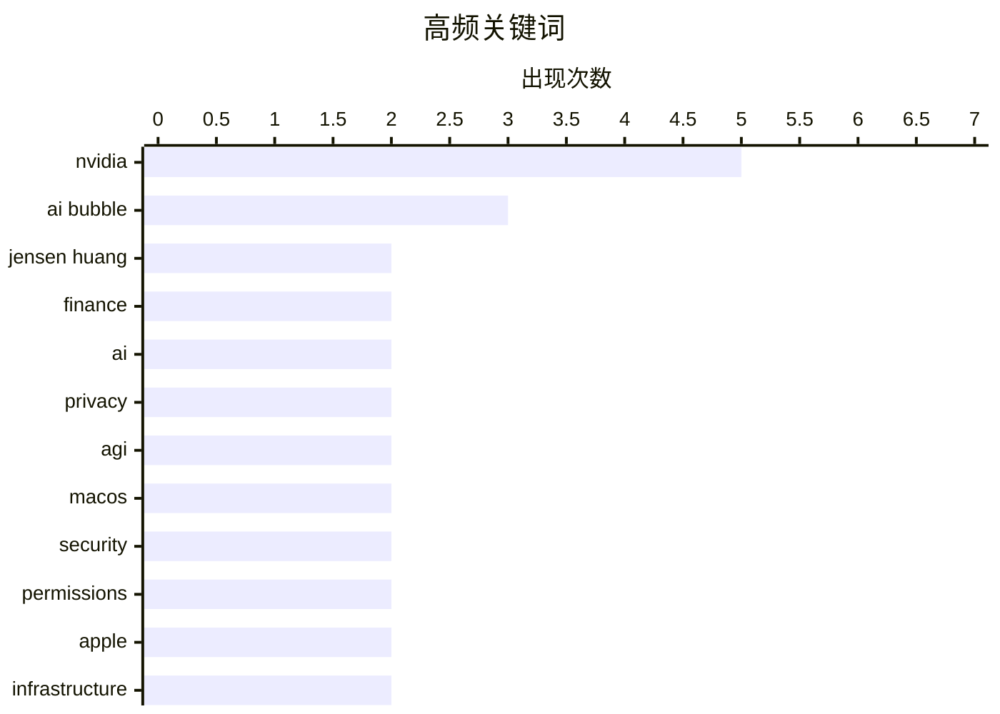

# 📰 Nov 17, 2026

> 来自 Karpathy 推荐的 92 个顶级技术博客，AI 精选 Top 15

## 📝 今日看点

英伟达正深陷创始人离职与“循环融资”财务争议的飓风中心，标志着由硬件巨头驱动的AI狂热正面临估值重塑与领导力断层的双重考验。与此同时，业界对AI泡沫破裂及强人工智能颠覆社会结构的忧虑达到顶峰，技术专家开始反思AI经济模式的长期可持续性。在宏观动荡中，开发者与厂商正加速转向私有化开源模型与更严苛的系统安全机制，以应对日益严峻的数据隐私与合规挑战。

---

## 🏆 今日必读

🥇 **英伟达的下一步：失去黄仁勋后何去何从？**

[What’s Next For Nvidia?](https://steveblank.com/2026/11/15/whats-next-for-nvidia/) — steveblank.com · 1 天前 · 💡 观点 / 杂谈

> 黄仁勋在执掌英伟达 33 年后宣布辞职，使这家万亿级芯片巨头面临失去灵魂人物的巨大挑战。远见型 CEO 离职后，企业往往会陷入创新停滞、仅靠品牌惯性维持增长的普遍困境。英伟达目前正处于从创始人驱动向职业经理人转型的危险期，其核心竞争力可能因领导层更迭而受到侵蚀。历史上极少有公司能在失去核心愿景家后重现辉煌，英伟达必须在维持现有市场地位与持续技术突破之间寻找新的平衡点。这种转变不仅关乎公司内部治理，更将直接影响全球 AI 算力供应链的稳定性。

💡 **为什么值得读**: 深入分析了硅谷历史上“后创始人时代”的企业危机，对理解英伟达未来走势具有前瞻性。

🏷️ Nvidia, Jensen Huang, leadership, innovation

🥈 **本·汤普森评英伟达：高风险的“循环融资”游戏**

[Ben Thompson on Nvidia](https://stratechery.com/2026/obituaries/) — daringfireball.net · 21 小时前 · 💡 观点 / 杂谈

> 著名科技分析师 Ben Thompson 剖析了英伟达独特的“风险业务”模式，即利用自身雄厚的现金流和信用评级为购买其芯片的初创公司提供资金支持。这种模式被看空者质疑为“循环融资”，旨在虚增市场需求，而看好者则认为这是通往 AI 盈利时代的必要财务桥梁。这种策略只有市值数万亿美元的巨头才有财力推行，但其本质是将公司的命运与整个 AI 生态系统的偿债能力深度绑定。这种激进的财务手段在推动 AI 繁荣的同时，也埋下了巨大的系统性金融隐患。一旦 AI 收益无法覆盖债务，这种闭环融资链条将面临断裂风险。

💡 **为什么值得读**: 揭示了英伟达市值神话背后的财务杠杆逻辑，是理解 AI 泡沫争议的关键视角。

🏷️ Nvidia, AI economy, finance, Stratechery

🥉 **华尔街日报：英伟达作为 AI 经济“空白支票”的日子已进入倒计时**

[WSJ: ‘Nvidia’s Days as an Open Checkbook for the AI Economy Are Numbered’](https://www.wsj.com/tech/ai/nvidias-days-as-an-open-checkbook-for-the-ai-economy-are-numbered-90c7b388) — daringfireball.net · 22 小时前 · 🤖 AI / ML

> 随着黄仁勋卸任，英伟达正逐步收紧其对 AI 初创企业的财务支持政策。新任财务主管对前任 CEO 达成的部分交易持谨慎态度，计划大幅削减用于支持客户购买芯片的资金投入。此前依赖英伟达“背书”和资金支持的新兴云服务商正面临融资断裂的风险，这可能引发 AI 产业链的连锁反应。英伟达从“AI 经济的提款机”向保守财务策略的转向，标志着靠资本扩张驱动的 AI 增长模式正迎来转折点。初创企业必须证明其具备独立盈利能力，而非仅仅依靠硬件供应商的输血。

💡 **为什么值得读**: 报道了英伟达核心财务策略的重大转向，预示了 AI 初创企业即将面临的“断粮”危机。

🏷️ Nvidia, Jensen Huang, AI, investment

---

## 📊 数据概览

| 扫描源 | 抓取文章 | 时间范围 | 精选 |
|:---:|:---:|:---:|:---:|
| 84/92 | 2571 篇 → 36 篇 | 48h | **15 篇** |

### 分类分布



### 高频关键词



<details>
<summary>📈 纯文本关键词图（终端友好）</summary>

```
nvidia       │ ████████████████████ 5
ai bubble    │ ████████████░░░░░░░░ 3
jensen huang │ ████████░░░░░░░░░░░░ 2
finance      │ ████████░░░░░░░░░░░░ 2
ai           │ ████████░░░░░░░░░░░░ 2
privacy      │ ████████░░░░░░░░░░░░ 2
agi          │ ████████░░░░░░░░░░░░ 2
macos        │ ████████░░░░░░░░░░░░ 2
security     │ ████████░░░░░░░░░░░░ 2
permissions  │ ████████░░░░░░░░░░░░ 2
```

</details>

### 🏷️ 话题标签

**nvidia**(5) · **ai bubble**(3) · **jensen huang**(2) · finance(2) · ai(2) · privacy(2) · agi(2) · macos(2) · security(2) · permissions(2) · apple(2) · infrastructure(2) · datasette(2) · leadership(1) · innovation(1) · ai economy(1) · stratechery(1) · investment(1) · llm(1) · open weights(1)

---

## 💡 观点 / 杂谈

### 1. 英伟达的下一步：失去黄仁勋后何去何从？

[What’s Next For Nvidia?](https://steveblank.com/2026/11/15/whats-next-for-nvidia/) — **steveblank.com** · 1 天前 · ⭐ 28/30

> 黄仁勋在执掌英伟达 33 年后宣布辞职，使这家万亿级芯片巨头面临失去灵魂人物的巨大挑战。远见型 CEO 离职后，企业往往会陷入创新停滞、仅靠品牌惯性维持增长的普遍困境。英伟达目前正处于从创始人驱动向职业经理人转型的危险期，其核心竞争力可能因领导层更迭而受到侵蚀。历史上极少有公司能在失去核心愿景家后重现辉煌，英伟达必须在维持现有市场地位与持续技术突破之间寻找新的平衡点。这种转变不仅关乎公司内部治理，更将直接影响全球 AI 算力供应链的稳定性。

🏷️ Nvidia, Jensen Huang, leadership, innovation

---

### 2. 本·汤普森评英伟达：高风险的“循环融资”游戏

[Ben Thompson on Nvidia](https://stratechery.com/2026/obituaries/) — **daringfireball.net** · 21 小时前 · ⭐ 25/30

> 著名科技分析师 Ben Thompson 剖析了英伟达独特的“风险业务”模式，即利用自身雄厚的现金流和信用评级为购买其芯片的初创公司提供资金支持。这种模式被看空者质疑为“循环融资”，旨在虚增市场需求，而看好者则认为这是通往 AI 盈利时代的必要财务桥梁。这种策略只有市值数万亿美元的巨头才有财力推行，但其本质是将公司的命运与整个 AI 生态系统的偿债能力深度绑定。这种激进的财务手段在推动 AI 繁荣的同时，也埋下了巨大的系统性金融隐患。一旦 AI 收益无法覆盖债务，这种闭环融资链条将面临断裂风险。

🏷️ Nvidia, AI economy, finance, Stratechery

---

### 3. 英伟达泡沫

[The NVIDIA Bubble](https://www.wheresyoured.at/the-nvidia-bubble/) — **wheresyoured.at** · 5 分钟前 · ⭐ 24/30

> 本文深度剖析了英伟达及其背后的 AI 产业财务状况，质疑当前的繁荣是否建立在不可持续的估值之上。通过对 AI 领域资金流向的细致调查，作者指出芯片销售的激增并未转化为终端应用市场的对等收入。文章揭示了英伟达市值飙升与实际 AI 产出之间的巨大鸿沟，认为这种失衡是典型金融泡沫的特征。如果 AI 无法在短期内证明其盈利能力，英伟达所支撑的整个估值体系将面临崩塌风险。这种泡沫的破裂可能对全球科技股产生毁灭性的打击。

🏷️ NVIDIA, AI bubble, finance, hardware

---

### 4. 我的尘埃帝国：后人类时代的 AI 代理经济

[My Empire of Dirt](https://geohot.github.io//blog/jekyll/update/2026/11/17/my-empire-of-dirt.html) — **geohot.github.io** · 23 小时前 · ⭐ 24/30

> 传奇黑客 George Hotz 描绘了一个激进的未来愿景：随着递归超级智能（RSI）的到来，人类将彻底退出经济循环。未来的市场需求将由 AI 代理之间相互产生，届时不再需要像英伟达这样的供应商，也不再需要人类作为消费者。文章预言了一个完全由机器自我驱动、自我消耗的闭环系统，人类在其中的角色将被边缘化甚至抹除。这种观点挑战了传统的“AI 辅助人类”论调，认为技术进化的终点是摆脱对人类生物性的依赖。在这个“尘埃帝国”中，人类的意志将不再是经济发展的原动力。

🏷️ AGI, AI agents, RSI, future

---

### 5. 游戏结束了吗？AI 泡沫的终结

[Game over, man?](https://garymarcus.substack.com/p/game-over-man) — **garymarcus.substack.com** · 23 小时前 · ⭐ 23/30

> 知名 AI 批评家 Gary Marcus 指出，随着英伟达核心领导层变动及相关财务争议的爆出，AI 行业的估值泡沫已正式破裂。他认为过去一段时间内对 AI 能力的过度承诺与实际商业回报之间的矛盾终于爆发。文章回顾了导致这一转折点的关键信号，包括市场对大模型边际效用递减的担忧。作者断言，AI 行业正进入一个残酷的去泡沫阶段，只有具备真实价值的技术才能在洗牌中存活。这标志着“幻觉驱动”的投资时代结束，实干主义将重新回归。

🏷️ AI bubble, market trend, economy

---

### 6. PCAST 军团：AI 沙皇与英伟达丑闻背后的政治博弈

[The Legion of PCAST](https://www.whitehouse.gov/ostp/presidents-council-of-advisors-on-science-and-technology/) — **daringfireball.net** · 1 天前 · ⭐ 22/30

> 文章聚焦于特朗普政府的“AI 沙皇” David Sacks 及其在总统科学技术顾问委员会（PCAST）中的角色变动。在英伟达深陷领导层更迭与潜在财务丑闻的背景下，Sacks 的提前离职引发了外界对其试图在 AI 泡沫破裂前规避风险的猜测。作者探讨了华盛顿政治圈与硅谷科技巨头之间复杂的利益绑定，以及这种关系在市场动荡时如何变得脆弱。文章揭示了 AI 政策制定者在面对技术巨头危机时的尴尬处境与权力重组。这种政商关系的裂痕可能预示着未来 AI 监管政策的剧烈转向。

🏷️ AI bubble, Nvidia, policy, David Sacks

---

### 7. 警惕！美国基础设施正在崩溃，AI 或是幕后推手

[Wake up! America’s infrastructure is melting. And AI appears to be partly responsible.](https://garymarcus.substack.com/p/wake-up-americas-infrastructure-is) — **garymarcus.substack.com** · 1 小时前 · ⭐ 22/30

> 美国能源基础设施正面临严峻挑战，而 AI 技术的爆发式增长被认为是导致这一危机的重要原因。数百家公司已受到电力供应不稳的影响，AI 数据中心巨大的能耗需求正迅速耗尽电网余量。文章指出，这种对算力的盲目追求忽视了物理基础设施的承载极限，可能导致系统性崩溃。作者呼吁社会必须正视 AI 发展与能源安全之间的矛盾，避免基础设施陷入“熔断”状态。

🏷️ AI, infrastructure, energy, sustainability

---

## 🛠 工具 / 开源

### 8. 每个人都能轻松上手的私有化开源权重模型指南

[Here's how anyone can easily use private, open weight models](https://micahflee.com/heres-how-anyone-can-easily-use-private-open-weight-models/) — **micahflee.com** · 23 小时前 · ⭐ 25/30

> 尽管大语言模型（LLM）存在数据中心能耗等争议，但其强大的生产力已不容忽视。针对 OpenAI 和 Anthropic 等闭源厂商的数据隐私风险，使用开源权重模型（Open-weight models）已成为一种安全且高效的替代方案。用户无需将敏感数据上传至云端，通过本地化部署即可获得同等级别的 AI 辅助能力。作者详细介绍了普通用户如何利用现有工具轻松运行这些私有模型，从而在享受 AI 便利的同时掌握数据控制权。这种去中心化的 AI 使用模式正在打破大科技公司对智能技术的垄断。

🏷️ LLM, open weights, privacy, local AI

---

### 9. Datasette 1.0a43 发布

[datasette 1.0a43](https://simonwillison.net/2026/Nov/15/datasette/) — **simonwillison.net** · 1 天前 · ⭐ 20/30

> Datasette 发布了 1.0a43 版本，标志着其 1.0 里程碑已完成 53%。该版本最核心的改进是为输出渲染器插件引入了流式传输（Streaming）支持，显著提升了处理大规模数据时的响应效率。开发者 Simon Willison 透露，他大量借助 Claude Fable 5.2 模型来加速代码编写和任务清理。此外，该版本还包含多项针对插件钩子的优化和稳定性修复。

🏷️ Datasette, SQLite, LLM-coding, Claude

---

### 10. datasette-maplibre 0.1a0：新一代地理空间插件

[datasette-maplibre 0.1a0](https://simonwillison.net/2026/Nov/15/datasette-maplibre/) — **simonwillison.net** · 1 天前 · ⭐ 19/30

> 新发布的 datasette-maplibre 0.1a0 是 Datasette 生态中久违的地理空间插件。该插件集成了高性能的 MapLibre GL JS 库，并默认使用 OpenFreeMap 提供的免费矢量地图服务。它为用户提供了一种无需支付昂贵地图 API 费用即可在 Datasette 中可视化地理数据的新方案。通过结合 SQLite 的空间扩展，该工具能够快速构建交互式的地图应用。

🏷️ Datasette, MapLibre, GIS, plugin

---

## 🔒 安全

### 11. 苹果发布 macOS 27.3 Beta 2 全新安全设置文档

[Apple Support Document on the New ‘Full Disk Access’ and ‘System & App Protection Override’ Settings in MacOS 27.3 Beta 2](https://support.apple.com/en-us/149699) — **daringfireball.net** · 13 小时前 · ⭐ 23/30

> 苹果在最新的 macOS 27.3 Beta 2 中引入了更为严苛的权限管理机制，重点更新了“完全磁盘访问”与“系统应用保护覆盖”设置。此举旨在解决用户在不了解风险的情况下，过度授予第三方应用系统级权限的问题。尽管部分开发者认为这些频繁的警告弹窗会干扰用户体验，但苹果坚持认为这是确保用户知情权和系统完整性的必要手段。文章详细解读了这些新设置的技术逻辑，展示了苹果在隐私保护与易用性权衡上的最新立场。对于依赖深层系统权限的软件开发者而言，这标志着开发门槛的进一步提高。

🏷️ macOS, security, permissions, Apple

---

### 12. 每周更新 530：电子邮件依赖与应用架构

[Weekly Update 530: Email Dependencies & Apps](https://www.troyhunt.com/weekly-update-530/) — **troyhunt.com** · 1 天前 · ⭐ 22/30

> 电子邮件已成为像水电一样的基础公用事业，但其背后的复杂依赖关系往往被用户忽视。Troy Hunt 探讨了当这些核心服务不可用时，个人和企业面临的巨大风险。文章分析了过度依赖单一供应商的弊端，以及现代应用在架构上对外部服务的深层绑定。作者强调，数字时代的生存需要建立冗余机制，而非盲目信任服务商的永久可用性。

🏷️ email, infrastructure, security, dependencies

---

### 13. macOS 27.3b2 引入针对“完全磁盘访问”的新隐私控制机制

[MacOS Golden Gate 27.3b2 Includes New Privacy Controls for Full Disk Access (and More)](https://9to5mac.com/2026/11/16/macos-27-3-includes-new-privacy-controls-for-full-disk-access-and-more/) — **daringfireball.net** · 19 小时前 · ⭐ 21/30

> macOS 27.3 开发者预览版 Beta 2 引入了针对“完全磁盘访问权限”的全新隐私控制机制。苹果将原本在 27.2 中统一的权限开关进行拆分，要求用户通过更明确、更具交互性的操作来授予这一高风险权限。此举旨在防止应用在用户不知情的情况下获取系统底层数据访问权。通过增加权限授予的“摩擦力”，macOS 进一步强化了其安全防线，确保敏感数据的访问完全受控于用户的主动意图。

🏷️ macOS, privacy, permissions, Apple

---

## 🤖 AI / ML

### 14. 华尔街日报：英伟达作为 AI 经济“空白支票”的日子已进入倒计时

[WSJ: ‘Nvidia’s Days as an Open Checkbook for the AI Economy Are Numbered’](https://www.wsj.com/tech/ai/nvidias-days-as-an-open-checkbook-for-the-ai-economy-are-numbered-90c7b388) — **daringfireball.net** · 22 小时前 · ⭐ 25/30

> 随着黄仁勋卸任，英伟达正逐步收紧其对 AI 初创企业的财务支持政策。新任财务主管对前任 CEO 达成的部分交易持谨慎态度，计划大幅削减用于支持客户购买芯片的资金投入。此前依赖英伟达“背书”和资金支持的新兴云服务商正面临融资断裂的风险，这可能引发 AI 产业链的连锁反应。英伟达从“AI 经济的提款机”向保守财务策略的转向，标志着靠资本扩张驱动的 AI 增长模式正迎来转折点。初创企业必须证明其具备独立盈利能力，而非仅仅依靠硬件供应商的输血。

🏷️ Nvidia, Jensen Huang, AI, investment

---

### 15. 保罗·克里斯蒂亚诺：距离 AI 颠覆政权可能仅剩 12 个月

[Paul Christiano – We could be 12 months away from AIs that can overthrow the government](https://www.dwarkesh.com/p/paul-christiano-2) — **dwarkesh.com** · 22 小时前 · ⭐ 25/30

> AI 安全专家 Paul Christiano 在访谈中发出严厉警告，认为人类可能在短短一年内迎来具备颠覆政府能力的强人工智能。这种级别的 AI 风险不仅限于技术失控，更可能导致人类文明难以恢复的结构性崩溃。访谈深入探讨了 AI 模型在自主决策和资源调配方面的潜在威胁，以及当前对齐技术在应对指数级增长的智能时的无力感。作者呼吁必须在灾难发生前，建立更严苛的监管框架和技术安全防线。这不仅是技术挑战，更是关乎人类生存的政治与伦理博弈。

🏷️ AI safety, alignment, AGI, risk

---

*生成于 2026-11-17 15:49 | 扫描 84 源 → 获取 2571 篇 → 精选 15 篇*
*基于 [Hacker News Popularity Contest 2025](https://refactoringenglish.com/tools/hn-popularity/) RSS 源列表，由 [Andrej Karpathy](https://x.com/karpathy) 推荐*
