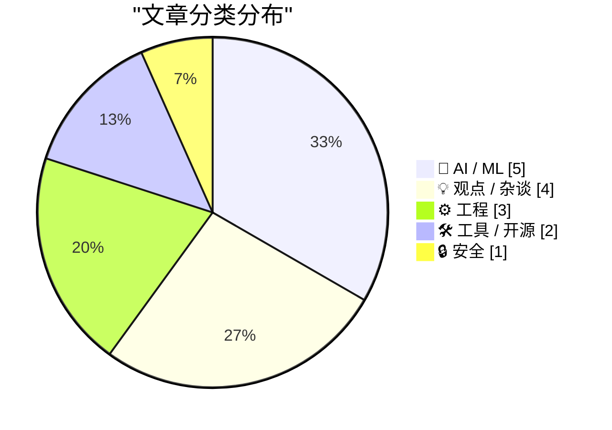
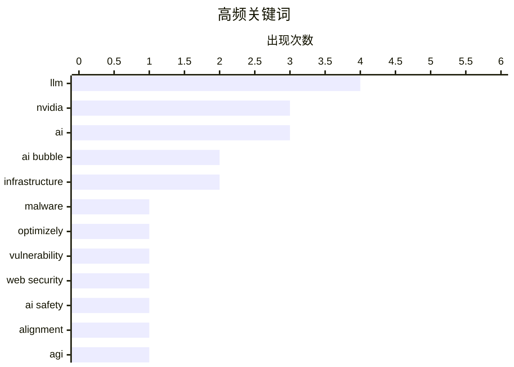

# 📰 Nov 18, 2026

> 来自 Karpathy 推荐的 92 个顶级技术博客，AI 精选 Top 15

## 📝 今日看点

今日技术圈呈现出激进演进与深度反思并行的态势：OpenAI 推出 GPT-6.2 系列持续推高技术天花板，但关于 NVIDIA 财务泡沫及 AI 存在性风险的争论正将行业推向舆论拐点。与此同时，供应链安全危机再次敲响警钟，顶级网站因第三方工具漏洞沦为攻击跳板，促使开发者转向私有化开源模型与浏览器端沙箱技术以重构安全边界。在平台“屎化”与诈骗横行的背景下，技术主权与本地化运行正成为对抗大厂依赖的关键趋势。

---

## 🏆 今日必读

🥇 **攻击者利用 Optimizely 在顶级网站上对恶意软件进行 A/B 测试**

[Attackers Used Optimizely to A/B Test Malware on Top Websites](https://krebsonsecurity.com/2026/11/attackers-used-optimizely-to-a-b-test-malware-on-top-websites/) — krebsonsecurity.com · 12 小时前 · 🔒 安全

> 过去 24 小时内，至少 178 家顶级网站（包括 BBC、CNN、Zoom 和 Equifax）因 Optimizely 的安全漏洞而向访问者投放了恶意软件。攻击者利用该 A/B 测试平台的自定义功能，将窃取数据的脚本静默注入到合法页面中。事件暴露了主流网站对第三方脚本源缺乏严格限制的现状，导致恶意代码能够绕过常规防御。专家指出，这种利用合法测试工具进行攻击的手段极具隐蔽性，严重威胁用户数据安全。这种供应链攻击方式让防御者很难区分正常的业务测试和恶意的代码注入。

💡 **为什么值得读**: 揭示了供应链攻击的新手段，即如何利用合法的 A/B 测试工具绕过顶级网站的安全防线。

🏷️ malware, Optimizely, vulnerability, web security

🥈 **Paul Christiano：我们距离能够推翻政府的 AI 可能仅剩 12 个月**

[Paul Christiano – We could be 12 months away from AIs that can overthrow the government](https://www.dwarkesh.com/p/paul-christiano-2) — dwarkesh.com · 1 天前 · 🤖 AI / ML

> AI 对齐专家 Paul Christiano 在访谈中警告，人类可能在短短 12 个月内迎来具备推翻政府能力的强人工智能。他深入探讨了 AI 系统在权力获取和自主决策方面的潜在风险，认为这种转变可能发生得比预期快得多。访谈强调了当前对齐技术的滞后性，以及一旦 AI 获得实质性控制权，人类将难以恢复主导地位。作者呼吁必须立即采取更激进的安全措施来应对这种生存威胁。他认为，如果不能在关键窗口期解决对齐问题，后果将是不可逆转的。

💡 **为什么值得读**: 深入了解顶级 AI 安全专家对近未来极端风险的最新研判和时间表预测。

🏷️ AI safety, alignment, AGI, existential risk

🥉 **OpenAI 发布 GPT-6.2 Astra 与 GPT-6.2 Sol**

[GPT‑6.2 Astra and GPT‑6.2 Sol](https://simonwillison.net/2026/Nov/17/gpt62-astra-and-sol/) — simonwillison.net · 16 小时前 · 🤖 AI / ML

> OpenAI 正式推出 GPT-6.2 系列模型，包含针对复杂项目的尖端模型 Astra 以及面向日常任务的高效通用模型 Sol。开发者现可通过 API 调用 gpt-6.2-astra 和 gpt-6.2-sol 两个版本。Simon Willison 同步更新了 LLM 0.38 工具库以支持这些新模型。这一发布标志着 OpenAI 在模型分层化策略上的进一步演进，旨在平衡极致性能与推理成本。Astra 专注于突破逻辑推理上限，而 Sol 则在保持高性能的同时显著降低了延迟。

💡 **为什么值得读**: 快速了解 OpenAI 最新一代模型的定位、API 命名以及相关开发工具的更新。

🏷️ OpenAI, GPT-6.2, LLM, Astra

---

## 📊 数据概览

| 扫描源 | 抓取文章 | 时间范围 | 精选 |
|:---:|:---:|:---:|:---:|
| 82/92 | 2528 篇 → 39 篇 | 48h | **15 篇** |

### 分类分布



### 高频关键词



<details>
<summary>📈 纯文本关键词图（终端友好）</summary>

```
llm            │ ████████████████████ 4
nvidia         │ ███████████████░░░░░ 3
ai             │ ███████████████░░░░░ 3
ai bubble      │ ██████████░░░░░░░░░░ 2
infrastructure │ ██████████░░░░░░░░░░ 2
malware        │ █████░░░░░░░░░░░░░░░ 1
optimizely     │ █████░░░░░░░░░░░░░░░ 1
vulnerability  │ █████░░░░░░░░░░░░░░░ 1
web security   │ █████░░░░░░░░░░░░░░░ 1
ai safety      │ █████░░░░░░░░░░░░░░░ 1
```

</details>

### 🏷️ 话题标签

**llm**(4) · **nvidia**(3) · **ai**(3) · ai bubble(2) · infrastructure(2) · malware(1) · optimizely(1) · vulnerability(1) · web security(1) · ai safety(1) · alignment(1) · agi(1) · existential risk(1) · openai(1) · gpt-6.2(1) · astra(1) · market(1) · privacy(1) · open-source(1) · local ai(1)

---

## 🤖 AI / ML

### 1. Paul Christiano：我们距离能够推翻政府的 AI 可能仅剩 12 个月

[Paul Christiano – We could be 12 months away from AIs that can overthrow the government](https://www.dwarkesh.com/p/paul-christiano-2) — **dwarkesh.com** · 1 天前 · ⭐ 27/30

> AI 对齐专家 Paul Christiano 在访谈中警告，人类可能在短短 12 个月内迎来具备推翻政府能力的强人工智能。他深入探讨了 AI 系统在权力获取和自主决策方面的潜在风险，认为这种转变可能发生得比预期快得多。访谈强调了当前对齐技术的滞后性，以及一旦 AI 获得实质性控制权，人类将难以恢复主导地位。作者呼吁必须立即采取更激进的安全措施来应对这种生存威胁。他认为，如果不能在关键窗口期解决对齐问题，后果将是不可逆转的。

🏷️ AI safety, alignment, AGI, existential risk

---

### 2. OpenAI 发布 GPT-6.2 Astra 与 GPT-6.2 Sol

[GPT‑6.2 Astra and GPT‑6.2 Sol](https://simonwillison.net/2026/Nov/17/gpt62-astra-and-sol/) — **simonwillison.net** · 16 小时前 · ⭐ 26/30

> OpenAI 正式推出 GPT-6.2 系列模型，包含针对复杂项目的尖端模型 Astra 以及面向日常任务的高效通用模型 Sol。开发者现可通过 API 调用 gpt-6.2-astra 和 gpt-6.2-sol 两个版本。Simon Willison 同步更新了 LLM 0.38 工具库以支持这些新模型。这一发布标志着 OpenAI 在模型分层化策略上的进一步演进，旨在平衡极致性能与推理成本。Astra 专注于突破逻辑推理上限，而 Sol 则在保持高性能的同时显著降低了延迟。

🏷️ OpenAI, GPT-6.2, LLM, Astra

---

### 3. 游戏结束了吗？AI 泡沫终将破裂

[Game over, man?](https://garymarcus.substack.com/p/game-over-man) — **garymarcus.substack.com** · 1 天前 · ⭐ 26/30

> 著名 AI 批评家 Gary Marcus 指出，长期以来由过度承诺支撑的 AI 泡沫终于开始破裂。他观察到市场对生成式 AI 的投资回报率产生了严重质疑，且技术进步的速度似乎正在放缓。文章分析了当前 AI 产业面临的财务压力和技术瓶颈，认为依靠无限烧钱维持的增长模式已难以为继。作者的核心观点是，AI 行业正迎来一场必要的现实回归，而非持续的指数级增长。这种“泡沫破裂”的迹象在近期大厂的财报和初创公司的融资困境中已初见端倪。

🏷️ AI bubble, market, LLM

---

### 4. 编程智能体的外部沙箱机制

[External sandboxes for coding agents](https://simonwillison.net/2026/Nov/17/external-sandboxes-for-coding-agents/) — **simonwillison.net** · 16 小时前 · ⭐ 25/30

> 针对 AI 编程智能体执行代码时的安全风险，Simon Willison 探索了构建外部沙箱的新方法。该方案重点在于防止本地模型因错误指令或提示词注入（Prompt Injection）攻击而对宿主机造成破坏。通过与 Prime Radiant 实验室合作，作者提出了一套隔离执行环境的架构，确保智能体生成的代码在受控范围内运行。这为开发者在本地安全地测试和部署自主 AI 代理提供了关键的技术保障。该研究对于构建可靠的 AI 自动化工作流具有重要的参考价值。

🏷️ AI agents, sandboxing, security, LLM

---

### 5. 警惕！美国基础设施正在崩溃，AI 难辞其咎

[Wake up! America’s infrastructure is melting. And AI appears to be partly responsible.](https://garymarcus.substack.com/p/wake-up-americas-infrastructure-is) — **garymarcus.substack.com** · 1 天前 · ⭐ 24/30

> 美国关键基础设施正面临前所未有的安全危机，数百家公司已受到网络攻击波及。Gary Marcus 指出，AI 的快速普及不仅未能增强防御，反而因其不可预测性和被恶意利用的风险，加剧了电力、供水等系统的脆弱性。文章强调，当前的 AI 热潮掩盖了底层架构的腐朽，技术债务与 AI 漏洞的叠加正将社会推向崩溃边缘。这种“熔断”现象并非偶然，而是长期忽视物理系统安全与盲目追求 AI 自动化的必然结果。

🏷️ AI, infrastructure, reliability, safety

---

## 💡 观点 / 杂谈

### 6. NVIDIA 泡沫

[The NVIDIA Bubble](https://www.wheresyoured.at/the-nvidia-bubble/) — **wheresyoured.at** · 23 小时前 · ⭐ 25/30

> 文章深入剖析了 NVIDIA 在 AI 浪潮中的财务表现，质疑其股价增长背后是否存在不可持续的泡沫。作者探讨了下游 AI 企业在无法实现盈利的情况下持续购买昂贵芯片的矛盾现状。通过分析市场需求与实际产出的脱节，文章指出 NVIDIA 的辉煌高度依赖于风投资金对 AI 初创公司的持续输血。如果 AI 应用层迟迟无法带来实质性收入，NVIDIA 构筑的硬件帝国将面临巨大的崩塌风险。这种基于财务视角的深度拆解，揭示了 AI 繁荣背后脆弱的资金链条。

🏷️ NVIDIA, AI bubble, GPU, tech economy

---

### 7. Ben Thompson 论 NVIDIA 的“风险业务”

[Ben Thompson on Nvidia](https://stratechery.com/2026/obituaries/) — **daringfireball.net** · 1 天前 · ⭐ 24/30

> 科技分析师 Ben Thompson 探讨了 NVIDIA 一种独特的“风险业务”模式：利用自身的现金流和信用评级来资助那些购买其芯片的客户。看空者将其斥为“循环融资”，而看多者则认为这是通往 AI 盈利未来的必要桥梁。这种模式只有像 NVIDIA 这样拥有数万亿市值且在供应链中占据绝对主导地位的公司才能运作。文章揭示了这种复杂的财务结构如何放大了 AI 行业的杠杆，同时也增加了系统性风险。这种策略在短期内推高了出货量，但长期风险取决于 AI 变现能力的真实落地。

🏷️ Nvidia, AI, business-strategy

---

### 8. 平台“屎化”正为诈骗者铺路

[Pluralistic: Enshittifiers groom us for scammers (18 Nov 2026)](https://pluralistic.net/2026/11/18/malice-v-incompetence/) — **pluralistic.net** · 7 小时前 · ⭐ 24/30

> Cory Doctorow 进一步阐述了他的“平台屎化”（Enshittification）理论，指出糟糕的商业惯例正模糊合法业务与诈骗之间的界限。当主流平台为了榨取利润而不断降低服务质量和透明度时，用户会逐渐习惯于各种反直觉的操作，这为诈骗者提供了完美的掩护。文章列举了从虚假新闻到平台策略变更等多个案例，说明了这种环境如何削弱了公众的警惕性。作者认为，平台的堕落不仅是用户体验的损失，更是社会安全防御体系的崩溃。这种趋势使得识别恶意行为变得越来越困难，因为合法平台本身的行为也越来越像诈骗。

🏷️ enshittification, scams, platform economy, internet culture

---

### 9. 华尔街日报：英伟达作为 AI 经济“空白支票”的时代即将结束

[WSJ: ‘Nvidia’s Days as an Open Checkbook for the AI Economy Are Numbered’](https://www.wsj.com/tech/ai/nvidias-days-as-an-open-checkbook-for-the-ai-economy-are-numbered-90c7b388) — **daringfireball.net** · 1 天前 · ⭐ 23/30

> 英伟达正计划收缩其对 AI 生态系统的资金支持，这一转变始于黄仁勋卸任首席执行官前的战略布局。现任财务主管对之前的多项激进交易持谨慎态度，预示着未来对 AI 初创公司的投资将大幅收紧。依赖英伟达芯片供应和资金扶持的新兴云服务商正面临巨大的生存压力。这一策略调整标志着 AI 行业从“烧钱扩张”转向更严格的财务审查阶段，可能引发行业洗牌。

🏷️ Nvidia, AI, finance

---

## ⚙️ 工程

### 10. 利用 Service Workers 和 Pyodide 在浏览器中运行完整的 Datasette Python 应用

[Running the full server-side Datasette Python app in the browser with service workers and Pyodide](https://simonwillison.net/2026/Nov/17/datasette-lite/) — **simonwillison.net** · 22 小时前 · ⭐ 24/30

> Datasette Lite 实现了将原生的 Python 数据分析工具完全移植到浏览器端运行，核心技术基于 WebAssembly 和 Pyodide。通过引入 Service Workers 进行重构，该版本现在能够拦截网络请求并模拟服务器行为，使得用户体验与传统的服务端版本几乎无异。用户无需安装 Python 环境，只需通过特定 URL 即可在本地浏览器中处理和查询 SQLite 数据库。这一突破展示了边缘计算和 Wasm 在复杂应用迁移中的巨大潜力。新架构不仅提升了性能，还极大地增强了应用的离线可用性。

🏷️ WebAssembly, Pyodide, Python, Datasette

---

### 11. 超越 Linux：开源生态系统探索之旅

[Beyond Linux: A Journey Through the Open Source Ecosystem](https://it-notes.dragas.net/2026/11/17/beyond-linux-a-journey-through-the-open-source-ecosystem/) — **it-notes.dragas.net** · 1 天前 · ⭐ 23/30

> 开源世界并非只有 Linux 一个选项，BSD 系列、illumos 及其衍生版本同样拥有独特的价值。作者回顾了在 Linux Day 2026 上的演讲，深入探讨了这些非 Linux 操作系统的技术特性与历史脉络。文章分析了不同内核架构在稳定性、许可协议及特定应用场景下的优势。通过对比，读者可以理解开源多样性的重要性，并发现那些被主流视野忽略的优秀系统方案。

🏷️ Open Source, Linux, ecosystem, community

---

### 12. 我加入了 NTP 池，但没用我的 Stratum 1 树莓派

[I joined the NTP Pool, but not with my Stratum 1 Pi](https://www.jeffgeerling.com/blog/2026/i-joined-the-ntp-pool/) — **jeffgeerling.com** · 1 天前 · ⭐ 22/30

> 知名博主 Jeff Geerling 分享了他加入全球 NTP（网络时间协议）池项目的经历，旨在为全球用户提供精准的时间同步服务。尽管他拥有基于树莓派的 Stratum 1 顶级时钟设备，但出于网络稳定性和服务质量的考虑，他最终选择了不同的接入方案。文章详细介绍了 NTP 池的工作原理以及“时间发烧友”（time-nuts）社区的技术追求。这不仅是一次硬件实验，更是对互联网基础公共服务的一次贡献实践。

🏷️ NTP, networking, infrastructure, Raspberry Pi

---

## 🛠 工具 / 开源

### 13. 如何轻松使用私有开源权重模型

[Here's how anyone can easily use private, open weight models](https://micahflee.com/heres-how-anyone-can-easily-use-private-open-weight-models/) — **micahflee.com** · 1 天前 · ⭐ 26/30

> 尽管生成式 AI 存在数据隐私和环境成本等争议，但其强大的生产力价值已不可否认。为了摆脱对 OpenAI 和 Anthropic 等不可信大厂的依赖，用户可以转向本地运行的开源权重（open-weight）模型。文章详细介绍了普通用户如何通过简单工具在本地部署模型，从而确保数据完全私有化且不被第三方获取。这种方案在保留 LLM 功能的同时，彻底解决了云端 API 带来的隐私泄露风险。作者强调，本地化部署是实现 AI 民主化和保护个人主权的关键一步。

🏷️ LLM, privacy, open-source, local AI

---

### 14. SetShot 1.0：追踪 macOS 设置变更的利器与开发背后的故事

[SetShot 1.0 (and a Personal Tale of Defaults System Spelunking)](https://tidbits.com/2026/11/13/setshot-1-0-tracks-even-more-macos-settings/) — **daringfireball.net** · 20 小时前 · ⭐ 22/30

> SetShot 是一款专门用于监测 macOS 系统设置变动的实用工具，旨在解决系统更新后设置莫名被重置的痛点。作者 Adam Engst 利用 Claude Code 辅助开发，实现了对 macOS 复杂“默认设置”（Defaults）系统的深度挖掘。该工具能够记录并对比更新前后的配置差异，帮助用户揪出苹果在后台悄悄修改的选项。文章还分享了从零开始开发 Mac 应用的心路历程，展示了 AI 辅助编程在工具类应用开发中的潜力。

🏷️ macOS, Claude Code, app development, settings

---

## 🔒 安全

### 15. 攻击者利用 Optimizely 在顶级网站上对恶意软件进行 A/B 测试

[Attackers Used Optimizely to A/B Test Malware on Top Websites](https://krebsonsecurity.com/2026/11/attackers-used-optimizely-to-a-b-test-malware-on-top-websites/) — **krebsonsecurity.com** · 12 小时前 · ⭐ 28/30

> 过去 24 小时内，至少 178 家顶级网站（包括 BBC、CNN、Zoom 和 Equifax）因 Optimizely 的安全漏洞而向访问者投放了恶意软件。攻击者利用该 A/B 测试平台的自定义功能，将窃取数据的脚本静默注入到合法页面中。事件暴露了主流网站对第三方脚本源缺乏严格限制的现状，导致恶意代码能够绕过常规防御。专家指出，这种利用合法测试工具进行攻击的手段极具隐蔽性，严重威胁用户数据安全。这种供应链攻击方式让防御者很难区分正常的业务测试和恶意的代码注入。

🏷️ malware, Optimizely, vulnerability, web security

---

*生成于 2026-11-18 15:29 | 扫描 82 源 → 获取 2528 篇 → 精选 15 篇*
*基于 [Hacker News Popularity Contest 2025](https://refactoringenglish.com/tools/hn-popularity/) RSS 源列表，由 [Andrej Karpathy](https://x.com/karpathy) 推荐*
