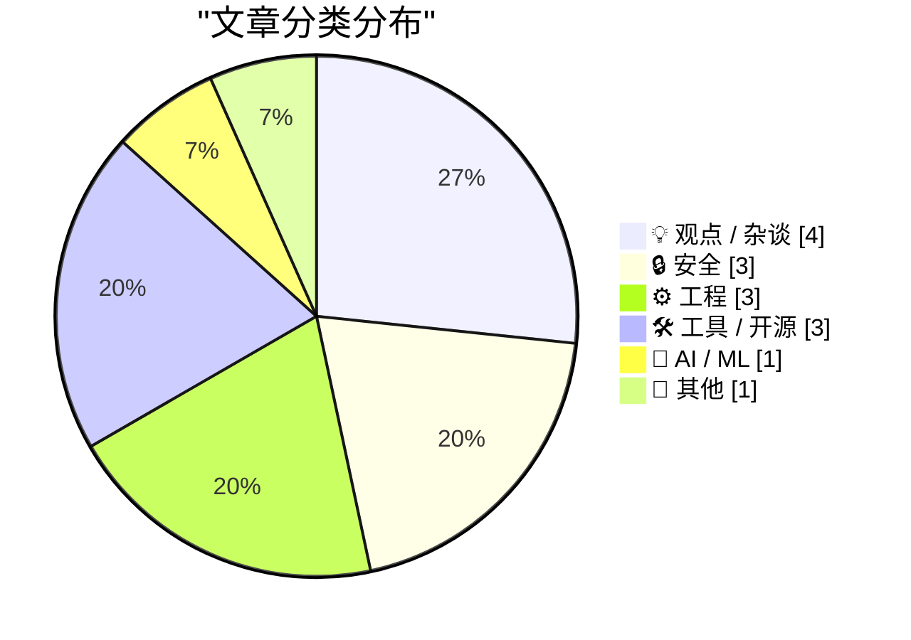
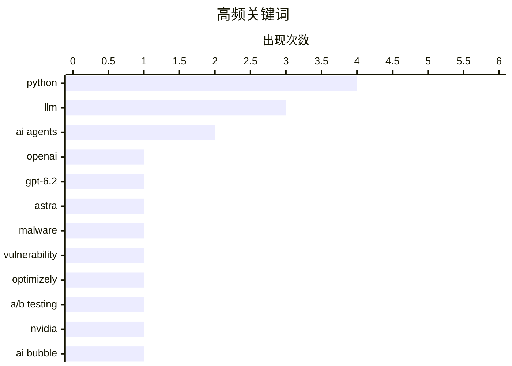

# 📰 Nov 19, 2026

> 来自 Karpathy 推荐的 92 个顶级技术博客，AI 精选 Top 15

## 📝 今日看点

今日技术圈呈现出 AI 极速更迭与底层安全危机并行的态势。OpenAI 与 Google 竞相发布新一代模型，但在算力泡沫隐忧与 AI 编程局限性的讨论中，业界正对大模型的实际落地能力进行理性反思。与此同时，NGINX 高危漏洞及针对顶级网站的供应链攻击敲响了基础设施安全警钟，迫使开发者在利用 Wasm 等新技术拓展浏览器边界的同时，必须加速构建针对 AI 智能体的安全沙箱防御体系。

---

## 🏆 今日必读

🥇 **GPT-6.2 Astra 与 GPT-6.2 Sol 正式发布**

[GPT‑6.2 Astra and GPT‑6.2 Sol](https://simonwillison.net/2026/Nov/17/gpt62-astra-and-sol/) — simonwillison.net · 1 天前 · 🤖 AI / ML

> OpenAI 推出了 GPT-6.2 系列的两款核心模型：面向复杂、尖端项目的 Astra 以及针对日常工作优化的高效通用模型 Sol。这两款模型已同步上线 API，开发者可通过 `gpt-6.2-astra` 和 `gpt-6.2-sol` 进行调用。知名开发者 Simon Willison 迅速响应，发布了 LLM 0.38 版本以提供对这些新模型的原生支持。新版本不仅集成了 OpenAI 的最新能力，还优化了本地命令行工具的交互体验。用户现在可以根据任务难度，在极致性能与高性价比之间灵活切换。

💡 **为什么值得读**: 第一时间掌握 OpenAI 最新一代模型的定位差异及其配套开发工具的更新动态。

🏷️ OpenAI, GPT-6.2, LLM, Astra

🥈 **攻击者利用 Optimizely 漏洞在顶级网站进行恶意软件 A/B 测试**

[Attackers Used Optimizely to A/B Test Malware on Top Websites](https://krebsonsecurity.com/2026/11/attackers-used-optimizely-to-a-b-test-malware-on-top-websites/) — krebsonsecurity.com · 1 天前 · 🔒 安全

> 在过去 24 小时内，包括 BBC、CNN、Zoom 和 Equifax 在内的至少 178 个知名网站因 Optimizely 平台的安全漏洞被植入了恶意软件。攻击者利用该 A/B 测试工具的特性，针对不同访客隐蔽地分发数据窃取脚本。安全专家指出，许多顶级网站由于未强制执行严格的内容安全策略（CSP），导致恶意代码能轻易从第三方域名加载。此次事件凸显了供应链攻击的新趋势，即利用合法的营销工具作为木马分发跳板。网站管理员需立即审查第三方脚本权限并收紧安全策略以防范此类风险。

💡 **为什么值得读**: 揭示了供应链攻击的隐蔽新手段，警示运维人员重视第三方营销工具的安全管控。

🏷️ malware, vulnerability, Optimizely, A/B testing

🥉 **英伟达泡沫：AI 基础设施的财务隐忧**

[The NVIDIA Bubble](https://www.wheresyoured.at/the-nvidia-bubble/) — wheresyoured.at · 1 天前 · 💡 观点 / 杂谈

> 本文深入剖析了英伟达（NVIDIA）在 AI 浪潮下的财务现状及其潜在的估值泡沫。作者分析了当前科技巨头对 GPU 的疯狂采购与 AI 应用实际盈利能力之间的巨大鸿沟。文章指出，如果 AI 产业无法在短期内证明其商业变现逻辑，英伟达的增长神话可能面临破裂风险。通过对比历史上的科技泡沫，作者提醒市场关注 AI 基础设施投入的可持续性。结论认为，当前的繁荣在很大程度上依赖于对未来产出的过度乐观预期。

💡 **为什么值得读**: 从宏观财务视角审视 AI 硬件巨头的风险，适合关注 AI 产业趋势与投资逻辑的读者。

🏷️ NVIDIA, AI bubble, finance, GPU

---

## 📊 数据概览

| 扫描源 | 抓取文章 | 时间范围 | 精选 |
|:---:|:---:|:---:|:---:|
| 82/92 | 2548 篇 → 31 篇 | 48h | **15 篇** |

### 分类分布



### 高频关键词



<details>
<summary>📈 纯文本关键词图（终端友好）</summary>

```
python        │ ████████████████████ 4
llm           │ ███████████████░░░░░ 3
ai agents     │ ██████████░░░░░░░░░░ 2
openai        │ █████░░░░░░░░░░░░░░░ 1
gpt-6.2       │ █████░░░░░░░░░░░░░░░ 1
astra         │ █████░░░░░░░░░░░░░░░ 1
malware       │ █████░░░░░░░░░░░░░░░ 1
vulnerability │ █████░░░░░░░░░░░░░░░ 1
optimizely    │ █████░░░░░░░░░░░░░░░ 1
a/b testing   │ █████░░░░░░░░░░░░░░░ 1
```

</details>

### 🏷️ 话题标签

**python**(4) · **llm**(3) · **ai agents**(2) · openai(1) · gpt-6.2(1) · astra(1) · malware(1) · vulnerability(1) · optimizely(1) · a/b testing(1) · nvidia(1) · ai bubble(1) · finance(1) · gpu(1) · memory safety(1) · cve(1) · nginx(1) · c++(1) · curl(1) · rust(1)

---

## 💡 观点 / 杂谈

### 1. 英伟达泡沫：AI 基础设施的财务隐忧

[The NVIDIA Bubble](https://www.wheresyoured.at/the-nvidia-bubble/) — **wheresyoured.at** · 1 天前 · ⭐ 26/30

> 本文深入剖析了英伟达（NVIDIA）在 AI 浪潮下的财务现状及其潜在的估值泡沫。作者分析了当前科技巨头对 GPU 的疯狂采购与 AI 应用实际盈利能力之间的巨大鸿沟。文章指出，如果 AI 产业无法在短期内证明其商业变现逻辑，英伟达的增长神话可能面临破裂风险。通过对比历史上的科技泡沫，作者提醒市场关注 AI 基础设施投入的可持续性。结论认为，当前的繁荣在很大程度上依赖于对未来产出的过度乐观预期。

🏷️ NVIDIA, AI bubble, finance, GPU

---

### 2. 平台劣化（Enshittification）正为诈骗者铺路

[Pluralistic: Enshittifiers groom us for scammers (18 Nov 2026)](https://pluralistic.net/2026/11/18/malice-v-incompetence/) — **pluralistic.net** · 1 天前 · ⭐ 22/30

> Cory Doctorow 在本文中探讨了“平台劣化”与网络诈骗之间的共生关系。他指出，当合法企业的业务实践变得越来越糟糕、难以辨认时，诈骗者就更容易混水摸鱼。文章通过多个案例说明，用户在习惯了糟糕的服务体验后，对异常行为的警惕性会显著下降。作者认为，改善互联网生态不仅需要打击诈骗，更需要遏制大企业的垄断与服务退化。这种社会技术评论为理解当前互联网安全困境提供了独特的视角，强调了商业道德与网络安全的关联。

🏷️ enshittification, scams, platform decay, economics

---

### 3. Python 软件基金会（PSF）年终筹款活动

[The PSF end-of-year fundraiser](https://simonwillison.net/2026/Nov/18/psf-end-of-year-fundraiser/) — **simonwillison.net** · 1 天前 · ⭐ 20/30

> Python 软件基金会（PSF）正式启动了 2026 年终筹款活动，旨在为支持 Python 开发及其社区的非营利组织筹集资金。PSF 承担着管理 Python 知识产权、运营核心基础设施 PyPI 以及资助核心开发者冲刺（sprints）等关键任务。随着 Python 在全球开发者中的广泛应用，维护其生态系统的安全性和稳定性需要持续的资金投入。文章呼吁受益于 Python 的企业和个人通过捐赠回馈社区，以确保这一开源生态的可持续发展。筹得的资金将直接用于提升 PyPI 的安全性以及支持全球范围内的 PyCon 等社区活动。

🏷️ Python, PSF, community, fundraising

---

### 4. Pluralistic：如何丧失版权法中最优的劳工政策

[Pluralistic: How to forfeit one of copyright's best labor policies (19 Nov 2026)](https://pluralistic.net/2026/11/19/loan-out-companies/) — **pluralistic.net** · 1 小时前 · ⭐ 20/30

> 文章探讨了美国版权法中“转让撤销权”（Termination of Transfer）与创作者常用的“借调公司”（Loan-out Companies）之间的法律冲突。版权法原本允许创作者在转让版权 35 年后重新收回权利，但如果合同是通过创作者自己的借调公司签署的，这项权利可能会因法律定性问题而失效。这种法律漏洞使得原本旨在保护创作者的政策，在复杂的商业结构面前变得脆弱。作者警告创作者，为了眼前的避税或社保福利而采用借调公司模式，可能会导致未来永久失去对核心作品的控制权。这反映了现代劳工政策在应对复杂企业法律结构时的滞后性。

🏷️ copyright, labor policy, intellectual property, law

---

## 🔒 安全

### 5. 攻击者利用 Optimizely 漏洞在顶级网站进行恶意软件 A/B 测试

[Attackers Used Optimizely to A/B Test Malware on Top Websites](https://krebsonsecurity.com/2026/11/attackers-used-optimizely-to-a-b-test-malware-on-top-websites/) — **krebsonsecurity.com** · 1 天前 · ⭐ 26/30

> 在过去 24 小时内，包括 BBC、CNN、Zoom 和 Equifax 在内的至少 178 个知名网站因 Optimizely 平台的安全漏洞被植入了恶意软件。攻击者利用该 A/B 测试工具的特性，针对不同访客隐蔽地分发数据窃取脚本。安全专家指出，许多顶级网站由于未强制执行严格的内容安全策略（CSP），导致恶意代码能轻易从第三方域名加载。此次事件凸显了供应链攻击的新趋势，即利用合法的营销工具作为木马分发跳板。网站管理员需立即审查第三方脚本权限并收紧安全策略以防范此类风险。

🏷️ malware, vulnerability, Optimizely, A/B testing

---

### 6. “无法防范”：NGINX 曝出高危内存安全漏洞

["No way to prevent this" say users of only language where this regularly happens](https://xeiaso.net/shitposts/no-way-to-prevent-this/memory-safety/CVE-2026-123633/) — **xeiaso.net** · 1 天前 · ⭐ 25/30

> NGINX 近期发布了 CVE-2026-123633 和 CVE-2026-123007 两个高危漏洞补丁，涉及 HTTP/2 协议处理中的严重内存管理问题。其中一个漏洞源于连接槽不足时的 Use-After-Free 错误，另一个则是流控制中的整数下溢导致的越界内存拷贝。这些漏洞允许未经身份验证的远程攻击者在受影响系统上执行任意代码（RCE）。作者借此讽刺了 C 语言在内存安全方面的固有缺陷，认为这类问题在 Rust 等现代语言中本可避免。系统管理员必须尽快升级 NGINX 实例以封堵安全漏洞。

🏷️ memory safety, CVE, NGINX, C++

---

### 7. 为编程智能体构建外部沙箱

[External sandboxes for coding agents](https://simonwillison.net/2026/Nov/17/external-sandboxes-for-coding-agents/) — **simonwillison.net** · 1 天前 · ⭐ 24/30

> Simon Willison 探讨了为执行代码的 AI 智能体（Agents）构建外部沙箱的必要性与实现方案。该项目旨在防止本地模型因误操作或提示词注入攻击（Prompt Injection）对宿主机造成破坏。通过与 Prime Radiant 实验室合作，作者研究了如何安全地隔离智能体生成的代码运行环境。方案重点在于提供一个既能让智能体自由测试代码，又能严格限制其访问敏感系统资源的边界。这对于希望在本地安全部署自主编程助手的开发者具有重要参考价值。

🏷️ sandbox, AI agents, security, LLM

---

## ⚙️ 工程

### 8. 对话 Daniel Stenberg：关于 curl 的 Rust 重写与 AI 的局限性

[Quoting Daniel Stenberg](https://simonwillison.net/2026/Nov/18/daniel-stenberg/) — **simonwillison.net** · 23 小时前 · ⭐ 24/30

> curl 创始人 Daniel Stenberg 对 AI 代理将 curl 从 C 语言重写为 Rust 的尝试发表了犀利评论。他指出，当 AI 代理将 18.5 万行 C 代码转化为 34 万行 Rust 代码时，原项目组已在三周内合并了 300 多个提交并修复了 200 多个 Bug。AI 生成的重写版本完全缺失了这些最新的安全修复和功能改进，且代码量显著膨胀。Stenberg 强调，简单的代码转换无法替代持续的维护与对复杂逻辑的深度理解。这一观点揭示了当前 AI 在处理高活跃开源项目重构时的显著短板。

🏷️ curl, Rust, C, AI agents

---

### 9. 利用 Service Workers 和 Pyodide 在浏览器中运行完整的 Datasette

[Running the full server-side Datasette Python app in the browser with service workers and Pyodide](https://simonwillison.net/2026/Nov/17/datasette-lite/) — **simonwillison.net** · 1 天前 · ⭐ 23/30

> Datasette Lite 迎来了重大重写，通过 WebAssembly (Wasm) 和 Pyodide 技术实现了在浏览器中完整运行 Python 应用。新版本引入了 Service Workers 机制，使得浏览器端的体验与服务器端几乎无异。用户现在可以直接通过特定 URL 加载数据、运行 SQL 查询并生成可视化图表，而无需安装任何本地环境。这种架构彻底消除了对后端服务器的依赖，极大地降低了数据分享和探索的门槛。该项目展示了现代 Web 技术在运行复杂 Python 生态应用方面的巨大潜力。

🏷️ WebAssembly, Pyodide, Python, browser

---

### 10. 深入 PyPy：初探 RPython

[Inside PyPy: first contact with RPython](https://bernsteinbear.com/blog/inside-pypy-first-contact-with-rpython/?utm_source=rss) — **bernsteinbear.com** · 15 小时前 · ⭐ 22/30

> 开发者在构建新编程语言时常面临实现语言选择的困境，而 RPython 作为 PyPy 的底层框架提供了一种独特的解决方案。RPython 是 Python 的一个严格子集，通过静态分析将其翻译为高效的 C 代码，并能自动为目标语言生成 JIT 编译器。文章深入探讨了 RPython 的运作机制，展示了它如何利用元追踪（meta-tracing）技术简化高性能虚拟机的开发。相比于从零编写 C 或汇编，RPython 让开发者能以接近 Python 的开发效率获得接近原生的执行性能。这种“一次编写，到处 JIT”的特性，使其成为语言实现领域极具吸引力的工具。

🏷️ PyPy, RPython, compilers, Python

---

## 🛠 工具 / 开源

### 11. llm-gemini 0.38 发布：支持 Gemini 4 Neon

[llm-gemini 0.38](https://simonwillison.net/2026/Nov/18/llm-gemini/) — **simonwillison.net** · 15 小时前 · ⭐ 23/30

> 随着 Google 发布 Gemini 4 Neon 模型，Simon Willison 同步更新了 `llm-gemini` 插件至 0.38 版本。新版本正式支持 Neon 模型，但作者在文中吐槽了 Gemini 4 系列日益混乱的定价策略。Gemini 4 Neon 的加入使得原本就复杂的计费模型变得更加难以预测，增加了开发者的选型难度。尽管如此，该插件仍为开发者提供了便捷的接口来调用 Google 最新的多模态能力。用户可以通过简单的命令行更新即可开始体验 Neon 模型的性能表现。

🏷️ LLM, Gemini, Google, Python

---

### 12. 版本控制周报：2026 年 11 月 18 日

[This Week in Source Control: 18 November 2026](https://nesbitt.io/2026/11/18/this-week-in-source-control.html) — **nesbitt.io** · 1 天前 · ⭐ 23/30

> 本周版本控制领域动态汇总，涵盖了主流代码托管平台和版本控制工具的最新发布与安全通告。文章整理了 Git 社区的最新补丁说明，以及针对各大 Forge 平台的安全漏洞预警。此外，还收录了多篇关于优化工作流和源代码管理的深度技术文章。对于需要紧跟版本控制技术演进的开发者和 DevOps 工程师来说，这是一个高效的信息同步来源。通过阅读本周报，读者可以快速掌握行业内的关键技术变更。

🏷️ Git, source control, version control, devops

---

### 13. SetShot 1.0 发布：一场关于 macOS 默认设置系统的深度探索

[SetShot 1.0 (and a Personal Tale of Defaults System Spelunking)](https://tidbits.com/2026/11/13/setshot-1-0-tracks-even-more-macos-settings/) — **daringfireball.net** · 1 天前 · ⭐ 20/30

> 针对 macOS 系统更新后设置可能被神秘篡改的问题，开发者利用 Claude Code 编写并发布了名为 SetShot 的实用工具。SetShot 能够捕获 macOS 系统设置的完整快照，并通过对比不同时间点的快照来揭示更新过程中发生的细微变化。该应用深入挖掘了 macOS 底层的 defaults 配置系统，旨在解决用户对系统更新透明度的担忧。尽管初步测试尚未抓到 Apple 违规更改设置的现行，但它为排查照片同步异常或笔记丢失等系统故障提供了关键的审计线索。该工具的开发过程也展示了 AI 辅助编程在构建系统级实用工具方面的潜力。

🏷️ macOS, Claude Code, utility, AI-assisted coding

---

## 🤖 AI / ML

### 14. GPT-6.2 Astra 与 GPT-6.2 Sol 正式发布

[GPT‑6.2 Astra and GPT‑6.2 Sol](https://simonwillison.net/2026/Nov/17/gpt62-astra-and-sol/) — **simonwillison.net** · 1 天前 · ⭐ 26/30

> OpenAI 推出了 GPT-6.2 系列的两款核心模型：面向复杂、尖端项目的 Astra 以及针对日常工作优化的高效通用模型 Sol。这两款模型已同步上线 API，开发者可通过 `gpt-6.2-astra` 和 `gpt-6.2-sol` 进行调用。知名开发者 Simon Willison 迅速响应，发布了 LLM 0.38 版本以提供对这些新模型的原生支持。新版本不仅集成了 OpenAI 的最新能力，还优化了本地命令行工具的交互体验。用户现在可以根据任务难度，在极致性能与高性价比之间灵活切换。

🏷️ OpenAI, GPT-6.2, LLM, Astra

---

## 📝 其他

### 15. 苹果云服务遭遇故障，连状态页面也未能幸免

[Apple’s Cloud Services Are Having a Bad Day, Including Their Status Page](https://www.macrumors.com/2026/11/17/apple-accounts-experiencing-issues/) — **daringfireball.net** · 1 天前 · ⭐ 20/30

> Apple 的多项云服务包括 Apple 账户登录和 iCloud 同步近期遭遇了严重故障，影响了全球大量用户。受影响的服务涵盖了照片、笔记和系统设置，表现为数据同步不完整或跨设备更改无法生效。尽管 Apple 设有官方系统状态页面，但在故障期间该页面也出现了更新滞后或显示错误，无法准确反映实时服务状态。作者在测试 macOS 27.3 beta 时发现，即使系统提示同步完成，实际数据依然存在断层。这次事件再次引发了用户对云端数据依赖性及服务透明度的讨论，暴露出大型云基础设施在极端情况下的脆弱性。

🏷️ Apple, iCloud, outage, cloud services

---

*生成于 2026-11-19 15:34 | 扫描 82 源 → 获取 2548 篇 → 精选 15 篇*
*基于 [Hacker News Popularity Contest 2025](https://refactoringenglish.com/tools/hn-popularity/) RSS 源列表，由 [Andrej Karpathy](https://x.com/karpathy) 推荐*
