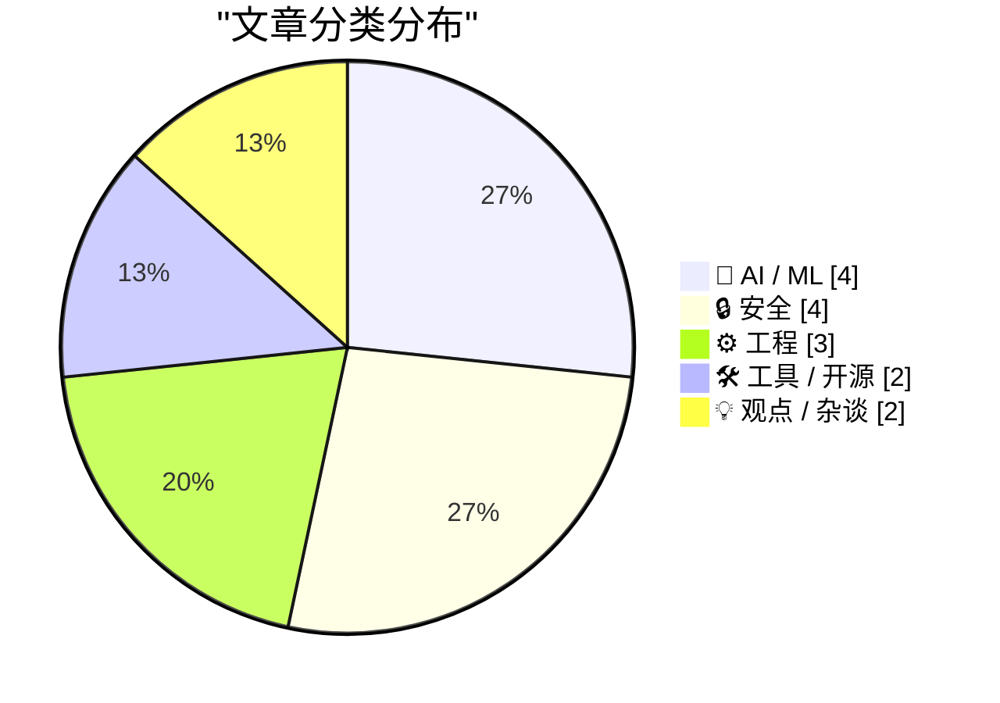
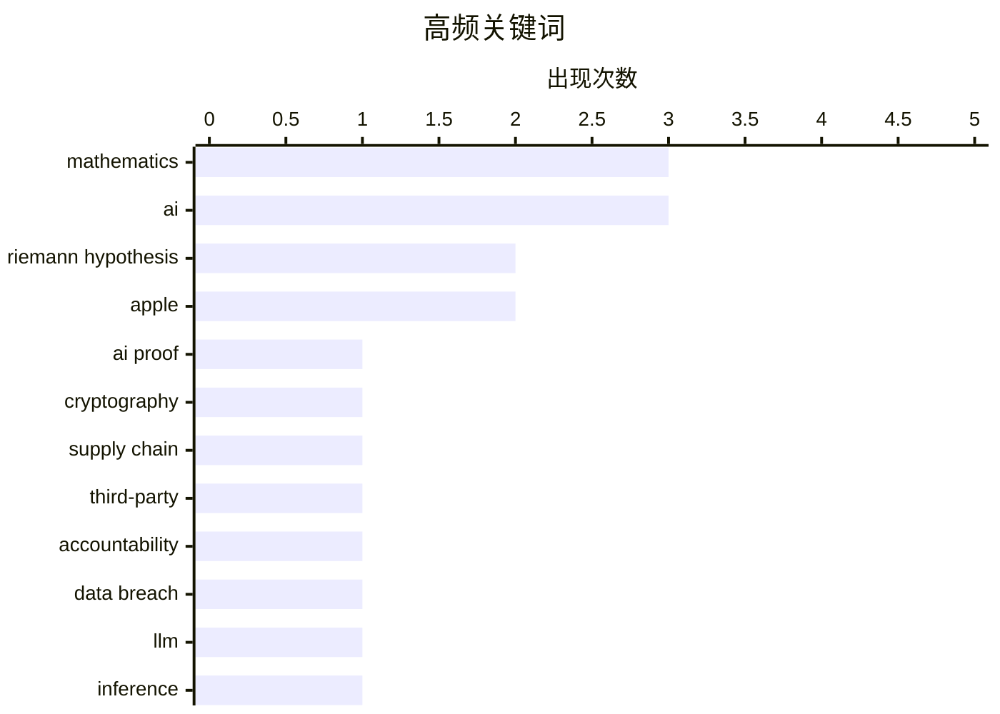

# 📰 Nov 22, 2026

> 来自 Karpathy 推荐的 92 个顶级技术博客，AI 精选 Top 15

## 📝 今日看点

今日技术圈聚焦AI的深度演进与商业化博弈，从广义黎曼猜想的证明争议到苹果AI的阶梯收费计划，行业正经历从技术狂热向理性变现与泡沫反思的转变。安全领域迎来重磅监管与责任重构，FBI对勒索软件恢复欺诈的打击以及对第三方脚本责任的探讨，揭示了数字化供应链中严峻的信任危机。与此同时，Rust驱动的工具革新与强调“规避低级错误”的工程哲学，正持续重塑着现代软件开发的性能边界与质量底线。

---

## 🏆 今日必读

🥇 **什么是广义黎曼猜想？**

[What is the Generalized Riemann Hypothesis?](https://www.johndcook.com/blog/2026/11/20/grh/) — johndcook.com · 1 天前 · 🤖 AI / ML

> 黎曼猜想（RH）及其推广形式——广义黎曼猜想（GRH）是数学界最核心的难题之一。近期有两项宣称证明了 GRH 的成果引起关注，分别来自 AI 生成和人类数学家。RH 关注黎曼 zeta 函数的零点分布，而 GRH 将此范围扩大到了狄利克雷 L 函数（Dirichlet L-functions）。理解 GRH 对于数论中素数分布的精确预测至关重要，它是许多现代数学定理成立的前提。作者通过本文厘清了这一复杂数学概念的定义及其在当前技术背景下的重要性。

💡 **为什么值得读**: 深入浅出地解释了数学界最重大的未解之谜及其最新动态，适合对数论和 AI 辅助证明感兴趣的读者。

🏷️ mathematics, Riemann Hypothesis, AI proof, cryptography

🥈 **每周更新 531：Optimizely 事件、脚本依赖与第三方责任**

[Weekly Update 531: Optimizely. Script Dependencies & Third Parties](https://www.troyhunt.com/weekly-update-531/) — troyhunt.com · 9 小时前 · 🔒 安全

> 网络安全专家 Troy Hunt 在本周更新中深入探讨了第三方脚本依赖带来的安全责任归属问题。文章以 Optimizely 的安全披露为例，批评了企业在发生数据泄露时试图将责任推卸给“第三方供应商”的行为。作者强调“责任无法外包”，企业必须对其供应链中的每一个环节及其引入的脚本负责。文中还讨论了如何通过监控和管理第三方依赖来降低潜在的攻击面。这种对责任的界定对于构建健壮的企业安全文化至关重要。

💡 **为什么值得读**: 警示开发者和安全从业者，在享受第三方服务便利的同时，必须正视并管理其带来的供应链安全风险。

🏷️ supply chain, third-party, accountability, data breach

🥉 **为什么输出缓存对 LLM 不起作用**

[Why output caching doesn't work](https://seangoedecke.com/why-output-caching-doesnt-work/) — seangoedecke.com · 1 天前 · 🤖 AI / ML

> LLM 推理成本优化通常依赖于输入缓存（如 KV Cache），但缓存模型输出（Output Caching）往往收效甚微。由于 LLM 输出具有高度的随机性和上下文敏感性，完全相同的长输出请求在实际应用中极少重复出现。此外，维护庞大的输出缓存库所带来的检索延迟和存储成本，往往超过了重新生成的开销。作者指出，只有在极少数高度静态的场景下输出缓存才有意义。对于大多数开发者而言，应专注于优化 Prompt 结构和输入层缓存，而非盲目追求输出层面的复用。

💡 **为什么值得读**: 深入分析了 LLM 推理优化的常见误区，为构建高性能 AI 应用提供了务实的架构建议。

🏷️ LLM, Inference, Caching, Performance

---

## 📊 数据概览

| 扫描源 | 抓取文章 | 时间范围 | 精选 |
|:---:|:---:|:---:|:---:|
| 79/92 | 2433 篇 → 25 篇 | 48h | **15 篇** |

### 分类分布



### 高频关键词



<details>
<summary>📈 纯文本关键词图（终端友好）</summary>

```
mathematics        │ ████████████████████ 3
ai                 │ ████████████████████ 3
riemann hypothesis │ █████████████░░░░░░░ 2
apple              │ █████████████░░░░░░░ 2
ai proof           │ ███████░░░░░░░░░░░░░ 1
cryptography       │ ███████░░░░░░░░░░░░░ 1
supply chain       │ ███████░░░░░░░░░░░░░ 1
third-party        │ ███████░░░░░░░░░░░░░ 1
accountability     │ ███████░░░░░░░░░░░░░ 1
data breach        │ ███████░░░░░░░░░░░░░ 1
```

</details>

### 🏷️ 话题标签

**mathematics**(3) · **ai**(3) · **riemann hypothesis**(2) · apple(2) · ai proof(1) · cryptography(1) · supply chain(1) · third-party(1) · accountability(1) · data breach(1) · llm(1) · inference(1) · caching(1) · performance(1) · ransomware(1) · fraud(1) · cybersecurity(1) · fbi(1) · python(1) · wsgi(1)

---

## 🤖 AI / ML

### 1. 什么是广义黎曼猜想？

[What is the Generalized Riemann Hypothesis?](https://www.johndcook.com/blog/2026/11/20/grh/) — **johndcook.com** · 1 天前 · ⭐ 27/30

> 黎曼猜想（RH）及其推广形式——广义黎曼猜想（GRH）是数学界最核心的难题之一。近期有两项宣称证明了 GRH 的成果引起关注，分别来自 AI 生成和人类数学家。RH 关注黎曼 zeta 函数的零点分布，而 GRH 将此范围扩大到了狄利克雷 L 函数（Dirichlet L-functions）。理解 GRH 对于数论中素数分布的精确预测至关重要，它是许多现代数学定理成立的前提。作者通过本文厘清了这一复杂数学概念的定义及其在当前技术背景下的重要性。

🏷️ mathematics, Riemann Hypothesis, AI proof, cryptography

---

### 2. 为什么输出缓存对 LLM 不起作用

[Why output caching doesn't work](https://seangoedecke.com/why-output-caching-doesnt-work/) — **seangoedecke.com** · 1 天前 · ⭐ 26/30

> LLM 推理成本优化通常依赖于输入缓存（如 KV Cache），但缓存模型输出（Output Caching）往往收效甚微。由于 LLM 输出具有高度的随机性和上下文敏感性，完全相同的长输出请求在实际应用中极少重复出现。此外，维护庞大的输出缓存库所带来的检索延迟和存储成本，往往超过了重新生成的开销。作者指出，只有在极少数高度静态的场景下输出缓存才有意义。对于大多数开发者而言，应专注于优化 Prompt 结构和输入层缓存，而非盲目追求输出层面的复用。

🏷️ LLM, Inference, Caching, Performance

---

### 3. 苹果文档披露 Apple Intelligence 将按 iCloud+ 等级设置使用限制

[Apple Documents Extra Apple Intelligence Usage Limits Per iCloud+ Paid Tier](https://support.apple.com/en-us/127901) — **daringfireball.net** · 20 小时前 · ⭐ 23/30

> 苹果官方文档显示，从 2027 年的软件版本开始，Apple Intelligence 功能将实施阶梯式服务计划。虽然基础 AI 功能对支持设备免费，但涉及强大服务器端模型的特性（如高级 Siri AI、智能照片编辑工具等）将根据 iCloud+ 的付费等级设置使用上限。这一举措标志着苹果开始将其 AI 能力与订阅服务深度绑定，以抵消高昂的服务器运算成本。用户若需更高频次的 AI 访问权限，将需要订阅更高档位的 iCloud+ 方案。此政策预计从 macOS 27.3 等版本开始逐步推行。

🏷️ Apple Intelligence, AI, iCloud, Subscription

---

### 4. 引用 Levent Alpöge：关于黎曼猜想证明的声明

[Quoting Levent Alpöge](https://simonwillison.net/2026/Nov/20/levent-alpoge/) — **simonwillison.net** · 1 天前 · ⭐ 22/30

> 数学家 Levent Alpöge 宣称在 AI 助手 Claude 的协作下，发现了黎曼猜想（RH）及其推广形式（GRH）的证明方法。该研究不仅提出了数学逻辑上的潜在突破，还尝试利用 AI 对证明过程进行了无假设的形式化验证。如果该成果属实，将解决数学界最著名的千年难题之一，并可能进一步攻克扩展黎曼猜想（ERH）。这一进展展示了大型语言模型在处理极端复杂数学推理和形式化证明方面的巨大潜力。目前该声明仍处于同行评议和验证的早期阶段。

🏷️ AI, Claude, Mathematics, Riemann Hypothesis

---

## 🔒 安全

### 5. 每周更新 531：Optimizely 事件、脚本依赖与第三方责任

[Weekly Update 531: Optimizely. Script Dependencies & Third Parties](https://www.troyhunt.com/weekly-update-531/) — **troyhunt.com** · 9 小时前 · ⭐ 27/30

> 网络安全专家 Troy Hunt 在本周更新中深入探讨了第三方脚本依赖带来的安全责任归属问题。文章以 Optimizely 的安全披露为例，批评了企业在发生数据泄露时试图将责任推卸给“第三方供应商”的行为。作者强调“责任无法外包”，企业必须对其供应链中的每一个环节及其引入的脚本负责。文中还讨论了如何通过监控和管理第三方依赖来降低潜在的攻击面。这种对责任的界定对于构建健壮的企业安全文化至关重要。

🏷️ supply chain, third-party, accountability, data breach

---

### 6. ‘RansomwareHelp’ 首席技术官因电汇欺诈被起诉

[CTO of ‘RansomwareHelp’ Indicted for Wire Fraud](https://krebsonsecurity.com/2026/11/cto-of-ransomwarehelp-indicted-for-wire-fraud/) — **krebsonsecurity.com** · 1 天前 · ⭐ 26/30

> 美国联邦调查局（FBI）通过钓鱼执法，起诉了勒索软件恢复公司 RansomwareHelp.com 的首席技术官。该公司运营已有六年，声称使用“先进的密码学工具”来恢复被锁数据，实则只是私下向黑客支付赎金。他们不仅向受害者收取高额差价，还对从未执行的技术工作进行虚假计费。这种欺诈行为不仅误导了受害者，还间接资助了网络犯罪生态。此案揭示了勒索软件恢复行业中存在的严重诚信危机和监管真空。

🏷️ Ransomware, Fraud, Cybersecurity, FBI

---

### 7. 体验 macOS 27.3 Beta 2 中的全新隐私控制

[★ A Week With the New Privacy Controls in MacOS 27.3 Beta 2](https://daringfireball.net/2026/11/a_week_with_the_new_privacy_controls_in_macos_273) — **daringfireball.net** · 18 小时前 · ⭐ 23/30

> 作者分享了在 macOS 27.3 Beta 2 版本中使用全新隐私控制功能的深度体验。新系统强化了“完全磁盘访问权限”的管理，并引入了更细致的应用间控制权限。虽然整体隐私保护力度有所提升，但作者对菜单栏中持续显示的“应用控制指示器”表示不满，认为其视觉干扰过大。这些改进体现了苹果在用户隐私透明度与系统易用性之间持续进行的权衡。对于依赖自动化工具的用户来说，这些变化可能需要调整现有的工作流。

🏷️ macOS, Privacy, Apple, Operating Systems

---

### 8. 为什么 Johnny 无法打补丁

[Why Johnny Can’t Patch](https://dfarq.homeip.net/why-johnny-cant-patch-2/?utm_source=rss&#038;utm_medium=rss&#038;utm_campaign=why-johnny-cant-patch-2) — **dfarq.homeip.net** · 1 天前 · ⭐ 23/30

> 软件补丁滞后是网络安全领域长期存在的顽疾，近期 PHP 等高危漏洞的爆发再次凸显了这一问题的严峻性。企业在面对补丁时，往往受困于复杂的依赖关系、陈旧的遗留系统以及缺乏自动化回归测试等技术债务。许多组织在“修复已知漏洞”与“维持业务系统稳定性”之间陷入两难，导致关键更新被无限期推迟。作者指出，补丁部署的失败不仅是技术工具的问题，更是管理流程失效和安全优先级分配不足的体现。解决该问题需要从系统架构的解耦和自动化运维流程的标准化入手。

🏷️ security, patching, vulnerability, PHP

---

## ⚙️ 工程

### 9. 写好代码的秘诀：避免低级错误

[To code well, avoid blunders](https://seangoedecke.com/to-code-well-avoid-blunders/) — **seangoedecke.com** · 14 小时前 · ⭐ 23/30

> 编程的核心秘诀不在于追求天才般的灵感，而在于避免灾难性的低级错误（Blunders）。文章借用国际象棋的逻辑指出，只要不犯明显的失误，就能在大多数竞争中胜出。优秀的工程师应专注于降低代码的复杂度和脆弱性，确保系统的稳健性而非炫耀技巧。作者认为，通过建立严谨的检查机制和简单的设计模式，可以有效提升代码质量。这种“防守型编程”的思想在长期工程实践中比瞬间的灵光一现更为可靠。

🏷️ Software Engineering, Best Practices, Coding

---

### 10. 离散傅里叶变换 (DFT) 笔记

[Notes on the discrete Fourier transform (DFT)](https://eli.thegreenplace.net/2026/notes-on-the-discrete-fourier-transform-dft/) — **eli.thegreenplace.net** · 15 小时前 · ⭐ 22/30

> 离散傅里叶变换（DFT）是数字信号处理（DSP）的核心，专门用于处理有限长度的离散信号。相比于处理无限序列的离散时间傅里叶变换（DTFT），DFT 通过在频域进行采样，使得计算机能够高效处理信号。文章详细推导了从 DTFT 到 DFT 的演进过程，并解释了周期性延拓在数学上的必要性。通过理解 DFT 的性质，开发者可以更好地应用快速傅里叶变换（FFT）等算法进行频谱分析。这是系列教程中从理论模型转向实际数字计算的关键环节。

🏷️ DFT, signal processing, mathematics, algorithms

---

### 11. 使用 Datalog 实现线性扫描寄存器分配

[Linear scan register allocation in Datalog](https://bernsteinbear.com/blog/lsra-datalog/?utm_source=rss) — **bernsteinbear.com** · 1 天前 · ⭐ 22/30

> 线性扫描寄存器分配（LSRA）是编译器后端优化的关键步骤，本文探索了使用声明式语言 Datalog 来实现这一算法的新路径。通过将寄存器分配问题建模为逻辑规则，开发者可以利用 Datalog 的推理引擎自动处理复杂的生存期分析和溢出逻辑。这种方法相比传统的命令式实现，显著提高了代码的可读性和可验证性，减少了边界情况下的逻辑错误。文章结合 PLDI 2026 的研究成果，展示了如何用简洁的逻辑表达式替代数百行复杂的 C++ 或 Rust 代码。这种声明式方法为编译器设计提供了更高层次的抽象。

🏷️ compilers, Datalog, register allocation, PLDI

---

## 🛠 工具 / 开源

### 12. Muru：新一代 AI 辅助的 Rust 版 Python Web 服务器

[Muru](https://simonwillison.net/2026/Nov/21/muru/) — **simonwillison.net** · 14 小时前 · ⭐ 24/30

> mod_wsgi 的创始人 Graham Dumpleton 推出了名为 Muru 的新项目，旨在打造理想的 Python Web 生产环境服务器。Muru 使用 Rust 语言编写，并利用 AI 辅助开发，同时支持 ASGI 和 WSGI 协议。该项目集成了作者二十年来在 Python 托管领域的深度经验，力求解决现有方案在性能和易用性上的痛点。它不仅适用于生产环境的高并发需求，也兼顾了开发环境的便捷性。目前该项目已在 GitHub 开源，代表了 Python 基础设施向高性能系统语言转型的趋势。

🏷️ Python, WSGI, AI, Deployment

---

### 13. 包管理周报：2026 年 11 月 21 日

[This Week in Package Management: 21 November 2026](https://nesbitt.io/2026/11/21/this-week-in-package-management.html) — **nesbitt.io** · 1 天前 · ⭐ 22/30

> 本周包管理领域汇总了各大主流生态系统的最新版本发布、安全公告及技术文章。内容涵盖了 npm、PyPI、Cargo 等包管理器的关键更新，重点关注供应链安全和依赖解析算法的改进。报告详细列出了近期发现的恶意包及其影响范围，为开发者提供了及时的安全预警。此外，文中还探讨了包管理工具在提升构建速度和跨平台兼容性方面的最新工程实践。通过这份周报，开发者可以快速掌握软件供应链领域的最新动态。

🏷️ package management, DevOps, software supply chain

---

## 💡 观点 / 杂谈

### 14. The Talk Show：一场“哎呀”式的背叛

[The Talk Show: ‘A Whoopsie Treason’](https://daringfireball.net/thetalkshow/2026/11/20/ep-457) — **daringfireball.net** · 1 天前 · ⭐ 24/30

> 本期 The Talk Show 播客节目涵盖了近期科技圈的多项热点话题。主持人与嘉宾 Christina Warren 讨论了英伟达（Nvidia）CEO 黄仁勋的相关争议、苹果新推出的 HomeView 概念以及新款 iPad Mini 的表现。节目还深入探讨了传闻中的 iPhone Duo 机型，并跨界聊到了罗伯特·帕丁森出演詹姆斯·邦德的消息。内容侧重于对苹果生态系统和半导体行业动态的深度评论。通过这种非正式的对谈，读者可以快速捕捉科技行业的舆论风向。

🏷️ Nvidia, Apple, Tech Industry, Podcast

---

### 15. 深度分析：正在破裂的泡沫

[Premium: Bursting Bubbles](https://www.wheresyoured.at/premium-bursting-bubbles/) — **wheresyoured.at** · 1 天前 · ⭐ 23/30

> 文章深入剖析了经济泡沫的兴衰周期及其对社会财富分配的破坏性影响。作者指出，泡沫的本质是财富向极少数顶层人士集中的过程，而普通投资者往往在崩溃前夕成为接盘者。文中特别警示了当前科技领域（尤其是 AI 领域）可能存在的过度投机行为，认为这种破坏性的循环并不能带来真正的技术进步。结论呼吁读者保持理性，警惕那些由资本堆砌而非实际价值驱动的行业繁荣。只有在泡沫破裂后，真正的核心价值才会显现。

🏷️ economics, tech bubble, market analysis

---

*生成于 2026-11-22 14:25 | 扫描 79 源 → 获取 2433 篇 → 精选 15 篇*
*基于 [Hacker News Popularity Contest 2025](https://refactoringenglish.com/tools/hn-popularity/) RSS 源列表，由 [Andrej Karpathy](https://x.com/karpathy) 推荐*
