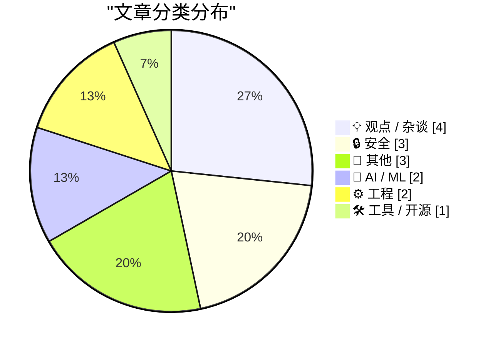
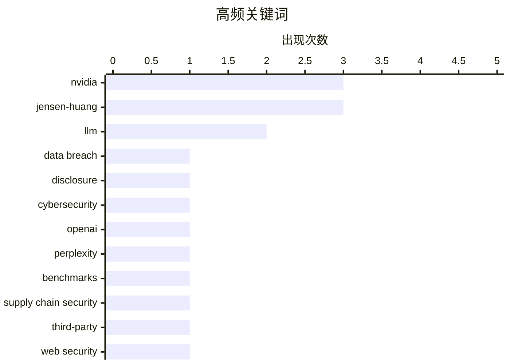

# 📰 Nov 23, 2026

> 来自 Karpathy 推荐的 92 个顶级技术博客，AI 精选 Top 15

## 📝 今日看点

今日技术圈聚焦于核心硬件巨头的权力回归与地缘政治博弈，黄仁勋重掌英伟达帅印凸显了顶尖人才在国家战略中的分量。与此同时，AI 领域正从单纯的性能竞赛转向精细化运营，苹果与 OpenAI 分别在商业化分级与模型评估标准上迈出关键一步。此外，数据安全披露中的责任规避与系统隐私权限的复杂化，再次引发了业界对企业透明度与用户权益保护的深度反思。

---

## 🏆 今日必读

🥇 **为什么数据泄露披露如此困难：来自与被黑公司数百封邮件的教训**

[Here's Why Data Breach Disclosure is so Hard: Lessons from Hundreds of Emails with Hacked Companies](https://www.troyhunt.com/heres-why-data-breach-disclosure-is-so-hard-lessons-from-hundreds-of-emails-with-hacked-companies/) — troyhunt.com · 9 小时前 · 🔒 安全

> 数据泄露披露过程充满挑战，Troy Hunt 通过分析与数百家被黑公司的往来邮件揭示了其中的阻碍。企业在面对安全研究员时往往表现出冷淡态度、故意拖延，并让法务和公关部门深度介入以规避责任。常见的负面模式包括将责任推卸给第三方供应商，或利用模糊的措辞淡化事件严重性。这种防御性姿态不仅损害了透明度，也增加了安全研究员协助修复漏洞的难度。作者认为，披露失败的核心在于企业文化和组织流程，而非单纯的技术问题。

💡 **为什么值得读**: 揭示了企业在面对安全危机时的真实心理博弈，是了解网络安全合规与公关困境的深度参考。

🏷️ data breach, disclosure, cybersecurity, LLM

🥈 **关于 OpenAI 困惑度数据披露的笔记**

[Notes on OpenAI's perplexity reveal](https://seangoedecke.com/notes-on-openais-perplexity-reveal/) — seangoedecke.com · 17 小时前 · 🤖 AI / ML

> OpenAI 近期发布了一张展示其历代模型困惑度（Perplexity）随时间变化的图表，引发了对模型智能演进的讨论。困惑度是衡量语言模型预测文本准确性的核心指标，数值越低代表模型对语言规律的掌握越深。图表显示从 GPT-3 到最新的 o1 模型，困惑度呈现出清晰且持续的下降趋势，验证了缩放法则（Scaling Laws）的有效性。作者认为 OpenAI 借此数据将“智能”与其模型性能直接挂钩，试图确立其在 AI 领域的领先地位。

💡 **为什么值得读**: 通过核心量化指标“困惑度”直观展现 AI 模型的进化轨迹，帮助读者理解大模型能力的增长逻辑。

🏷️ OpenAI, LLM, perplexity, benchmarks

🥉 **每周更新 531：Optimizely、脚本依赖与第三方风险**

[Weekly Update 531: Optimizely. Script Dependencies & Third Parties](https://www.troyhunt.com/weekly-update-531/) — troyhunt.com · 1 天前 · 🔒 安全

> 本周更新重点探讨了企业在第三方服务发生数据泄露时试图“外包责任”的现象，特别是涉及 Optimizely 等脚本依赖的情况。许多公司在通知中强调事故发生在第三方，意图以此减轻自身法律或声誉责任。然而，这种做法忽略了企业对用户数据的最终问责制，因为用户是与主品牌建立的信任关系。作者强调，脚本依赖和第三方集成已成为现代 Web 安全的薄弱环节，企业必须加强对供应链风险的管控。

💡 **为什么值得读**: 警示开发者和企业，第三方脚本集成不仅是技术问题，更是关乎品牌信任与法律责任的风险点。

🏷️ supply chain security, third-party, web security

---

## 📊 数据概览

| 扫描源 | 抓取文章 | 时间范围 | 精选 |
|:---:|:---:|:---:|:---:|
| 79/92 | 2425 篇 → 28 篇 | 48h | **15 篇** |

### 分类分布



### 高频关键词



<details>
<summary>📈 纯文本关键词图（终端友好）</summary>

```
nvidia                │ ████████████████████ 3
jensen-huang          │ ████████████████████ 3
llm                   │ █████████████░░░░░░░ 2
data breach           │ ███████░░░░░░░░░░░░░ 1
disclosure            │ ███████░░░░░░░░░░░░░ 1
cybersecurity         │ ███████░░░░░░░░░░░░░ 1
openai                │ ███████░░░░░░░░░░░░░ 1
perplexity            │ ███████░░░░░░░░░░░░░ 1
benchmarks            │ ███████░░░░░░░░░░░░░ 1
supply chain security │ ███████░░░░░░░░░░░░░ 1
```

</details>

### 🏷️ 话题标签

**nvidia**(3) · **jensen-huang**(3) · **llm**(2) · data breach(1) · disclosure(1) · cybersecurity(1) · openai(1) · perplexity(1) · benchmarks(1) · supply chain security(1) · third-party(1) · web security(1) · ceo(1) · apple intelligence(1) · ai(1) · siri(1) · icloud(1) · python(1) · wsgi(1) · ai-assisted(1)

---

## 💡 观点 / 杂谈

### 1. 政府监管与市场需求：以英伟达芯片为例

[Government Regulation and Demand](https://stratechery.com/2026/obituaries/) — **daringfireball.net** · 2 小时前 · ⭐ 23/30

> 本文探讨了政府监管与市场需求之间的复杂关系，特别是针对美国对华芯片出口的战略考量。作者引用 Ben Thompson 的观点指出，中国政府虽能通过行政手段控制供给侧（如大规模投资），但构建一个成熟的 AI 生态系统则属于需求侧，难度极大。文章认为，让中国继续依赖英伟达等美国公司的芯片，实际上有助于维持美国在技术生态上的主导地位。这种观点挑战了单纯通过禁运来遏制竞争的传统思维，强调了生态系统在长期竞争中的决定性作用。

🏷️ semiconductors, regulation, geopolitics

---

### 2. 多元化：债务陷阱

[Pluralistic: The Debt Trap (23 Nov 2026)](https://pluralistic.net/2026/11/23/grasshoppers-v-ants/) — **pluralistic.net** · 4 小时前 · ⭐ 21/30

> 本文探讨了现代经济与技术生态中模糊的因果关系如何演变为“债务陷阱”。通过对 Apple 禁用提及竞争对手的电子书、Facebook 对互联网的误导性宣传以及大众排放门（Dieselgate）等一系列案例的梳理，揭示了大型机构如何利用信息不对称获利。文章重点批判了科技巨头通过垄断地位和法律手段操纵市场、压制竞争的行为。作者认为，这种缺乏透明度的系统性腐败正导致社会整体利益受损，普通用户往往在不知不觉中承担了代价。

🏷️ tech policy, economics, internet culture

---

### 3. 犹豫不决时，就大干一场

[When in doubt, flail about](https://seangoedecke.com/when-in-doubt-flail-about/) — **seangoedecke.com** · 17 小时前 · ⭐ 20/30

> 在面对缺乏明确指导或未知技术难题的模糊情境时，采取“胡乱尝试”（Flailing）的策略往往比谨慎等待更有效。这种方法的核心在于通过快速、大量的低成本实验来获取反馈，从而打破僵局并收集关键信息。虽然这种做法可能带有一定的声誉风险，但在信息极度匮乏时，行动本身就是一种探测手段。与其在原地陷入“分析瘫痪”，不如通过快速迭代来缩小问题范围。作者建议在可控范围内进行这种探索，以最快速度找到正确的方向。

🏷️ productivity, career-growth, decision-making

---

### 4. 垃圾核心：算力霸权与反抗

[slopcore](https://geohot.github.io//blog/jekyll/update/2026/11/23/slopcore.html) — **geohot.github.io** · 1 天前 · ⭐ 20/30

> George Hotz 在其博客中猛烈抨击了当前对算力资源（如 GPU）的监管与限制，将其比作对人类进步的阻碍。他认为，那些打着“安全”旗号限制个人拥有大规模算力的机构，本质上是为了维持自身的垄断地位并防止竞争。文章呼吁反抗这种对算力的中心化控制，主张算力获取应当是自由且符合“自然规律”的。作者表达了对 21 世纪可能出现的算力独裁者的极度担忧，认为强制人类主导 AI 是一种违背自然的行为。

🏷️ AI regulation, GPU, compute, decentralization

---

## 🔒 安全

### 5. 为什么数据泄露披露如此困难：来自与被黑公司数百封邮件的教训

[Here's Why Data Breach Disclosure is so Hard: Lessons from Hundreds of Emails with Hacked Companies](https://www.troyhunt.com/heres-why-data-breach-disclosure-is-so-hard-lessons-from-hundreds-of-emails-with-hacked-companies/) — **troyhunt.com** · 9 小时前 · ⭐ 27/30

> 数据泄露披露过程充满挑战，Troy Hunt 通过分析与数百家被黑公司的往来邮件揭示了其中的阻碍。企业在面对安全研究员时往往表现出冷淡态度、故意拖延，并让法务和公关部门深度介入以规避责任。常见的负面模式包括将责任推卸给第三方供应商，或利用模糊的措辞淡化事件严重性。这种防御性姿态不仅损害了透明度，也增加了安全研究员协助修复漏洞的难度。作者认为，披露失败的核心在于企业文化和组织流程，而非单纯的技术问题。

🏷️ data breach, disclosure, cybersecurity, LLM

---

### 6. 每周更新 531：Optimizely、脚本依赖与第三方风险

[Weekly Update 531: Optimizely. Script Dependencies & Third Parties](https://www.troyhunt.com/weekly-update-531/) — **troyhunt.com** · 1 天前 · ⭐ 26/30

> 本周更新重点探讨了企业在第三方服务发生数据泄露时试图“外包责任”的现象，特别是涉及 Optimizely 等脚本依赖的情况。许多公司在通知中强调事故发生在第三方，意图以此减轻自身法律或声誉责任。然而，这种做法忽略了企业对用户数据的最终问责制，因为用户是与主品牌建立的信任关系。作者强调，脚本依赖和第三方集成已成为现代 Web 安全的薄弱环节，企业必须加强对供应链风险的管控。

🏷️ supply chain security, third-party, web security

---

### 7. MacOS 27.3 Beta 2 全新隐私控制体验周报

[★ A Week With the New Privacy Controls in MacOS 27.3 Beta 2](https://daringfireball.net/2026/11/a_week_with_the_new_privacy_controls_in_macos_273) — **daringfireball.net** · 1 天前 · ⭐ 24/30

> MacOS 27.3 Beta 2 引入了全新的隐私控制机制，重点改进了“完全磁盘访问权限”等权限的管理逻辑。作者在为期一周的测试中发现，这些新控件在提升系统安全性的同时，也带来了一些交互上的挑战。其中最显著的问题是菜单栏中持续显示的指示器，用于提醒用户有应用正在控制其他应用，这在视觉上造成了干扰。尽管存在 UI 细节上的争议，但整体安全架构的收紧显示了苹果进一步强化桌面端隐私保护的决心。

🏷️ macOS, privacy, Apple, operating system

---

## 📝 其他

### 8. 英伟达董事会恢复黄仁勋职务

[Nvidia Board Reinstates Jensen Huang](https://nvidianews.nvidia.com/news/nvidia-board-reinstates-jensen-huang-as-president-ceo-and-board-director) — **daringfireball.net** · 3 小时前 · ⭐ 25/30

> 英伟达（Nvidia）董事会宣布立即恢复黄仁勋（Jensen Huang）的总裁、首席执行官及董事会成员职务。在此之前，董事会与黄仁勋进行了一系列深入会谈，最终对其坦诚态度及领导能力表示满意并达成一致投票。此次回归平息了近期关于公司领导层变动的动荡，确保了英伟达在 AI 芯片市场的战略连续性。董事会在决策过程中还参考了公司高层及外部利益相关者的反馈，确认黄仁勋仍是领导公司的最佳人选。

🏷️ Nvidia, Jensen-Huang, CEO

---

### 9. Semafor：特朗普在黄仁勋复职前致电英伟达董事会表示支持

[Semafor: ‘Hours Before Huang’s Reinstatement, Trump Called Nvidia’s Board to Argue for His Return’](https://www.semafor.com/article/11/23/2026/jensen-huang-reinstated-as-nvidia-ceo) — **daringfireball.net** · 1 小时前 · ⭐ 23/30

> 据 Semafor 报道，美国总统特朗普在英伟达董事会投票恢复黄仁勋职务前数小时，曾亲自致电董事会成员表达支持。白宫通讯联络主任表示，此举旨在“保护美国的商业天才”，并对董事会的最终决定表示赞赏。这一罕见的政治干预行为凸显了英伟达在国家战略及 AI 竞赛中的核心地位。事件引发了外界对于政府与科技巨头之间关系边界，以及共和党传统市场干预立场的广泛讨论。

🏷️ Nvidia, corporate-governance, Jensen-Huang

---

### 10. 特朗普谈黄仁勋重返英伟达

[Donald Trump on Jensen Huang’s Reinstatement at Nvidia](https://truthsocial.com/@realDonaldTrump/posts/117666713950631493) — **daringfireball.net** · 29 分钟前 · ⭐ 20/30

> 本文记录了美国总统在社交媒体上声称自己促成了黄仁勋（Jensen Huang）重返英伟达（Nvidia）的“交易”。在接受 CNBC 长达 50 分钟的电话采访后，特朗普发文将这一变动归功于自己的干预。文章简要展示了政治力量试图介入顶级半导体公司高管变动的姿态。这一事件反映了科技巨头的人事变动已成为政治博弈和公开喊话的一部分。尽管背景充满争议，但这标志着算力霸权已成为国家战略的核心议题。

🏷️ Nvidia, Jensen-Huang, politics

---

## 🤖 AI / ML

### 11. 关于 OpenAI 困惑度数据披露的笔记

[Notes on OpenAI's perplexity reveal](https://seangoedecke.com/notes-on-openais-perplexity-reveal/) — **seangoedecke.com** · 17 小时前 · ⭐ 26/30

> OpenAI 近期发布了一张展示其历代模型困惑度（Perplexity）随时间变化的图表，引发了对模型智能演进的讨论。困惑度是衡量语言模型预测文本准确性的核心指标，数值越低代表模型对语言规律的掌握越深。图表显示从 GPT-3 到最新的 o1 模型，困惑度呈现出清晰且持续的下降趋势，验证了缩放法则（Scaling Laws）的有效性。作者认为 OpenAI 借此数据将“智能”与其模型性能直接挂钩，试图确立其在 AI 领域的领先地位。

🏷️ OpenAI, LLM, perplexity, benchmarks

---

### 12. 苹果记录 iCloud+ 付费等级对应的额外 Apple Intelligence 使用限制

[Apple Documents Extra Apple Intelligence Usage Limits Per iCloud+ Paid Tier](https://support.apple.com/en-us/127901) — **daringfireball.net** · 1 天前 · ⭐ 25/30

> 苹果公司明确了 Apple Intelligence 和 Siri AI 功能的使用限制，将其与 iCloud+ 付费订阅等级挂钩。虽然基础功能对支持设备免费开放，但涉及强大服务器端模型的特性（如智能照片编辑、Clean Up 等）将设有使用上限。从 2027 年的软件版本（如 27.3）开始，订阅更高档位 iCloud+ 的用户将获得更多的服务器资源访问权限。这一策略标志着苹果正式将 AI 能力转化为其服务业务的长期收入增长点。

🏷️ Apple Intelligence, AI, Siri, iCloud

---

## ⚙️ 工程

### 13. 离散傅里叶变换 (DFT) 笔记

[Notes on the discrete Fourier transform (DFT)](https://eli.thegreenplace.net/2026/notes-on-the-discrete-fourier-transform-dft/) — **eli.thegreenplace.net** · 1 天前 · ⭐ 23/30

> 本文深入探讨了离散傅里叶变换（DFT）的技术细节，这是数字信号处理（DSP）中处理有限长度离散信号的核心工具。相比于处理无限时长信号的离散时间傅里叶级数（DTFS）和变换（DTFT），DFT 更符合现实中计算机处理数据的逻辑。文章详细推导了 DFT 的数学定义，并解释了它如何将时域采样信号转换为频域表示。通过对比不同变换形式的适用场景，作者为读者构建了从理论信号分析到实际工程应用的知识桥梁。

🏷️ DFT, signal processing, mathematics, algorithms

---

### 14. 写好代码的秘诀：避免低级错误

[To code well, avoid blunders](https://seangoedecke.com/to-code-well-avoid-blunders/) — **seangoedecke.com** · 1 天前 · ⭐ 22/30

> 编程的核心秘诀并非追求天才般的灵光一现，而是避免灾难性的低级错误（Blunders）。在软件开发这类复杂系统中，稳定性和可预测性远比精巧的算法更重要。类比国际象棋，只要不白送棋子就能战胜大多数对手；同理，不写出导致系统崩溃或难以维护的代码就是卓越。开发者应将精力从“追求极致性能”转向“建立防御性编程习惯”和“减少认知负荷”。在编程这场“输家游戏”中，谁犯错少，谁就是最后的赢家。

🏷️ software-quality, programming-philosophy, best-practices

---

## 🛠 工具 / 开源

### 15. Muru：由 mod_wsgi 创始人打造的 AI 辅助 Rust 服务器

[Muru](https://simonwillison.net/2026/Nov/21/muru/) — **simonwillison.net** · 1 天前 · ⭐ 24/30

> Muru 是由 mod_wsgi 创始人 Graham Dumpleton 开发的全新高性能 Python Web 服务器，采用 Rust 语言编写并辅以 AI 辅助设计。它旨在为 ASGI 和 WSGI 协议提供最佳的生产与开发环境支持，解决 Python 应用在部署中的性能瓶颈。该项目融合了作者 20 年来在 Python Web 托管领域的深厚经验，强调易用性与极致性能的平衡。Muru 的出现为 Python 开发者在 Gunicorn 或 Uvicorn 之外提供了一个更现代、更稳健的选择。

🏷️ Python, WSGI, AI-assisted, web-server

---

*生成于 2026-11-23 17:51 | 扫描 79 源 → 获取 2425 篇 → 精选 15 篇*
*基于 [Hacker News Popularity Contest 2025](https://refactoringenglish.com/tools/hn-popularity/) RSS 源列表，由 [Andrej Karpathy](https://x.com/karpathy) 推荐*
