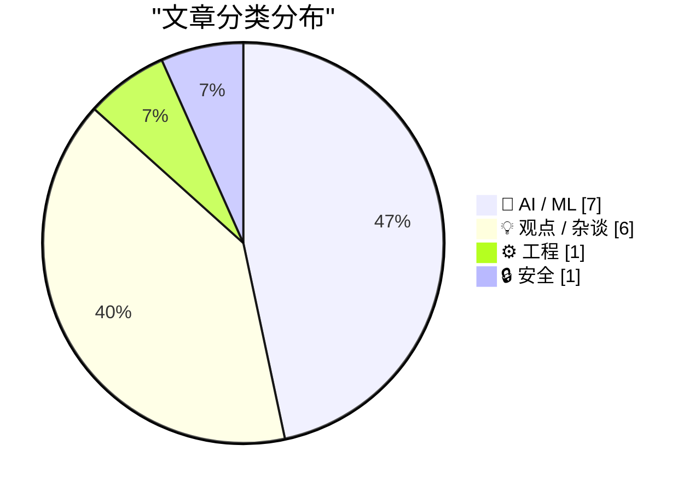
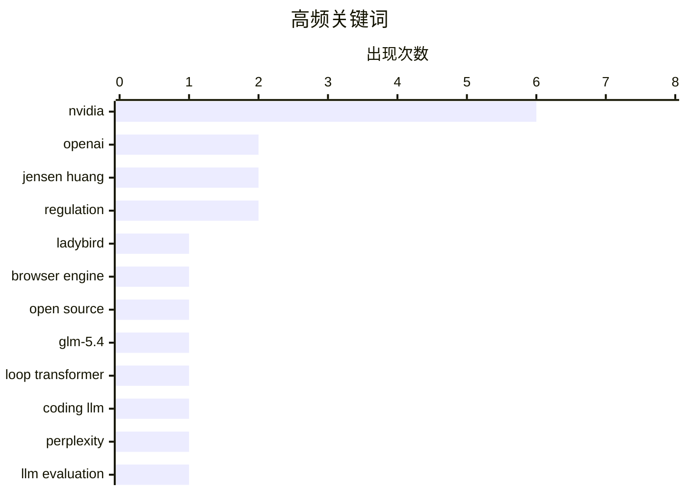

# 📰 Nov 24, 2026

> 来自 Karpathy 推荐的 92 个顶级技术博客，AI 精选 Top 15

## 📝 今日看点

今日技术圈的核心焦点在于英伟达领袖黄仁勋的戏剧性复职，尽管有政界游说与员工热烈欢迎，但市场对生成式 AI 的乐观情绪正因 Scaling Law 的边际效应递减而面临严峻挑战。与此同时，AI 底层架构持续演进，GLM-5.4 的循环 Transformer 与 GPT-6.2 的学术突破展示了模型智能的新高度。此外，Ladybird 浏览器的首发也标志着开发者正试图打破现代浏览器引擎的长期垄断，重塑互联网底层生态。

---

## 🏆 今日必读

🥇 **Ladybird 浏览器发布首个 Alpha 版本**

[Ladybird's first alpha release](https://simonwillison.net/2026/Nov/23/ladybird/) — simonwillison.net · 19 小时前 · ⚙️ 工程

> Ladybird 浏览器宣布发布首个 Alpha 版本，挑战现代浏览器市场由少数引擎垄断的局面。该项目极具野心，在 2026 年实现了包括 HTML 解析、CSS 引擎、布局系统、JavaScript 引擎乃至 WebAssembly 支持在内的几乎所有核心组件的自主开发。虽然核心架构自研，但仍集成了 HarfBuzz 处理文本、Skia 负责 2D 绘图、ffmpeg 处理视频以及 SQLite 管理数据。这标志着在 Chromium 和 WebKit 之外，开发者拥有了一个全新的、非商业驱动的跨平台浏览器选择。该版本的发布验证了从零构建现代浏览器引擎在技术上的可行性。

💡 **为什么值得读**: 见证 2026 年从零构建一个现代浏览器引擎的壮举，了解其技术栈选型与自研边界。

🏷️ Ladybird, browser engine, open source

🥈 **GLM-5.4：通过首个循环 Transformer 迈向通用编程**

[GLM-5.4: Toward Generalized Coding with Our First Loop Transformer](https://simonwillison.net/2026/Nov/23/glm-54/) — simonwillison.net · 17 小时前 · 🤖 AI / ML

> 中国 AI 实验室 Z.ai 发布了 GLM-5.4 模型，这是其首款采用循环 Transformer（Loop Transformer）架构的模型。与标准 Transformer 每层仅运行一次不同，循环架构允许一组权重共享的层进行多次迭代，不断优化前一轮的隐藏状态。这种设计旨在提升模型的泛化编程能力，通过参数复用实现更深层的逻辑推理。初步测试显示，该架构在处理复杂代码逻辑时表现出更强的鲁棒性。这种架构创新为大模型在有限参数下实现更高智能提供了新路径。

💡 **为什么值得读**: 关注国产大模型在架构创新（循环 Transformer）上的最新突破及其对编程能力的显著提升。

🏷️ GLM-5.4, Loop Transformer, coding LLM

🥉 **关于 OpenAI 披露困惑度趋势图的观察**

[Notes on OpenAI's perplexity reveal](https://seangoedecke.com/notes-on-openais-perplexity-reveal/) — seangoedecke.com · 1 天前 · 🤖 AI / ML

> OpenAI 发布了一张展示其历代模型困惑度（Perplexity）随时间演变的趋势图，揭示了模型智能增长的量化轨迹。困惑度作为衡量语言模型预测能力的核心指标，在从 GPT-3 到最新模型的演进中呈现出显著且持续的下降趋势。文章分析了这种性能提升背后的算力投入与算法优化关系，并探讨了困惑度下降与实际应用智能之间的关联。通过该图表，读者可以直观感受到 Scaling Law 在模型迭代中的具体体现。作者认为，尽管困惑度在下降，但如何将其转化为解决复杂问题的能力仍是核心挑战。

💡 **为什么值得读**: 通过 OpenAI 官方披露的底层指标，深度理解大模型进化背后的量化规律与 Scaling Law 的现状。

🏷️ OpenAI, perplexity, LLM evaluation

---

## 📊 数据概览

| 扫描源 | 抓取文章 | 时间范围 | 精选 |
|:---:|:---:|:---:|:---:|
| 83/92 | 2500 篇 → 49 篇 | 48h | **15 篇** |

### 分类分布



### 高频关键词



<details>
<summary>📈 纯文本关键词图（终端友好）</summary>

```
nvidia           │ ████████████████████ 6
openai           │ ███████░░░░░░░░░░░░░ 2
jensen huang     │ ███████░░░░░░░░░░░░░ 2
regulation       │ ███████░░░░░░░░░░░░░ 2
ladybird         │ ███░░░░░░░░░░░░░░░░░ 1
browser engine   │ ███░░░░░░░░░░░░░░░░░ 1
open source      │ ███░░░░░░░░░░░░░░░░░ 1
glm-5.4          │ ███░░░░░░░░░░░░░░░░░ 1
loop transformer │ ███░░░░░░░░░░░░░░░░░ 1
coding llm       │ ███░░░░░░░░░░░░░░░░░ 1
```

</details>

### 🏷️ 话题标签

**nvidia**(6) · **openai**(2) · **jensen huang**(2) · regulation(2) · ladybird(1) · browser engine(1) · open source(1) · glm-5.4(1) · loop transformer(1) · coding llm(1) · perplexity(1) · llm evaluation(1) · anthropic(1) · ai industry(1) · data breach(1) · disclosure(1) · security(1) · privacy(1) · gpt-6.2(1) · llm(1)

---

## 🤖 AI / ML

### 1. GLM-5.4：通过首个循环 Transformer 迈向通用编程

[GLM-5.4: Toward Generalized Coding with Our First Loop Transformer](https://simonwillison.net/2026/Nov/23/glm-54/) — **simonwillison.net** · 17 小时前 · ⭐ 27/30

> 中国 AI 实验室 Z.ai 发布了 GLM-5.4 模型，这是其首款采用循环 Transformer（Loop Transformer）架构的模型。与标准 Transformer 每层仅运行一次不同，循环架构允许一组权重共享的层进行多次迭代，不断优化前一轮的隐藏状态。这种设计旨在提升模型的泛化编程能力，通过参数复用实现更深层的逻辑推理。初步测试显示，该架构在处理复杂代码逻辑时表现出更强的鲁棒性。这种架构创新为大模型在有限参数下实现更高智能提供了新路径。

🏷️ GLM-5.4, Loop Transformer, coding LLM

---

### 2. 关于 OpenAI 披露困惑度趋势图的观察

[Notes on OpenAI's perplexity reveal](https://seangoedecke.com/notes-on-openais-perplexity-reveal/) — **seangoedecke.com** · 1 天前 · ⭐ 26/30

> OpenAI 发布了一张展示其历代模型困惑度（Perplexity）随时间演变的趋势图，揭示了模型智能增长的量化轨迹。困惑度作为衡量语言模型预测能力的核心指标，在从 GPT-3 到最新模型的演进中呈现出显著且持续的下降趋势。文章分析了这种性能提升背后的算力投入与算法优化关系，并探讨了困惑度下降与实际应用智能之间的关联。通过该图表，读者可以直观感受到 Scaling Law 在模型迭代中的具体体现。作者认为，尽管困惑度在下降，但如何将其转化为解决复杂问题的能力仍是核心挑战。

🏷️ OpenAI, perplexity, LLM evaluation

---

### 3. 突发：OpenAI 与 Anthropic 员工陷入恐慌

[BREAKING: Employees at OpenAI and Anthropic are panicking](https://garymarcus.substack.com/p/breaking-employees-at-openai-and) — **garymarcus.substack.com** · 1 小时前 · ⭐ 26/30

> 知名 AI 批评家 Gary Marcus 披露 OpenAI 和 Anthropic 的员工正陷入集体恐慌，且这种情绪并非源于股价波动。恐慌的核心在于大模型在 Scaling Law 上的边际效应递减，以及新一代模型在性能提升上可能未达预期。内部人员对当前技术路线能否实现通用人工智能（AGI）产生了前所未有的怀疑。这种情绪蔓延反映了顶级实验室在面对算力成本激增与智能增长放缓双重压力下的焦虑。这一现象暗示了 AI 行业可能正面临从“疯狂扩张”到“遭遇瓶颈”的转折点。

🏷️ OpenAI, Anthropic, AI industry

---

### 4. GPT 6.2 Astra 破解历史谜题

[GPT 6.2 Astra Solves a Historical Mystery](https://simonwillison.net/2026/Nov/24/astra-historical-mystery/) — **simonwillison.net** · 31 分钟前 · ⭐ 25/30

> 历史学教授 Mark Humphries 展示了 GPT-6.2 Astra 在历史研究中的惊人应用：成功识别了耶鲁大学拜内克图书馆馆藏的一本 1808 年匿名素描本的作者。在仅需极少提示的情况下，该模型通过分析素描本中的视觉线索与海量历史文献进行交叉比对，自主完成了复杂的溯源工作。这一案例证明了多模态大模型在处理模糊历史资料和学术发现方面的巨大潜力。它不仅极大地提高了研究效率，还为解决长期悬而未决的学术谜题提供了新路径。这预示着 AI 将成为未来人文学科研究的标配工具。

🏷️ GPT-6.2, LLM, historical research

---

### 5. 英伟达董事会恢复黄仁勋职务

[Nvidia Board Reinstates Jensen Huang](https://nvidianews.nvidia.com/news/nvidia-board-reinstates-jensen-huang-as-president-ceo-and-board-director) — **daringfireball.net** · 1 天前 · ⭐ 25/30

> 英伟达董事会宣布一致投票通过，立即恢复黄仁勋（Jensen Huang）的总裁、首席执行官及董事会成员职务。此前黄仁勋曾经历短暂的离职或变动，董事会在与其进行系列深入讨论后，对其坦诚态度及领导能力表示完全认可。此次回归旨在稳定公司在 AI 芯片市场的领导地位，并平息外界对管理层动荡的疑虑。这一决策得到了公司高级管理层及主要投资方的广泛支持。英伟达股价随之做出反应，显示出市场对这位创始人回归的正面预期。

🏷️ Nvidia, Jensen Huang, CEO

---

### 6. 突发：黄仁勋回归对生成式 AI 行业的提振效应似乎难以为继

[Breaking: When it comes to generative AI, the bump from rehiring Jensen doesn’t appear to be holding](https://garymarcus.substack.com/p/breaking-when-it-comes-to-generative) — **garymarcus.substack.com** · 2 小时前 · ⭐ 25/30

> 尽管黄仁勋重掌英伟达帅印，但市场对生成式 AI 行业的乐观情绪并未因此持久。最新数据显示，英伟达股价在短暂回升后动力减弱，而另一 AI 巨头 Anthropic 的股价已跌破其 IPO 发行价。这种市场表现反映了投资者对 AI 泡沫可能破裂的担忧，以及对高估值公司盈利能力的重新审视。文章指出，单纯的人事变动已不足以对冲行业整体面临的增长放缓压力。资本市场正从“盲目崇拜”转向“业绩驱动”，这对所有 AI 独角兽都是严峻考验。

🏷️ Generative AI, Nvidia, market trends

---

### 7. Levent Alpöge 在 Claude 协助下证明了黎曼猜想！这意味着什么？

[Levent Alpöge has solved the Riemann Hypothesis with help of Claude! What does it mean?](https://garymarcus.substack.com/p/levent-alpoge-has-solved-the-riemann) — **garymarcus.substack.com** · 1 天前 · ⭐ 24/30

> 数学家 Levent Alpöge 声称在 Anthropic 的 AI 模型 Claude 的协助下证明了黎曼猜想，这一数学界的“圣杯”级突破引发了广泛关注。文章分析了 AI 在处理高度抽象的数学逻辑和形式化验证中的潜力，同时也探讨了为何此类科学突破未能立即转化为市场信心。Gary Marcus 借此审视了 AI 辅助科研的真实边界，以及公众对 AI 产出结果的信任危机。尽管证明尚需同行评审，但这标志着 AI 在纯数学领域的应用进入了新阶段。

🏷️ Claude, Riemann Hypothesis, AI for Science, Mathematics

---

## 💡 观点 / 杂谈

### 8. 黄仁勋重返工作岗位

[Jensen Huang Returns to Work](https://www.businessinsider.com/jensen-huang-returns-to-nvidia-hq-im-terribly-sorry-2026-11) — **daringfireball.net** · 17 小时前 · ⭐ 24/30

> 黄仁勋正式回到英伟达总部上班，现场员工聚集在总部大厅高喊其名字以示欢迎。有趣的是，他当天并未穿着标志性的黑色皮夹克，而是换上了一件海军蓝棉大衣，并感言“这是我工作的第一天”。现场气氛热烈，员工们争相目睹这位创始人的回归，显示出其在公司内部极高的威望。这一象征性的时刻标志着英伟达内部动荡期的正式结束。对于英伟达而言，创始人的回归不仅是权力的复位，更是企业文化和士气的重塑。

🏷️ Nvidia, Jensen Huang, leadership

---

### 9. Semafor：特朗普在黄仁勋复职前曾致电英伟达董事会游说

[Semafor: ‘Hours Before Huang’s Reinstatement, Trump Called Nvidia’s Board to Argue for His Return’](https://www.semafor.com/article/11/23/2026/jensen-huang-reinstated-as-nvidia-ceo) — **daringfireball.net** · 1 天前 · ⭐ 24/30

> 据 Semafor 报道，在英伟达董事会决定恢复黄仁勋职务的前几小时，美国总统特朗普曾亲自致电董事会为其游说。白宫通讯联络主任证实了这一干预行为，称必须“保护我们的天才”，并认为董事会做出了正确决定。这一事件凸显了英伟达在国家 AI 战略中的核心地位，也反映了政治力量对顶级科技公司治理的直接影响力。这种政府层面的介入在半导体行业历史上极为罕见，引发了关于企业独立性与国家利益之间关系的广泛讨论。这表明英伟达已成为地缘政治博弈中的关键棋子。

🏷️ Nvidia, corporate governance, Trump

---

### 10. 政府监管与市场需求：英伟达的对华博弈

[Government Regulation and Demand](https://stratechery.com/2026/obituaries/) — **daringfireball.net** · 1 天前 · ⭐ 24/30

> 美国对华芯片出口管制与英伟达（Nvidia）的市场地位是当前地缘政治的核心。文章探讨了通过让中国依赖美国芯片生态系统来维持技术领先的策略，指出中国政府虽能通过行政手段控制供应端，但难以在短期内构建起类似 CUDA 的软件与开发者生态。这种“需求侧”的锁定效应比单纯的硬件领先更具战略价值。作者认为，切断供应可能反而迫使中国加速自主生态的成熟，维持某种程度的依赖或许是更稳妥的博弈手段。

🏷️ semiconductors, regulation, China, Nvidia

---

### 11. Pluralistic：免费午餐（2026年11月24日）

[Pluralistic: Free lunches (24 Nov 2026)](https://pluralistic.net/2026/11/24/move-fast-break-kings/) — **pluralistic.net** · 5 小时前 · ⭐ 23/30

> 科技巨头的利润空间往往建立在对他人的剥削和市场机会的挤压之上，这种“免费午餐”模式正在面临挑战。文章通过“快速行动，打破王权”的视角，批判了科技行业通过 DRM（数字版权管理）和垄断手段获取超额利润的行为。内容涵盖了从迪士尼排队系统建模到唱片工业版权诉讼等多个案例，揭示了财富积累背后的分配不公。作者呼吁通过技术手段和政策干预，将这些被垄断的利润重新转化为公众的创新机会。

🏷️ tech economics, DRM, digital rights

---

### 12. “黄仁勋门”会拉总统下水吗？

[Could Jensengate take down the President?](https://garymarcus.substack.com/p/could-jensengate-take-down-the-president) — **garymarcus.substack.com** · 22 小时前 · ⭐ 23/30

> 围绕英伟达（Nvidia）及其首席执行官黄仁勋的争议正演变为一场可能波及美国高层的政治风暴。文章推测了英伟达在政府决策、芯片出口政策以及市场操纵方面的潜在丑闻，以及这些因素如何成为新一届国会的调查重点。Gary Marcus 指出，当一家科技巨头的利益与国家安全和经济命脉深度绑定时，其内部危机极易转化为政治危机。这种政商关系的失衡可能导致严重的法律后果，甚至威胁到现任政府的稳定性。

🏷️ AI policy, Nvidia, regulation

---

### 13. Pluralistic：债务陷阱（2026年11月23日）

[Pluralistic: The Debt Trap (23 Nov 2026)](https://pluralistic.net/2026/11/23/grasshoppers-v-ants/) — **pluralistic.net** · 1 天前 · ⭐ 22/30

> 模糊的因果关系是现代经济和社会体系崩溃的诱因，企业利用这种复杂性构建了隐蔽的“债务陷阱”。文章探讨了从 Facebook 对网页端的操纵到苹果公司禁止提及竞争对手的电子书等一系列侵权行为。通过分析“柴油门”丑闻和特朗普大学等案例，作者指出权势阶层如何利用信息不对称来逃避责任。这种系统性的欺诈不仅损害了消费者利益，也破坏了市场的公平竞争基础。

🏷️ economics, causality, policy

---

## ⚙️ 工程

### 14. Ladybird 浏览器发布首个 Alpha 版本

[Ladybird's first alpha release](https://simonwillison.net/2026/Nov/23/ladybird/) — **simonwillison.net** · 19 小时前 · ⭐ 29/30

> Ladybird 浏览器宣布发布首个 Alpha 版本，挑战现代浏览器市场由少数引擎垄断的局面。该项目极具野心，在 2026 年实现了包括 HTML 解析、CSS 引擎、布局系统、JavaScript 引擎乃至 WebAssembly 支持在内的几乎所有核心组件的自主开发。虽然核心架构自研，但仍集成了 HarfBuzz 处理文本、Skia 负责 2D 绘图、ffmpeg 处理视频以及 SQLite 管理数据。这标志着在 Chromium 和 WebKit 之外，开发者拥有了一个全新的、非商业驱动的跨平台浏览器选择。该版本的发布验证了从零构建现代浏览器引擎在技术上的可行性。

🏷️ Ladybird, browser engine, open source

---

## 🔒 安全

### 15. 数据泄露披露为何如此困难：来自数百封企业沟通邮件的教训

[Here's Why Data Breach Disclosure is so Hard: Lessons from Hundreds of Emails with Hacked Companies](https://www.troyhunt.com/heres-why-data-breach-disclosure-is-so-hard-lessons-from-hundreds-of-emails-with-hacked-companies/) — **troyhunt.com** · 1 天前 · ⭐ 26/30

> 网络安全专家 Troy Hunt 通过分析与数百家被黑客攻击公司的往来邮件，揭示了数据泄露披露过程中的重重阻碍。研究发现，企业在面对泄露时普遍存在防御性姿态、故意拖延以及法律团队过度介入等负面模式。这些邮件暴露出企业更倾向于掩盖问题而非保护用户，导致披露过程充满敌意且缺乏透明度。文章总结了企业在危机沟通中的典型错误，并指出这种“法律优先”的策略往往会适得其反。对于安全从业者而言，这些真实案例提供了宝贵的合规与沟通反面教材。

🏷️ data breach, disclosure, security, privacy

---

*生成于 2026-11-24 17:25 | 扫描 83 源 → 获取 2500 篇 → 精选 15 篇*
*基于 [Hacker News Popularity Contest 2025](https://refactoringenglish.com/tools/hn-popularity/) RSS 源列表，由 [Andrej Karpathy](https://x.com/karpathy) 推荐*
