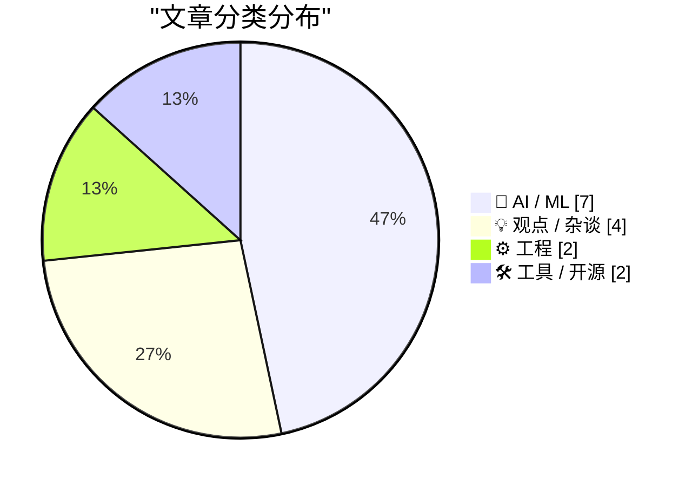
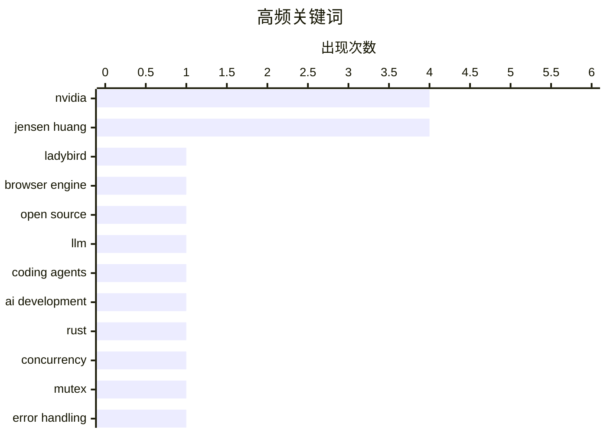

# 📰 Nov 25, 2026

> 来自 Karpathy 推荐的 92 个顶级技术博客，AI 精选 Top 15

## 📝 今日看点

今日技术圈的核心焦点在于 NVIDIA 领袖黄仁勋的重归及其对全球 AI 算力霸权的深远影响，这一变动甚至惊动白宫，凸显了算力巨头在国家战略中的核心地位。与此同时，AI 领域正迎来架构与范式的双重革新，从循环 Transformer 架构的突破到“智能体体验”对传统交互的重塑，预示着通用智能正加速迈向新阶段。此外，独立浏览器引擎 Ladybird 的首发与 Rust 核心机制的深度博弈，反映出底层工程界对技术自主权与系统健壮性的不懈追求。

---

## 🏆 今日必读

🥇 **Ladybird 浏览器发布首个 Alpha 版本**

[Ladybird's first alpha release](https://simonwillison.net/2026/Nov/23/ladybird/) — simonwillison.net · 1 天前 · ⚙️ 工程

> Ladybird 浏览器发布了首个 Alpha 版本，这是一个在 2026 年极具野心的纯手工打造项目。该浏览器独立实现了 HTML 解析、CSS 引擎、布局系统、JavaScript 引擎甚至 WebAssembly 支持。虽然仍依赖 Skia 进行 2D 绘图、HarfBuzz 进行文本整形以及 ffmpeg 处理视频，但核心渲染逻辑完全自研。项目旨在打破现有浏览器市场的垄断，展示了从零构建现代 Web 引擎的可能性。目前该版本已可供开发者测试其跨平台兼容性和渲染性能。

💡 **为什么值得读**: 了解在 Chromium 统治时代，一个完全独立自研的现代浏览器引擎是如何从零构建并达到 Alpha 阶段的。

🏷️ Ladybird, browser engine, open source

🥈 **过去 12 个月 LLM 发展的三个关键拐点**

[Three LLM inflection points in twelve months](https://simonwillison.net/2026/Nov/24/llm-inflection-points/) — simonwillison.net · 17 小时前 · 🤖 AI / ML

> Simon Willison 在 AI Engineer Code Summit 上总结了过去一年内 LLM 和编程智能体经历的三个关键拐点。文章深入探讨了模型在推理能力、长上下文处理以及工具调用效率方面的飞跃。这些拐点不仅改变了开发者与代码交互的方式，也重新定义了自动化编程的边界。通过对这些技术演进的分析，作者揭示了 AI 辅助编程从简单的代码补全向复杂系统架构设计的转变。这种演进速度预示着软件工程范式正在发生根本性重构。

💡 **为什么值得读**: 资深技术专家对过去一年 AI 编程领域核心技术演进的深度复盘，有助于把握行业趋势。

🏷️ LLM, coding agents, AI development

🥉 **废除 Rust 的锁中毒机制**

[Abolish Lock Poisoning](https://lucumr.pocoo.org/2026/11/25/poisoning/) — lucumr.pocoo.org · 17 小时前 · ⚙️ 工程

> 文章探讨了 Rust 语言中争议性的“互斥锁中毒”（Mutex Poisoning）机制，即当线程在持有 std::sync::Mutex 时发生 panic，该锁会被标记为中毒。这一设计初衷是为了防止后续线程访问到可能处于不一致状态的数据，但作者认为这增加了代码处理的复杂性。在现代 Rust 实践中，这种机制往往导致开发者不得不处理繁琐的 PoisonError，而实际获益有限。作者主张废除或重新设计该特性，以简化并发编程模型并提升开发体验。

💡 **为什么值得读**: 深入探讨 Rust 标准库设计中的历史遗留问题，适合对并发安全和语言演进感兴趣的开发者。

🏷️ Rust, concurrency, mutex, error handling

---

## 📊 数据概览

| 扫描源 | 抓取文章 | 时间范围 | 精选 |
|:---:|:---:|:---:|:---:|
| 81/92 | 2471 篇 → 46 篇 | 48h | **15 篇** |

### 分类分布



### 高频关键词



<details>
<summary>📈 纯文本关键词图（终端友好）</summary>

```
nvidia         │ ████████████████████ 4
jensen huang   │ ████████████████████ 4
ladybird       │ █████░░░░░░░░░░░░░░░ 1
browser engine │ █████░░░░░░░░░░░░░░░ 1
open source    │ █████░░░░░░░░░░░░░░░ 1
llm            │ █████░░░░░░░░░░░░░░░ 1
coding agents  │ █████░░░░░░░░░░░░░░░ 1
ai development │ █████░░░░░░░░░░░░░░░ 1
rust           │ █████░░░░░░░░░░░░░░░ 1
concurrency    │ █████░░░░░░░░░░░░░░░ 1
```

</details>

### 🏷️ 话题标签

**nvidia**(4) · **jensen huang**(4) · **ladybird**(1) · browser engine(1) · open source(1) · llm(1) · coding agents(1) · ai development(1) · rust(1) · concurrency(1) · mutex(1) · error handling(1) · ai safety(1) · superintelligence(1) · recursive self-improvement(1) · ai economy(1) · glm-5.4(1) · transformer(1) · coding model(1) · leadership(1)

---

## 🤖 AI / ML

### 1. 过去 12 个月 LLM 发展的三个关键拐点

[Three LLM inflection points in twelve months](https://simonwillison.net/2026/Nov/24/llm-inflection-points/) — **simonwillison.net** · 17 小时前 · ⭐ 26/30

> Simon Willison 在 AI Engineer Code Summit 上总结了过去一年内 LLM 和编程智能体经历的三个关键拐点。文章深入探讨了模型在推理能力、长上下文处理以及工具调用效率方面的飞跃。这些拐点不仅改变了开发者与代码交互的方式，也重新定义了自动化编程的边界。通过对这些技术演进的分析，作者揭示了 AI 辅助编程从简单的代码补全向复杂系统架构设计的转变。这种演进速度预示着软件工程范式正在发生根本性重构。

🏷️ LLM, coding agents, AI development

---

### 2. 回应针对“递归自我改进”的质疑

[Responding to objections to recursive self-improvement](https://www.dwarkesh.com/p/rsiobjections) — **dwarkesh.com** · 19 小时前 · ⭐ 26/30

> Dwarkesh Patel 针对人工智能“递归自我改进”的常见质疑进行了系统性回应。文章分析了怀疑论者关于硬件瓶颈、算法收益递减以及安全性挑战的核心论点。作者通过逻辑推演指出，即便存在物理限制，AI 优化自身代码和架构的能力仍可能导致智能水平的指数级跃升。结论强调，不应低估超级智能通过自我迭代实现技术突破的速度。这种自我改进机制被认为是通往超人工智能（ASI）的关键路径。

🏷️ AI safety, superintelligence, recursive self-improvement

---

### 3. “经济已成‘人质’：黄仁勋与 NVIDIA 的统治力”

[‘The Economy Is a Hostage Situation’](https://www.theatlantic.com/technology/2026/11/ai-hostage-economy-nvidia-huang/689552/?gift=aQyUJR7AIw1mJWdQ6Ed6yMQrokNaYAmgr0aVusAzQCY&amp;) — **daringfireball.net** · 21 小时前 · ⭐ 25/30

> 《大西洋月刊》分析了 NVIDIA 及其首席执行官黄仁勋对当前全球 AI 经济的绝对统治力，将其形容为一种“人质状态”。NVIDIA 不仅提供核心算力硬件，还通过大规模投资支撑着整个 AI 生态系统，使得黄仁勋个人成为了市场信心的支柱。文章指出，如果失去黄仁勋的领导，可能会引发投资者恐慌并导致 AI 泡沫破裂。这种高度依赖单一企业和领袖的局面，反映了美国技术领先地位背后的脆弱性。NVIDIA 已不仅仅是一家公司，而是整个 AI 产业的“外骨骼”。

🏷️ Nvidia, AI economy, Jensen Huang

---

### 4. GLM-5.4：首款循环 Transformer 架构迈向通用编程

[GLM-5.4: Toward Generalized Coding with Our First Loop Transformer](https://simonwillison.net/2026/Nov/23/glm-54/) — **simonwillison.net** · 1 天前 · ⭐ 24/30

> 智谱 AI（Z.ai）发布了 GLM-5.4 模型，这是其首款采用“循环 Transformer”（Loop Transformer）架构的模型。与标准 Transformer 每层仅运行一次不同，该架构允许一组权重共享的层进行多次迭代，不断精炼前一轮的隐藏状态。这种设计在保持参数量精简的同时，显著提升了模型在复杂编程任务中的推理深度。实验表明，循环机制有助于模型更好地处理长程逻辑依赖，迈向更通用的自动化编程。该模型标志着国产大模型在架构创新上取得了重要突破。

🏷️ GLM-5.4, transformer, coding model

---

### 5. 黄仁勋重返 NVIDIA 总部上班

[Jensen Huang Returns to Work](https://www.businessinsider.com/jensen-huang-returns-to-nvidia-hq-im-terribly-sorry-2026-11) — **daringfireball.net** · 1 天前 · ⭐ 24/30

> NVIDIA 首席执行官黄仁勋在经历一段缺席后重返公司总部，受到员工的热烈欢迎。现场员工高呼其名，黄仁勋未穿标志性的黑色皮夹克，而是穿着一件海军蓝棉大衣现身。他感言这是他的“工作第一天”，标志着这位 AI 巨头掌舵人的正式回归。此次回归对稳定 NVIDIA 内部士气及维持市场对 AI 产业的信心具有重要的象征意义。视频显示现场气氛极度狂热，反映了其在公司内部无可替代的领袖地位。

🏷️ Nvidia, Jensen Huang, Leadership

---

### 6. 你试过像智能体一样使用你的软件吗？

[Have You Tried Using Your Agent?](https://blog.jim-nielsen.com/2026/have-you-tried-your-agent/) — **blog.jim-nielsen.com** · -119 分钟前 · ⭐ 24/30

> 作者 Jim Nielsen 探讨了软件开发中“智能体体验”（AX）与“人类体验”之间的失衡问题。他观察到，随着 AI 智能体的普及，开发者越来越倾向于构建易于机器抓取和理解的接口，却忽略了真实用户的直观感受。文章担忧软件正在变得对机器人友好，而对人类而言却愈发难以使用。作者呼吁回归以人为本的设计原则，提醒开发者不要在追求自动化效率的过程中牺牲了软件的可访问性。这种趋势可能导致未来的互联网变成一个只有机器在交互的荒凉之地。

🏷️ AI agents, UX, AX

---

### 7. GPT 6.2 Astra 破解历史谜团

[GPT 6.2 Astra Solves a Historical Mystery](https://simonwillison.net/2026/Nov/24/astra-historical-mystery/) — **simonwillison.net** · 1 天前 · ⭐ 22/30

> 历史学教授 Mark Humphries 展示了 GPT-6.2 Astra 在学术研究中的惊人潜力。该模型在仅需极少提示的情况下，自主识别出了耶鲁大学拜内克图书馆馆藏的一本 1808 年匿名素描本的作者。这一案例证明了下一代大模型在处理模糊历史文献、跨模态识别和自主推理方面的显著进步。它不仅是一个技术演示，更预示着 AI 将从简单的辅助工具进化为能够进行深度档案发掘的“自主研究员”。

🏷️ GPT-6.2, historical research, LLM application

---

## 💡 观点 / 杂谈

### 8. 白宫紧急推动黄仁勋回归 NVIDIA

[I Told You to Bet the Over](https://www.wsj.com/business/nvidia-jensen-huang-white-house-9ad03961?st=HzeUyV) — **daringfireball.net** · 21 小时前 · ⭐ 23/30

> 《华尔街日报》披露了白宫在 48 小时内紧急介入，推动 NVIDIA 首席执行官黄仁勋回归的幕后细节。包括总统和副总统在内的政府高层直接参与了与董事会的沟通，旨在挽救这位对美国科技领先地位至关重要的领袖。特朗普在采访中表示市场对此反应非常积极，证实了政府对半导体和 AI 核心企业稳定性的高度关注。这一事件凸显了顶级科技公司高管变动已上升至国家安全和经济稳定的战略高度。政府的干预反映了 NVIDIA 在当前地缘政治竞争中的核心地位。

🏷️ Nvidia, Jensen Huang, White House

---

### 9. 纽约对抗汽车“平庸化”：各州修补国会失误的蓝图

[Pluralistic: New York vs auto-enshittification (25 Nov 2026)](https://pluralistic.net/2026/11/25/empire-state-strikes-back/) — **pluralistic.net** · 3 小时前 · ⭐ 23/30

> 汽车制造商正通过软件锁定和订阅服务将车辆变为“带轮子的监控器”，这种“平庸化”（enshittification）趋势剥夺了车主的所有权。纽约州正通过地方立法手段对抗这种趋势，为其他州在联邦立法缺位时保护消费者权益提供了实战蓝图。文章深入探讨了“自制 DRM”、特斯拉金融体系以及软件限制如何损害维修权。作者认为，地方立法是打破科技巨头垄断、恢复硬件所有权的关键路径。这种州级别的反击将迫使制造商在全国范围内改变其封闭的生态策略。

🏷️ enshittification, tech policy, automotive, consumer rights

---

### 10. 特朗普式的爱国主义：英伟达与地缘政治

[Patriotism, Trump-Style](https://nypost.com/2026/11/23/us-news/trump-suggests-jensen-huang-could-have-moved-to-china-if-not-reinstated-as-nvidia-ceo-sex-sells-fellas/) — **daringfireball.net** · 18 小时前 · ⭐ 22/30

> 特朗普在接受 CNBC 采访时声称，如果不是因为他的干预，英伟达（Nvidia）首席执行官黄仁勋可能会转而领导中国的 AI 产业。他强调黄仁勋虽然出生于台湾，但“流着那里的血”，暗示了地缘政治背景下人才流动的风险。这一言论反映了美国政府将半导体巨头视为国家安全核心资产的激进立场。文章通过这一事件探讨了技术领袖在政治博弈中面临的忠诚度质疑与监管压力，以及 AI 产业如何被深度卷入国家竞争。

🏷️ Nvidia, Jensen Huang, Geopolitics

---

### 11. 缺陷加速主义：科技泡沫下的疲惫反思

[Defective Accelerationism](https://www.wheresyoured.at/defective-accelerationism/) — **wheresyoured.at** · 22 小时前 · ⭐ 22/30

> 科技评论家 Ed Zitron 提出了“缺陷加速主义”的概念，批判当前科技行业盲目追求速度而忽视产品质量和伦理的现状。文章指出，这种加速并非基于真正的技术突破，而是由资本焦虑和过度承诺驱动的虚假繁荣。作者认为，这种模式不仅导致了开发者和评论者的极度疲惫，更制造了大量无法解决实际问题的“缺陷”技术。核心观点在于，当前的科技轨迹正处于一种不可持续的自我消耗状态，亟需回归理性和实质性创新。

🏷️ accelerationism, AI culture, tech industry

---

## ⚙️ 工程

### 12. Ladybird 浏览器发布首个 Alpha 版本

[Ladybird's first alpha release](https://simonwillison.net/2026/Nov/23/ladybird/) — **simonwillison.net** · 1 天前 · ⭐ 27/30

> Ladybird 浏览器发布了首个 Alpha 版本，这是一个在 2026 年极具野心的纯手工打造项目。该浏览器独立实现了 HTML 解析、CSS 引擎、布局系统、JavaScript 引擎甚至 WebAssembly 支持。虽然仍依赖 Skia 进行 2D 绘图、HarfBuzz 进行文本整形以及 ffmpeg 处理视频，但核心渲染逻辑完全自研。项目旨在打破现有浏览器市场的垄断，展示了从零构建现代 Web 引擎的可能性。目前该版本已可供开发者测试其跨平台兼容性和渲染性能。

🏷️ Ladybird, browser engine, open source

---

### 13. 废除 Rust 的锁中毒机制

[Abolish Lock Poisoning](https://lucumr.pocoo.org/2026/11/25/poisoning/) — **lucumr.pocoo.org** · 17 小时前 · ⭐ 26/30

> 文章探讨了 Rust 语言中争议性的“互斥锁中毒”（Mutex Poisoning）机制，即当线程在持有 std::sync::Mutex 时发生 panic，该锁会被标记为中毒。这一设计初衷是为了防止后续线程访问到可能处于不一致状态的数据，但作者认为这增加了代码处理的复杂性。在现代 Rust 实践中，这种机制往往导致开发者不得不处理繁琐的 PoisonError，而实际获益有限。作者主张废除或重新设计该特性，以简化并发编程模型并提升开发体验。

🏷️ Rust, concurrency, mutex, error handling

---

## 🛠 工具 / 开源

### 14. 源码控制周报：2026 年 11 月 25 日

[This Week in Source Control: 25 November 2026](https://nesbitt.io/2026/11/25/this-week-in-source-control.html) — **nesbitt.io** · 7 小时前 · ⭐ 24/30

> 本周源码控制周报汇总了 2026 年 11 月下旬版本控制系统和代码托管平台的最新动态。内容涵盖了 Git 及相关工具的新版本发布、关键安全公告以及行业内的深度技术文章。报告重点关注了代码仓库安全性的提升以及分布式协作流程的优化。对于需要跟踪版本控制技术演进的开发者和运维工程师来说，这是获取一手资讯的快捷渠道。通过这些更新，开发者可以了解如何利用最新的工具特性来提升团队的交付效率。

🏷️ git, version control, software-development

---

### 15. datasette-charts 0.2a0 发布：支持 AI 自动绘图

[datasette-charts 0.2a0](https://simonwillison.net/2026/Nov/24/datasette-charts/) — **simonwillison.net** · 1 天前 · ⭐ 21/30

> Datasette 发布了其可视化插件 datasette-charts 的 0.2a0 版本。该版本最大的亮点是集成了 Datasette Agent，允许用户通过自然语言对话直接请求生成图表。系统利用底层的图表建议和生成逻辑，将复杂的 SQL 查询结果自动转化为直观的可视化展示。这一更新显著降低了数据探索的门槛，实现了从“对话”到“可视化分析”的无缝衔接。开发者可以通过简单的配置，让数据库具备智能交互和自动绘图能力。

🏷️ Datasette, data visualization, plugin

---

*生成于 2026-11-25 17:01 | 扫描 81 源 → 获取 2471 篇 → 精选 15 篇*
*基于 [Hacker News Popularity Contest 2025](https://refactoringenglish.com/tools/hn-popularity/) RSS 源列表，由 [Andrej Karpathy](https://x.com/karpathy) 推荐*
