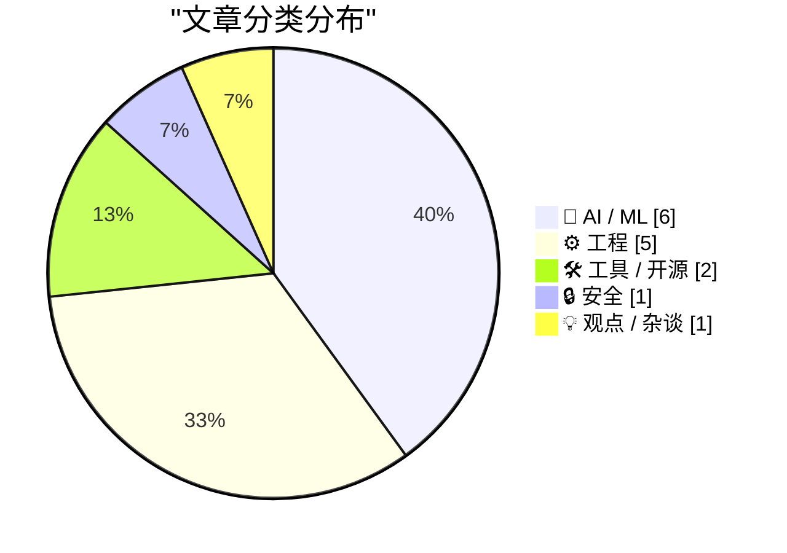
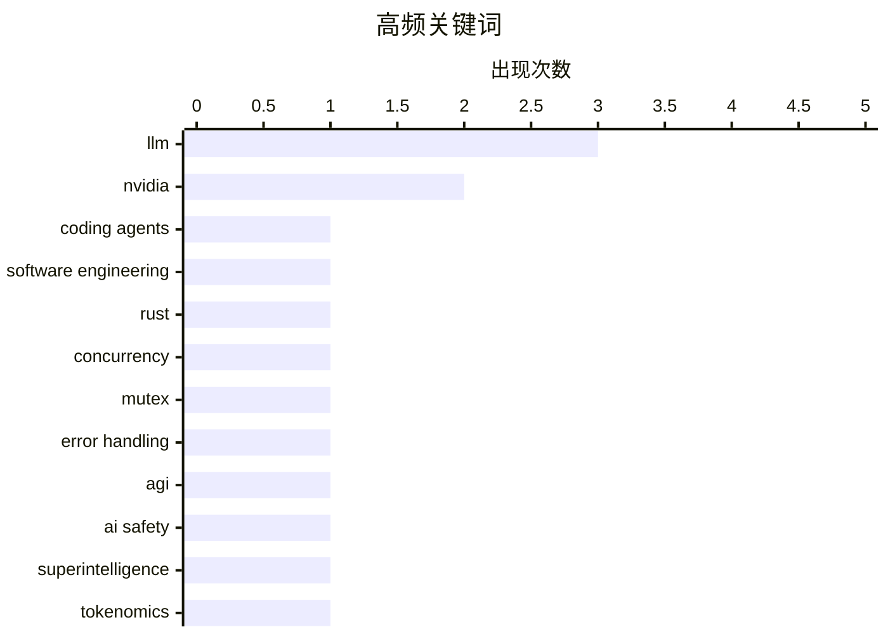

# 📰 Nov 26, 2026

> 来自 Karpathy 推荐的 92 个顶级技术博客，AI 精选 Top 15

## 📝 今日看点

AI 领域正经历从模型能力跨越到“智能体体验”（AX）重塑的范式转移，递归自我改进与学术突破预示着超级智能的加速到来。与此同时，英伟达对 AI 经济的绝对统治力引发了市场对产业结构失衡的深度忧虑。在底层工程与安全领域，1Password 的数据泄露事件与 SQLite、Rust 等核心工具的迭代，共同勾勒出在追求极致效率的同时，系统稳定性与安全性依然是技术演进的底色。

---

## 🏆 今日必读

🥇 **过去 12 个月 LLM 发展的三个关键拐点**

[Three LLM inflection points in twelve months](https://simonwillison.net/2026/Nov/24/llm-inflection-points/) — simonwillison.net · 1 天前 · 🤖 AI / ML

> 过去一年中，大语言模型（LLM）和编程智能体（Coding Agents）的能力经历了三个具有里程碑意义的拐点。作者在 AI Engineer Code Summit 的演讲中指出，这些拐点标志着 AI 从简单的代码补全工具演进为能够处理复杂工程任务的自主代理。第一阶段是模型基础推理能力的飞跃，随后是长上下文窗口和多模态能力的普及，最后是智能体在实际工程流中的深度集成。这些变化彻底改变了开发者与代码交互的方式，使 AI 成为真正的协作伙伴。文章深入探讨了这些技术演进背后的逻辑及其对未来软件开发的影响。

💡 **为什么值得读**: 由知名技术博主 Simon Willison 总结，帮助你理清过去一年 AI 编程领域最核心的技术演进脉络。

🏷️ LLM, coding agents, software engineering

🥈 **废除 Rust 中的锁中毒机制**

[Abolish Lock Poisoning](https://lucumr.pocoo.org/2026/11/25/poisoning/) — lucumr.pocoo.org · 1 天前 · ⚙️ 工程

> Rust 标准库中的 `std::sync::Mutex` 具有“锁中毒”（Lock Poisoning）特性，即当持有锁的线程发生 panic 时，该锁会进入中毒状态。后续调用 `lock()` 将返回错误，旨在防止访问可能处于不一致状态的数据。然而，作者认为这一设计在现代 Rust 实践中已显得冗余且增加了不必要的复杂性，因为大多数开发者只是简单地通过 `unwrap()` 处理该错误。文章主张在未来的 Rust 版本中废除这一机制，认为它属于不该保留的历史遗留设计。这一观点引发了关于并发安全与 API 简洁性之间权衡的深度讨论。

💡 **为什么值得读**: 深入探讨 Rust 核心并发机制的设计缺陷，适合关注系统级语言演进和并发编程的开发者。

🏷️ Rust, concurrency, mutex, error handling

🥉 **回应针对 AI 递归自我改进的质疑**

[Responding to objections to recursive self-improvement](https://www.dwarkesh.com/p/rsiobjections) — dwarkesh.com · 1 天前 · 🤖 AI / ML

> 文章针对人工智能递归自我改进（RSI）和超级智能实现过程中的常见反对意见进行了深度回应。怀疑论者通常认为数据耗尽、计算资源瓶颈以及物理世界反馈延迟会阻止 AI 的指数级增长。作者逐一分析了这些观点，指出即便存在边际效用递减，AI 在算法优化、硬件架构设计以及合成数据利用上的闭环迭代仍具有巨大潜力。结论认为，虽然现实约束确实存在，但不足以否定智能爆炸的可能性。这篇文章为理解 AI 长期演进路径提供了严密的逻辑框架。

💡 **为什么值得读**: 对 AI 演进中最具争议的“智能爆炸”理论进行了高水平的辩论，是理解 AI 未来上限的必读深度稿。

🏷️ AGI, AI safety, superintelligence

---

## 📊 数据概览

| 扫描源 | 抓取文章 | 时间范围 | 精选 |
|:---:|:---:|:---:|:---:|
| 81/92 | 2492 篇 → 40 篇 | 48h | **15 篇** |

### 分类分布



### 高频关键词



<details>
<summary>📈 纯文本关键词图（终端友好）</summary>

```
llm                  │ ████████████████████ 3
nvidia               │ █████████████░░░░░░░ 2
coding agents        │ ███████░░░░░░░░░░░░░ 1
software engineering │ ███████░░░░░░░░░░░░░ 1
rust                 │ ███████░░░░░░░░░░░░░ 1
concurrency          │ ███████░░░░░░░░░░░░░ 1
mutex                │ ███████░░░░░░░░░░░░░ 1
error handling       │ ███████░░░░░░░░░░░░░ 1
agi                  │ ███████░░░░░░░░░░░░░ 1
ai safety            │ ███████░░░░░░░░░░░░░ 1
```

</details>

### 🏷️ 话题标签

**llm**(3) · **nvidia**(2) · **coding agents**(1) · software engineering(1) · rust(1) · concurrency(1) · mutex(1) · error handling(1) · agi(1) · ai safety(1) · superintelligence(1) · tokenomics(1) · ai cost(1) · gpt-6(1) · astra(1) · research(1) · 1password(1) · data breach(1) · security(1) · metadata(1)

---

## 🤖 AI / ML

### 1. 过去 12 个月 LLM 发展的三个关键拐点

[Three LLM inflection points in twelve months](https://simonwillison.net/2026/Nov/24/llm-inflection-points/) — **simonwillison.net** · 1 天前 · ⭐ 28/30

> 过去一年中，大语言模型（LLM）和编程智能体（Coding Agents）的能力经历了三个具有里程碑意义的拐点。作者在 AI Engineer Code Summit 的演讲中指出，这些拐点标志着 AI 从简单的代码补全工具演进为能够处理复杂工程任务的自主代理。第一阶段是模型基础推理能力的飞跃，随后是长上下文窗口和多模态能力的普及，最后是智能体在实际工程流中的深度集成。这些变化彻底改变了开发者与代码交互的方式，使 AI 成为真正的协作伙伴。文章深入探讨了这些技术演进背后的逻辑及其对未来软件开发的影响。

🏷️ LLM, coding agents, software engineering

---

### 2. 回应针对 AI 递归自我改进的质疑

[Responding to objections to recursive self-improvement](https://www.dwarkesh.com/p/rsiobjections) — **dwarkesh.com** · 1 天前 · ⭐ 26/30

> 文章针对人工智能递归自我改进（RSI）和超级智能实现过程中的常见反对意见进行了深度回应。怀疑论者通常认为数据耗尽、计算资源瓶颈以及物理世界反馈延迟会阻止 AI 的指数级增长。作者逐一分析了这些观点，指出即便存在边际效用递减，AI 在算法优化、硬件架构设计以及合成数据利用上的闭环迭代仍具有巨大潜力。结论认为，虽然现实约束确实存在，但不足以否定智能爆炸的可能性。这篇文章为理解 AI 长期演进路径提供了严密的逻辑框架。

🏷️ AGI, AI safety, superintelligence

---

### 3. 杰文斯悖论在 AI 领域失效了吗？

[Has Jevons paradox broken down?](https://martinalderson.com/posts/has-jevons-paradox-broken-down/?utm_source=rss&amp;utm_medium=rss&amp;utm_campaign=feed) — **martinalderson.com** · 1 天前 · ⭐ 26/30

> 杰文斯悖论认为技术进步提高资源利用效率反而会增加总消耗，但当前 AI Token 的消费趋势似乎并未遵循这一规律。Ramp 的数据显示，尽管 Token 价格在过去一年大幅下降且模型性能提升，企业的 Token 支出增长却出现了停滞。作者结合自身经验分析，Token 消耗量正面临人类信息处理能力和组织架构调整速度的双重瓶颈。这意味着在 AI 领域，效率提升带来的需求增长可能被非技术性的“摩擦力”所抵消。文章探讨了这种现象是否意味着 AI 泡沫的降温或应用模式的转变。

🏷️ LLM, tokenomics, AI cost

---

### 4. GPT-6.2 Astra 破解历史谜题

[GPT 6.2 Astra Solves a Historical Mystery](https://simonwillison.net/2026/Nov/24/astra-historical-mystery/) — **simonwillison.net** · 1 天前 · ⭐ 25/30

> 历史学教授 Mark Humphries 分享了一个利用 GPT-6.2 Astra 进行学术研究的惊人案例。在仅提供极少提示的情况下，该模型自主识别出了耶鲁大学贝内克图书馆收藏的一本 1808 年匿名素描本的作者。GPT-6.2 通过分析素描本中的视觉细节、历史背景和关联文献，展现了卓越的跨学科推理能力。这一成果证明了下一代大模型在处理非结构化历史数据和复杂学术鉴定任务中的巨大潜力。作者认为，这预示着 AI 将从简单的辅助工具进化为能够独立进行发现的人文科学专家。

🏷️ GPT-6, Astra, research, LLM

---

### 5. “经济已成‘人质’：英伟达与黄仁勋的统治力”

[‘The Economy Is a Hostage Situation’](https://www.theatlantic.com/technology/2026/11/ai-hostage-economy-nvidia-huang/689552/?gift=aQyUJR7AIw1mJWdQ6Ed6yMQrokNaYAmgr0aVusAzQCY&amp;) — **daringfireball.net** · 1 天前 · ⭐ 25/30

> 文章探讨了英伟达（Nvidia）及其首席执行官黄仁勋在当前 AI 经济中近乎绝对的统治地位。英伟达不仅是算力供应方，更通过大规模投资和生态构建成为了 AI 产业的“外骨骼”，使得整个市场的信心高度依赖于该公司的表现。作者指出，黄仁勋已成为 AI 繁荣的中心图腾，其个人决策与美国科技领先地位深度绑定。这种过度集中的依赖关系意味着一旦英伟达增长乏力，整个 AI 泡沫可能面临破裂风险。文章将这种现状形容为一种“人质局面”，警示了单一巨头对全球科技经济的潜在冲击。

🏷️ Nvidia, AI economy, Jensen Huang, market

---

### 6. 你试过像智能体一样使用你的软件吗？

[Have You Tried Using Your Agent?](https://blog.jim-nielsen.com/2026/have-you-tried-your-agent/) — **blog.jim-nielsen.com** · 21 小时前 · ⭐ 24/30

> 随着 AI 智能体的普及，软件开发重心正从用户体验（UX）转向“智能体体验”（AX）。作者担忧开发者为了方便 AI 抓取和处理数据，正在构建对机器人友好但对人类用户而言变得难以使用的界面。这种趋势可能导致软件设计的初衷发生偏移，使人类在数字世界中逐渐边缘化。文章呼吁开发者在追求 AX 的同时，应始终坚持以人为本的交互原则，避免软件沦为纯粹的机器接口。作者提醒我们，不应为了迎合 AI 代理而牺牲了真实人类的使用感受。

🏷️ AI agents, UX, AX

---

## ⚙️ 工程

### 7. 废除 Rust 中的锁中毒机制

[Abolish Lock Poisoning](https://lucumr.pocoo.org/2026/11/25/poisoning/) — **lucumr.pocoo.org** · 1 天前 · ⭐ 27/30

> Rust 标准库中的 `std::sync::Mutex` 具有“锁中毒”（Lock Poisoning）特性，即当持有锁的线程发生 panic 时，该锁会进入中毒状态。后续调用 `lock()` 将返回错误，旨在防止访问可能处于不一致状态的数据。然而，作者认为这一设计在现代 Rust 实践中已显得冗余且增加了不必要的复杂性，因为大多数开发者只是简单地通过 `unwrap()` 处理该错误。文章主张在未来的 Rust 版本中废除这一机制，认为它属于不该保留的历史遗留设计。这一观点引发了关于并发安全与 API 简洁性之间权衡的深度讨论。

🏷️ Rust, concurrency, mutex, error handling

---

### 8. “作曲家的一生”：交互式 UI 设计探索

[‘The Life of a Composer’](https://composer.pablostanley.com/#1) — **daringfireball.net** · 23 小时前 · ⭐ 23/30

> 设计师 Pablo Stanley 创作了一个名为“作曲家的一生”（The Life of a Composer）的交互式体验项目，深入探讨了构建复杂输入框背后的细节。该项目通过精美的视觉设计、动效和音效，展示了看似简单的界面元素在工程实现和交互逻辑上的极高复杂性。它不仅是一次关于 UI 细节的科普，更是一场极具启发性的数字艺术表演。作者认为这种独特的叙事方式为展示技术细节和界面设计理念提供了全新的范本。通过这个项目，读者可以深刻理解“简单”界面背后的不凡匠心。

🏷️ UI/UX, frontend, input field, design

---

### 9. 为什么 CoreApplication 属性条目在源程序关闭时似乎失效了？

[Why did it seem that the entries in the CoreApplication Properties expired when the source application shut down?](https://devblogs.microsoft.com/oldnewthing/20261125-00/?p=112895/) — **devblogs.microsoft.com/oldnewthing** · 1 天前 · ⭐ 22/30

> 开发者常误以为 Windows 的 CoreApplication 属性包在应用程序关闭时会自动清理条目，但实际问题出在存储对象的生命周期上。当应用程序退出时，其进程内创建的 COM 对象会被销毁，导致其他进程持有的属性引用变为无效。文章通过分析 COM 跨进程通信机制，解释了属性包本身是持久的，但其包含的“活对象”无法脱离源进程存在。解决此类问题的关键在于区分纯数据属性与对象引用，并理解 Windows 运行时环境的对象管理逻辑。

🏷️ Windows API, COM, object lifetime, C++

---

### 10. 拉斯维加斯算法、蒙特卡洛算法与整数分解

[Las Vegas, Monte Carlo, and Integer Factorization](https://www.johndcook.com/blog/2026/11/26/las-vegas-monte-carlo/) — **johndcook.com** · 3 小时前 · ⭐ 22/30

> 概率算法主要分为两类：蒙特卡洛算法具有固定运行时间但存在错误概率，而拉斯维加斯算法运行时间随机但结果始终准确（零错误率）。文章回顾了 1946 年 Stanisław Ulam 提出蒙特卡洛方法及后续 László Babai 命名拉斯维加斯算法的历史背景。在整数分解等计算难题中，这两类算法的应用决定了计算效率与结果可靠性的权衡。通过对比两者的数学特性，读者可以理解如何在算法设计中利用随机性来解决确定性算法难以处理的问题。

🏷️ algorithms, Monte Carlo, mathematics, computer science

---

### 11. 2026 微架构降临节

[Advent of Microarchitecture 2026](http://xania.org/202611/advent-of-what?utm_source=feed&amp;utm_medium=rss) — **xania.org** · 1 天前 · ⭐ 22/30

> 作者推出了一系列关于微架构（Microarchitecture）的视频专题，旨在以类似“Advent of Code”的形式进行技术分享。该系列将深入探讨处理器底层原理、指令集执行及硬件优化等核心课题。通过每日更新的内容，挑战者可以跟随作者学习现代 CPU 的复杂运作机制。这不仅是一次技术科普，更是针对底层开发者和硬件爱好者的实战教学尝试。

🏷️ microarchitecture, CPU, hardware

---

## 🛠 工具 / 开源

### 12. sqlite3_rsync：SQLite 官方远程同步工具

[sqlite3_rsync: Database Remote-Copy Tool For SQLite](https://simonwillison.net/2026/Nov/26/sqlite3-rsync/) — **simonwillison.net** · 10 小时前 · ⭐ 23/30

> sqlite3_rsync 是 SQLite 官方推出的数据库远程同步工具，最早于 3.47.0 版本引入并在 3.50.0 版本中得到增强。该工具允许用户在不停止数据库运行的情况下，高效地将本地 SQLite 数据库同步到远程服务器。它巧妙地利用了 SQLite 的 WAL 模式特性，确保同步过程中的数据一致性且不阻塞任何写入操作。作者强调了该工具在备份、迁移和分布式部署场景中的巨大潜力，认为它是 SQLite 生态中一个被低估的利器。相比传统的物理拷贝，它能显著减少数据传输量并保证事务完整性。

🏷️ SQLite, rsync, database, replication

---

### 13. 版本控制周报：2026 年 11 月 25 日

[This Week in Source Control: 25 November 2026](https://nesbitt.io/2026/11/25/this-week-in-source-control.html) — **nesbitt.io** · 1 天前 · ⭐ 23/30

> 本周版本控制领域汇总了各大代码托管平台（Forges）和版本控制系统的最新发布、安全公告及技术文章。内容涵盖了 Git 及其生态系统的更新动态，旨在帮助开发者追踪源码管理工具的演进。通过整合分散的信息源，本期周报提供了关于代码协作效率提升和安全漏洞修复的关键信息。对于依赖版本控制进行日常开发的团队来说，这是获取行业标准变化的重要渠道。

🏷️ Git, version control, DevOps

---

## 🔒 安全

### 14. 1Password 后端系统遭入侵，仅泄露客户账户元数据

[1Password’s Backend Systems Were Compromised, Revealing Only Customer Account Metadata](https://1password.com/blog/update-on-nov-2026-security-incident) — **daringfireball.net** · 17 小时前 · ⭐ 25/30

> 1Password 披露了 2026 年 11 月发生的一起安全事件，攻击者入侵了其部分后端系统并获取了少量客户账户信息。泄露的数据包括用户的姓名和登录邮箱，但核心的保险库数据（Vault data）和加密密钥完全未受影响。由于 1Password 采用零知识证明架构，服务器端并不存储用户的原始密码或密钥，因此攻击者无法解密任何用户资产。官方已采取遏制措施并恢复了受影响服务的干净版本，目前未发现进一步的风险。这一事件再次证明了“零知识”架构在极端情况下的防御价值。

🏷️ 1Password, data breach, security, metadata

---

## 💡 观点 / 杂谈

### 15. 英伟达与特朗普的国家资本主义

[Nvidia and Trump’s State Capitalism](https://www.wsj.com/opinion/nvidia-jensen-huang-donald-trump-130e644c) — **daringfireball.net** · 1 天前 · ⭐ 23/30

> 特朗普政府对英伟达出口管制政策的干预引发了关于法治与国家安全的深度讨论。文章指出，特朗普将出口管制视为可变筹码，使国家安全利益服从于其个人政治意愿。通过回顾 2025 年特朗普拒绝执行国会两党通过的 TikTok 禁令，揭示了其行政权力对既定法律的挑战。这种治理模式被视为向“国家资本主义”转型，模糊了商业利益与国家战略的界限。作者认为这种向威权主义风格靠拢的政策导向，可能对长期国家安全造成沉重代价。

🏷️ Nvidia, export controls, AI, geopolitics

---

*生成于 2026-11-26 16:42 | 扫描 81 源 → 获取 2492 篇 → 精选 15 篇*
*基于 [Hacker News Popularity Contest 2025](https://refactoringenglish.com/tools/hn-popularity/) RSS 源列表，由 [Andrej Karpathy](https://x.com/karpathy) 推荐*
