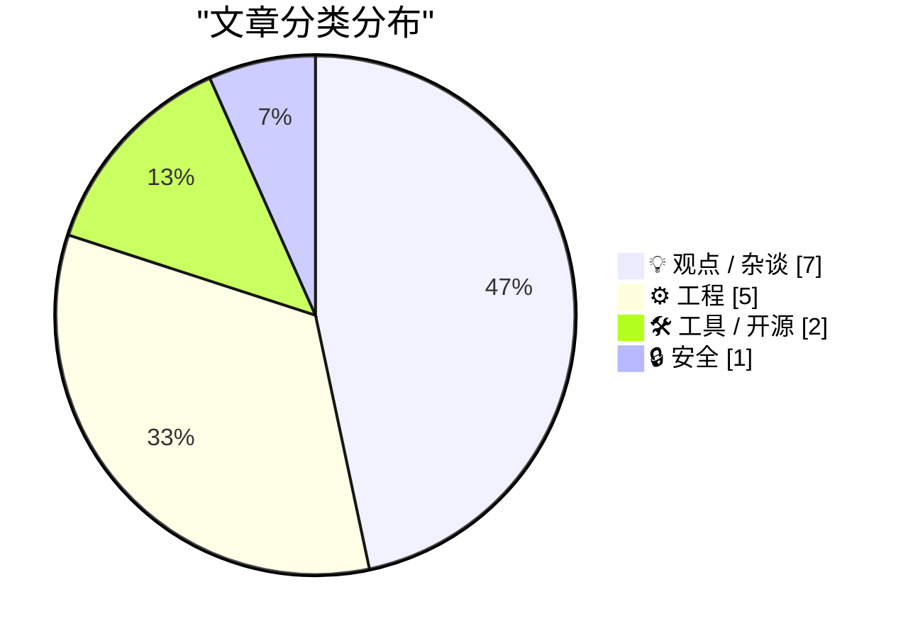
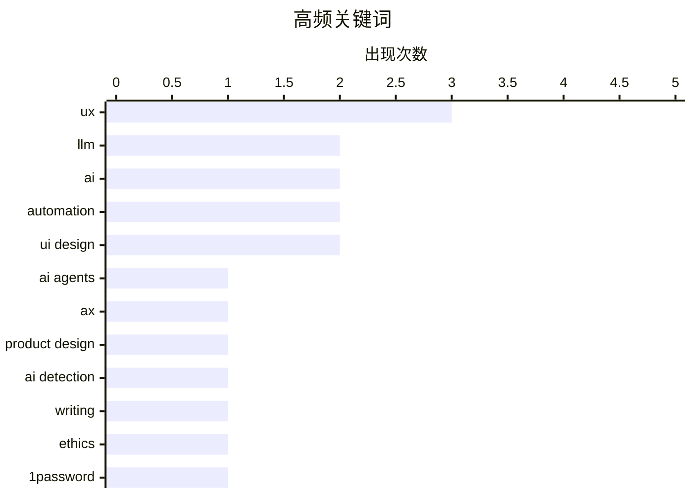

# 📰 Nov 27, 2026

> 来自 Karpathy 推荐的 92 个顶级技术博客，AI 精选 Top 15

## 📝 今日看点

今日技术圈聚焦于 AI 浪潮引发的范式转移，开发者正面临从“人类体验”向“代理体验”转变的伦理挑战，而 AI 工具也被警惕为加强职场控制的“新泰勒主义”手段。安全与工程领域，1Password 的元数据泄露事件再次凸显了零知识加密架构在防御中的关键价值，同时 SQLite 等基础工具的持续演进正进一步提升远程协作的效率。此外，从 UI 设计中“显性交互”的回归呼吁到半导体供应链的地缘政治博弈，反映出技术演进正处于功能实用主义与宏观安全策略的交汇点。

---

## 🏆 今日必读

🥇 **你试过用你的 AI 代理吗？**

[Have You Tried Using Your Agent?](https://blog.jim-nielsen.com/2026/have-you-tried-your-agent/) — blog.jim-nielsen.com · 1 天前 · 💡 观点 / 杂谈

> 软件开发正面临从关注人类体验（HX）向关注代理体验（AX）的危险转变。开发者越来越多地构建对机器人友好但对人类不友好的接口，导致 Web 的可访问性在人类层面退化。作者担心 AX 正在成为软件构建的首要任务，而忽略了真实用户的交互直觉。文章呼吁开发者亲自测试自己构建的 AI 代理，以直观感受这种技术异化带来的负面影响。我们不应为了迎合自动化而牺牲人类体验的优先级。

💡 **为什么值得读**: 警示开发者在 AI 浪潮中重新审视“以人为本”的设计初衷，防止技术异化。

🏷️ AI agents, AX, UX, product design

🥈 **谁有权判定作品是否由 AI 创作？**

[Who gets to decide if something is written by AI?](https://seangoedecke.com/who-gets-to-decide-if-something-is-written-by-ai/) — seangoedecke.com · 16 小时前 · 💡 观点 / 杂谈

> 随着文学奖项和出版合同因 AI 创作争议而频频受阻，判定作品“血统”的权力归属成为核心矛盾。Pangram 等 AI 检测工具虽然准确率存疑，却在现实中掌握着决定作者职业生涯的生杀大权。文章通过 Caine 文学奖和 Hachette 出版社的真实案例，揭示了检测技术与创作自由之间的紧张关系。目前尚无统一标准来界定 AI 辅助与纯人工创作的界限，这种模糊性给创作者带来了巨大的法律和职业风险。

💡 **为什么值得读**: 探讨 AI 时代创作者面临的伦理与职业风险，反思技术检测工具的权威性与局限性。

🏷️ AI detection, LLM, writing, ethics

🥉 **1Password 后端系统遭入侵，仅泄露客户账户元数据**

[1Password’s Backend Systems Were Compromised, Revealing Only Customer Account Metadata](https://1password.com/blog/update-on-nov-2026-security-incident) — daringfireball.net · 1 天前 · 🔒 安全

> 1Password 披露了 2026 年 11 月发生的一起安全事件，攻击者获取了部分后端系统的访问权限。泄露的信息仅限于部分客户的姓名和登录邮箱等元数据，不涉及任何敏感密码。由于采用了零知识加密架构，用户的保险库数据、内部项以及保护它们的密钥均未受到影响。1Password 官方强调其无法访问用户的密码或私钥，确保了核心数据的安全性。目前受影响服务已完成清理并恢复，公司已采取进一步遏制措施。

💡 **为什么值得读**: 了解主流密码管理器的安全防御机制，以及零知识架构在发生入侵时的实际保护作用。

🏷️ 1Password, data breach, security, metadata

---

## 📊 数据概览

| 扫描源 | 抓取文章 | 时间范围 | 精选 |
|:---:|:---:|:---:|:---:|
| 80/92 | 2473 篇 → 23 篇 | 48h | **15 篇** |

### 分类分布



### 高频关键词



<details>
<summary>📈 纯文本关键词图（终端友好）</summary>

```
ux             │ ████████████████████ 3
llm            │ █████████████░░░░░░░ 2
ai             │ █████████████░░░░░░░ 2
automation     │ █████████████░░░░░░░ 2
ui design      │ █████████████░░░░░░░ 2
ai agents      │ ███████░░░░░░░░░░░░░ 1
ax             │ ███████░░░░░░░░░░░░░ 1
product design │ ███████░░░░░░░░░░░░░ 1
ai detection   │ ███████░░░░░░░░░░░░░ 1
writing        │ ███████░░░░░░░░░░░░░ 1
```

</details>

### 🏷️ 话题标签

**ux**(3) · **llm**(2) · **ai**(2) · automation(2) · ui design(2) · ai agents(1) · ax(1) · product design(1) · ai detection(1) · writing(1) · ethics(1) · 1password(1) · data breach(1) · security(1) · metadata(1) · taylorism(1) · labor(1) · ansible(1) · ubuntu(1) · devops(1)

---

## 💡 观点 / 杂谈

### 1. 你试过用你的 AI 代理吗？

[Have You Tried Using Your Agent?](https://blog.jim-nielsen.com/2026/have-you-tried-your-agent/) — **blog.jim-nielsen.com** · 1 天前 · ⭐ 27/30

> 软件开发正面临从关注人类体验（HX）向关注代理体验（AX）的危险转变。开发者越来越多地构建对机器人友好但对人类不友好的接口，导致 Web 的可访问性在人类层面退化。作者担心 AX 正在成为软件构建的首要任务，而忽略了真实用户的交互直觉。文章呼吁开发者亲自测试自己构建的 AI 代理，以直观感受这种技术异化带来的负面影响。我们不应为了迎合自动化而牺牲人类体验的优先级。

🏷️ AI agents, AX, UX, product design

---

### 2. 谁有权判定作品是否由 AI 创作？

[Who gets to decide if something is written by AI?](https://seangoedecke.com/who-gets-to-decide-if-something-is-written-by-ai/) — **seangoedecke.com** · 16 小时前 · ⭐ 25/30

> 随着文学奖项和出版合同因 AI 创作争议而频频受阻，判定作品“血统”的权力归属成为核心矛盾。Pangram 等 AI 检测工具虽然准确率存疑，却在现实中掌握着决定作者职业生涯的生杀大权。文章通过 Caine 文学奖和 Hachette 出版社的真实案例，揭示了检测技术与创作自由之间的紧张关系。目前尚无统一标准来界定 AI 辅助与纯人工创作的界限，这种模糊性给创作者带来了巨大的法律和职业风险。

🏷️ AI detection, LLM, writing, ethics

---

### 3. 泰勒主义与 AI 的共同卖点：对工人的控制

[Pluralistic: Taylorism and AI's shared sales-pitch (27 Nov 2026)](https://pluralistic.net/2026/11/27/taylor-made/) — **pluralistic.net** · 2 小时前 · ⭐ 25/30

> 文章深入剖析了 AI 浪潮背后的管理逻辑，认为其本质是 21 世纪的“泰勒主义”。企业管理者购买 AI 工具的核心动力并非单纯提高生产力，而是为了加强对员工的监控与控制。通过将复杂工作拆解并由 AI 辅助，资方试图实现劳动力的去技能化，从而降低对特定员工的议价能力。这种技术叙事延续了历史上管理层对工人自主权的长期剥夺。AI 在此被包装成了实现“科学管理”终极目标的完美工具。

🏷️ AI, Taylorism, labor, automation

---

### 4. 发明算法：将技术创造视为搜索过程

[The Invention Algorithm](https://www.construction-physics.com/p/the-invention-algorithm) — **construction-physics.com** · 30 分钟前 · ⭐ 22/30

> 文章提出将新技术创造的过程理解为一种“搜索算法”。发明家必须在海量的物理现象、零部件和组合可能性中进行筛选，寻找能实现特定功能的唯一排列组合。这种视角将偶然的灵感转化为一种结构化的概率搜索，解释了技术演进的路径依赖。通过优化这种“搜索”效率，人类可以更系统地推动科技进步。作者认为，理解这一过程有助于解释为什么某些时代和环境更容易产生突破性创新。

🏷️ innovation, R&D, search process, technology

---

### 5. 显性交互特征（Affordances）应当回归

[★ Obvious Affordances Are Due for a Comeback](https://daringfireball.net/2026/11/obvious_affordances_are_due_for_a_comeback) — **daringfireball.net** · 1 天前 · ⭐ 21/30

> 现代 UI 设计过度追求极简主义，导致界面失去了必要的“交互特征”（Affordances）。当可点击的按钮看起来与普通文本无异时，设计就陷入了“过分简化”的陷阱。文章引用爱因斯坦“应尽可能简单，但不能过于简单”的名言，呼吁设计师重新审视视觉线索的重要性。回归显性设计不仅能提升易用性，还能降低用户的认知负担。作者认为，明显的交互暗示是时候在主流设计中重新回归了。

🏷️ UI design, UX, affordance, design theory

---

### 6. “特朗普希望黄仁勋回归，但总统在华盛顿正陷入孤立”

[‘Trump Wanted Jensen Huang Back. Now, the President Is Alone in Washington’](https://www.cnbc.com/2026/11/24/trump-jensen-huang-nvidia.html) — **daringfireball.net** · 1 天前 · ⭐ 21/30

> 尽管特朗普总统力挺英伟达 CEO 黄仁勋，但其国会盟友却因国家安全顾虑而持反对立场。议员们担心黄仁勋与潜在的中国情报资产之间的关系，可能危及美国半导体供应链的安全。参议员 Kevin Cramer 等人明确表示，即便总统支持，国会仍将继续对黄仁勋展开调查。这一冲突凸显了科技巨头在复杂地缘政治博弈中所处的尴尬境地。目前，黄仁勋的处境正成为白宫与国会之间权力斗争的焦点。

🏷️ Nvidia, Jensen Huang, politics, semiconductors

---

### 7. 引用 Jack Despain Zhou：AI 带来的去个人化危机

[Quoting Jack Despain Zhou](https://simonwillison.net/2026/Nov/26/jack-despain-zhou/) — **simonwillison.net** · 1 天前 · ⭐ 20/30

> 随着生成式 AI 的普及，互联网内容正面临严重的“去个人化”现象，大量视频脚本、会议演示和电子邮件都充斥着明显的 Claude 或 GPT 风格。这种现象导致原本代表个人声誉和机构权威的内容变得千篇一律，丧失了独特的表达特征。作者担忧，当严肃的专业人士也开始依赖 AI 生成内容时，文字背后的思想深度和个人特质正在被算法抹平。这种技术异化让原本应该体现人类独特性的交流变得廉价且机械。我们正处于一个“听起来都像 AI”的平庸时代。

🏷️ AI, LLM, Claude, content creation

---

## ⚙️ 工程

### 8. Ansible 在 Ubuntu 26 上等待权限提升时失败

[Ansible Fails waiting for privilege escalation on Ubuntu 26](https://www.jeffgeerling.com/blog/2026/ansible-fails-become-ubuntu2604/) — **jeffgeerling.com** · 1 天前 · ⭐ 24/30

> 在将服务器迁移至 Ubuntu 26.04 的过程中，Ansible 自动化脚本在处理带密码保护的 sudo 操作时会出现超时或失败。即便使用了 -K 参数手动输入密码，任务依然无法正常执行权限提升。这一问题主要源于新版系统在处理 TTY 交互或 sudo 提示符方面的底层变化，导致 Ansible 无法正确捕获密码输入请求。开发者需要针对 Ubuntu 26 的新特性调整 playbook 配置或修改 sudoers 权限策略。文章提供了针对这一特定版本升级的避坑指南。

🏷️ Ansible, Ubuntu, DevOps, automation

---

### 9. 无需动手，远程断开并重连 Mac 上的 USB 设备

[Remotely unplugging a USB device on my Mac, without touching it](https://www.jeffgeerling.com/blog/2026/remote-control-usb-hub/) — **jeffgeerling.com** · 11 小时前 · ⭐ 23/30

> 在通过 WireGuard VPN 远程调试连接到 Mac Studio 的硬件设备时，经常需要物理插拔 USB 来重置状态。作者分享了如何利用可编程 USB 枢纽或 macOS 系统命令，在不进入办公室的情况下实现 USB 设备的“软断电”与重连。这对于需要频繁刷写固件或进入 DFU 模式的嵌入式开发流程至关重要。通过软件控制 USB 总线的供电，开发者可以远程完成原本必须现场操作的硬件重置任务。该方案有效解决了远程办公中硬件交互的最后一步障碍。

🏷️ USB, remote debugging, macOS, hardware

---

### 10. 编辑器的生命历程

[‘The Life of a Composer’](https://composer.pablostanley.com/#1) — **daringfireball.net** · 1 天前 · ⭐ 21/30

> 现代 UI 设计中的“编辑器”（Composer）并非简单的输入框，而是一个涉及复杂交互逻辑的精密组件。设计师 Pablo Stanley 通过一个极具创意的交互式网页，拆解了构建高级输入界面所需的细节考量。该体验结合了独特的视觉动效、音效与背景音乐，生动展示了从光标定位到富文本处理的工程挑战。这种寓教于乐的呈现方式，为开发者和设计师理解界面细节提供了全新的视角。通过这种独特的叙事方式，枯燥的界面开发细节变得极具启发性。

🏷️ UI design, frontend, UX, input field

---

### 11. 将非敏捷对象放入 CoreApplication 属性中会发生什么？

[What happens when you put a non-agile object in the CoreApplication Properties?](https://devblogs.microsoft.com/oldnewthing/20261126-00/?p=112899/) — **devblogs.microsoft.com/oldnewthing** · 1 天前 · ⭐ 21/30

> 在 Windows 开发中，CoreApplication.Properties 是一个全局属性包，但存入其中的对象若不具备“敏捷性”（Non-agile）会引发特定行为。当一个绑定在特定线程（如单线程单元 STA）的对象被存入后，一旦该原始线程销毁，该对象的引用就会失效。尽管属性字典中的条目依然存在，但尝试访问它将导致错误或返回空值。开发者必须意识到全局存储并不等同于延长了线程绑定对象的生命周期。这一机制对于理解 Windows 运行时（WinRT）的线程模型至关重要。

🏷️ Windows, COM, threading, C++

---

### 12. 拉斯维加斯算法、蒙特卡罗算法与整数分解

[Las Vegas, Monte Carlo, and Integer Factorization](https://www.johndcook.com/blog/2026/11/26/las-vegas-monte-carlo/) — **johndcook.com** · 1 天前 · ⭐ 20/30

> 概率算法主要分为两大类：蒙特卡罗（Monte Carlo）算法具有固定的运行时间但存在一定的错误概率，而拉斯维加斯（Las Vegas）算法运行时间不确定但保证结果绝对正确。这两个术语分别由 Nicholas Metropolis 和 László Babai 提出，源于对随机性不同利用方式的区分。在整数分解等计算难题中，拉斯维加斯算法尤为重要，因为它能在随机尝试中确保找到的因子是准确的。理解这两者的权衡是掌握现代计算理论和密码学算法的基础。文章还简述了这些术语诞生的历史背景。

🏷️ algorithms, Monte Carlo, probability

---

## 🛠 工具 / 开源

### 13. sqlite3_rsync：SQLite 官方远程同步工具

[sqlite3_rsync: Database Remote-Copy Tool For SQLite](https://simonwillison.net/2026/Nov/26/sqlite3-rsync/) — **simonwillison.net** · 1 天前 · ⭐ 23/30

> SQLite 官方推出的 sqlite3_rsync 工具在 3.50.0 版本中得到了显著增强，成为处理远程数据库同步的利器。该工具允许用户在不停止服务的情况下，对活跃的数据库文件进行增量同步。相比传统的 rsync，它能更智能地处理 SQLite 的页面结构和并发写入，确保数据一致性。它通过增量传输减少了带宽占用，非常适合在弱网环境下进行数据库分发。它是实现 SQLite 远程备份、读写分离或边缘同步的轻量级原生方案。

🏷️ SQLite, rsync, database, replication

---

### 14. datasette-charts 0.3a0 发布：支持图表标注功能

[datasette-charts 0.3a0](https://simonwillison.net/2026/Nov/25/datasette-charts/) — **simonwillison.net** · 1 天前 · ⭐ 20/30

> 数据可视化工具插件 datasette-charts 发布了 0.3a0 预览版，重点引入了图表标注（Annotations）功能。用户现在可以在生成的图表上直接添加参考线、阴影区域以及文本标签，或者将三者结合使用。这一更新显著增强了图表的信息传达能力，使用户能够突出显示特定的数据阈值或时间区间。该版本通过简单的配置即可实现复杂的视觉标注，进一步完善了 Datasette 生态的数据分析体验。开发者可以通过 GitHub 访问最新源码并尝试这些增强功能。

🏷️ Datasette, data visualization, Python, open source

---

## 🔒 安全

### 15. 1Password 后端系统遭入侵，仅泄露客户账户元数据

[1Password’s Backend Systems Were Compromised, Revealing Only Customer Account Metadata](https://1password.com/blog/update-on-nov-2026-security-incident) — **daringfireball.net** · 1 天前 · ⭐ 25/30

> 1Password 披露了 2026 年 11 月发生的一起安全事件，攻击者获取了部分后端系统的访问权限。泄露的信息仅限于部分客户的姓名和登录邮箱等元数据，不涉及任何敏感密码。由于采用了零知识加密架构，用户的保险库数据、内部项以及保护它们的密钥均未受到影响。1Password 官方强调其无法访问用户的密码或私钥，确保了核心数据的安全性。目前受影响服务已完成清理并恢复，公司已采取进一步遏制措施。

🏷️ 1Password, data breach, security, metadata

---

*生成于 2026-11-27 16:28 | 扫描 80 源 → 获取 2473 篇 → 精选 15 篇*
*基于 [Hacker News Popularity Contest 2025](https://refactoringenglish.com/tools/hn-popularity/) RSS 源列表，由 [Andrej Karpathy](https://x.com/karpathy) 推荐*
